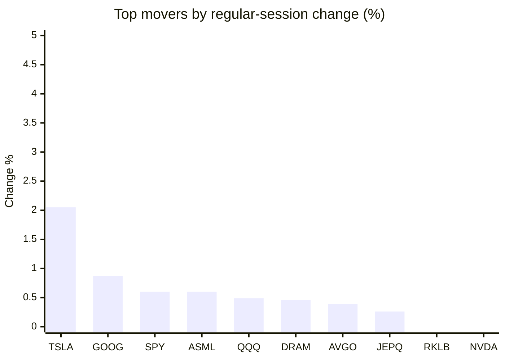
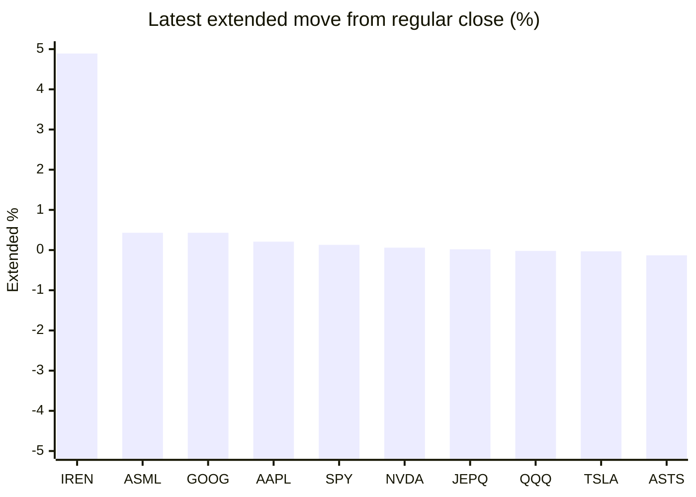

# Stock Brief - 2026-10-12

Generated at 2026-10-12 15:50 +07 from `watchlist.md`.
Prices are snapshots from Yahoo Finance public chart data. Extended/overnight is the latest available pre/post-market datapoint from the same feed.

## Market Snapshot

- SPY: close 778.57, latest extended 779.60, regular move +0.60%, extended move +0.13%
- QQQ: close 751.27, latest extended 751.10, regular move +0.49%, extended move -0.02%
- JEPQ: close 61.09, latest extended 61.10, regular move +0.26%, extended move +0.02%

## Watchlist Prices

| Ticker | Name | Regular close | Latest extended/overnight | Regular move | Extended move | Latest data time | Source |
|---|---|---:|---:|---:|---:|---|---|
| INTC | Intel Corporation | 104.70 USD | 103.44 USD | -2.22% | -1.20% | 2026-10-12 04:50 EDT | [Yahoo](https://finance.yahoo.com/quote/INTC/) |
| AVGO | Broadcom Inc. | 361.54 USD | 360.00 USD | +0.39% | -0.43% | 2026-10-12 04:50 EDT | [Yahoo](https://finance.yahoo.com/quote/AVGO/) |
| RKLB | Rocket Lab Corporation | 68.21 USD | 68.04 USD | -0.28% | -0.25% | 2026-10-12 04:50 EDT | [Yahoo](https://finance.yahoo.com/quote/RKLB/) |
| AAPL | Apple Inc. | 336.64 USD | 337.36 USD | -1.11% | +0.21% | 2026-10-12 04:49 EDT | [Yahoo](https://finance.yahoo.com/quote/AAPL/) |
| NVDA | NVIDIA Corporation | 229.28 USD | 229.41 USD | -0.52% | +0.06% | 2026-10-12 04:50 EDT | [Yahoo](https://finance.yahoo.com/quote/NVDA/) |
| TSLA | Tesla, Inc. | 382.70 USD | 382.57 USD | +2.05% | -0.03% | 2026-10-12 04:50 EDT | [Yahoo](https://finance.yahoo.com/quote/TSLA/) |
| SNDK | Sandisk Corporation | 1,581.82 USD | 1,549.35 USD | -1.72% | -2.05% | 2026-10-12 04:48 EDT | [Yahoo](https://finance.yahoo.com/quote/SNDK/) |
| QQQ | Invesco QQQ Trust, Series 1 | 751.27 USD | 751.10 USD | +0.49% | -0.02% | 2026-10-12 04:49 EDT | [Yahoo](https://finance.yahoo.com/quote/QQQ/) |
| SPY | State Street SPDR S&P 500 ETF T | 778.57 USD | 779.60 USD | +0.60% | +0.13% | 2026-10-12 04:50 EDT | [Yahoo](https://finance.yahoo.com/quote/SPY/) |
| JEPQ | JPMorgan Nasdaq Equity Premium  | 61.09 USD | 61.10 USD | +0.26% | +0.02% | 2026-10-12 04:38 EDT | [Yahoo](https://finance.yahoo.com/quote/JEPQ/) |
| ASTS | AST SpaceMobile, Inc. | 50.97 USD | 50.90 USD | -10.48% | -0.13% | 2026-10-12 04:50 EDT | [Yahoo](https://finance.yahoo.com/quote/ASTS/) |
| MU | Micron Technology, Inc. | 1,029.00 USD | 1,006.43 USD | -0.66% | -2.19% | 2026-10-12 04:50 EDT | [Yahoo](https://finance.yahoo.com/quote/MU/) |
| IREN | IREN LIMITED | 35.19 USD | 36.91 USD | -1.46% | +4.89% | 2026-10-12 04:50 EDT | [Yahoo](https://finance.yahoo.com/quote/IREN/) |
| EOSE | Eos Energy Enterprises, Inc. | 2.52 USD | 2.50 USD | -8.86% | -0.76% | 2026-10-12 04:47 EDT | [Yahoo](https://finance.yahoo.com/quote/EOSE/) |
| GOOG | Alphabet Inc. | 347.86 USD | 349.34 USD | +0.87% | +0.43% | 2026-10-12 04:48 EDT | [Yahoo](https://finance.yahoo.com/quote/GOOG/) |
| DRAM | Roundhill Memory ETF | 57.19 USD | 56.04 USD | +0.46% | -2.01% | 2026-10-12 04:50 EDT | [Yahoo](https://finance.yahoo.com/quote/DRAM/) |
| AMD | Advanced Micro Devices, Inc. | 608.10 USD | 604.50 USD | -2.03% | -0.59% | 2026-10-12 04:50 EDT | [Yahoo](https://finance.yahoo.com/quote/AMD/) |
| ASML | ASML Holding N.V. - New York Re | 1,780.34 USD | 1,787.98 USD | +0.60% | +0.43% | 2026-10-12 04:50 EDT | [Yahoo](https://finance.yahoo.com/quote/ASML/) |

## Charts

### Top Movers - Regular Session

### Extended / Overnight Move

### Quick Heatmap

| Group | Names in watchlist | Avg regular move | Avg extended move |
|---|---|---:|---:|
| Mega-cap tech | AVGO, AAPL, NVDA, TSLA, GOOG | +0.34% | +0.05% |
| Semis / memory | INTC, SNDK, MU, DRAM, AMD, ASML | -0.93% | -1.27% |
| Space / high beta | RKLB, ASTS, IREN, EOSE | -5.27% | +0.94% |
| ETFs | QQQ, SPY, JEPQ | +0.45% | +0.04% |

## News Headlines

- [Fed Chair Kevin Warsh and the FOMC Just Fired a Warning Shot at the Second-Priciest Stock Market in History](https://www.fool.com/investing/2026/10/12/fed-chair-kevin-warsh-fomc-fired-warning-shot-at-second-priciest-stock-market-in-history/?.tsrc=rss) (2026-10-12 15:26 Bangkok)
- [This Senior Citizen Group Says the Social Security COLA Will Be 3.5% in 2027. How Close Was Its Prediction Last Year?](https://www.fool.com/retirement/2026/10/12/senior-citizen-group-says-social-security-cola/?.tsrc=rss) (2026-10-12 15:21 Bangkok)
- [Nvidia and Visa Have Little in Common. I'd Split $1,000 Between Them and Hold Until 2035.](https://www.fool.com/investing/2026/10/12/nvidia-and-visa-have-little-in-common-i-d-split-usd1-000-between-them-and-hold-until-2035/?.tsrc=rss) (2026-10-12 14:57 Bangkok)
- [Broadcom CEO Flags Capital as AI’s Biggest Constraint. Can Broadcom Fund Its $42 Billion Anthropic Loan Commitment?](https://www.tikr.com/blog/broadcom-ceo-flags-capital-as-ais-biggest-constraint-can-broadcom-fund-its-42-billion-anthropic-loan-commitment?ref=yahoofinance&.tsrc=rss) (2026-10-12 14:41 Bangkok)
- [RKLB Stock Rises Overnight: NASA Chief Warns Moon Race With China Is ‘Months, Not Years’ As Neutron Opportunity Grows](https://stocktwits.com/news-articles/markets/equity/rklb-stock-nasa-chief-moon-race-china-months-not-years-neutron-opportunity-grows/cZxITlQRBFF?.tsrc=rss) (2026-10-12 14:27 Bangkok)
- [GMIF2026 Annual Awards Unveiled: Samsung, Sandisk, Lenovo, Silicon Motion, BIWIN, and More Recognized](https://finance.yahoo.com/technology/ai/articles/gmif2026-annual-awards-unveiled-samsung-071300218.html?.tsrc=rss) (2026-10-12 14:13 Bangkok)
- [Micron, SK Hynix Stocks Slip Overnight: China’s CXMT Advances Next-Gen DRAM Technology](https://stocktwits.com/news-articles/markets/equity/micron-sk-hynix-stocks-slip-overnight-china-s-cxmt-advances-next-gen-dram-technology/cZxIRD4RBFV?.tsrc=rss) (2026-10-12 14:01 Bangkok)
- [Prediction: This Will Be Nvidia's Next Stock Split](https://www.fool.com/investing/2026/10/12/prediction-this-will-be-nvidias-next-stock-split/?.tsrc=rss) (2026-10-12 13:50 Bangkok)

## Caveats

- This is not investment advice. Extended-hours prices can be thin and volatile.
- Yahoo public endpoints may lag official exchange data.
