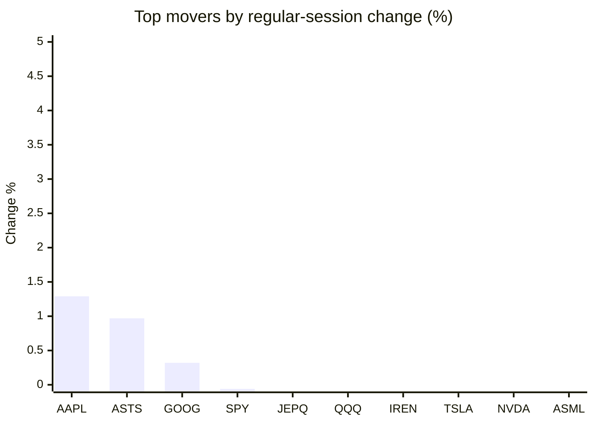
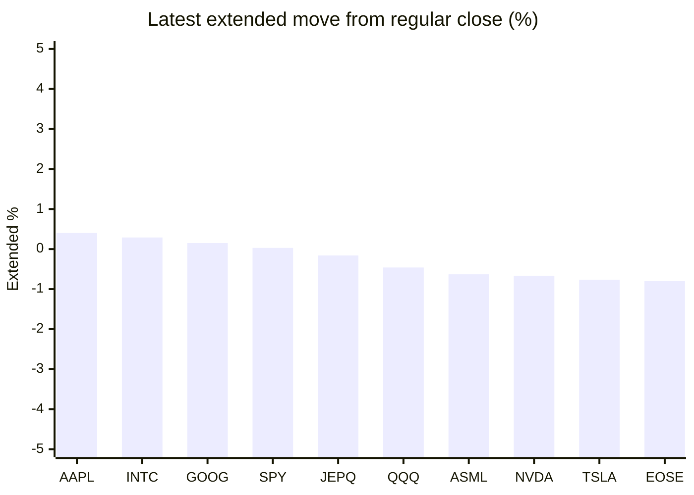

# Stock Brief - 2026-10-13

Generated at 2026-10-13 16:07 +07 from `watchlist.md`.
Prices are snapshots from Yahoo Finance public chart data. Extended/overnight is the latest available pre/post-market datapoint from the same feed.

## Market Snapshot

- SPY: close 778.10, latest extended 778.32, regular move -0.06%, extended move +0.03%
- QQQ: close 746.04, latest extended 742.64, regular move -0.70%, extended move -0.46%
- JEPQ: close 60.93, latest extended 60.83, regular move -0.26%, extended move -0.16%

## Watchlist Prices

| Ticker | Name | Regular close | Latest extended/overnight | Regular move | Extended move | Latest data time | Source |
|---|---|---:|---:|---:|---:|---|---|
| INTC | Intel Corporation | 101.35 USD | 101.64 USD | -3.20% | +0.29% | 2026-10-13 05:06 EDT | [Yahoo](https://finance.yahoo.com/quote/INTC/) |
| AVGO | Broadcom Inc. | 354.73 USD | 351.50 USD | -1.88% | -0.91% | 2026-10-13 05:07 EDT | [Yahoo](https://finance.yahoo.com/quote/AVGO/) |
| RKLB | Rocket Lab Corporation | 65.71 USD | 64.78 USD | -3.67% | -1.42% | 2026-10-13 05:06 EDT | [Yahoo](https://finance.yahoo.com/quote/RKLB/) |
| AAPL | Apple Inc. | 340.97 USD | 342.35 USD | +1.29% | +0.40% | 2026-10-13 05:06 EDT | [Yahoo](https://finance.yahoo.com/quote/AAPL/) |
| NVDA | NVIDIA Corporation | 226.32 USD | 224.80 USD | -1.29% | -0.67% | 2026-10-13 05:07 EDT | [Yahoo](https://finance.yahoo.com/quote/NVDA/) |
| TSLA | Tesla, Inc. | 378.03 USD | 375.11 USD | -1.22% | -0.77% | 2026-10-13 05:06 EDT | [Yahoo](https://finance.yahoo.com/quote/TSLA/) |
| SNDK | Sandisk Corporation | 1,487.33 USD | 1,441.62 USD | -5.97% | -3.07% | 2026-10-13 05:07 EDT | [Yahoo](https://finance.yahoo.com/quote/SNDK/) |
| QQQ | Invesco QQQ Trust, Series 1 | 746.04 USD | 742.64 USD | -0.70% | -0.46% | 2026-10-13 05:06 EDT | [Yahoo](https://finance.yahoo.com/quote/QQQ/) |
| SPY | State Street SPDR S&P 500 ETF T | 778.10 USD | 778.32 USD | -0.06% | +0.03% | 2026-10-13 05:07 EDT | [Yahoo](https://finance.yahoo.com/quote/SPY/) |
| JEPQ | JPMorgan Nasdaq Equity Premium  | 60.93 USD | 60.83 USD | -0.26% | -0.16% | 2026-10-13 04:53 EDT | [Yahoo](https://finance.yahoo.com/quote/JEPQ/) |
| ASTS | AST SpaceMobile, Inc. | 51.46 USD | 49.56 USD | +0.97% | -3.69% | 2026-10-13 05:07 EDT | [Yahoo](https://finance.yahoo.com/quote/ASTS/) |
| MU | Micron Technology, Inc. | 989.04 USD | 965.00 USD | -3.88% | -2.43% | 2026-10-13 05:06 EDT | [Yahoo](https://finance.yahoo.com/quote/MU/) |
| IREN | IREN LIMITED | 34.80 USD | 34.30 USD | -1.11% | -1.45% | 2026-10-13 05:07 EDT | [Yahoo](https://finance.yahoo.com/quote/IREN/) |
| EOSE | Eos Energy Enterprises, Inc. | 2.39 USD | 2.37 USD | -5.16% | -0.80% | 2026-10-13 05:04 EDT | [Yahoo](https://finance.yahoo.com/quote/EOSE/) |
| GOOG | Alphabet Inc. | 348.97 USD | 349.51 USD | +0.32% | +0.15% | 2026-10-13 05:05 EDT | [Yahoo](https://finance.yahoo.com/quote/GOOG/) |
| DRAM | Roundhill Memory ETF | 54.72 USD | 52.66 USD | -4.32% | -3.76% | 2026-10-13 05:06 EDT | [Yahoo](https://finance.yahoo.com/quote/DRAM/) |
| AMD | Advanced Micro Devices, Inc. | 594.24 USD | 588.70 USD | -2.28% | -0.93% | 2026-10-13 05:06 EDT | [Yahoo](https://finance.yahoo.com/quote/AMD/) |
| ASML | ASML Holding N.V. - New York Re | 1,750.24 USD | 1,739.20 USD | -1.69% | -0.63% | 2026-10-13 05:07 EDT | [Yahoo](https://finance.yahoo.com/quote/ASML/) |

## Charts

### Top Movers - Regular Session

### Extended / Overnight Move

### Quick Heatmap

| Group | Names in watchlist | Avg regular move | Avg extended move |
|---|---|---:|---:|
| Mega-cap tech | AVGO, AAPL, NVDA, TSLA, GOOG | -0.56% | -0.36% |
| Semis / memory | INTC, SNDK, MU, DRAM, AMD, ASML | -3.56% | -1.76% |
| Space / high beta | RKLB, ASTS, IREN, EOSE | -2.24% | -1.84% |
| ETFs | QQQ, SPY, JEPQ | -0.34% | -0.20% |

## News Headlines

- [AI stocks plunge as tech chief calls market a ‘casino’](https://uk.finance.yahoo.com/news/ai-stocks-plunge-tech-chief-081541032.html?.tsrc=rss) (2026-10-13 15:15 Bangkok)
- [History Says Micron Stock Saves Its Biggest Gains for the Fourth Quarter. This Year, Its Outlook Points the Same Way.](https://www.fool.com/investing/2026/10/13/history-says-micron-stock-saves-its-biggest-gains-for-the-fourth-quarter-this-year-its-outlook-points-the-same-way/?.tsrc=rss) (2026-10-13 15:07 Bangkok)
- [EXCLUSIVE: SanDisk Has ‘More Upside,’ Says Nicholas Mugalli — His $3,000 Target Implies a 102% Rally for SNDK](https://finance.yahoo.com/markets/stocks/articles/exclusive-sandisk-more-upside-says-074301442.html?.tsrc=rss) (2026-10-13 14:43 Bangkok)
- [Broadcom’s AI Durability Warning Triggers Sharp Drop In SK Hynix, Samsung In Korea; Nvidia's China AI Chip Share Falls As Huawei Closes In](https://stocktwits.com/news-articles/markets/equity/broadcom-s-ai-durability-warning-triggers-sharp-drop-in-sk-hynix-samsung-in-korea-nvidia-s-china-ai-chip-share-falls-as-huawei-closes-in/cZxBJkuRBoJ?.tsrc=rss) (2026-10-13 14:21 Bangkok)
- [AST SpaceMobile (ASTS) Stock May Be Priced For Perfection](https://finance.yahoo.com/markets/stocks/articles/ast-spacemobile-asts-stock-may-072026910.html?.tsrc=rss) (2026-10-13 14:20 Bangkok)
- [Broadcom Introduces VMware HyperArmor, Expanding Hypervisor Security and Protections for VMware Cloud Foundation](https://finance.yahoo.com/technology/ai/articles/broadcom-introduces-vmware-hyperarmor-expanding-070000343.html?.tsrc=rss) (2026-10-13 14:00 Bangkok)
- [ASTS Stock Faces Starlink Threat: Analyst Says Musk Could Pair Ligado, Viasat And FCC Spectrum For ‘Massive’ Midband Block](https://stocktwits.com/news-articles/markets/equity/asts-stock-starlink-threat-analyst-musk-pair-ligado-viasat-fcc-spectrum-massive-midband-block/cZxBeWPRBo7?.tsrc=rss) (2026-10-13 13:38 Bangkok)
- [NVTS Stock Rises Overnight: Navitas Unveils 24 kW Nvidia AI Power Board Targeting 97% Efficiency](https://stocktwits.com/news-articles/markets/equity/nvts-stock-unveils-24-kw-nvidia-ai-power-board-targeting-97--percent-efficiency/cZxBeWcRBoe?.tsrc=rss) (2026-10-13 13:38 Bangkok)

## Caveats

- This is not investment advice. Extended-hours prices can be thin and volatile.
- Yahoo public endpoints may lag official exchange data.
