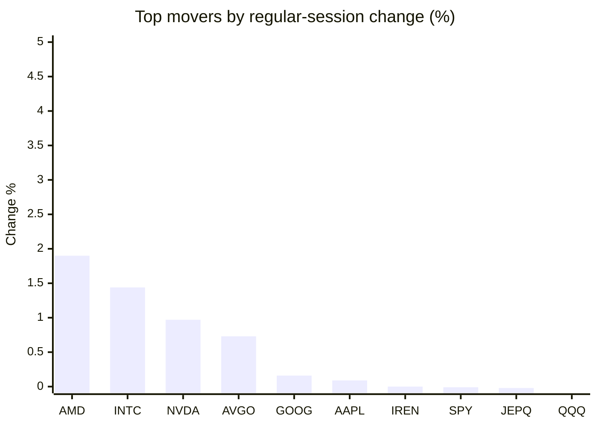
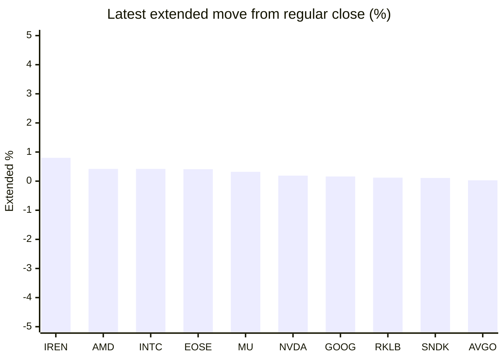

# Stock Brief - 2026-10-14

Generated at 2026-10-14 14:17 +07 from `watchlist.md`.
Prices are snapshots from Yahoo Finance public chart data. Extended/overnight is the latest available pre/post-market datapoint from the same feed.

## Market Snapshot

- SPY: close 778.01, latest extended 777.57, regular move -0.01%, extended move -0.06%
- QQQ: close 743.57, latest extended 742.87, regular move -0.33%, extended move -0.09%
- JEPQ: close 60.92, latest extended 60.91, regular move -0.02%, extended move -0.02%

## Watchlist Prices

| Ticker | Name | Regular close | Latest extended/overnight | Regular move | Extended move | Latest data time | Source |
|---|---|---:|---:|---:|---:|---|---|
| INTC | Intel Corporation | 102.81 USD | 103.24 USD | +1.44% | +0.42% | 2026-10-13 19:59 EDT | [Yahoo](https://finance.yahoo.com/quote/INTC/) |
| AVGO | Broadcom Inc. | 357.31 USD | 357.40 USD | +0.73% | +0.03% | 2026-10-13 19:59 EDT | [Yahoo](https://finance.yahoo.com/quote/AVGO/) |
| RKLB | Rocket Lab Corporation | 64.22 USD | 64.30 USD | -2.27% | +0.12% | 2026-10-13 19:59 EDT | [Yahoo](https://finance.yahoo.com/quote/RKLB/) |
| AAPL | Apple Inc. | 341.27 USD | 340.35 USD | +0.09% | -0.27% | 2026-10-13 19:59 EDT | [Yahoo](https://finance.yahoo.com/quote/AAPL/) |
| NVDA | NVIDIA Corporation | 228.52 USD | 228.96 USD | +0.97% | +0.19% | 2026-10-13 19:59 EDT | [Yahoo](https://finance.yahoo.com/quote/NVDA/) |
| TSLA | Tesla, Inc. | 375.23 USD | 374.88 USD | -0.74% | -0.09% | 2026-10-13 19:59 EDT | [Yahoo](https://finance.yahoo.com/quote/TSLA/) |
| SNDK | Sandisk Corporation | 1,482.33 USD | 1,484.00 USD | -0.34% | +0.11% | 2026-10-13 19:59 EDT | [Yahoo](https://finance.yahoo.com/quote/SNDK/) |
| QQQ | Invesco QQQ Trust, Series 1 | 743.57 USD | 742.87 USD | -0.33% | -0.09% | 2026-10-13 19:59 EDT | [Yahoo](https://finance.yahoo.com/quote/QQQ/) |
| SPY | State Street SPDR S&P 500 ETF T | 778.01 USD | 777.57 USD | -0.01% | -0.06% | 2026-10-13 19:59 EDT | [Yahoo](https://finance.yahoo.com/quote/SPY/) |
| JEPQ | JPMorgan Nasdaq Equity Premium  | 60.92 USD | 60.91 USD | -0.02% | -0.02% | 2026-10-13 19:31 EDT | [Yahoo](https://finance.yahoo.com/quote/JEPQ/) |
| ASTS | AST SpaceMobile, Inc. | 47.06 USD | 47.03 USD | -8.54% | -0.07% | 2026-10-13 19:59 EDT | [Yahoo](https://finance.yahoo.com/quote/ASTS/) |
| MU | Micron Technology, Inc. | 953.19 USD | 956.20 USD | -3.62% | +0.32% | 2026-10-13 19:59 EDT | [Yahoo](https://finance.yahoo.com/quote/MU/) |
| IREN | IREN LIMITED | 34.80 USD | 35.08 USD | +0.00% | +0.80% | 2026-10-13 19:59 EDT | [Yahoo](https://finance.yahoo.com/quote/IREN/) |
| EOSE | Eos Energy Enterprises, Inc. | 2.32 USD | 2.33 USD | -2.93% | +0.41% | 2026-10-13 19:59 EDT | [Yahoo](https://finance.yahoo.com/quote/EOSE/) |
| GOOG | Alphabet Inc. | 349.52 USD | 350.10 USD | +0.16% | +0.16% | 2026-10-13 19:59 EDT | [Yahoo](https://finance.yahoo.com/quote/GOOG/) |
| DRAM | Roundhill Memory ETF | 52.84 USD | 52.66 USD | -3.44% | -0.34% | 2026-10-13 19:59 EDT | [Yahoo](https://finance.yahoo.com/quote/DRAM/) |
| AMD | Advanced Micro Devices, Inc. | 605.53 USD | 608.10 USD | +1.90% | +0.42% | 2026-10-13 19:59 EDT | [Yahoo](https://finance.yahoo.com/quote/AMD/) |
| ASML | ASML Holding N.V. - New York Re | 1,717.76 USD | 1,705.00 USD | -1.86% | -0.74% | 2026-10-13 19:59 EDT | [Yahoo](https://finance.yahoo.com/quote/ASML/) |

## Charts

### Top Movers - Regular Session

### Extended / Overnight Move

### Quick Heatmap

| Group | Names in watchlist | Avg regular move | Avg extended move |
|---|---|---:|---:|
| Mega-cap tech | AVGO, AAPL, NVDA, TSLA, GOOG | +0.24% | +0.00% |
| Semis / memory | INTC, SNDK, MU, DRAM, AMD, ASML | -0.99% | +0.03% |
| Space / high beta | RKLB, ASTS, IREN, EOSE | -3.43% | +0.32% |
| ETFs | QQQ, SPY, JEPQ | -0.12% | -0.06% |

## News Headlines

- [TSLA Stock Rises Overnight: Tesla’s Long-Delayed Roadster Event Is Back On — Musk Teases ‘Timing Is Everything’](https://stocktwits.com/news-articles/markets/equity/tsla-stock-tesla-roadster-event-back-musk-teases-timing-is-everything/cZxfhlNRBpQ?.tsrc=rss) (2026-10-14 13:39 Bangkok)
- [ASML Raises Sales Forecast For A Third Time, But Q3 Revenue Miss Sends Stock Lower: Earnings Selloff Spreads To MU, SNDK, INTC](https://stocktwits.com/news-articles/markets/equity/asml-raises-sales-forecast-for-a-third-time-but-q3-sales-miss-sends-stock-lower-earnings-selloff-spreads-to-mu-sndk-intc/cZxfWHbRBp9?.tsrc=rss) (2026-10-14 13:11 Bangkok)
- [Sandisk (SNDK) Faces Fresh CXMT Pressure, Is The Stock Expensive?](https://finance.yahoo.com/markets/stocks/articles/sandisk-sndk-faces-fresh-cxmt-061047508.html?.tsrc=rss) (2026-10-14 13:10 Bangkok)
- [Tesla Roadster Reveal Nears as Elon Musk Fuels ‘Back to the Future’ Easter-Egg Speculation — TSLA CEO Says ‘Timing Is Everything’](https://finance.yahoo.com/markets/stocks/articles/tesla-roadster-reveal-nears-elon-061046578.html?.tsrc=rss) (2026-10-14 13:10 Bangkok)
- [NVIDIA Commits $250 Million to Advance UK Agentic Safety and Security Research Over the Next Five Years](https://finance.yahoo.com/technology/ai/articles/nvidia-commits-250-million-advance-060100639.html?.tsrc=rss) (2026-10-14 13:01 Bangkok)
- [LSEG Accelerates Tick History Analysis With NVIDIA](https://finance.yahoo.com/technology/articles/lseg-accelerates-tick-history-analysis-060000311.html?.tsrc=rss) (2026-10-14 13:00 Bangkok)
- [100 Million Siri Users Paying $20 A Month Could Generate $24 Billion A Year For Apple, Analyst Says: 'That's a Low-End Example'](https://finance.yahoo.com/technology/ai/articles/100-million-siri-users-paying-054628217.html?.tsrc=rss) (2026-10-14 12:46 Bangkok)
- [LG ELECTRONICS ANNOUNCES NEW SMART HOME ACCESSORIES, DESIGNED IN COLLABORATION WITH APPLE FOR THE APPLE HOME COLLECTION](https://finance.yahoo.com/technology/articles/lg-electronics-announces-smart-home-051000732.html?.tsrc=rss) (2026-10-14 12:10 Bangkok)

## Caveats

- This is not investment advice. Extended-hours prices can be thin and volatile.
- Yahoo public endpoints may lag official exchange data.
