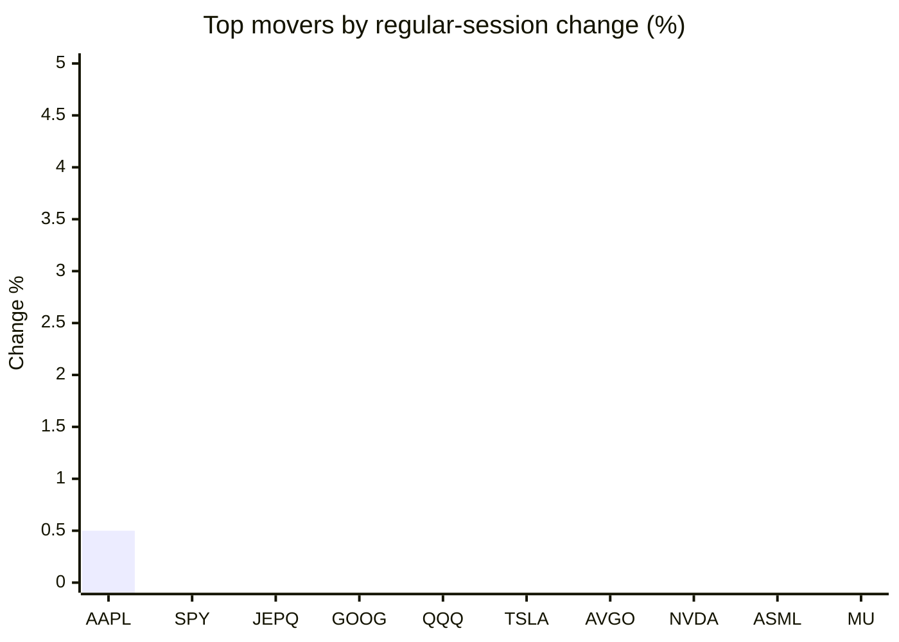
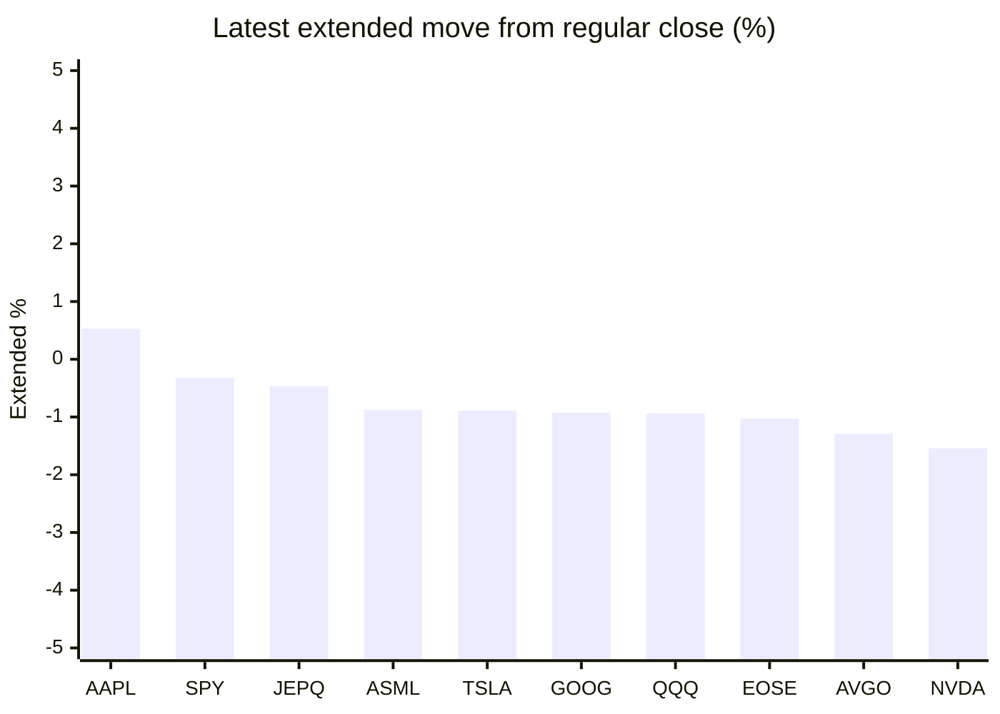

# Stock Brief - 2026-10-15

Generated at 2026-10-15 14:09 +07 from `watchlist.md`.
Prices are snapshots from Yahoo Finance public chart data. Extended/overnight is the latest available pre/post-market datapoint from the same feed.

## Market Snapshot

- SPY: close 769.60, latest extended 767.13, regular move -1.08%, extended move -0.32%
- QQQ: close 728.95, latest extended 722.10, regular move -1.97%, extended move -0.94%
- JEPQ: close 60.09, latest extended 59.81, regular move -1.36%, extended move -0.47%

## Watchlist Prices

| Ticker | Name | Regular close | Latest extended/overnight | Regular move | Extended move | Latest data time | Source |
|---|---|---:|---:|---:|---:|---|---|
| INTC | Intel Corporation | 98.12 USD | 95.73 USD | -4.56% | -2.44% | 2026-10-14 19:59 EDT | [Yahoo](https://finance.yahoo.com/quote/INTC/) |
| AVGO | Broadcom Inc. | 346.25 USD | 341.80 USD | -3.10% | -1.29% | 2026-10-14 19:59 EDT | [Yahoo](https://finance.yahoo.com/quote/AVGO/) |
| RKLB | Rocket Lab Corporation | 59.18 USD | 53.30 USD | -7.85% | -9.94% | 2026-10-14 19:59 EDT | [Yahoo](https://finance.yahoo.com/quote/RKLB/) |
| AAPL | Apple Inc. | 342.96 USD | 344.78 USD | +0.50% | +0.53% | 2026-10-14 19:59 EDT | [Yahoo](https://finance.yahoo.com/quote/AAPL/) |
| NVDA | NVIDIA Corporation | 221.30 USD | 217.89 USD | -3.16% | -1.54% | 2026-10-14 19:59 EDT | [Yahoo](https://finance.yahoo.com/quote/NVDA/) |
| TSLA | Tesla, Inc. | 367.16 USD | 363.89 USD | -2.15% | -0.89% | 2026-10-14 19:59 EDT | [Yahoo](https://finance.yahoo.com/quote/TSLA/) |
| SNDK | Sandisk Corporation | 1,403.34 USD | 1,356.01 USD | -5.33% | -3.37% | 2026-10-14 19:59 EDT | [Yahoo](https://finance.yahoo.com/quote/SNDK/) |
| QQQ | Invesco QQQ Trust, Series 1 | 728.95 USD | 722.10 USD | -1.97% | -0.94% | 2026-10-14 19:59 EDT | [Yahoo](https://finance.yahoo.com/quote/QQQ/) |
| SPY | State Street SPDR S&P 500 ETF T | 769.60 USD | 767.13 USD | -1.08% | -0.32% | 2026-10-14 19:59 EDT | [Yahoo](https://finance.yahoo.com/quote/SPY/) |
| JEPQ | JPMorgan Nasdaq Equity Premium  | 60.09 USD | 59.81 USD | -1.36% | -0.47% | 2026-10-14 19:58 EDT | [Yahoo](https://finance.yahoo.com/quote/JEPQ/) |
| ASTS | AST SpaceMobile, Inc. | 42.14 USD | 41.16 USD | -10.46% | -2.33% | 2026-10-14 19:59 EDT | [Yahoo](https://finance.yahoo.com/quote/ASTS/) |
| MU | Micron Technology, Inc. | 914.13 USD | 889.10 USD | -4.10% | -2.74% | 2026-10-14 19:59 EDT | [Yahoo](https://finance.yahoo.com/quote/MU/) |
| IREN | IREN LIMITED | 30.56 USD | 29.90 USD | -12.18% | -2.15% | 2026-10-14 19:59 EDT | [Yahoo](https://finance.yahoo.com/quote/IREN/) |
| EOSE | Eos Energy Enterprises, Inc. | 1.95 USD | 1.93 USD | -15.95% | -1.03% | 2026-10-14 19:59 EDT | [Yahoo](https://finance.yahoo.com/quote/EOSE/) |
| GOOG | Alphabet Inc. | 343.65 USD | 340.50 USD | -1.68% | -0.92% | 2026-10-14 19:59 EDT | [Yahoo](https://finance.yahoo.com/quote/GOOG/) |
| DRAM | Roundhill Memory ETF | 50.14 USD | 48.30 USD | -5.11% | -3.67% | 2026-10-14 19:59 EDT | [Yahoo](https://finance.yahoo.com/quote/DRAM/) |
| AMD | Advanced Micro Devices, Inc. | 570.82 USD | 555.00 USD | -5.73% | -2.77% | 2026-10-14 19:59 EDT | [Yahoo](https://finance.yahoo.com/quote/AMD/) |
| ASML | ASML Holding N.V. - New York Re | 1,650.00 USD | 1,635.47 USD | -3.94% | -0.88% | 2026-10-14 19:58 EDT | [Yahoo](https://finance.yahoo.com/quote/ASML/) |

## Charts

### Top Movers - Regular Session

### Extended / Overnight Move

### Quick Heatmap

| Group | Names in watchlist | Avg regular move | Avg extended move |
|---|---|---:|---:|
| Mega-cap tech | AVGO, AAPL, NVDA, TSLA, GOOG | -1.92% | -0.82% |
| Semis / memory | INTC, SNDK, MU, DRAM, AMD, ASML | -4.80% | -2.64% |
| Space / high beta | RKLB, ASTS, IREN, EOSE | -11.61% | -3.86% |
| ETFs | QQQ, SPY, JEPQ | -1.47% | -0.58% |

## News Headlines

- [ASTS Stock Heads For Worst Year Since Listing — Analyst Says 60-Satellite Milestone Could Slip To 2028](https://stocktwits.com/news-articles/markets/equity/asts-stock-worst-year-listing-analyst-60-satellite-slip-2028/cZxWNdmRBAI?.tsrc=rss) (2026-10-15 13:17 Bangkok)
- [QCOM, AVGO, NVDA Stocks In Focus As ByteDance Reportedly Closes In On A MediaTek Pact For AI Data Center Chips](https://stocktwits.com/news-articles/markets/equity/qcom-avgo-nvda-stocks-in-focus-as-byte-dance-reportedly-closes-in-on-a-media-tech-pact-for-ai-data-center-chips/cZxWNP1RBA4?.tsrc=rss) (2026-10-15 13:16 Bangkok)
- [Broadcom vs. SK Hynix: Here's What Revenue Trends Tell Investors About These Artificial Intelligence Companies](https://www.fool.com/coverage/charts/2026/10/15/broadcom-vs-sk-hynix-here-s-what-revenue-trends-tell-investors-about-these-artificial-intelligence-companies/?.tsrc=rss) (2026-10-15 12:58 Bangkok)
- [Analyst Sees TSLA-SPCX Merger Coming By December, but Prediction Markets Aren’t Buying It](https://www.benzinga.com/markets/tech/26/10/62372757/analyst-sees-tsla-spcx-merger-coming-by-december-but-prediction-markets-arent-buying-it?utm_source=yahooFinance&utm_campaign=partner_feed&utm_medium=referral&.tsrc=rss) (2026-10-15 12:57 Bangkok)
- [TSLA Stock Slips Overnight Ahead Of Roadster Event — Elon Musk Promises ‘Greatest Product Demo Of All Time’](https://stocktwits.com/news-articles/markets/equity/tsla-stock-roadster-event-elon-musk-greatest-product-demo-of-all-time/cZxWmPlRBA3?.tsrc=rss) (2026-10-15 12:39 Bangkok)
- [Elon Musk Sees ‘Almost All Cars’ Going Electric as Gasoline-Only Vehicles Fall Below Half of Global Sales](https://www.benzinga.com/markets/prediction-markets/26/10/62372456/elon-musk-gasoline-cars-electric-vehicle-tesla?utm_source=yahooFinance&utm_campaign=partner_feed&utm_medium=referral&.tsrc=rss) (2026-10-15 11:38 Bangkok)
- [Why Did SOFI, PLUG, ASTS Stocks Plunge To 52-Week Lows?](https://stocktwits.com/news-articles/markets/equity/why-did-sofi-plug-asts-stocks-plunge-to-52-week-lows/cZxWjEcRBAb?.tsrc=rss) (2026-10-15 11:26 Bangkok)
- [Apple's Annual Revenue Quadrupled From $108 Billion to $416 Billion During Tim Cook's 15 Years as CEO, With iPhone Sales Alone Jumping From $47 Billion to Nearly $210 Billion. What That Growth Says About Betting on Apple's Next Chapter Under John Ternus.](https://www.fool.com/investing/2026/10/15/apples-annual-revenue-quadrupled-from-108-billion/?.tsrc=rss) (2026-10-15 11:20 Bangkok)

## Caveats

- This is not investment advice. Extended-hours prices can be thin and volatile.
- Yahoo public endpoints may lag official exchange data.
