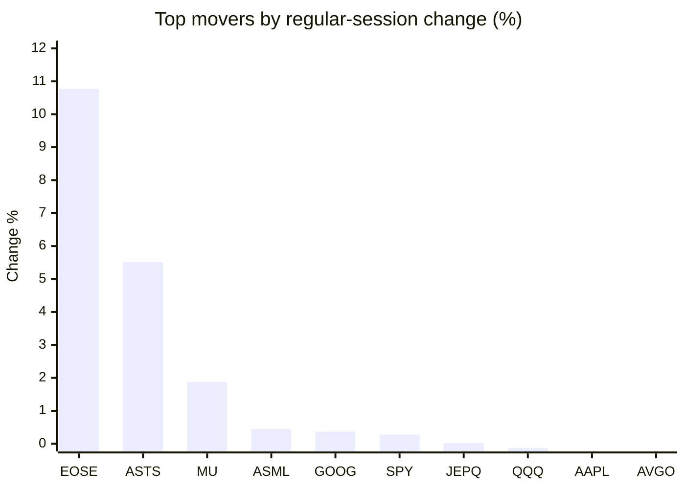
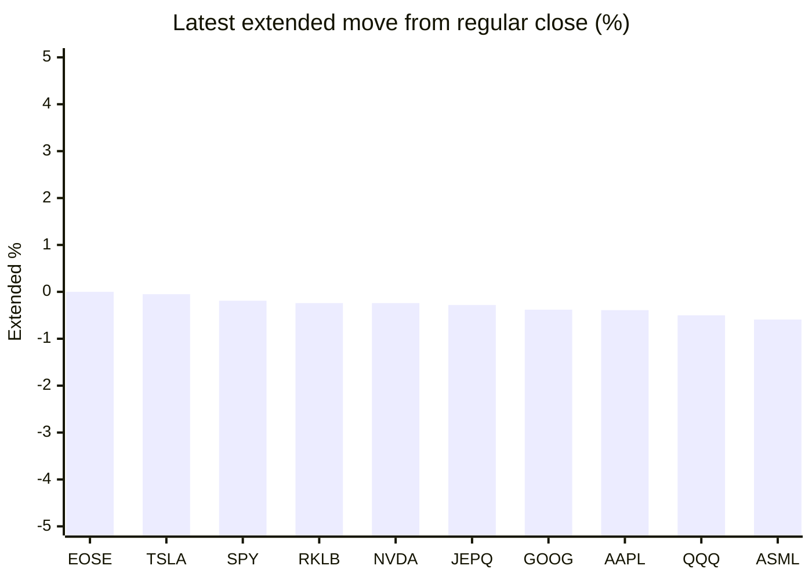

# Stock Brief - 2026-10-16

Generated at 2026-10-16 13:52 +07 from `watchlist.md`.
Prices are snapshots from Yahoo Finance public chart data. Extended/overnight is the latest available pre/post-market datapoint from the same feed.

## Market Snapshot

- SPY: close 771.79, latest extended 770.32, regular move +0.28%, extended move -0.19%
- QQQ: close 728.00, latest extended 724.33, regular move -0.13%, extended move -0.50%
- JEPQ: close 60.10, latest extended 59.93, regular move +0.02%, extended move -0.28%

## Watchlist Prices

| Ticker | Name | Regular close | Latest extended/overnight | Regular move | Extended move | Latest data time | Source |
|---|---|---:|---:|---:|---:|---|---|
| INTC | Intel Corporation | 95.37 USD | 94.63 USD | -2.80% | -0.77% | 2026-10-15 19:59 EDT | [Yahoo](https://finance.yahoo.com/quote/INTC/) |
| AVGO | Broadcom Inc. | 344.33 USD | 341.90 USD | -0.55% | -0.71% | 2026-10-15 19:59 EDT | [Yahoo](https://finance.yahoo.com/quote/AVGO/) |
| RKLB | Rocket Lab Corporation | 55.25 USD | 55.12 USD | -6.64% | -0.24% | 2026-10-15 19:59 EDT | [Yahoo](https://finance.yahoo.com/quote/RKLB/) |
| AAPL | Apple Inc. | 342.00 USD | 340.67 USD | -0.28% | -0.39% | 2026-10-15 19:58 EDT | [Yahoo](https://finance.yahoo.com/quote/AAPL/) |
| NVDA | NVIDIA Corporation | 217.23 USD | 216.71 USD | -1.84% | -0.24% | 2026-10-15 19:59 EDT | [Yahoo](https://finance.yahoo.com/quote/NVDA/) |
| TSLA | Tesla, Inc. | 362.44 USD | 362.27 USD | -1.29% | -0.05% | 2026-10-15 19:59 EDT | [Yahoo](https://finance.yahoo.com/quote/TSLA/) |
| SNDK | Sandisk Corporation | 1,394.83 USD | 1,370.21 USD | -0.61% | -1.76% | 2026-10-15 19:59 EDT | [Yahoo](https://finance.yahoo.com/quote/SNDK/) |
| QQQ | Invesco QQQ Trust, Series 1 | 728.00 USD | 724.33 USD | -0.13% | -0.50% | 2026-10-15 19:59 EDT | [Yahoo](https://finance.yahoo.com/quote/QQQ/) |
| SPY | State Street SPDR S&P 500 ETF T | 771.79 USD | 770.32 USD | +0.28% | -0.19% | 2026-10-15 19:59 EDT | [Yahoo](https://finance.yahoo.com/quote/SPY/) |
| JEPQ | JPMorgan Nasdaq Equity Premium  | 60.10 USD | 59.93 USD | +0.02% | -0.28% | 2026-10-15 19:50 EDT | [Yahoo](https://finance.yahoo.com/quote/JEPQ/) |
| ASTS | AST SpaceMobile, Inc. | 44.46 USD | 43.88 USD | +5.51% | -1.31% | 2026-10-15 19:58 EDT | [Yahoo](https://finance.yahoo.com/quote/ASTS/) |
| MU | Micron Technology, Inc. | 931.24 USD | 923.02 USD | +1.87% | -0.88% | 2026-10-15 19:59 EDT | [Yahoo](https://finance.yahoo.com/quote/MU/) |
| IREN | IREN LIMITED | 30.39 USD | 30.13 USD | -0.56% | -0.86% | 2026-10-15 19:59 EDT | [Yahoo](https://finance.yahoo.com/quote/IREN/) |
| EOSE | Eos Energy Enterprises, Inc. | 2.16 USD | 2.16 USD | +10.77% | -0.00% | 2026-10-15 19:59 EDT | [Yahoo](https://finance.yahoo.com/quote/EOSE/) |
| GOOG | Alphabet Inc. | 344.91 USD | 343.59 USD | +0.37% | -0.38% | 2026-10-15 19:58 EDT | [Yahoo](https://finance.yahoo.com/quote/GOOG/) |
| DRAM | Roundhill Memory ETF | 49.33 USD | 48.69 USD | -1.62% | -1.30% | 2026-10-15 19:59 EDT | [Yahoo](https://finance.yahoo.com/quote/DRAM/) |
| AMD | Advanced Micro Devices, Inc. | 562.23 USD | 553.50 USD | -1.50% | -1.55% | 2026-10-15 19:59 EDT | [Yahoo](https://finance.yahoo.com/quote/AMD/) |
| ASML | ASML Holding N.V. - New York Re | 1,657.44 USD | 1,647.74 USD | +0.45% | -0.59% | 2026-10-15 19:59 EDT | [Yahoo](https://finance.yahoo.com/quote/ASML/) |

## Charts

### Top Movers - Regular Session

### Extended / Overnight Move

### Quick Heatmap

| Group | Names in watchlist | Avg regular move | Avg extended move |
|---|---|---:|---:|
| Mega-cap tech | AVGO, AAPL, NVDA, TSLA, GOOG | -0.72% | -0.35% |
| Semis / memory | INTC, SNDK, MU, DRAM, AMD, ASML | -0.70% | -1.14% |
| Space / high beta | RKLB, ASTS, IREN, EOSE | +2.27% | -0.60% |
| ETFs | QQQ, SPY, JEPQ | +0.06% | -0.33% |

## News Headlines

- [Stocktwits Space Race Weekly: SPCX Weathers Selloff Better Than ASTS, RKLB And FLY — RDW Fares Best](https://stocktwits.com/news-articles/markets/equity/stocktwits-space-race-weekly-spcx-weathers-selloff-better-than-asts-rklb-fly-rdw/cZx0tLwRBrz?.tsrc=rss) (2026-10-16 13:23 Bangkok)
- [Apple (AAPL) Gets Court Order For AI Hiring Records In Trade Secrets Fight](https://finance.yahoo.com/technology/ai/articles/apple-aapl-gets-court-order-061641188.html?.tsrc=rss) (2026-10-16 13:16 Bangkok)
- [Stocktwits AI Roundup: AI Chip Selloff Deepens, CoreWeave Debt Concerns And Apple’s China AI Launch](https://stocktwits.com/news-articles/markets/equity/stocktwits-ai-roundup-ai-chip-selloff-deepens-core-weave-debt-concerns-and-apple-s-china-ai-launch/cZx0t5vRBry?.tsrc=rss) (2026-10-16 13:11 Bangkok)
- [Top 3 Founder Led Stocks To Watch In October 2026](https://finance.yahoo.com/markets/stocks/articles/top-3-founder-led-stocks-051755764.html?.tsrc=rss) (2026-10-16 12:17 Bangkok)
- [Is Chinese Memory Competition Altering The Investment Case For Micron Stock (MU)?](https://finance.yahoo.com/markets/stocks/articles/chinese-memory-competition-altering-investment-051632891.html?.tsrc=rss) (2026-10-16 12:16 Bangkok)
- [Tesla unveils ‘flying’ sports car](https://uk.finance.yahoo.com/news/tesla-unveils-flying-sports-car-050027047.html?.tsrc=rss) (2026-10-16 12:00 Bangkok)
- [Micron Is Down 23% From Its High. History Suggests This Is What Happens Next.](https://www.fool.com/investing/2026/10/16/micron-is-down-xx-from-its-high-history-suggests-t/?.tsrc=rss) (2026-10-16 11:50 Bangkok)
- [Elon Musk Unveils Tesla Roadster That Can Fly, Drive Upside Down and Barrel Roll With SpaceX Thrusters](https://finance.yahoo.com/technology/articles/elon-musk-unveils-tesla-roadster-043453351.html?.tsrc=rss) (2026-10-16 11:34 Bangkok)

## Caveats

- This is not investment advice. Extended-hours prices can be thin and volatile.
- Yahoo public endpoints may lag official exchange data.
