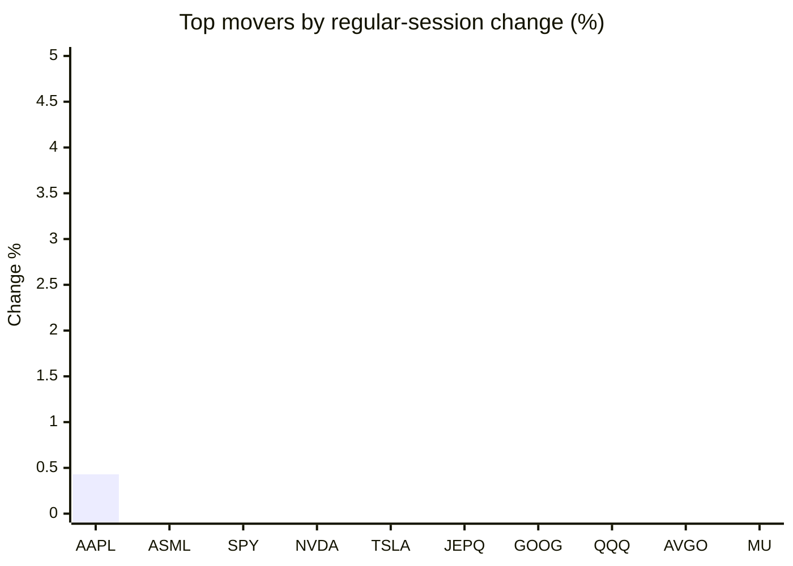
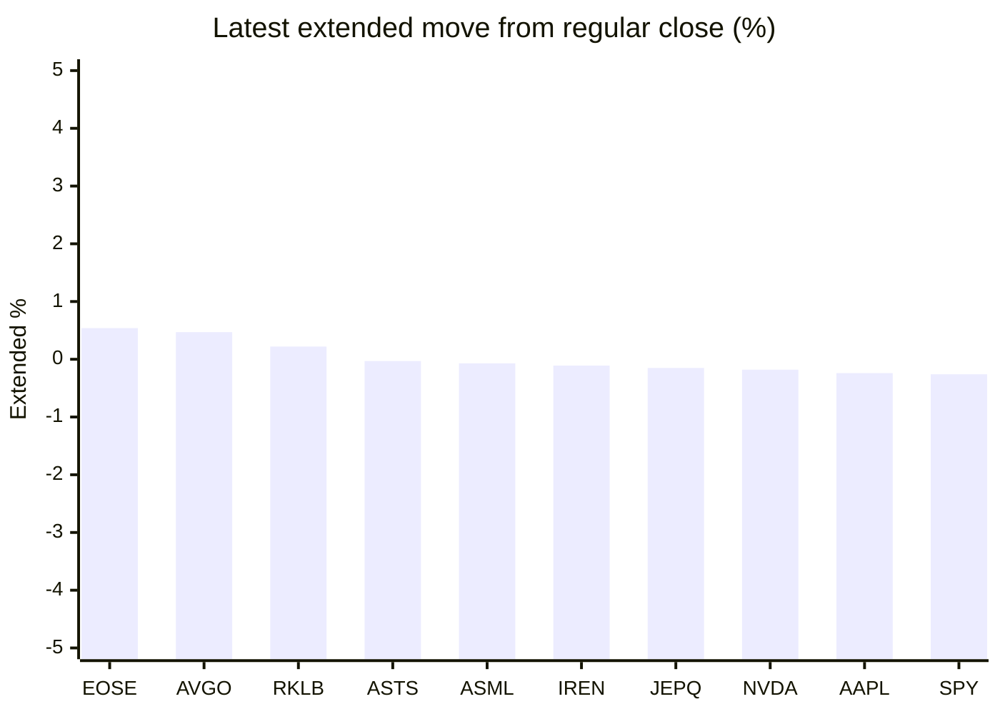

# Stock Brief - 2026-10-17

Generated at 2026-10-17 13:44 +07 from `watchlist.md`.
Prices are snapshots from Yahoo Finance public chart data. Extended/overnight is the latest available pre/post-market datapoint from the same feed.

## Market Snapshot

- SPY: close 763.25, latest extended 761.26, regular move -1.11%, extended move -0.26%
- QQQ: close 709.80, latest extended 707.87, regular move -2.50%, extended move -0.27%
- JEPQ: close 58.81, latest extended 58.72, regular move -2.15%, extended move -0.15%

## Watchlist Prices

| Ticker | Name | Regular close | Latest extended/overnight | Regular move | Extended move | Latest data time | Source |
|---|---|---:|---:|---:|---:|---|---|
| INTC | Intel Corporation | 89.85 USD | 89.33 USD | -5.79% | -0.58% | 2026-10-16 19:59 EDT | [Yahoo](https://finance.yahoo.com/quote/INTC/) |
| AVGO | Broadcom Inc. | 328.75 USD | 330.30 USD | -4.52% | +0.47% | 2026-10-16 19:59 EDT | [Yahoo](https://finance.yahoo.com/quote/AVGO/) |
| RKLB | Rocket Lab Corporation | 50.84 USD | 50.95 USD | -7.98% | +0.22% | 2026-10-16 19:59 EDT | [Yahoo](https://finance.yahoo.com/quote/RKLB/) |
| AAPL | Apple Inc. | 343.46 USD | 342.62 USD | +0.43% | -0.24% | 2026-10-16 19:59 EDT | [Yahoo](https://finance.yahoo.com/quote/AAPL/) |
| NVDA | NVIDIA Corporation | 214.13 USD | 213.75 USD | -1.43% | -0.18% | 2026-10-16 19:59 EDT | [Yahoo](https://finance.yahoo.com/quote/NVDA/) |
| TSLA | Tesla, Inc. | 354.72 USD | 352.46 USD | -2.13% | -0.64% | 2026-10-16 19:59 EDT | [Yahoo](https://finance.yahoo.com/quote/TSLA/) |
| SNDK | Sandisk Corporation | 1,299.30 USD | 1,292.43 USD | -6.85% | -0.53% | 2026-10-16 19:59 EDT | [Yahoo](https://finance.yahoo.com/quote/SNDK/) |
| QQQ | Invesco QQQ Trust, Series 1 | 709.80 USD | 707.87 USD | -2.50% | -0.27% | 2026-10-16 19:59 EDT | [Yahoo](https://finance.yahoo.com/quote/QQQ/) |
| SPY | State Street SPDR S&P 500 ETF T | 763.25 USD | 761.26 USD | -1.11% | -0.26% | 2026-10-16 19:59 EDT | [Yahoo](https://finance.yahoo.com/quote/SPY/) |
| JEPQ | JPMorgan Nasdaq Equity Premium  | 58.81 USD | 58.72 USD | -2.15% | -0.15% | 2026-10-16 19:58 EDT | [Yahoo](https://finance.yahoo.com/quote/JEPQ/) |
| ASTS | AST SpaceMobile, Inc. | 40.66 USD | 40.65 USD | -8.55% | -0.03% | 2026-10-16 19:59 EDT | [Yahoo](https://finance.yahoo.com/quote/ASTS/) |
| MU | Micron Technology, Inc. | 878.84 USD | 875.98 USD | -5.63% | -0.33% | 2026-10-16 19:59 EDT | [Yahoo](https://finance.yahoo.com/quote/MU/) |
| IREN | IREN LIMITED | 26.99 USD | 26.96 USD | -11.19% | -0.11% | 2026-10-16 19:59 EDT | [Yahoo](https://finance.yahoo.com/quote/IREN/) |
| EOSE | Eos Energy Enterprises, Inc. | 1.82 USD | 1.83 USD | -15.74% | +0.54% | 2026-10-16 19:59 EDT | [Yahoo](https://finance.yahoo.com/quote/EOSE/) |
| GOOG | Alphabet Inc. | 336.91 USD | 335.70 USD | -2.32% | -0.36% | 2026-10-16 19:59 EDT | [Yahoo](https://finance.yahoo.com/quote/GOOG/) |
| DRAM | Roundhill Memory ETF | 46.45 USD | 46.27 USD | -5.84% | -0.39% | 2026-10-16 19:59 EDT | [Yahoo](https://finance.yahoo.com/quote/DRAM/) |
| AMD | Advanced Micro Devices, Inc. | 528.75 USD | 527.09 USD | -5.95% | -0.31% | 2026-10-16 19:59 EDT | [Yahoo](https://finance.yahoo.com/quote/AMD/) |
| ASML | ASML Holding N.V. - New York Re | 1,641.52 USD | 1,640.41 USD | -0.96% | -0.07% | 2026-10-16 19:56 EDT | [Yahoo](https://finance.yahoo.com/quote/ASML/) |

## Charts

### Top Movers - Regular Session

### Extended / Overnight Move

### Quick Heatmap

| Group | Names in watchlist | Avg regular move | Avg extended move |
|---|---|---:|---:|
| Mega-cap tech | AVGO, AAPL, NVDA, TSLA, GOOG | -1.99% | -0.19% |
| Semis / memory | INTC, SNDK, MU, DRAM, AMD, ASML | -5.17% | -0.37% |
| Space / high beta | RKLB, ASTS, IREN, EOSE | -10.86% | +0.16% |
| ETFs | QQQ, SPY, JEPQ | -1.92% | -0.23% |

## News Headlines

- [Missed Out On Micron and Sandisk? Make Sure You Don't Miss Out On This Memory Stock.](https://www.fool.com/investing/2026/10/17/missed-out-on-micron-and-sandisk-make-sure-you-don/?.tsrc=rss) (2026-10-17 12:50 Bangkok)
- [TSMC Says AI Chip Demand Is Still Far Above What It Can Supply. That's Why I'd Buy Nvidia Stock.](https://www.fool.com/investing/2026/10/16/tsmc-says-ai-chip-demand-is-still-far-above-what-it-can-supply-that-s-why-i-d-buy-nvidia-stock/?.tsrc=rss) (2026-10-17 10:17 Bangkok)
- [Elon Musk’s Roadster, Nvidia’s Space AI Push, Nadella’s Security Warning: Mag 7 Voices This Week](https://stocktwits.com/news-articles/markets/equity/elon-musk-roadster-nvidia-space-ai-push-nadella-security-warning-mag-7-ceos-this-week/cZxjushRBtE?.tsrc=rss) (2026-10-17 09:46 Bangkok)
- [Micron stock faces unexpected trouble despite sold-out AI factory](https://www.thestreet.com/investing/stocks/micron-taiwan-union-ai-factory?.tsrc=rss) (2026-10-17 08:37 Bangkok)
- [Tesla’s Flying Roadster Has Wall Street Talking About SpaceX, Not Cars](https://www.fool.com/investing/2026/10/16/teslas-flying-roadster-has-wall-street-talking-about-spacex-not-cars/?.tsrc=rss) (2026-10-17 08:25 Bangkok)
- [Battery X Metals Highlights Participation at X Takeover 2026, an Electric Vehicle and Emerging Technology Event Held at Tesla's Gigafactory Texas, Providing Exposure to Industry Perspectives and Technology Developments](https://finance.yahoo.com/technology/articles/battery-x-metals-highlights-participation-012000266.html?.tsrc=rss) (2026-10-17 08:20 Bangkok)
- [Will Starlink Mobile matter for Apple?](https://finance.yahoo.com/markets/stocks/articles/starlink-mobile-matter-apple-010939746.html?.tsrc=rss) (2026-10-17 08:09 Bangkok)
- [Stocktwits Zero To Sixty — Tesla’s Roadster Flies With SpaceX Thrusters, Rivian Opens Cars To AI Agents, And Lucid Eyes France](https://stocktwits.com/news-articles/markets/equity/stocktwits-zero-to-sixty-tesla-s-roadster-flies-with-space-x-thrusters-rivian-opens-cars-to-ai-agents-and-lucid-eyes-france/cZxjA7KRBt5?.tsrc=rss) (2026-10-17 07:33 Bangkok)

## Caveats

- This is not investment advice. Extended-hours prices can be thin and volatile.
- Yahoo public endpoints may lag official exchange data.
