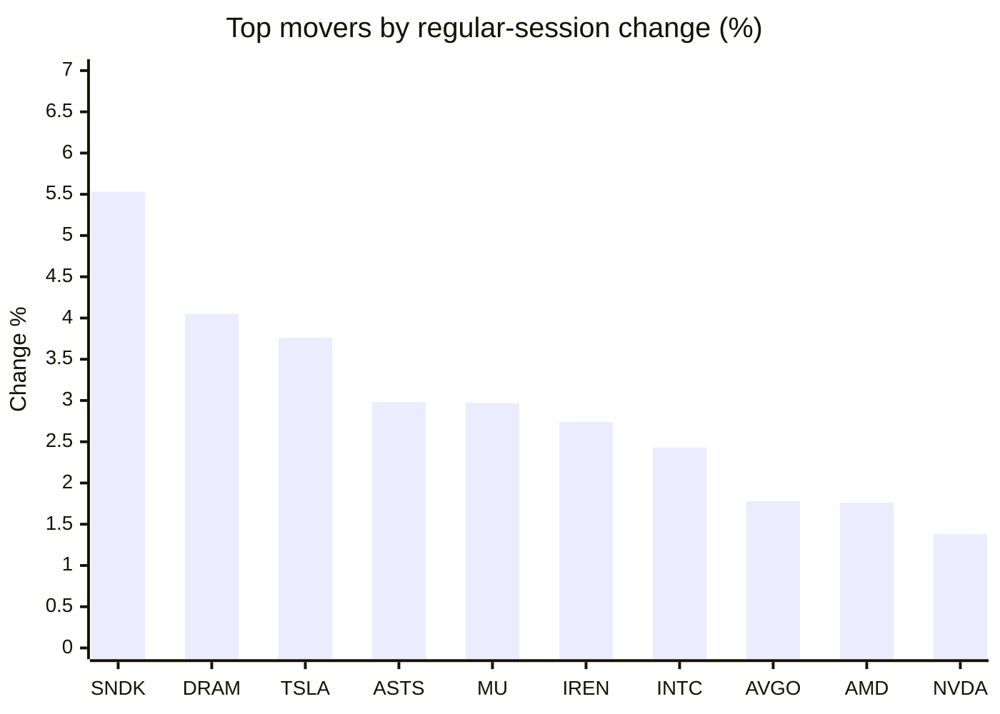
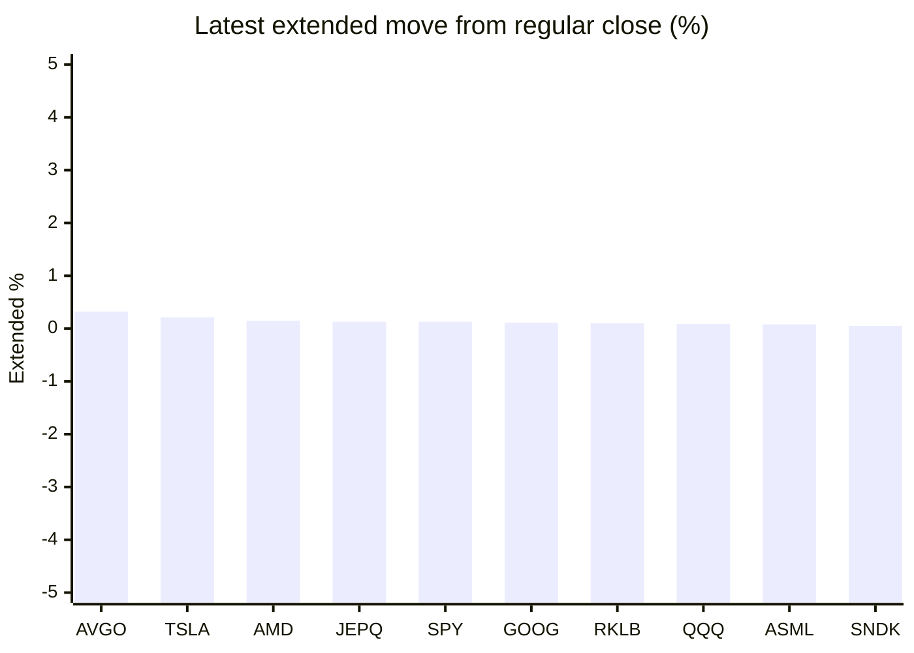

# Stock Brief - 2026-10-20

Generated at 2026-10-20 14:18 +07 from `watchlist.md`.
Prices are snapshots from Yahoo Finance public chart data. Extended/overnight is the latest available pre/post-market datapoint from the same feed.

## Market Snapshot

- SPY: close 766.48, latest extended 767.50, regular move +0.42%, extended move +0.13%
- QQQ: close 718.36, latest extended 719.02, regular move +1.21%, extended move +0.09%
- JEPQ: close 59.50, latest extended 59.58, regular move +1.17%, extended move +0.13%

## Watchlist Prices

| Ticker | Name | Regular close | Latest extended/overnight | Regular move | Extended move | Latest data time | Source |
|---|---|---:|---:|---:|---:|---|---|
| INTC | Intel Corporation | 92.03 USD | 91.97 USD | +2.43% | -0.06% | 2026-10-19 19:59 EDT | [Yahoo](https://finance.yahoo.com/quote/INTC/) |
| AVGO | Broadcom Inc. | 334.59 USD | 335.65 USD | +1.78% | +0.32% | 2026-10-19 19:59 EDT | [Yahoo](https://finance.yahoo.com/quote/AVGO/) |
| RKLB | Rocket Lab Corporation | 51.36 USD | 51.41 USD | +1.02% | +0.10% | 2026-10-19 19:57 EDT | [Yahoo](https://finance.yahoo.com/quote/RKLB/) |
| AAPL | Apple Inc. | 342.94 USD | 343.04 USD | -0.15% | +0.03% | 2026-10-19 19:59 EDT | [Yahoo](https://finance.yahoo.com/quote/AAPL/) |
| NVDA | NVIDIA Corporation | 217.09 USD | 217.18 USD | +1.38% | +0.04% | 2026-10-19 19:59 EDT | [Yahoo](https://finance.yahoo.com/quote/NVDA/) |
| TSLA | Tesla, Inc. | 368.06 USD | 368.83 USD | +3.76% | +0.21% | 2026-10-19 19:59 EDT | [Yahoo](https://finance.yahoo.com/quote/TSLA/) |
| SNDK | Sandisk Corporation | 1,371.12 USD | 1,371.75 USD | +5.53% | +0.05% | 2026-10-19 19:59 EDT | [Yahoo](https://finance.yahoo.com/quote/SNDK/) |
| QQQ | Invesco QQQ Trust, Series 1 | 718.36 USD | 719.02 USD | +1.21% | +0.09% | 2026-10-19 19:59 EDT | [Yahoo](https://finance.yahoo.com/quote/QQQ/) |
| SPY | State Street SPDR S&P 500 ETF T | 766.48 USD | 767.50 USD | +0.42% | +0.13% | 2026-10-19 19:59 EDT | [Yahoo](https://finance.yahoo.com/quote/SPY/) |
| JEPQ | JPMorgan Nasdaq Equity Premium  | 59.50 USD | 59.58 USD | +1.17% | +0.13% | 2026-10-19 19:56 EDT | [Yahoo](https://finance.yahoo.com/quote/JEPQ/) |
| ASTS | AST SpaceMobile, Inc. | 41.87 USD | 41.82 USD | +2.98% | -0.12% | 2026-10-19 19:59 EDT | [Yahoo](https://finance.yahoo.com/quote/ASTS/) |
| MU | Micron Technology, Inc. | 904.90 USD | 905.26 USD | +2.97% | +0.04% | 2026-10-19 19:59 EDT | [Yahoo](https://finance.yahoo.com/quote/MU/) |
| IREN | IREN LIMITED | 27.73 USD | 27.62 USD | +2.74% | -0.40% | 2026-10-19 19:59 EDT | [Yahoo](https://finance.yahoo.com/quote/IREN/) |
| EOSE | Eos Energy Enterprises, Inc. | 1.81 USD | 1.80 USD | -0.55% | -0.55% | 2026-10-19 19:59 EDT | [Yahoo](https://finance.yahoo.com/quote/EOSE/) |
| GOOG | Alphabet Inc. | 340.16 USD | 340.54 USD | +0.96% | +0.11% | 2026-10-19 19:56 EDT | [Yahoo](https://finance.yahoo.com/quote/GOOG/) |
| DRAM | Roundhill Memory ETF | 48.33 USD | 48.33 USD | +4.05% | -0.00% | 2026-10-19 19:59 EDT | [Yahoo](https://finance.yahoo.com/quote/DRAM/) |
| AMD | Advanced Micro Devices, Inc. | 538.05 USD | 538.88 USD | +1.76% | +0.15% | 2026-10-19 19:59 EDT | [Yahoo](https://finance.yahoo.com/quote/AMD/) |
| ASML | ASML Holding N.V. - New York Re | 1,647.12 USD | 1,648.50 USD | +0.34% | +0.08% | 2026-10-19 19:52 EDT | [Yahoo](https://finance.yahoo.com/quote/ASML/) |

## Charts

### Top Movers - Regular Session

### Extended / Overnight Move

### Quick Heatmap

| Group | Names in watchlist | Avg regular move | Avg extended move |
|---|---|---:|---:|
| Mega-cap tech | AVGO, AAPL, NVDA, TSLA, GOOG | +1.55% | +0.14% |
| Semis / memory | INTC, SNDK, MU, DRAM, AMD, ASML | +2.84% | +0.04% |
| Space / high beta | RKLB, ASTS, IREN, EOSE | +1.55% | -0.24% |
| ETFs | QQQ, SPY, JEPQ | +0.93% | +0.12% |

## News Headlines

- [ASTS Stock Slips Overnight: Viasat Urges FCC To Reject AST SpaceMobile’s ‘Fatally Flawed’ Overseas Spectrum Bid](https://stocktwits.com/news-articles/markets/equity/asts-stock-viasat-fcc-reject-ast-spacemobile-fatally-flawed-overseas-spectrum-bid/cZxqmoSRBug?.tsrc=rss) (2026-10-20 13:10 Bangkok)
- [RKLB Stock Dips Overnight: Rocket Lab Shows Neutron Progress After 2027 Delay, But Retail Wants Dates And Deals](https://stocktwits.com/news-articles/markets/equity/rklb-stock-rocket-lab-neutron-progress-2027-delay-retail-dates-and-deals/cZxql2FRBuQ?.tsrc=rss) (2026-10-20 12:49 Bangkok)
- [3 European AI Factory Automation Stocks Retail Investors Should Watch Now](https://finance.yahoo.com/technology/ai/articles/3-european-ai-factory-automation-051514947.html?.tsrc=rss) (2026-10-20 12:15 Bangkok)
- [Chip Stocks Just Had Their Longest Losing Streak Since 2008. Should You Buy Nvidia Stock Now?](https://www.fool.com/investing/2026/10/19/chip-stocks-just-had-their-longest-losing-streak-since-2008-should-you-buy-nvidia-stock-now/?.tsrc=rss) (2026-10-20 10:43 Bangkok)
- [AVGO Stock Edges Up Overnight After 10-Year Docomo Deal, But Retail Stays On Edge Over CEO’s AI ‘Casino’ Remarks](https://stocktwits.com/news-articles/markets/equity/avgo-stock-10-year-docomo-deal-retail-on-edge-ceo-ai-casino-remarks/cZxqiudRBuJ?.tsrc=rss) (2026-10-20 10:08 Bangkok)
- [Micron (MU) Looks Cheap at 5 Times Forward Earnings. Can Its Profit Boom Last?](https://finance.yahoo.com/markets/stocks/articles/micron-mu-looks-cheap-5-153626120.html?.tsrc=rss) (2026-10-20 09:52 Bangkok)
- [Up 10% in the Last Two Weeks, Is Airbnb the Perfect Stock for Today's Market?](https://www.fool.com/investing/2026/10/19/up-10-in-the-last-two-weeks-is-airbnb-the-perfect-stock-for-today-s-market/?.tsrc=rss) (2026-10-20 09:50 Bangkok)
- [Deep Hardware-Software Integration Drives Apple’s (AAPL) Underappreciated AI Advantage](https://finance.yahoo.com/markets/stocks/articles/deep-hardware-software-integration-drives-163110026.html?.tsrc=rss) (2026-10-20 09:41 Bangkok)

## Caveats

- This is not investment advice. Extended-hours prices can be thin and volatile.
- Yahoo public endpoints may lag official exchange data.
