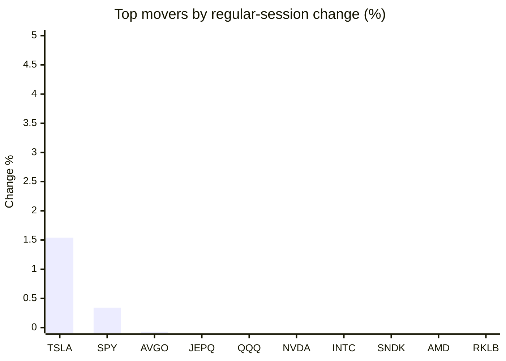
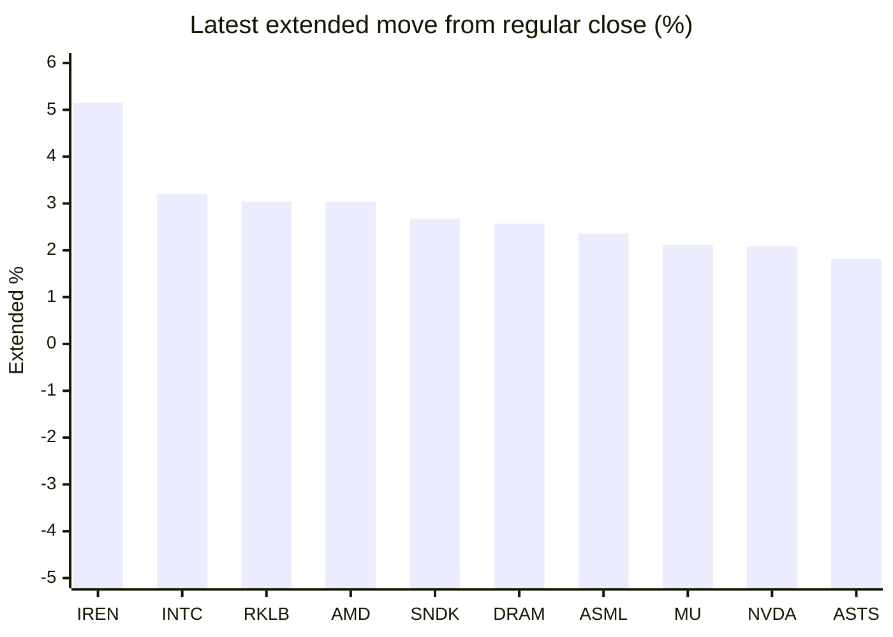

# Stock Brief - 2026-10-21

Generated at 2026-10-21 14:17 +07 from `watchlist.md`.
Prices are snapshots from Yahoo Finance public chart data. Extended/overnight is the latest available pre/post-market datapoint from the same feed.

## Market Snapshot

- SPY: close 769.05, latest extended 770.73, regular move +0.34%, extended move +0.22%
- QQQ: close 717.63, latest extended 722.85, regular move -0.10%, extended move +0.73%
- JEPQ: close 59.44, latest extended 59.85, regular move -0.10%, extended move +0.69%

## Watchlist Prices

| Ticker | Name | Regular close | Latest extended/overnight | Regular move | Extended move | Latest data time | Source |
|---|---|---:|---:|---:|---:|---|---|
| INTC | Intel Corporation | 91.69 USD | 94.63 USD | -0.37% | +3.20% | 2026-10-20 19:59 EDT | [Yahoo](https://finance.yahoo.com/quote/INTC/) |
| AVGO | Broadcom Inc. | 334.37 USD | 340.10 USD | -0.07% | +1.71% | 2026-10-20 19:59 EDT | [Yahoo](https://finance.yahoo.com/quote/AVGO/) |
| RKLB | Rocket Lab Corporation | 50.90 USD | 52.45 USD | -0.90% | +3.04% | 2026-10-20 19:59 EDT | [Yahoo](https://finance.yahoo.com/quote/RKLB/) |
| AAPL | Apple Inc. | 339.50 USD | 338.00 USD | -1.00% | -0.44% | 2026-10-20 19:59 EDT | [Yahoo](https://finance.yahoo.com/quote/AAPL/) |
| NVDA | NVIDIA Corporation | 216.47 USD | 221.00 USD | -0.29% | +2.09% | 2026-10-20 19:59 EDT | [Yahoo](https://finance.yahoo.com/quote/NVDA/) |
| TSLA | Tesla, Inc. | 373.71 USD | 380.45 USD | +1.54% | +1.80% | 2026-10-20 19:59 EDT | [Yahoo](https://finance.yahoo.com/quote/TSLA/) |
| SNDK | Sandisk Corporation | 1,365.38 USD | 1,402.00 USD | -0.42% | +2.68% | 2026-10-20 19:59 EDT | [Yahoo](https://finance.yahoo.com/quote/SNDK/) |
| QQQ | Invesco QQQ Trust, Series 1 | 717.63 USD | 722.85 USD | -0.10% | +0.73% | 2026-10-20 19:59 EDT | [Yahoo](https://finance.yahoo.com/quote/QQQ/) |
| SPY | State Street SPDR S&P 500 ETF T | 769.05 USD | 770.73 USD | +0.34% | +0.22% | 2026-10-20 19:59 EDT | [Yahoo](https://finance.yahoo.com/quote/SPY/) |
| JEPQ | JPMorgan Nasdaq Equity Premium  | 59.44 USD | 59.85 USD | -0.10% | +0.69% | 2026-10-20 19:55 EDT | [Yahoo](https://finance.yahoo.com/quote/JEPQ/) |
| ASTS | AST SpaceMobile, Inc. | 41.13 USD | 41.88 USD | -1.77% | +1.82% | 2026-10-20 19:56 EDT | [Yahoo](https://finance.yahoo.com/quote/ASTS/) |
| MU | Micron Technology, Inc. | 896.07 USD | 915.08 USD | -0.98% | +2.12% | 2026-10-20 19:59 EDT | [Yahoo](https://finance.yahoo.com/quote/MU/) |
| IREN | IREN LIMITED | 26.62 USD | 27.99 USD | -4.00% | +5.15% | 2026-10-20 19:59 EDT | [Yahoo](https://finance.yahoo.com/quote/IREN/) |
| EOSE | Eos Energy Enterprises, Inc. | 1.68 USD | 1.70 USD | -7.18% | +1.19% | 2026-10-20 19:59 EDT | [Yahoo](https://finance.yahoo.com/quote/EOSE/) |
| GOOG | Alphabet Inc. | 336.40 USD | 337.17 USD | -1.11% | +0.23% | 2026-10-20 19:59 EDT | [Yahoo](https://finance.yahoo.com/quote/GOOG/) |
| DRAM | Roundhill Memory ETF | 47.72 USD | 48.95 USD | -1.26% | +2.57% | 2026-10-20 19:59 EDT | [Yahoo](https://finance.yahoo.com/quote/DRAM/) |
| AMD | Advanced Micro Devices, Inc. | 534.74 USD | 551.00 USD | -0.62% | +3.04% | 2026-10-20 19:59 EDT | [Yahoo](https://finance.yahoo.com/quote/AMD/) |
| ASML | ASML Holding N.V. - New York Re | 1,630.84 USD | 1,669.29 USD | -0.99% | +2.36% | 2026-10-20 19:59 EDT | [Yahoo](https://finance.yahoo.com/quote/ASML/) |

## Charts

### Top Movers - Regular Session

### Extended / Overnight Move

### Quick Heatmap

| Group | Names in watchlist | Avg regular move | Avg extended move |
|---|---|---:|---:|
| Mega-cap tech | AVGO, AAPL, NVDA, TSLA, GOOG | -0.18% | +1.08% |
| Semis / memory | INTC, SNDK, MU, DRAM, AMD, ASML | -0.77% | +2.66% |
| Space / high beta | RKLB, ASTS, IREN, EOSE | -3.46% | +2.80% |
| ETFs | QQQ, SPY, JEPQ | +0.04% | +0.55% |

## News Headlines

- [Will Tesla’s New Flying Roadster Send the Stock Flying?](https://www.fool.com/investing/2026/10/21/will-tesla-s-new-flying-roadster-send-the-stock-flying/?.tsrc=rss) (2026-10-21 13:50 Bangkok)
- [Cathie Wood's Ark Invest Grew Its Portfolio to $15.4 Billion Last Quarter, With Tesla, AMD, and a New SpaceX Stake Making Up About 18% of ARKK Assets. Is Her Concentrated Bet Paying Off?](https://www.fool.com/investing/2026/10/21/cathie-woods-ark-invest-grew-its-portfolio-to-154/?.tsrc=rss) (2026-10-21 13:20 Bangkok)
- [Pigment Raises $250M at $2.3B Valuation](https://finance.yahoo.com/technology/ai/articles/pigment-raises-250m-2-3b-060000624.html?.tsrc=rss) (2026-10-21 13:00 Bangkok)
- [Maas Group shares rise 5% as Nvidia weighs fresh backing for Firmus](https://finance.yahoo.com/markets/stocks/articles/maas-group-shares-rise-5-055151094.html?.tsrc=rss) (2026-10-21 12:51 Bangkok)
- [Elon Musk says talks ongoing to merge Tesla and SpaceX](https://www.independent.co.uk/tech/tesla-spacex-merger-value-elon-musk-b3070384.html?.tsrc=rss) (2026-10-21 12:46 Bangkok)
- [Rocket Lab (RKLB) Is Back In The Spotlight, What Are Investors Weighing?](https://finance.yahoo.com/markets/stocks/articles/rocket-lab-rklb-back-spotlight-051912029.html?.tsrc=rss) (2026-10-21 12:19 Bangkok)
- [Nvidia in talks to invest in Firmus Grid after scrapped IPO- The Information](https://finance.yahoo.com/markets/stocks/articles/nvidia-talks-invest-firmus-grid-051839349.html?.tsrc=rss) (2026-10-21 12:18 Bangkok)
- [Dow Jones Futures: SpaceX, Supermicro Revive AI Stocks; Tesla, Meta On Deck](https://finance.yahoo.com/m/40378091-9f13-35f6-a4eb-65961ef4434c/dow-jones-futures%3A-spacex%2C.html?.tsrc=rss) (2026-10-21 11:40 Bangkok)

## Caveats

- This is not investment advice. Extended-hours prices can be thin and volatile.
- Yahoo public endpoints may lag official exchange data.
