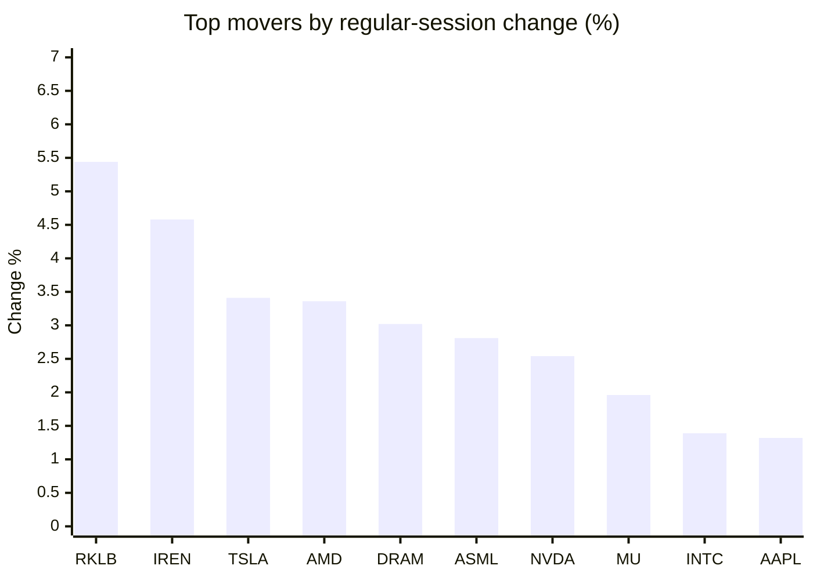
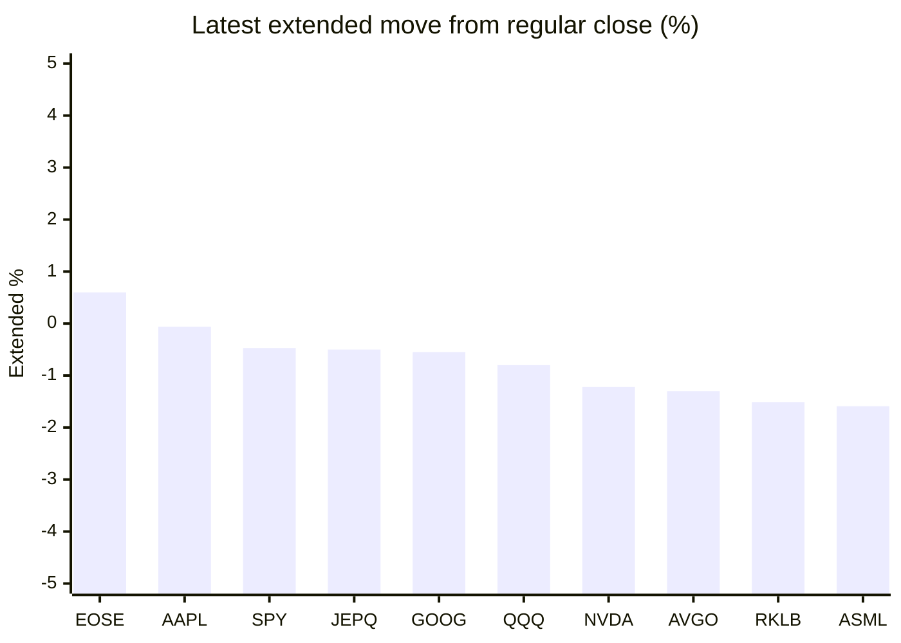

# Stock Brief - 2026-10-22

Generated at 2026-10-22 14:18 +07 from `watchlist.md`.
Prices are snapshots from Yahoo Finance public chart data. Extended/overnight is the latest available pre/post-market datapoint from the same feed.

## Market Snapshot

- SPY: close 773.09, latest extended 769.46, regular move +0.53%, extended move -0.47%
- QQQ: close 725.20, latest extended 719.42, regular move +1.05%, extended move -0.80%
- JEPQ: close 59.95, latest extended 59.65, regular move +0.86%, extended move -0.50%

## Watchlist Prices

| Ticker | Name | Regular close | Latest extended/overnight | Regular move | Extended move | Latest data time | Source |
|---|---|---:|---:|---:|---:|---|---|
| INTC | Intel Corporation | 92.96 USD | 90.94 USD | +1.39% | -2.17% | 2026-10-21 19:59 EDT | [Yahoo](https://finance.yahoo.com/quote/INTC/) |
| AVGO | Broadcom Inc. | 337.80 USD | 333.40 USD | +1.03% | -1.30% | 2026-10-21 19:59 EDT | [Yahoo](https://finance.yahoo.com/quote/AVGO/) |
| RKLB | Rocket Lab Corporation | 53.67 USD | 52.86 USD | +5.44% | -1.51% | 2026-10-21 19:59 EDT | [Yahoo](https://finance.yahoo.com/quote/RKLB/) |
| AAPL | Apple Inc. | 343.99 USD | 343.80 USD | +1.32% | -0.06% | 2026-10-21 19:59 EDT | [Yahoo](https://finance.yahoo.com/quote/AAPL/) |
| NVDA | NVIDIA Corporation | 221.97 USD | 219.26 USD | +2.54% | -1.22% | 2026-10-21 19:59 EDT | [Yahoo](https://finance.yahoo.com/quote/NVDA/) |
| TSLA | Tesla, Inc. | 386.47 USD | 373.63 USD | +3.41% | -3.32% | 2026-10-21 19:59 EDT | [Yahoo](https://finance.yahoo.com/quote/TSLA/) |
| SNDK | Sandisk Corporation | 1,378.22 USD | 1,350.01 USD | +0.94% | -2.05% | 2026-10-21 19:59 EDT | [Yahoo](https://finance.yahoo.com/quote/SNDK/) |
| QQQ | Invesco QQQ Trust, Series 1 | 725.20 USD | 719.42 USD | +1.05% | -0.80% | 2026-10-21 19:59 EDT | [Yahoo](https://finance.yahoo.com/quote/QQQ/) |
| SPY | State Street SPDR S&P 500 ETF T | 773.09 USD | 769.46 USD | +0.53% | -0.47% | 2026-10-21 19:59 EDT | [Yahoo](https://finance.yahoo.com/quote/SPY/) |
| JEPQ | JPMorgan Nasdaq Equity Premium  | 59.95 USD | 59.65 USD | +0.86% | -0.50% | 2026-10-21 19:50 EDT | [Yahoo](https://finance.yahoo.com/quote/JEPQ/) |
| ASTS | AST SpaceMobile, Inc. | 40.90 USD | 40.20 USD | -0.56% | -1.71% | 2026-10-21 19:59 EDT | [Yahoo](https://finance.yahoo.com/quote/ASTS/) |
| MU | Micron Technology, Inc. | 913.67 USD | 898.31 USD | +1.96% | -1.68% | 2026-10-21 19:59 EDT | [Yahoo](https://finance.yahoo.com/quote/MU/) |
| IREN | IREN LIMITED | 27.84 USD | 27.13 USD | +4.58% | -2.55% | 2026-10-21 19:59 EDT | [Yahoo](https://finance.yahoo.com/quote/IREN/) |
| EOSE | Eos Energy Enterprises, Inc. | 1.68 USD | 1.69 USD | +0.00% | +0.60% | 2026-10-21 19:59 EDT | [Yahoo](https://finance.yahoo.com/quote/EOSE/) |
| GOOG | Alphabet Inc. | 330.95 USD | 329.12 USD | -1.62% | -0.55% | 2026-10-21 19:59 EDT | [Yahoo](https://finance.yahoo.com/quote/GOOG/) |
| DRAM | Roundhill Memory ETF | 49.16 USD | 48.26 USD | +3.02% | -1.82% | 2026-10-21 19:59 EDT | [Yahoo](https://finance.yahoo.com/quote/DRAM/) |
| AMD | Advanced Micro Devices, Inc. | 552.72 USD | 540.50 USD | +3.36% | -2.21% | 2026-10-21 19:59 EDT | [Yahoo](https://finance.yahoo.com/quote/AMD/) |
| ASML | ASML Holding N.V. - New York Re | 1,676.69 USD | 1,650.00 USD | +2.81% | -1.59% | 2026-10-21 19:56 EDT | [Yahoo](https://finance.yahoo.com/quote/ASML/) |

## Charts

### Top Movers - Regular Session

### Extended / Overnight Move

### Quick Heatmap

| Group | Names in watchlist | Avg regular move | Avg extended move |
|---|---|---:|---:|
| Mega-cap tech | AVGO, AAPL, NVDA, TSLA, GOOG | +1.34% | -1.29% |
| Semis / memory | INTC, SNDK, MU, DRAM, AMD, ASML | +2.25% | -1.92% |
| Space / high beta | RKLB, ASTS, IREN, EOSE | +2.37% | -1.29% |
| ETFs | QQQ, SPY, JEPQ | +0.81% | -0.59% |

## News Headlines

- [RKLB Is Among Nasdaq’s Top 5 Losers So Far This Month, Yet Analysts See 90% Upside — Can Neutron Justify Its SpaceX Premium?](https://stocktwits.com/news-articles/markets/equity/rklb-nasdaq-top-5-losers-analysts-upside-neutron-justify-spacex-premium/cZxwGQlRBwL?.tsrc=rss) (2026-10-22 14:01 Bangkok)
- [RhymeQ Raises $2.2 Million to Make Coding for Quantum Computers Easy for Millions of Developers Worldwide](https://finance.yahoo.com/technology/ai/articles/rhymeq-raises-2-2-million-070000300.html?.tsrc=rss) (2026-10-22 14:00 Bangkok)
- [Big Blue's Wild Wednesday Ride: IBM Crushes Q3 Earnings, So Why Did the Stock Tank Mid-Call?](https://www.fool.com/investing/2026/10/22/big-blues-wild-wednesday-ride-ibm-crushes-q3-earnings-so-why-did-the-stock-tank-mid-call/?.tsrc=rss) (2026-10-22 13:57 Bangkok)
- [Tesla Cuts 2026 Capex to $20 Billion, but Q4 Could Still Be Its Biggest Spending Quarter Since 2023](https://www.tikr.com/blog/tesla-cuts-2026-capex-to-20-billion-but-q4-could-still-be-its-biggest-spending-quarter-since-2023?ref=yahoofinance&.tsrc=rss) (2026-10-22 13:33 Bangkok)
- [Supermicro Introduces the NVIDIA Vera CPU Rack, a 256 CPU, 100% Liquid-Cooled Rack-Scale Solution, Complementing the NVIDIA Vera Rubin Platform, for Agentic AI at Scale](https://finance.yahoo.com/technology/ai/articles/supermicro-introduces-nvidia-vera-cpu-060000573.html?.tsrc=rss) (2026-10-22 13:00 Bangkok)
- [Tesla's profit drops as it explores a possible merger with Musk's other public company, SpaceX](https://www.euronews.com/2026/10/22/teslas-profit-drops-as-it-explores-a-possible-merger-with-musks-other-public-company-space?.tsrc=rss) (2026-10-22 12:53 Bangkok)
- [NVDA Logs Best Day In Over A Month: Burry Spotlights Partnership Blitz — Analyst Calls Full-Stack Strategy ‘Underappreciated’](https://stocktwits.com/news-articles/markets/equity/nvda-burry-partnership-blitz-analyst-full-stack-strategy-underappreciated/cZxvyOnRBwQ?.tsrc=rss) (2026-10-22 12:46 Bangkok)
- [Elon Musk Says He'd Be 'Stunned' If Any Robot Rivals Optimus At Launch: Gene Munster Calls It A Tesla 'Call Option' With 'Massive Value'](https://finance.yahoo.com/technology/ai/articles/elon-musk-says-hed-stunned-052803880.html?.tsrc=rss) (2026-10-22 12:28 Bangkok)

## Caveats

- This is not investment advice. Extended-hours prices can be thin and volatile.
- Yahoo public endpoints may lag official exchange data.
