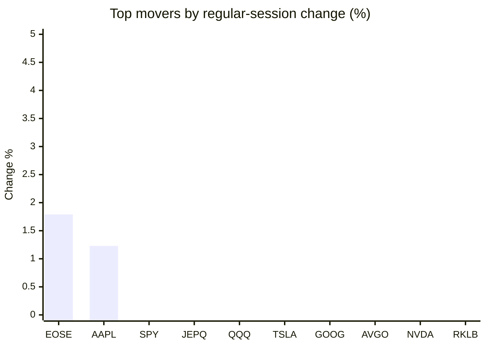
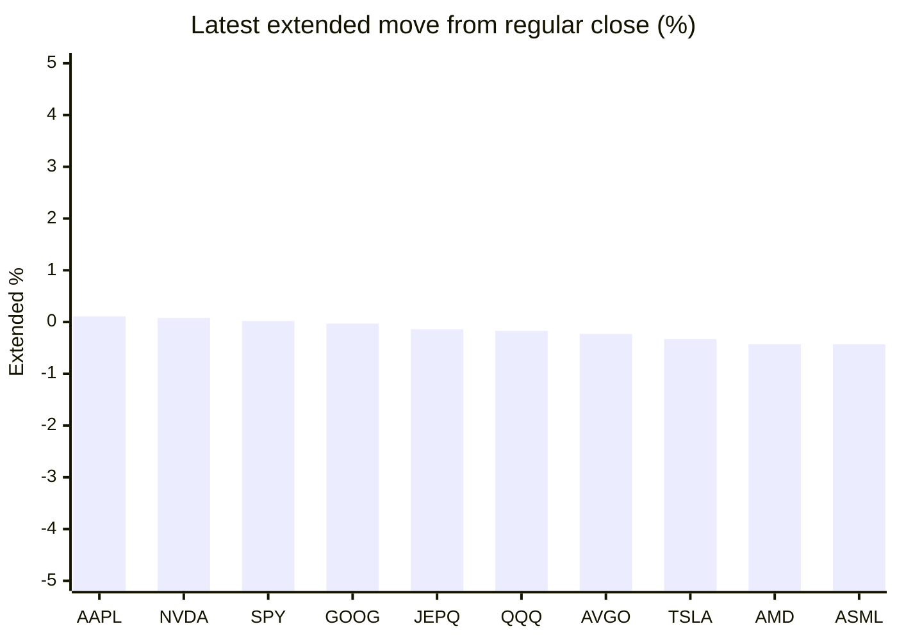

# Stock Brief - 2026-10-23

Generated at 2026-10-23 14:11 +07 from `watchlist.md`.
Prices are snapshots from Yahoo Finance public chart data. Extended/overnight is the latest available pre/post-market datapoint from the same feed.

## Market Snapshot

- SPY: close 763.96, latest extended 764.10, regular move -1.18%, extended move +0.02%
- QQQ: close 704.47, latest extended 703.29, regular move -2.86%, extended move -0.17%
- JEPQ: close 58.42, latest extended 58.34, regular move -2.55%, extended move -0.14%

## Watchlist Prices

| Ticker | Name | Regular close | Latest extended/overnight | Regular move | Extended move | Latest data time | Source |
|---|---|---:|---:|---:|---:|---|---|
| INTC | Intel Corporation | 85.49 USD | 84.76 USD | -8.04% | -0.85% | 2026-10-22 19:59 EDT | [Yahoo](https://finance.yahoo.com/quote/INTC/) |
| AVGO | Broadcom Inc. | 323.24 USD | 322.50 USD | -4.31% | -0.23% | 2026-10-22 19:59 EDT | [Yahoo](https://finance.yahoo.com/quote/AVGO/) |
| RKLB | Rocket Lab Corporation | 51.22 USD | 50.85 USD | -4.56% | -0.72% | 2026-10-22 19:57 EDT | [Yahoo](https://finance.yahoo.com/quote/RKLB/) |
| AAPL | Apple Inc. | 348.22 USD | 348.60 USD | +1.23% | +0.11% | 2026-10-22 19:59 EDT | [Yahoo](https://finance.yahoo.com/quote/AAPL/) |
| NVDA | NVIDIA Corporation | 212.21 USD | 212.38 USD | -4.40% | +0.08% | 2026-10-22 19:59 EDT | [Yahoo](https://finance.yahoo.com/quote/NVDA/) |
| TSLA | Tesla, Inc. | 374.58 USD | 373.35 USD | -3.08% | -0.33% | 2026-10-22 19:59 EDT | [Yahoo](https://finance.yahoo.com/quote/TSLA/) |
| SNDK | Sandisk Corporation | 1,260.93 USD | 1,233.00 USD | -8.51% | -2.22% | 2026-10-22 19:59 EDT | [Yahoo](https://finance.yahoo.com/quote/SNDK/) |
| QQQ | Invesco QQQ Trust, Series 1 | 704.47 USD | 703.29 USD | -2.86% | -0.17% | 2026-10-22 19:59 EDT | [Yahoo](https://finance.yahoo.com/quote/QQQ/) |
| SPY | State Street SPDR S&P 500 ETF T | 763.96 USD | 764.10 USD | -1.18% | +0.02% | 2026-10-22 19:59 EDT | [Yahoo](https://finance.yahoo.com/quote/SPY/) |
| JEPQ | JPMorgan Nasdaq Equity Premium  | 58.42 USD | 58.34 USD | -2.55% | -0.14% | 2026-10-22 19:59 EDT | [Yahoo](https://finance.yahoo.com/quote/JEPQ/) |
| ASTS | AST SpaceMobile, Inc. | 38.77 USD | 38.08 USD | -5.21% | -1.77% | 2026-10-22 19:59 EDT | [Yahoo](https://finance.yahoo.com/quote/ASTS/) |
| MU | Micron Technology, Inc. | 856.49 USD | 845.68 USD | -6.26% | -1.26% | 2026-10-22 19:59 EDT | [Yahoo](https://finance.yahoo.com/quote/MU/) |
| IREN | IREN LIMITED | 25.51 USD | 25.14 USD | -8.37% | -1.45% | 2026-10-22 19:59 EDT | [Yahoo](https://finance.yahoo.com/quote/IREN/) |
| EOSE | Eos Energy Enterprises, Inc. | 1.71 USD | 1.70 USD | +1.79% | -0.58% | 2026-10-22 19:59 EDT | [Yahoo](https://finance.yahoo.com/quote/EOSE/) |
| GOOG | Alphabet Inc. | 320.76 USD | 320.65 USD | -3.08% | -0.03% | 2026-10-22 19:58 EDT | [Yahoo](https://finance.yahoo.com/quote/GOOG/) |
| DRAM | Roundhill Memory ETF | 45.68 USD | 44.99 USD | -7.08% | -1.51% | 2026-10-22 19:59 EDT | [Yahoo](https://finance.yahoo.com/quote/DRAM/) |
| AMD | Advanced Micro Devices, Inc. | 507.93 USD | 505.74 USD | -8.10% | -0.43% | 2026-10-22 19:59 EDT | [Yahoo](https://finance.yahoo.com/quote/AMD/) |
| ASML | ASML Holding N.V. - New York Re | 1,560.54 USD | 1,553.76 USD | -6.93% | -0.43% | 2026-10-22 19:59 EDT | [Yahoo](https://finance.yahoo.com/quote/ASML/) |

## Charts

### Top Movers - Regular Session

### Extended / Overnight Move

### Quick Heatmap

| Group | Names in watchlist | Avg regular move | Avg extended move |
|---|---|---:|---:|
| Mega-cap tech | AVGO, AAPL, NVDA, TSLA, GOOG | -2.73% | -0.08% |
| Semis / memory | INTC, SNDK, MU, DRAM, AMD, ASML | -7.49% | -1.12% |
| Space / high beta | RKLB, ASTS, IREN, EOSE | -4.09% | -1.13% |
| ETFs | QQQ, SPY, JEPQ | -2.20% | -0.09% |

## News Headlines

- [Tesla's Automotive Revenue Fell 3%, and Energy Generation and Storage Tumbled 16%. Should Investors Still View Tesla as a Car Company?](https://www.fool.com/investing/2026/10/23/teslas-automotive-revenue-fell-3-and-energy-genera/?.tsrc=rss) (2026-10-23 14:05 Bangkok)
- [TSLA Eyes Best Week In 2 Months — Analyst Sees Physical Tech’s ‘Berkshire,’ But Bear Credits Court Ruling For Q3 Beat](https://stocktwits.com/news-articles/markets/equity/tsla-analyst-physical-tech-berkshire-bear-court-ruling-q3-beat/cZxyEIYRBxG?.tsrc=rss) (2026-10-23 13:13 Bangkok)
- [If the AI Bubble Bursts, These Stocks Will Be Winners](https://www.fool.com/investing/2026/10/23/if-the-ai-bubble-bursts-these-stocks-will-be-winners/?.tsrc=rss) (2026-10-23 12:50 Bangkok)
- [Not IonQ. Not D-Wave. This Quantum Stock Could Be 2027's Surprise Winner.](https://www.fool.com/investing/2026/10/23/not-ionq-not-d-wave-this-quantum-stock-could-be-20/?.tsrc=rss) (2026-10-23 12:20 Bangkok)
- [Our Pick Of The Best AI Growth Stocks In October 2026](https://finance.yahoo.com/technology/ai/articles/pick-best-ai-growth-stocks-051422083.html?.tsrc=rss) (2026-10-23 12:14 Bangkok)
- [ASTS Slips Overnight: Retail Sees Upside In SpaceX’s 80,000-Site Push — FCC Adviser Sees Global Satellite Power Race](https://stocktwits.com/news-articles/markets/equity/asts-retail-upside-spacex-site-push-fcc-adviser-global-satellite-power-race/cZxy5NTRBDx?.tsrc=rss) (2026-10-23 12:13 Bangkok)
- [Pony.ai partners with inDrive, Nvidia to launch robotaxis in Kazakhstan](https://finance.yahoo.com/technology/ai/articles/pony-ai-partners-indrive-nvidia-050536766.html?.tsrc=rss) (2026-10-23 12:05 Bangkok)
- [S&P 500 best performers: Zero mag 7 stocks past 13 weeks](https://www.thestreet.com/investing/sp-500-best-performers-zero-mag-7-stocks-past-13-weeks?.tsrc=rss) (2026-10-23 11:03 Bangkok)

## Caveats

- This is not investment advice. Extended-hours prices can be thin and volatile.
- Yahoo public endpoints may lag official exchange data.
