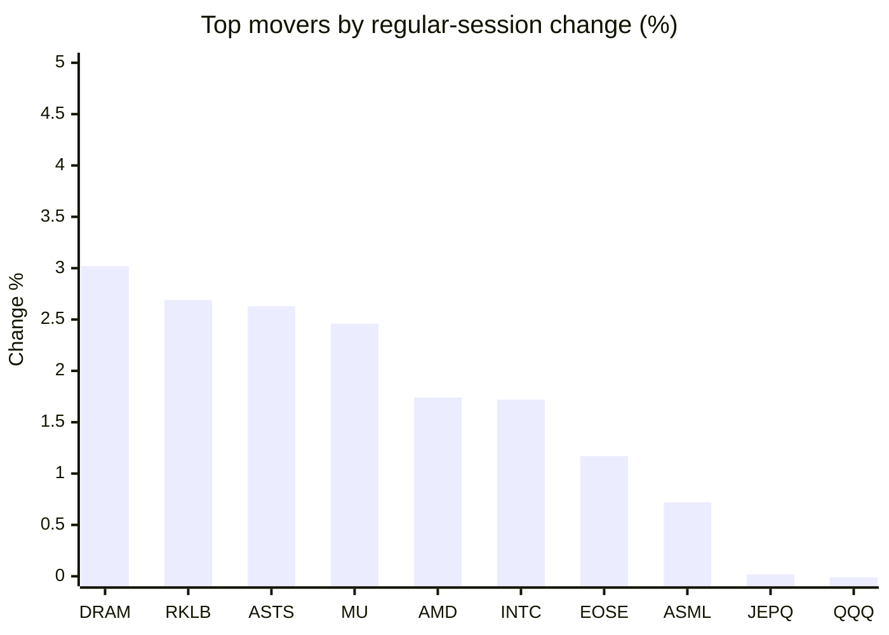
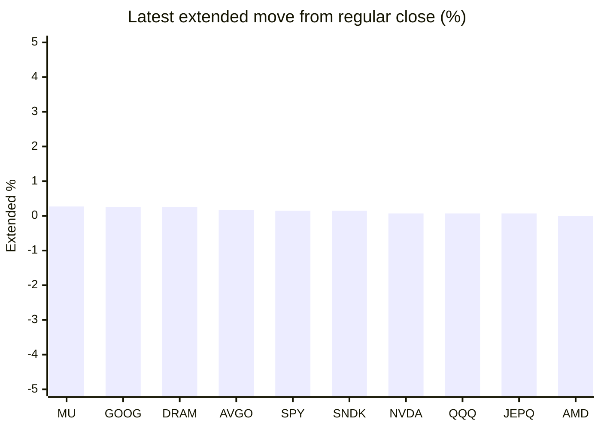

# Stock Brief - 2026-10-24

Generated at 2026-10-24 14:00 +07 from `watchlist.md`.
Prices are snapshots from Yahoo Finance public chart data. Extended/overnight is the latest available pre/post-market datapoint from the same feed.

## Market Snapshot

- SPY: close 759.97, latest extended 761.11, regular move -0.52%, extended move +0.15%
- QQQ: close 704.40, latest extended 704.88, regular move -0.01%, extended move +0.07%
- JEPQ: close 58.43, latest extended 58.47, regular move +0.02%, extended move +0.07%

## Watchlist Prices

| Ticker | Name | Regular close | Latest extended/overnight | Regular move | Extended move | Latest data time | Source |
|---|---|---:|---:|---:|---:|---|---|
| INTC | Intel Corporation | 86.96 USD | 86.64 USD | +1.72% | -0.37% | 2026-10-23 19:59 EDT | [Yahoo](https://finance.yahoo.com/quote/INTC/) |
| AVGO | Broadcom Inc. | 321.68 USD | 322.23 USD | -0.48% | +0.17% | 2026-10-23 19:59 EDT | [Yahoo](https://finance.yahoo.com/quote/AVGO/) |
| RKLB | Rocket Lab Corporation | 52.60 USD | 52.49 USD | +2.69% | -0.22% | 2026-10-23 19:58 EDT | [Yahoo](https://finance.yahoo.com/quote/RKLB/) |
| AAPL | Apple Inc. | 347.73 USD | 347.61 USD | -0.14% | -0.03% | 2026-10-23 19:59 EDT | [Yahoo](https://finance.yahoo.com/quote/AAPL/) |
| NVDA | NVIDIA Corporation | 210.96 USD | 211.11 USD | -0.59% | +0.07% | 2026-10-23 19:59 EDT | [Yahoo](https://finance.yahoo.com/quote/NVDA/) |
| TSLA | Tesla, Inc. | 372.22 USD | 372.22 USD | -0.63% | -0.00% | 2026-10-23 19:59 EDT | [Yahoo](https://finance.yahoo.com/quote/TSLA/) |
| SNDK | Sandisk Corporation | 1,238.03 USD | 1,239.85 USD | -1.82% | +0.15% | 2026-10-23 19:59 EDT | [Yahoo](https://finance.yahoo.com/quote/SNDK/) |
| QQQ | Invesco QQQ Trust, Series 1 | 704.40 USD | 704.88 USD | -0.01% | +0.07% | 2026-10-23 19:59 EDT | [Yahoo](https://finance.yahoo.com/quote/QQQ/) |
| SPY | State Street SPDR S&P 500 ETF T | 759.97 USD | 761.11 USD | -0.52% | +0.15% | 2026-10-23 19:59 EDT | [Yahoo](https://finance.yahoo.com/quote/SPY/) |
| JEPQ | JPMorgan Nasdaq Equity Premium  | 58.43 USD | 58.47 USD | +0.02% | +0.07% | 2026-10-23 19:54 EDT | [Yahoo](https://finance.yahoo.com/quote/JEPQ/) |
| ASTS | AST SpaceMobile, Inc. | 39.79 USD | 39.48 USD | +2.63% | -0.78% | 2026-10-23 19:59 EDT | [Yahoo](https://finance.yahoo.com/quote/ASTS/) |
| MU | Micron Technology, Inc. | 877.55 USD | 879.90 USD | +2.46% | +0.27% | 2026-10-23 19:59 EDT | [Yahoo](https://finance.yahoo.com/quote/MU/) |
| IREN | IREN LIMITED | 24.91 USD | 24.90 USD | -2.37% | -0.02% | 2026-10-23 19:59 EDT | [Yahoo](https://finance.yahoo.com/quote/IREN/) |
| EOSE | Eos Energy Enterprises, Inc. | 1.73 USD | 1.71 USD | +1.17% | -1.24% | 2026-10-23 19:58 EDT | [Yahoo](https://finance.yahoo.com/quote/EOSE/) |
| GOOG | Alphabet Inc. | 317.28 USD | 318.10 USD | -1.08% | +0.26% | 2026-10-23 19:59 EDT | [Yahoo](https://finance.yahoo.com/quote/GOOG/) |
| DRAM | Roundhill Memory ETF | 47.06 USD | 47.18 USD | +3.02% | +0.25% | 2026-10-23 19:59 EDT | [Yahoo](https://finance.yahoo.com/quote/DRAM/) |
| AMD | Advanced Micro Devices, Inc. | 516.79 USD | 516.80 USD | +1.74% | +0.00% | 2026-10-23 19:59 EDT | [Yahoo](https://finance.yahoo.com/quote/AMD/) |
| ASML | ASML Holding N.V. - New York Re | 1,571.80 USD | 1,570.00 USD | +0.72% | -0.11% | 2026-10-23 19:59 EDT | [Yahoo](https://finance.yahoo.com/quote/ASML/) |

## Charts

### Top Movers - Regular Session

### Extended / Overnight Move

### Quick Heatmap

| Group | Names in watchlist | Avg regular move | Avg extended move |
|---|---|---:|---:|
| Mega-cap tech | AVGO, AAPL, NVDA, TSLA, GOOG | -0.59% | +0.09% |
| Semis / memory | INTC, SNDK, MU, DRAM, AMD, ASML | +1.31% | +0.03% |
| Space / high beta | RKLB, ASTS, IREN, EOSE | +1.03% | -0.56% |
| ETFs | QQQ, SPY, JEPQ | -0.17% | +0.09% |

## News Headlines

- [Here's the AI Chip Stock That Hedge Funds Are Loading Up On](https://www.fool.com/investing/2026/10/24/heres-the-ai-chip-stock-that-hedge-funds-are-loadi/?.tsrc=rss) (2026-10-24 13:50 Bangkok)
- [If I Could Tell Every Investor 1 Thing About Stock Market Crashes, It Would Be This](https://www.fool.com/investing/2026/10/24/if-i-could-tell-every-investor-1-thing-about-stock/?.tsrc=rss) (2026-10-24 13:05 Bangkok)
- [TSMC or Nvidia: If I Could Only Own 1 for the Next 5 Years, It Would Be This 1.](https://www.fool.com/investing/2026/10/24/tsmc-or-nvidia-if-i-could-only-own-1-for-the-next/?.tsrc=rss) (2026-10-24 11:20 Bangkok)
- [Broadcom stock gets massive $600 call even as AI fears grow](https://www.thestreet.com/investing/broadcom-stock-avgo-600-price-target?.tsrc=rss) (2026-10-24 10:33 Bangkok)
- [Micron stock gets stunning $3,000 call despite 6% plunge](https://www.thestreet.com/investing/micron-stock-gets-stunning-3000-call-despite-6-percent-plunge?.tsrc=rss) (2026-10-24 09:17 Bangkok)
- [Tesla (TSLA) Starts Semi Volume Output With $2.8 Billion AI Component Bet](https://finance.yahoo.com/technology/ai/articles/tesla-tsla-starts-semi-volume-021147396.html?.tsrc=rss) (2026-10-24 09:11 Bangkok)
- [Jim Cramer's 5% to 8% rule puts Nvidia stock in focus](https://www.thestreet.com/investing/stocks/jim-cramer-nvidia-5-to-8-percent-pullback-rule?.tsrc=rss) (2026-10-24 08:37 Bangkok)
- [Elon Musk Says Tesla Cars' Value Lies in FSD Service: 'People Are Buying FSD With a Car Attached, Not the Other Way Around'](https://finance.yahoo.com/technology/articles/elon-musk-says-tesla-cars-013014650.html?.tsrc=rss) (2026-10-24 08:30 Bangkok)

## Caveats

- This is not investment advice. Extended-hours prices can be thin and volatile.
- Yahoo public endpoints may lag official exchange data.
