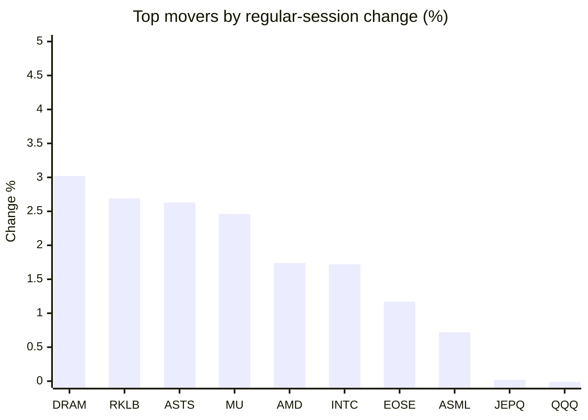
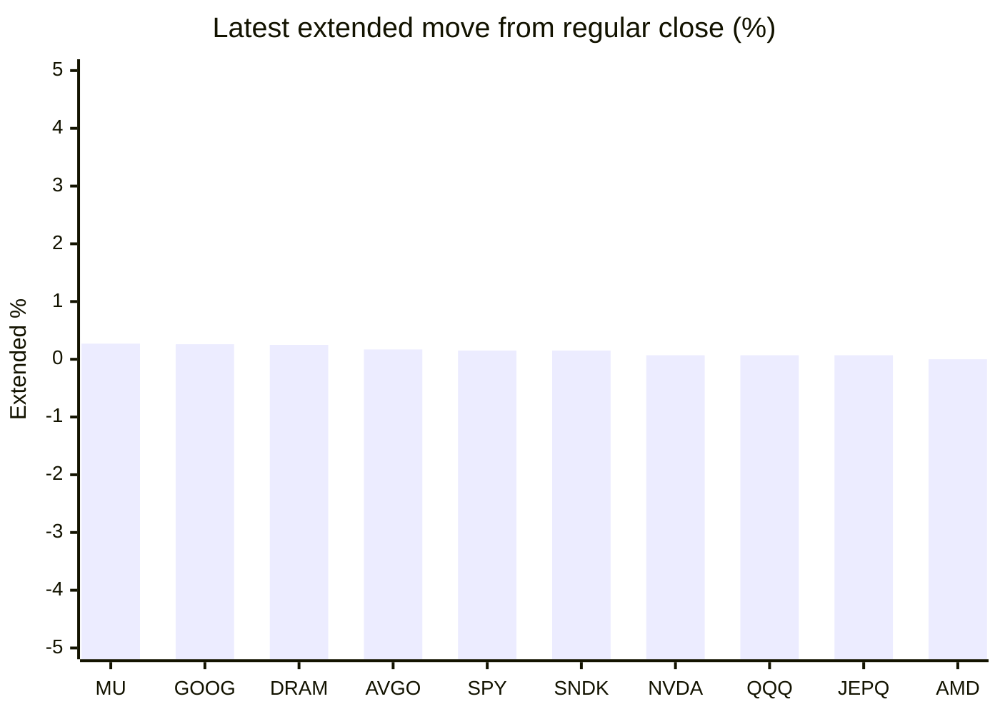

# Stock Brief - 2026-10-26

Generated at 2026-10-26 14:34 +07 from `watchlist.md`.
Prices are snapshots from Yahoo Finance public chart data. Extended/overnight is the latest available pre/post-market datapoint from the same feed.

## Market Snapshot

- SPY: close 759.97, latest extended 761.11, regular move -0.52%, extended move +0.15%
- QQQ: close 704.40, latest extended 704.88, regular move -0.01%, extended move +0.07%
- JEPQ: close 58.43, latest extended 58.47, regular move +0.02%, extended move +0.07%

## Watchlist Prices

| Ticker | Name | Regular close | Latest extended/overnight | Regular move | Extended move | Latest data time | Source |
|---|---|---:|---:|---:|---:|---|---|
| INTC | Intel Corporation | 86.96 USD | 86.64 USD | +1.72% | -0.37% | 2026-10-23 19:59 EDT | [Yahoo](https://finance.yahoo.com/quote/INTC/) |
| AVGO | Broadcom Inc. | 321.68 USD | 322.23 USD | -0.48% | +0.17% | 2026-10-23 19:59 EDT | [Yahoo](https://finance.yahoo.com/quote/AVGO/) |
| RKLB | Rocket Lab Corporation | 52.60 USD | 52.49 USD | +2.69% | -0.22% | 2026-10-23 19:58 EDT | [Yahoo](https://finance.yahoo.com/quote/RKLB/) |
| AAPL | Apple Inc. | 347.73 USD | 347.61 USD | -0.14% | -0.03% | 2026-10-23 19:59 EDT | [Yahoo](https://finance.yahoo.com/quote/AAPL/) |
| NVDA | NVIDIA Corporation | 210.96 USD | 211.11 USD | -0.59% | +0.07% | 2026-10-23 19:59 EDT | [Yahoo](https://finance.yahoo.com/quote/NVDA/) |
| TSLA | Tesla, Inc. | 372.22 USD | 372.22 USD | -0.63% | -0.00% | 2026-10-23 19:59 EDT | [Yahoo](https://finance.yahoo.com/quote/TSLA/) |
| SNDK | Sandisk Corporation | 1,238.03 USD | 1,239.85 USD | -1.82% | +0.15% | 2026-10-23 19:59 EDT | [Yahoo](https://finance.yahoo.com/quote/SNDK/) |
| QQQ | Invesco QQQ Trust, Series 1 | 704.40 USD | 704.88 USD | -0.01% | +0.07% | 2026-10-23 19:59 EDT | [Yahoo](https://finance.yahoo.com/quote/QQQ/) |
| SPY | State Street SPDR S&P 500 ETF T | 759.97 USD | 761.11 USD | -0.52% | +0.15% | 2026-10-23 19:59 EDT | [Yahoo](https://finance.yahoo.com/quote/SPY/) |
| JEPQ | JPMorgan Nasdaq Equity Premium  | 58.43 USD | 58.47 USD | +0.02% | +0.07% | 2026-10-23 19:54 EDT | [Yahoo](https://finance.yahoo.com/quote/JEPQ/) |
| ASTS | AST SpaceMobile, Inc. | 39.79 USD | 39.48 USD | +2.63% | -0.78% | 2026-10-23 19:59 EDT | [Yahoo](https://finance.yahoo.com/quote/ASTS/) |
| MU | Micron Technology, Inc. | 877.55 USD | 879.90 USD | +2.46% | +0.27% | 2026-10-23 19:59 EDT | [Yahoo](https://finance.yahoo.com/quote/MU/) |
| IREN | IREN LIMITED | 24.91 USD | 24.90 USD | -2.37% | -0.02% | 2026-10-23 19:59 EDT | [Yahoo](https://finance.yahoo.com/quote/IREN/) |
| EOSE | Eos Energy Enterprises, Inc. | 1.73 USD | 1.71 USD | +1.17% | -1.24% | 2026-10-23 19:58 EDT | [Yahoo](https://finance.yahoo.com/quote/EOSE/) |
| GOOG | Alphabet Inc. | 317.28 USD | 318.10 USD | -1.08% | +0.26% | 2026-10-23 19:59 EDT | [Yahoo](https://finance.yahoo.com/quote/GOOG/) |
| DRAM | Roundhill Memory ETF | 47.06 USD | 47.18 USD | +3.02% | +0.25% | 2026-10-23 19:59 EDT | [Yahoo](https://finance.yahoo.com/quote/DRAM/) |
| AMD | Advanced Micro Devices, Inc. | 516.79 USD | 516.80 USD | +1.74% | +0.00% | 2026-10-23 19:59 EDT | [Yahoo](https://finance.yahoo.com/quote/AMD/) |
| ASML | ASML Holding N.V. - New York Re | 1,571.80 USD | 1,570.00 USD | +0.72% | -0.11% | 2026-10-23 19:59 EDT | [Yahoo](https://finance.yahoo.com/quote/ASML/) |

## Charts

### Top Movers - Regular Session

### Extended / Overnight Move

### Quick Heatmap

| Group | Names in watchlist | Avg regular move | Avg extended move |
|---|---|---:|---:|
| Mega-cap tech | AVGO, AAPL, NVDA, TSLA, GOOG | -0.59% | +0.09% |
| Semis / memory | INTC, SNDK, MU, DRAM, AMD, ASML | +1.31% | +0.03% |
| Space / high beta | RKLB, ASTS, IREN, EOSE | +1.03% | -0.56% |
| ETFs | QQQ, SPY, JEPQ | -0.17% | +0.09% |

## News Headlines

- [Should You Pick Apple Stock Over Its Competitors?](https://www.trefis.com/stock/aapl/articles/620470/should-you-pick-apple-stock-over-its-competitors/2026-10-26?.tsrc=rss) (2026-10-26 14:11 Bangkok)
- [NVDA Stock Ticks Higher Overnight: a16z Data Shows GPU Rental Prices Rising Sharply, Even For Older Chips](https://stocktwits.com/news-articles/markets/equity/nvda-stock-ticks-higher-overnight-a16z-data-shows-gpu-rental-prices-rising-sharply-even-for-older-chips/cZUdsyzRBy4?.tsrc=rss) (2026-10-26 14:02 Bangkok)
- [Musk Says SpaceX Locked In $40 Billion for Chips, a Win for Nvidia: “We’re Investment Grade”](https://www.tikr.com/blog/musk-says-spacex-locked-in-40-billion-for-chips-a-win-for-nvidia-were-investment-grade?ref=yahoofinance&.tsrc=rss) (2026-10-26 13:39 Bangkok)
- [TSLA Stock Rises Overnight: Cybercabs Swarm Austin F1, Fresh Roadster Details Surface — But Analyst Sees 38% Downside](https://stocktwits.com/news-articles/markets/equity/tsla-stock-cybercabs-austin-f1-roadster-details-analyst-downside/cZUdAawRBy5?.tsrc=rss) (2026-10-26 13:00 Bangkok)
- [Is Nvidia Stock Cheaper Now That Its Multiple Has Fallen?](https://www.trefis.com/stock/nvda/articles/620535/is-nvidia-stock-cheaper-now-that-its-multiple-has-fallen/2026-10-25?.tsrc=rss) (2026-10-26 12:06 Bangkok)
- [From Crypto Roots to AI Selloff: Why CoreWeave Is Under Pressure](https://beincrypto.com/coreweave-ai-selloff-crypto-origins-debt/?.tsrc=rss) (2026-10-26 11:30 Bangkok)
- [Jensen Huang Says Nvidia's Next-Gen Vera Rubin Chips Will Generate $40 Billion in Revenue per Gigawatt, Up From $25 Billion for Grace Blackwell. What That Means for NVDA's Growth Runway.](https://www.fool.com/investing/2026/10/26/jensen-huang-says-nvidias-next-gen-vera-rubin-chip/?.tsrc=rss) (2026-10-26 11:20 Bangkok)
- [ASTS Stock Slips Overnight: AST Seeks More Spectrum For Broadband Expansion — Market Veteran Flags ‘Sky-High’ Valuation](https://stocktwits.com/news-articles/markets/equity/asts-stock-ast-more-spectrum-broadband-expansion-market-veteran-sky-high-valuation/cZUdVVORBUy?.tsrc=rss) (2026-10-26 10:05 Bangkok)

## Caveats

- This is not investment advice. Extended-hours prices can be thin and volatile.
- Yahoo public endpoints may lag official exchange data.
