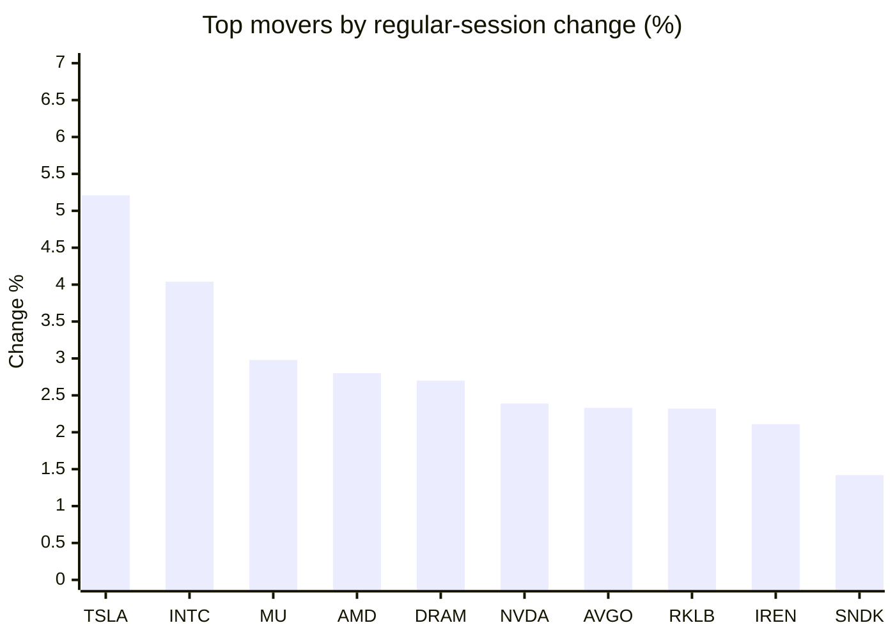
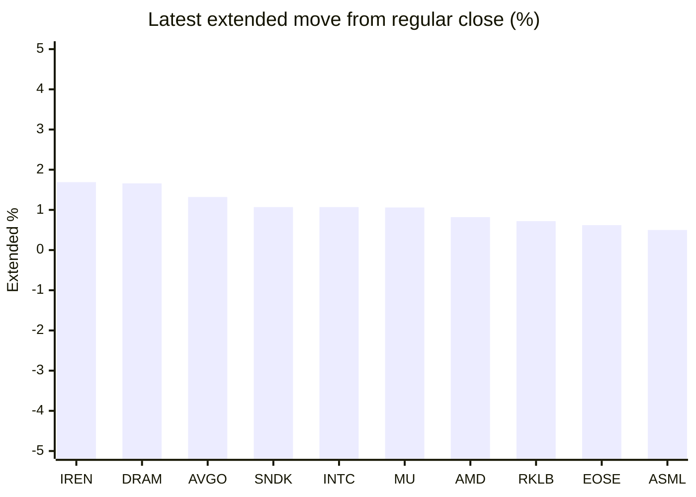

# Stock Brief - 2026-10-27

Generated at 2026-10-27 14:31 +07 from `watchlist.md`.
Prices are snapshots from Yahoo Finance public chart data. Extended/overnight is the latest available pre/post-market datapoint from the same feed.

## Market Snapshot

- SPY: close 765.37, latest extended 766.40, regular move +0.71%, extended move +0.13%
- QQQ: close 712.20, latest extended 714.44, regular move +1.11%, extended move +0.31%
- JEPQ: close 59.02, latest extended 59.22, regular move +1.01%, extended move +0.34%

## Watchlist Prices

| Ticker | Name | Regular close | Latest extended/overnight | Regular move | Extended move | Latest data time | Source |
|---|---|---:|---:|---:|---:|---|---|
| INTC | Intel Corporation | 90.47 USD | 91.44 USD | +4.04% | +1.07% | 2026-10-26 19:59 EDT | [Yahoo](https://finance.yahoo.com/quote/INTC/) |
| AVGO | Broadcom Inc. | 329.17 USD | 333.52 USD | +2.33% | +1.32% | 2026-10-26 19:59 EDT | [Yahoo](https://finance.yahoo.com/quote/AVGO/) |
| RKLB | Rocket Lab Corporation | 53.82 USD | 54.21 USD | +2.32% | +0.72% | 2026-10-26 19:55 EDT | [Yahoo](https://finance.yahoo.com/quote/RKLB/) |
| AAPL | Apple Inc. | 343.91 USD | 343.56 USD | -1.10% | -0.10% | 2026-10-26 19:59 EDT | [Yahoo](https://finance.yahoo.com/quote/AAPL/) |
| NVDA | NVIDIA Corporation | 216.00 USD | 216.50 USD | +2.39% | +0.23% | 2026-10-26 19:59 EDT | [Yahoo](https://finance.yahoo.com/quote/NVDA/) |
| TSLA | Tesla, Inc. | 391.62 USD | 393.21 USD | +5.21% | +0.41% | 2026-10-26 19:59 EDT | [Yahoo](https://finance.yahoo.com/quote/TSLA/) |
| SNDK | Sandisk Corporation | 1,255.58 USD | 1,269.00 USD | +1.42% | +1.07% | 2026-10-26 19:59 EDT | [Yahoo](https://finance.yahoo.com/quote/SNDK/) |
| QQQ | Invesco QQQ Trust, Series 1 | 712.20 USD | 714.44 USD | +1.11% | +0.31% | 2026-10-26 19:59 EDT | [Yahoo](https://finance.yahoo.com/quote/QQQ/) |
| SPY | State Street SPDR S&P 500 ETF T | 765.37 USD | 766.40 USD | +0.71% | +0.13% | 2026-10-26 19:59 EDT | [Yahoo](https://finance.yahoo.com/quote/SPY/) |
| JEPQ | JPMorgan Nasdaq Equity Premium  | 59.02 USD | 59.22 USD | +1.01% | +0.34% | 2026-10-26 19:59 EDT | [Yahoo](https://finance.yahoo.com/quote/JEPQ/) |
| ASTS | AST SpaceMobile, Inc. | 39.45 USD | 39.52 USD | -0.85% | +0.18% | 2026-10-26 19:59 EDT | [Yahoo](https://finance.yahoo.com/quote/ASTS/) |
| MU | Micron Technology, Inc. | 903.70 USD | 913.25 USD | +2.98% | +1.06% | 2026-10-26 19:59 EDT | [Yahoo](https://finance.yahoo.com/quote/MU/) |
| IREN | IREN LIMITED | 25.43 USD | 25.86 USD | +2.11% | +1.69% | 2026-10-26 19:59 EDT | [Yahoo](https://finance.yahoo.com/quote/IREN/) |
| EOSE | Eos Energy Enterprises, Inc. | 1.62 USD | 1.63 USD | -6.36% | +0.62% | 2026-10-26 19:59 EDT | [Yahoo](https://finance.yahoo.com/quote/EOSE/) |
| GOOG | Alphabet Inc. | 314.19 USD | 315.08 USD | -0.97% | +0.28% | 2026-10-26 19:59 EDT | [Yahoo](https://finance.yahoo.com/quote/GOOG/) |
| DRAM | Roundhill Memory ETF | 48.33 USD | 49.13 USD | +2.70% | +1.66% | 2026-10-26 19:59 EDT | [Yahoo](https://finance.yahoo.com/quote/DRAM/) |
| AMD | Advanced Micro Devices, Inc. | 531.28 USD | 535.66 USD | +2.80% | +0.82% | 2026-10-26 19:59 EDT | [Yahoo](https://finance.yahoo.com/quote/AMD/) |
| ASML | ASML Holding N.V. - New York Re | 1,590.90 USD | 1,598.89 USD | +1.22% | +0.50% | 2026-10-26 19:57 EDT | [Yahoo](https://finance.yahoo.com/quote/ASML/) |

## Charts

### Top Movers - Regular Session

### Extended / Overnight Move

### Quick Heatmap

| Group | Names in watchlist | Avg regular move | Avg extended move |
|---|---|---:|---:|
| Mega-cap tech | AVGO, AAPL, NVDA, TSLA, GOOG | +1.57% | +0.43% |
| Semis / memory | INTC, SNDK, MU, DRAM, AMD, ASML | +2.53% | +1.03% |
| Space / high beta | RKLB, ASTS, IREN, EOSE | -0.70% | +0.80% |
| ETFs | QQQ, SPY, JEPQ | +0.94% | +0.26% |

## News Headlines

- [MU, SKHY Stocks Rise As Anthropic Filing Shows $450B In Compute Commitments; Kospi Rally Triggers Program-Trading Pause](https://stocktwits.com/news-articles/markets/equity/mu-skhy-stocks-rise-as-anthropic-filing-shows-450-b-in-compute-commitments-kospi-rally-triggers-program-trading-pause/cZUI6gARBzq?.tsrc=rss) (2026-10-27 14:13 Bangkok)
- [Brazil Stocks Plunged. Should You Buy the Dip in MercadoLibre?](https://www.fool.com/investing/2026/10/27/brazil-stocks-plunged-should-you-buy-the-dip-in-mercadolibre/?.tsrc=rss) (2026-10-27 13:50 Bangkok)
- [Nvidia to invest $3 bln in Meta share offering as part of bigger AI partnership](https://finance.yahoo.com/technology/ai/articles/nvidia-invest-3-bln-meta-064611851.html?.tsrc=rss) (2026-10-27 13:46 Bangkok)
- [Agile Robots Launches Agile ONE SN Humanoid at NVIDIA GTC Berlin and Pilots Humanoids with Audi](https://finance.yahoo.com/technology/ai/articles/agile-robots-launches-agile-one-062200731.html?.tsrc=rss) (2026-10-27 13:22 Bangkok)
- [Vodafone Group (LSE:VOD) Eyes Satellite Spectrum Bid, Is The 3% Discount Enough?](https://finance.yahoo.com/markets/stocks/articles/vodafone-group-lse-vod-eyes-060902740.html?.tsrc=rss) (2026-10-27 13:09 Bangkok)
- [SPCX Stock Up Nearly 10% Since IPO — Analyst Sees 82% Upside Without Tesla Merger, Even If Revenue Misses Lofty Goals](https://stocktwits.com/news-articles/markets/equity/spcx-stock-analyst-upside-without-tesla-merger-even-if-revenue-misses-goals/cZUIUX2RBzF?.tsrc=rss) (2026-10-27 12:58 Bangkok)
- [NVIDIA and Meta to Expand Collaboration on Muse and Muse Family of Models Amid Robust Growth](https://finance.yahoo.com/technology/ai/articles/nvidia-meta-expand-collaboration-muse-055200163.html?.tsrc=rss) (2026-10-27 12:52 Bangkok)
- [Investors: Oct. 28 Will Be an Important Day for the Stock Market. Here's Why.](https://www.fool.com/investing/2026/10/27/investors-oct-28-will-be-an-important-day-for-the/?.tsrc=rss) (2026-10-27 12:50 Bangkok)

## Caveats

- This is not investment advice. Extended-hours prices can be thin and volatile.
- Yahoo public endpoints may lag official exchange data.
