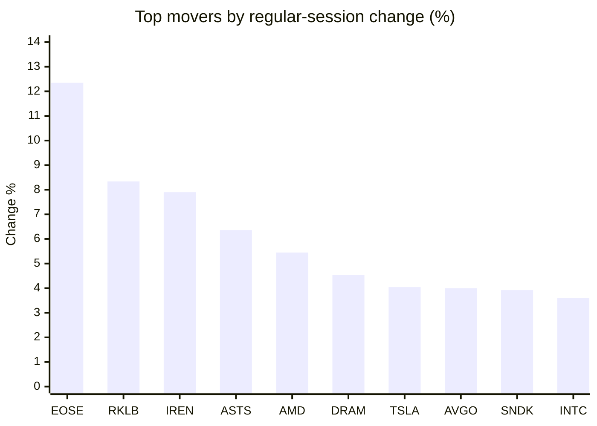
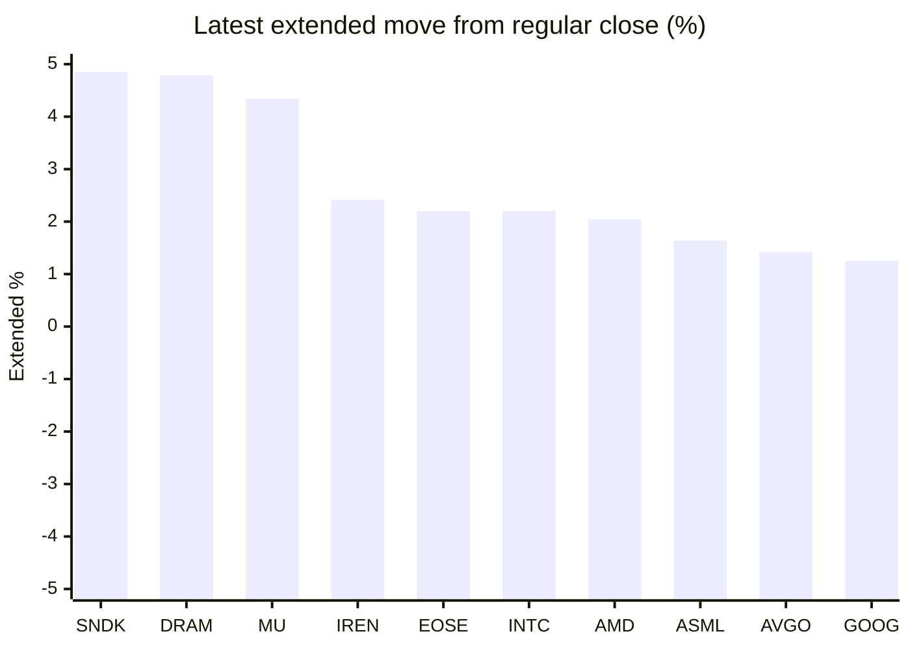

# Stock Brief - 2026-10-28

Generated at 2026-10-28 15:03 +07 from `watchlist.md`.
Prices are snapshots from Yahoo Finance public chart data. Extended/overnight is the latest available pre/post-market datapoint from the same feed.

## Market Snapshot

- SPY: close 769.66, latest extended 770.67, regular move +0.56%, extended move +0.13%
- QQQ: close 721.25, latest extended 725.50, regular move +1.27%, extended move +0.59%
- JEPQ: close 59.70, latest extended 59.90, regular move +1.15%, extended move +0.34%

## Watchlist Prices

| Ticker | Name | Regular close | Latest extended/overnight | Regular move | Extended move | Latest data time | Source |
|---|---|---:|---:|---:|---:|---|---|
| INTC | Intel Corporation | 93.74 USD | 95.80 USD | +3.61% | +2.20% | 2026-10-28 04:03 EDT | [Yahoo](https://finance.yahoo.com/quote/INTC/) |
| AVGO | Broadcom Inc. | 342.33 USD | 347.20 USD | +4.00% | +1.42% | 2026-10-28 04:03 EDT | [Yahoo](https://finance.yahoo.com/quote/AVGO/) |
| RKLB | Rocket Lab Corporation | 58.31 USD | 58.90 USD | +8.34% | +1.01% | 2026-10-28 04:02 EDT | [Yahoo](https://finance.yahoo.com/quote/RKLB/) |
| AAPL | Apple Inc. | 347.10 USD | 346.29 USD | +0.93% | -0.23% | 2026-10-28 04:03 EDT | [Yahoo](https://finance.yahoo.com/quote/AAPL/) |
| NVDA | NVIDIA Corporation | 217.94 USD | 219.64 USD | +0.90% | +0.78% | 2026-10-28 04:02 EDT | [Yahoo](https://finance.yahoo.com/quote/NVDA/) |
| TSLA | Tesla, Inc. | 407.46 USD | 411.80 USD | +4.04% | +1.07% | 2026-10-28 04:03 EDT | [Yahoo](https://finance.yahoo.com/quote/TSLA/) |
| SNDK | Sandisk Corporation | 1,304.84 USD | 1,368.10 USD | +3.92% | +4.85% | 2026-10-28 04:03 EDT | [Yahoo](https://finance.yahoo.com/quote/SNDK/) |
| QQQ | Invesco QQQ Trust, Series 1 | 721.25 USD | 725.50 USD | +1.27% | +0.59% | 2026-10-28 04:02 EDT | [Yahoo](https://finance.yahoo.com/quote/QQQ/) |
| SPY | State Street SPDR S&P 500 ETF T | 769.66 USD | 770.67 USD | +0.56% | +0.13% | 2026-10-28 04:03 EDT | [Yahoo](https://finance.yahoo.com/quote/SPY/) |
| JEPQ | JPMorgan Nasdaq Equity Premium  | 59.70 USD | 59.90 USD | +1.15% | +0.34% | 2026-10-28 04:01 EDT | [Yahoo](https://finance.yahoo.com/quote/JEPQ/) |
| ASTS | AST SpaceMobile, Inc. | 41.96 USD | 41.95 USD | +6.36% | -0.02% | 2026-10-28 04:01 EDT | [Yahoo](https://finance.yahoo.com/quote/ASTS/) |
| MU | Micron Technology, Inc. | 928.76 USD | 969.07 USD | +2.77% | +4.34% | 2026-10-28 04:03 EDT | [Yahoo](https://finance.yahoo.com/quote/MU/) |
| IREN | IREN LIMITED | 27.44 USD | 28.10 USD | +7.90% | +2.41% | 2026-10-28 04:03 EDT | [Yahoo](https://finance.yahoo.com/quote/IREN/) |
| EOSE | Eos Energy Enterprises, Inc. | 1.82 USD | 1.86 USD | +12.35% | +2.20% | 2026-10-28 04:02 EDT | [Yahoo](https://finance.yahoo.com/quote/EOSE/) |
| GOOG | Alphabet Inc. | 316.83 USD | 320.79 USD | +0.84% | +1.25% | 2026-10-28 04:01 EDT | [Yahoo](https://finance.yahoo.com/quote/GOOG/) |
| DRAM | Roundhill Memory ETF | 50.52 USD | 52.94 USD | +4.53% | +4.79% | 2026-10-28 04:02 EDT | [Yahoo](https://finance.yahoo.com/quote/DRAM/) |
| AMD | Advanced Micro Devices, Inc. | 560.26 USD | 571.68 USD | +5.45% | +2.04% | 2026-10-28 04:03 EDT | [Yahoo](https://finance.yahoo.com/quote/AMD/) |
| ASML | ASML Holding N.V. - New York Re | 1,635.57 USD | 1,662.34 USD | +2.81% | +1.64% | 2026-10-28 04:03 EDT | [Yahoo](https://finance.yahoo.com/quote/ASML/) |

## Charts

### Top Movers - Regular Session

### Extended / Overnight Move

### Quick Heatmap

| Group | Names in watchlist | Avg regular move | Avg extended move |
|---|---|---:|---:|
| Mega-cap tech | AVGO, AAPL, NVDA, TSLA, GOOG | +2.14% | +0.86% |
| Semis / memory | INTC, SNDK, MU, DRAM, AMD, ASML | +3.85% | +3.31% |
| Space / high beta | RKLB, ASTS, IREN, EOSE | +8.74% | +1.40% |
| ETFs | QQQ, SPY, JEPQ | +0.99% | +0.35% |

## News Headlines

- [Otto Group and Sereact Bring NVIDIA-Powered Physical AI to Returns Processing](https://finance.yahoo.com/technology/ai/articles/otto-group-sereact-bring-nvidia-070000277.html?.tsrc=rss) (2026-10-28 14:00 Bangkok)
- [MU, SNDK, Neocloud Stocks Extend Gains On Anthropic Boost, SK Hynix Q3 Stunner; Jim Cramer Urges Caution](https://stocktwits.com/news-articles/markets/equity/mu-sndk-neocloud-stocks-extend-gains-on-anthropic-boost-sk-hynix-q3-stunner-jim-cramer-urges-caution/cZU93s9RB61?.tsrc=rss) (2026-10-28 13:46 Bangkok)
- [ASTS Stock Logs Best Day In Nearly A Month — BlackRock’s Stake Takes Spotlight After Bruising Selloff](https://stocktwits.com/news-articles/markets/equity/asts-stock-blackrock-stake-spotlight-bruising-selloff/cZU9dwkRB6L?.tsrc=rss) (2026-10-28 13:11 Bangkok)
- [Tesla-SpaceX Merger Needs No Premium, Investor Says — But Floats $500 To Sway Angry Holders Missing Bigger Payoff](https://stocktwits.com/news-articles/markets/equity/tesla-spacex-merger-no-premium-investor-floats-500-sway-angry-holders/cZU9dpmRB6h?.tsrc=rss) (2026-10-28 13:05 Bangkok)
- [Elon Musk Says Tesla Robotaxi Expansion to Miami, Tampa Beaches Is ‘Coming Soon’ After Ron DeSantis’ Call for Expansion](https://finance.yahoo.com/technology/articles/elon-musk-says-tesla-robotaxi-053520197.html?.tsrc=rss) (2026-10-28 12:35 Bangkok)
- [Is AI Overhyped? Apollo Economist Sees "Zero Financial Payoff" Beyond Tech Companies](https://www.fool.com/investing/2026/10/28/is-ai-overhyped-apollo-economist-sees-zero-payoff/?.tsrc=rss) (2026-10-28 12:20 Bangkok)
- [Dow Jones Futures Fall, Techs Rise As SK Hynix Crushes Views; Fed, Microsoft, Google On Deck](https://finance.yahoo.com/m/7066a700-b33b-3fa1-858d-f75f49b920da/dow-jones-futures-fall%2C-techs.html?.tsrc=rss) (2026-10-28 14:59 Bangkok)
- [AI chip giant SK hynix posts seven-fold surge in quarterly operating profit](https://finance.yahoo.com/technology/ai/articles/ai-chip-giant-sk-hynix-003518443.html?.tsrc=rss) (2026-10-28 14:53 Bangkok)

## Caveats

- This is not investment advice. Extended-hours prices can be thin and volatile.
- Yahoo public endpoints may lag official exchange data.
