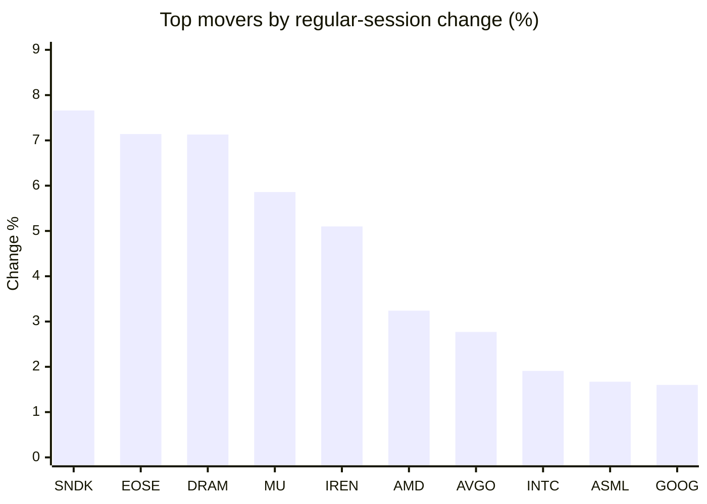
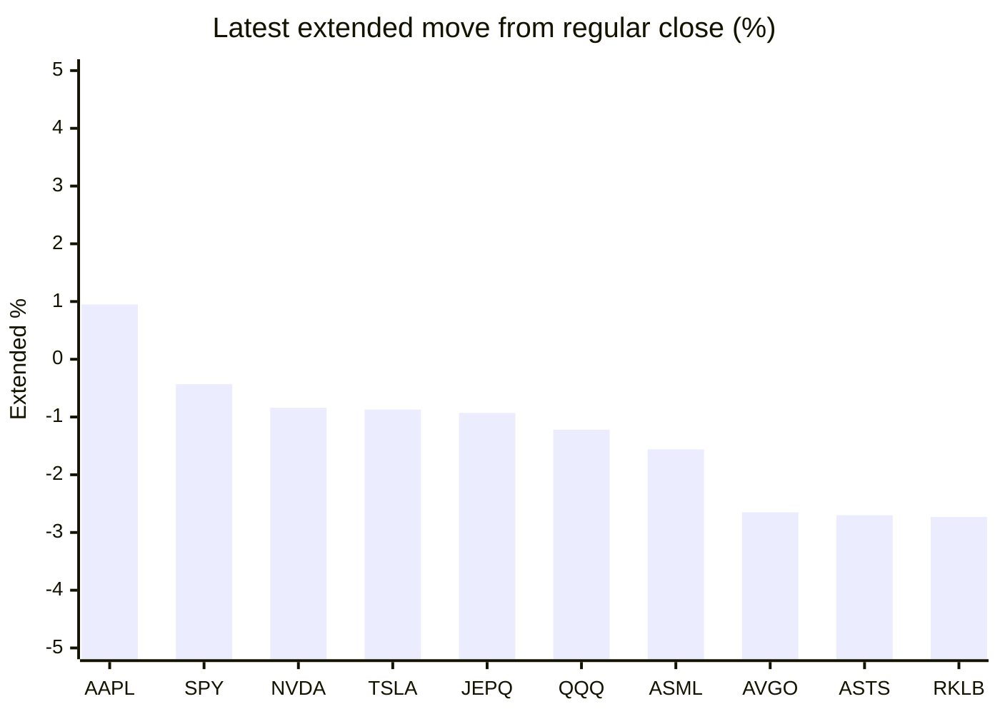

# Stock Brief - 2026-10-29

Generated at 2026-10-29 15:12 +07 from `watchlist.md`.
Prices are snapshots from Yahoo Finance public chart data. Extended/overnight is the latest available pre/post-market datapoint from the same feed.

## Market Snapshot

- SPY: close 772.31, latest extended 768.97, regular move +0.34%, extended move -0.43%
- QQQ: close 725.61, latest extended 716.75, regular move +0.60%, extended move -1.22%
- JEPQ: close 60.06, latest extended 59.50, regular move +0.60%, extended move -0.93%

## Watchlist Prices

| Ticker | Name | Regular close | Latest extended/overnight | Regular move | Extended move | Latest data time | Source |
|---|---|---:|---:|---:|---:|---|---|
| INTC | Intel Corporation | 95.53 USD | 91.99 USD | +1.91% | -3.71% | 2026-10-29 04:12 EDT | [Yahoo](https://finance.yahoo.com/quote/INTC/) |
| AVGO | Broadcom Inc. | 351.81 USD | 342.50 USD | +2.77% | -2.65% | 2026-10-29 04:12 EDT | [Yahoo](https://finance.yahoo.com/quote/AVGO/) |
| RKLB | Rocket Lab Corporation | 58.60 USD | 57.00 USD | +0.50% | -2.73% | 2026-10-29 04:12 EDT | [Yahoo](https://finance.yahoo.com/quote/RKLB/) |
| AAPL | Apple Inc. | 343.83 USD | 347.10 USD | -0.94% | +0.95% | 2026-10-29 04:10 EDT | [Yahoo](https://finance.yahoo.com/quote/AAPL/) |
| NVDA | NVIDIA Corporation | 215.38 USD | 213.57 USD | -1.17% | -0.84% | 2026-10-29 04:12 EDT | [Yahoo](https://finance.yahoo.com/quote/NVDA/) |
| TSLA | Tesla, Inc. | 404.22 USD | 400.71 USD | -0.80% | -0.87% | 2026-10-29 04:12 EDT | [Yahoo](https://finance.yahoo.com/quote/TSLA/) |
| SNDK | Sandisk Corporation | 1,404.77 USD | 1,352.00 USD | +7.66% | -3.76% | 2026-10-29 04:11 EDT | [Yahoo](https://finance.yahoo.com/quote/SNDK/) |
| QQQ | Invesco QQQ Trust, Series 1 | 725.61 USD | 716.75 USD | +0.60% | -1.22% | 2026-10-29 04:12 EDT | [Yahoo](https://finance.yahoo.com/quote/QQQ/) |
| SPY | State Street SPDR S&P 500 ETF T | 772.31 USD | 768.97 USD | +0.34% | -0.43% | 2026-10-29 04:12 EDT | [Yahoo](https://finance.yahoo.com/quote/SPY/) |
| JEPQ | JPMorgan Nasdaq Equity Premium  | 60.06 USD | 59.50 USD | +0.60% | -0.93% | 2026-10-29 04:11 EDT | [Yahoo](https://finance.yahoo.com/quote/JEPQ/) |
| ASTS | AST SpaceMobile, Inc. | 42.30 USD | 41.16 USD | +0.81% | -2.70% | 2026-10-29 04:11 EDT | [Yahoo](https://finance.yahoo.com/quote/ASTS/) |
| MU | Micron Technology, Inc. | 983.23 USD | 945.51 USD | +5.86% | -3.84% | 2026-10-29 04:12 EDT | [Yahoo](https://finance.yahoo.com/quote/MU/) |
| IREN | IREN LIMITED | 28.84 USD | 27.45 USD | +5.10% | -4.82% | 2026-10-29 04:12 EDT | [Yahoo](https://finance.yahoo.com/quote/IREN/) |
| EOSE | Eos Energy Enterprises, Inc. | 1.95 USD | 1.89 USD | +7.14% | -3.08% | 2026-10-29 04:12 EDT | [Yahoo](https://finance.yahoo.com/quote/EOSE/) |
| GOOG | Alphabet Inc. | 321.89 USD | 289.35 USD | +1.60% | -10.11% | 2026-10-29 04:12 EDT | [Yahoo](https://finance.yahoo.com/quote/GOOG/) |
| DRAM | Roundhill Memory ETF | 54.12 USD | 51.89 USD | +7.13% | -4.12% | 2026-10-29 04:12 EDT | [Yahoo](https://finance.yahoo.com/quote/DRAM/) |
| AMD | Advanced Micro Devices, Inc. | 578.44 USD | 559.92 USD | +3.24% | -3.20% | 2026-10-29 04:11 EDT | [Yahoo](https://finance.yahoo.com/quote/AMD/) |
| ASML | ASML Holding N.V. - New York Re | 1,662.85 USD | 1,636.95 USD | +1.67% | -1.56% | 2026-10-29 04:12 EDT | [Yahoo](https://finance.yahoo.com/quote/ASML/) |

## Charts

### Top Movers - Regular Session

### Extended / Overnight Move

### Quick Heatmap

| Group | Names in watchlist | Avg regular move | Avg extended move |
|---|---|---:|---:|
| Mega-cap tech | AVGO, AAPL, NVDA, TSLA, GOOG | +0.29% | -2.70% |
| Semis / memory | INTC, SNDK, MU, DRAM, AMD, ASML | +4.58% | -3.36% |
| Space / high beta | RKLB, ASTS, IREN, EOSE | +3.39% | -3.33% |
| ETFs | QQQ, SPY, JEPQ | +0.52% | -0.86% |

## News Headlines

- [Jensen Huang Foresees Booming AI Demand, but Elon Musk's Warning Highlights a Different Risk](https://www.fool.com/investing/2026/10/29/jensen-huang-sees-booming-ai-demand-but-elon-musks/?.tsrc=rss) (2026-10-29 14:33 Bangkok)
- [Amazon Could Buy Viasat As AST SpaceMobile Tries Rival Bid, Satellite Consultant Says: Musk-Bezos ‘Cage Fight’ Looms](https://stocktwits.com/news-articles/markets/equity/amazon-could-buy-viasat-as-ast-space-mobile-tries-rival-bid-satellite-consultant-says-musk-bezos-cage-fight-looms/cZUQgpHR9bO?.tsrc=rss) (2026-10-29 14:15 Bangkok)
- [INTC, AMD, AVGO, MU Decline On Samsung’s Profit Miss, Lighter Capex From Microsoft, Alphabet](https://stocktwits.com/news-articles/markets/equity/intc-amd-avgo-mu-decline-on-samsung-s-profit-miss-lighter-capex-from-microsoft-alphabet/cZUQgW3R9ba?.tsrc=rss) (2026-10-29 14:02 Bangkok)
- [Not Nvidia. Not AMD. This Is the Best Artificial Intelligence (AI) Stock to Buy in November](https://www.fool.com/investing/2026/10/29/not-nvidia-not-amd-this-is-the-best-artificial-intelligence-ai-stock-to-buy-in-november/?.tsrc=rss) (2026-10-29 13:35 Bangkok)
- [Intel Stock Enters Earnings With High Hopes From Analysts](https://finance.yahoo.com/m/ec43d90a-a22a-3227-8cfa-a34d4c621d05/intel-stock-enters-earnings.html?.tsrc=rss) (2026-10-29 13:00 Bangkok)
- [Tesla Is Flying in Europe, and We Aren't Talking About the Roadster -- 1 Big Concern Remains](https://www.fool.com/investing/2026/10/29/tesla-is-flying-in-europe-and-we-arent-talking-abo/?.tsrc=rss) (2026-10-29 12:50 Bangkok)
- [Broadcom And 2 More Quality Value Stocks To Watch](https://finance.yahoo.com/markets/stocks/articles/broadcom-2-more-quality-value-043350945.html?.tsrc=rss) (2026-10-29 11:33 Bangkok)
- [Nvidia Shareholders Have a Major Reason to Be Bullish After Jensen Huang's Latest Announcement](https://www.fool.com/investing/2026/10/29/nvidia-shareholders-have-a-major-reason-to-be-bull/?.tsrc=rss) (2026-10-29 11:20 Bangkok)

## Caveats

- This is not investment advice. Extended-hours prices can be thin and volatile.
- Yahoo public endpoints may lag official exchange data.
