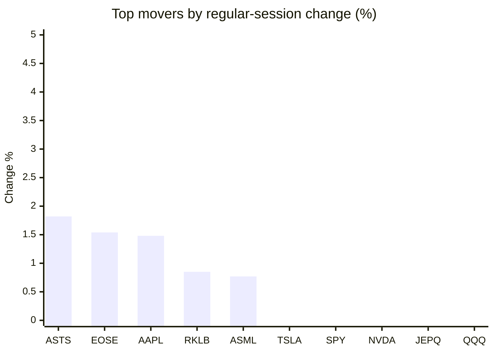
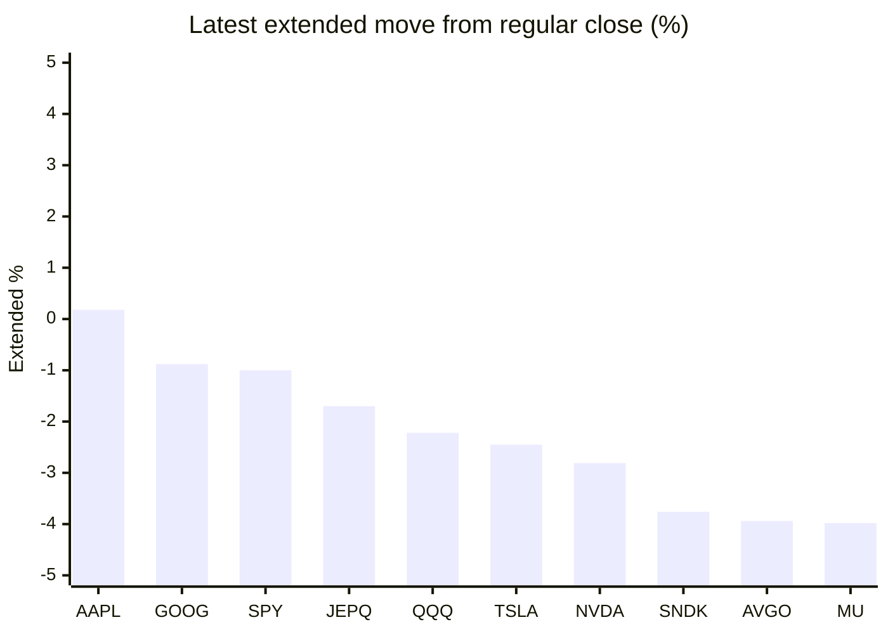

# Stock Brief - 2026-10-30

Generated at 2026-10-30 15:19 +07 from `watchlist.md`.
Prices are snapshots from Yahoo Finance public chart data. Extended/overnight is the latest available pre/post-market datapoint from the same feed.

## Market Snapshot

- SPY: close 769.36, latest extended 761.70, regular move -0.38%, extended move -1.00%
- QQQ: close 715.34, latest extended 699.47, regular move -1.42%, extended move -2.22%
- JEPQ: close 59.38, latest extended 58.37, regular move -1.13%, extended move -1.70%

## Watchlist Prices

| Ticker | Name | Regular close | Latest extended/overnight | Regular move | Extended move | Latest data time | Source |
|---|---|---:|---:|---:|---:|---|---|
| INTC | Intel Corporation | 92.07 USD | 69.05 USD | -3.62% | -25.00% | 2026-10-30 04:19 EDT | [Yahoo](https://finance.yahoo.com/quote/INTC/) |
| AVGO | Broadcom Inc. | 345.00 USD | 331.42 USD | -1.94% | -3.94% | 2026-10-30 04:17 EDT | [Yahoo](https://finance.yahoo.com/quote/AVGO/) |
| RKLB | Rocket Lab Corporation | 59.10 USD | 55.78 USD | +0.85% | -5.61% | 2026-10-30 04:18 EDT | [Yahoo](https://finance.yahoo.com/quote/RKLB/) |
| AAPL | Apple Inc. | 348.91 USD | 349.53 USD | +1.48% | +0.18% | 2026-10-30 04:19 EDT | [Yahoo](https://finance.yahoo.com/quote/AAPL/) |
| NVDA | NVIDIA Corporation | 213.66 USD | 207.65 USD | -0.80% | -2.81% | 2026-10-30 04:19 EDT | [Yahoo](https://finance.yahoo.com/quote/NVDA/) |
| TSLA | Tesla, Inc. | 403.30 USD | 393.40 USD | -0.23% | -2.45% | 2026-10-30 04:18 EDT | [Yahoo](https://finance.yahoo.com/quote/TSLA/) |
| SNDK | Sandisk Corporation | 1,330.05 USD | 1,280.00 USD | -5.32% | -3.76% | 2026-10-30 04:19 EDT | [Yahoo](https://finance.yahoo.com/quote/SNDK/) |
| QQQ | Invesco QQQ Trust, Series 1 | 715.34 USD | 699.47 USD | -1.42% | -2.22% | 2026-10-30 04:19 EDT | [Yahoo](https://finance.yahoo.com/quote/QQQ/) |
| SPY | State Street SPDR S&P 500 ETF T | 769.36 USD | 761.70 USD | -0.38% | -1.00% | 2026-10-30 04:19 EDT | [Yahoo](https://finance.yahoo.com/quote/SPY/) |
| JEPQ | JPMorgan Nasdaq Equity Premium  | 59.38 USD | 58.37 USD | -1.13% | -1.70% | 2026-10-30 04:18 EDT | [Yahoo](https://finance.yahoo.com/quote/JEPQ/) |
| ASTS | AST SpaceMobile, Inc. | 43.07 USD | 40.97 USD | +1.82% | -4.88% | 2026-10-30 04:19 EDT | [Yahoo](https://finance.yahoo.com/quote/ASTS/) |
| MU | Micron Technology, Inc. | 934.27 USD | 897.10 USD | -4.98% | -3.98% | 2026-10-30 04:19 EDT | [Yahoo](https://finance.yahoo.com/quote/MU/) |
| IREN | IREN LIMITED | 26.25 USD | 24.75 USD | -8.98% | -5.71% | 2026-10-30 04:18 EDT | [Yahoo](https://finance.yahoo.com/quote/IREN/) |
| EOSE | Eos Energy Enterprises, Inc. | 1.98 USD | 1.90 USD | +1.54% | -4.04% | 2026-10-30 04:16 EDT | [Yahoo](https://finance.yahoo.com/quote/EOSE/) |
| GOOG | Alphabet Inc. | 282.32 USD | 279.83 USD | -12.29% | -0.88% | 2026-10-30 04:18 EDT | [Yahoo](https://finance.yahoo.com/quote/GOOG/) |
| DRAM | Roundhill Memory ETF | 51.75 USD | 49.48 USD | -4.38% | -4.40% | 2026-10-30 04:18 EDT | [Yahoo](https://finance.yahoo.com/quote/DRAM/) |
| AMD | Advanced Micro Devices, Inc. | 566.42 USD | 526.60 USD | -2.08% | -7.03% | 2026-10-30 04:18 EDT | [Yahoo](https://finance.yahoo.com/quote/AMD/) |
| ASML | ASML Holding N.V. - New York Re | 1,675.70 USD | 1,600.25 USD | +0.77% | -4.50% | 2026-10-30 04:19 EDT | [Yahoo](https://finance.yahoo.com/quote/ASML/) |

## Charts

### Top Movers - Regular Session

### Extended / Overnight Move

### Quick Heatmap

| Group | Names in watchlist | Avg regular move | Avg extended move |
|---|---|---:|---:|
| Mega-cap tech | AVGO, AAPL, NVDA, TSLA, GOOG | -2.76% | -1.98% |
| Semis / memory | INTC, SNDK, MU, DRAM, AMD, ASML | -3.27% | -8.11% |
| Space / high beta | RKLB, ASTS, IREN, EOSE | -1.19% | -5.06% |
| ETFs | QQQ, SPY, JEPQ | -0.98% | -1.64% |

## News Headlines

- [Could Apple's First Touchscreen MacBook Pro, First Foldable iPhone Duo Phone, and HomeView Pole Vault Apple Beyond Nvidia to Become the First Company in the $10 Trillion Club?](https://www.fool.com/investing/2026/10/30/could-apples-first-touchscreen-macbook-pro-first-f/?.tsrc=rss) (2026-10-30 15:10 Bangkok)
- [Stocktwits AI Roundup: Intel, Amazon, Alphabet Results Trigger Meltdown As Big Tech’s Record Spending Returns To Focus](https://stocktwits.com/news-articles/markets/equity/stocktwits-ai-roundup-intel-amazon-alphabet-results-trigger-meltdown-as-big-tech-s-record-spending-returns-to-focus/cZUhVBWR9T2?.tsrc=rss) (2026-10-30 15:07 Bangkok)
- [NVDA Stock Drops: Nvidia May Back Data Center Loan For Its Own Customer, Analyst Sees Little Impact From Intel’s Weak Report](https://stocktwits.com/news-articles/markets/equity/nvda-stock-drops-nvidia-may-back-data-center-loan-its-own-customer-analyst-sees-little-impact-from-intel-s-weak-report/cZUhZT0R9RC?.tsrc=rss) (2026-10-30 14:22 Bangkok)
- [Learn Why The Bull Case For Micron Stock Could Change Following Memory Shortage Warning](https://finance.yahoo.com/markets/stocks/articles/learn-why-bull-case-micron-071618157.html?.tsrc=rss) (2026-10-30 14:16 Bangkok)
- [The Case Against a SpaceX and Tesla Merger](https://www.fool.com/investing/2026/10/30/the-case-against-a-spacex-and-tesla-merger/?.tsrc=rss) (2026-10-30 13:50 Bangkok)
- [Stocktwits Passport Portfolio: SPY, DIA Edge Higher In October, Beating QQQ And Asian Stocks Amid Tech Volatility](https://stocktwits.com/news-articles/markets/equity/stocktwits-passport-portfolio-spy-dia-edge-higher-in-october-beating-qqq-and-asian-stocks-amid-tech-volatility/cZUhk6SR9Ry?.tsrc=rss) (2026-10-30 13:43 Bangkok)
- [Nov. 2 Could Be a Big Day for Apple Stock](https://www.fool.com/investing/2026/10/30/nov-2-could-be-a-big-day-for-apple-stock/?.tsrc=rss) (2026-10-30 13:30 Bangkok)
- [Stocktwits Space Race Monthly: SPCX Holds Up Better Than ASTS, RKLB And PL In October — But VSAT Takes The Crown](https://stocktwits.com/news-articles/markets/equity/stocktwits-space-race-monthly-spcx-asts-rklb-pl-october-vsat-crown/cZUhSakR9RM?.tsrc=rss) (2026-10-30 12:39 Bangkok)

## Caveats

- This is not investment advice. Extended-hours prices can be thin and volatile.
- Yahoo public endpoints may lag official exchange data.
