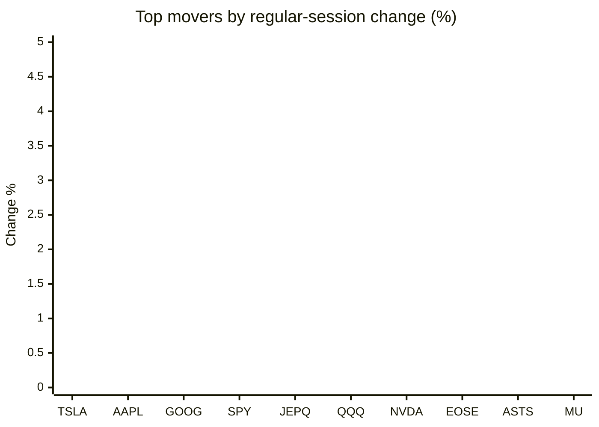
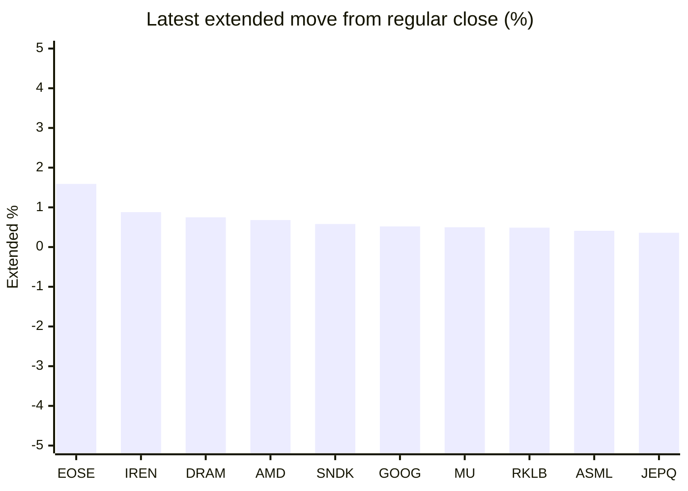

# Stock Brief - 2026-10-31

Generated at 2026-10-31 15:09 +07 from `watchlist.md`.
Prices are snapshots from Yahoo Finance public chart data. Extended/overnight is the latest available pre/post-market datapoint from the same feed.

## Market Snapshot

- SPY: close 755.72, latest extended 757.12, regular move -1.77%, extended move +0.19%
- QQQ: close 690.49, latest extended 692.74, regular move -3.47%, extended move +0.33%
- JEPQ: close 57.58, latest extended 57.79, regular move -3.03%, extended move +0.36%

## Watchlist Prices

| Ticker | Name | Regular close | Latest extended/overnight | Regular move | Extended move | Latest data time | Source |
|---|---|---:|---:|---:|---:|---|---|
| INTC | Intel Corporation | 65.76 USD | 64.89 USD | -28.58% | -1.32% | 2026-10-30 19:59 EDT | [Yahoo](https://finance.yahoo.com/quote/INTC/) |
| AVGO | Broadcom Inc. | 326.08 USD | 327.13 USD | -5.48% | +0.32% | 2026-10-30 19:59 EDT | [Yahoo](https://finance.yahoo.com/quote/AVGO/) |
| RKLB | Rocket Lab Corporation | 54.73 USD | 55.00 USD | -7.39% | +0.49% | 2026-10-30 19:59 EDT | [Yahoo](https://finance.yahoo.com/quote/RKLB/) |
| AAPL | Apple Inc. | 344.63 USD | 345.10 USD | -1.23% | +0.14% | 2026-10-30 19:59 EDT | [Yahoo](https://finance.yahoo.com/quote/AAPL/) |
| NVDA | NVIDIA Corporation | 204.64 USD | 205.25 USD | -4.22% | +0.30% | 2026-10-30 19:59 EDT | [Yahoo](https://finance.yahoo.com/quote/NVDA/) |
| TSLA | Tesla, Inc. | 399.81 USD | 400.22 USD | -0.87% | +0.10% | 2026-10-30 19:59 EDT | [Yahoo](https://finance.yahoo.com/quote/TSLA/) |
| SNDK | Sandisk Corporation | 1,150.89 USD | 1,157.58 USD | -13.47% | +0.58% | 2026-10-30 19:59 EDT | [Yahoo](https://finance.yahoo.com/quote/SNDK/) |
| QQQ | Invesco QQQ Trust, Series 1 | 690.49 USD | 692.74 USD | -3.47% | +0.33% | 2026-10-30 19:59 EDT | [Yahoo](https://finance.yahoo.com/quote/QQQ/) |
| SPY | State Street SPDR S&P 500 ETF T | 755.72 USD | 757.12 USD | -1.77% | +0.19% | 2026-10-30 19:59 EDT | [Yahoo](https://finance.yahoo.com/quote/SPY/) |
| JEPQ | JPMorgan Nasdaq Equity Premium  | 57.58 USD | 57.79 USD | -3.03% | +0.36% | 2026-10-30 19:59 EDT | [Yahoo](https://finance.yahoo.com/quote/JEPQ/) |
| ASTS | AST SpaceMobile, Inc. | 40.97 USD | 40.97 USD | -4.88% | -0.01% | 2026-10-30 19:57 EDT | [Yahoo](https://finance.yahoo.com/quote/ASTS/) |
| MU | Micron Technology, Inc. | 884.74 USD | 889.20 USD | -5.30% | +0.50% | 2026-10-30 19:59 EDT | [Yahoo](https://finance.yahoo.com/quote/MU/) |
| IREN | IREN LIMITED | 23.95 USD | 24.16 USD | -8.76% | +0.88% | 2026-10-30 19:59 EDT | [Yahoo](https://finance.yahoo.com/quote/IREN/) |
| EOSE | Eos Energy Enterprises, Inc. | 1.89 USD | 1.92 USD | -4.55% | +1.59% | 2026-10-30 19:59 EDT | [Yahoo](https://finance.yahoo.com/quote/EOSE/) |
| GOOG | Alphabet Inc. | 278.22 USD | 279.68 USD | -1.45% | +0.52% | 2026-10-30 19:59 EDT | [Yahoo](https://finance.yahoo.com/quote/GOOG/) |
| DRAM | Roundhill Memory ETF | 48.01 USD | 48.37 USD | -7.23% | +0.75% | 2026-10-30 19:59 EDT | [Yahoo](https://finance.yahoo.com/quote/DRAM/) |
| AMD | Advanced Micro Devices, Inc. | 504.80 USD | 508.22 USD | -10.88% | +0.68% | 2026-10-30 19:59 EDT | [Yahoo](https://finance.yahoo.com/quote/AMD/) |
| ASML | ASML Holding N.V. - New York Re | 1,565.90 USD | 1,572.39 USD | -6.55% | +0.41% | 2026-10-30 19:59 EDT | [Yahoo](https://finance.yahoo.com/quote/ASML/) |

## Charts

### Top Movers - Regular Session

### Extended / Overnight Move

### Quick Heatmap

| Group | Names in watchlist | Avg regular move | Avg extended move |
|---|---|---:|---:|
| Mega-cap tech | AVGO, AAPL, NVDA, TSLA, GOOG | -2.65% | +0.28% |
| Semis / memory | INTC, SNDK, MU, DRAM, AMD, ASML | -12.00% | +0.27% |
| Space / high beta | RKLB, ASTS, IREN, EOSE | -6.39% | +0.74% |
| ETFs | QQQ, SPY, JEPQ | -2.76% | +0.29% |

## News Headlines

- [Coherent Stock Fell 11% as Intel and Amazon Earnings Hit AI Hardware Stocks. Here’s Where the Stock Could Go](https://www.tikr.com/blog/coherent-stock-fell-11-as-intel-and-amazon-earnings-hit-ai-hardware-stocks-heres-where-the-stock-could-go?ref=yahoofinance&tlnk=yf-261031-x7rv5fc9&.tsrc=rss) (2026-10-31 14:15 Bangkok)
- [Apple’s Biggest Threat Isn’t Android — It’s AAPL's Own Devices, Analyst Says Ahead Of Q4 Earnings](https://stocktwits.com/news-articles/markets/equity/apple-biggest-threat-not-android-but-own-devices-aapl-q4-earnings-preview/cZUKsGYR9c1?.tsrc=rss) (2026-10-31 14:15 Bangkok)
- [Nvidia Drew DOJ Questions and Weighed Backing Debt for an Anthropic Data Center in One Week. Here’s Why Its Cash Flow Matters More](https://www.tikr.com/blog/nvidia-drew-doj-questions-and-weighed-backing-debt-for-an-anthropic-data-center-in-one-week-heres-why-its-cash-flow-matters-more?ref=yahoofinance&tlnk=yf-261031-mwmwxhm6&.tsrc=rss) (2026-10-31 14:12 Bangkok)
- [A SpaceX and Tesla Merger Will Only Be Successful If This One Thing Happens](https://www.fool.com/investing/2026/10/31/a-spacex-and-tesla-merger-will-only-be-successful/?.tsrc=rss) (2026-10-31 13:50 Bangkok)
- [Qualcomm Stock Fell 11% in a Day on Intel’s PC Warning. Here’s Why November 4 Tests Its Claim That Phones Have Bottomed](https://www.tikr.com/blog/qualcomm-stock-fell-11-in-a-day-on-intels-pc-warning-heres-why-november-4-tests-its-claim-that-phones-have-bottomed?ref=yahoofinance&tlnk=yf-261031-m53x98r9&.tsrc=rss) (2026-10-31 13:44 Bangkok)
- [AMD Stock Fell 11% in a Day Ahead of Its November 3 Report. Here’s Why Intel’s 78% Data Center Jump Matters More to AMD Than Its PC Warning](https://www.tikr.com/blog/amd-stock-fell-11-in-a-day-ahead-of-its-november-3-report-heres-why-intels-78-data-center-jump-matters-more-to-amd-than-its-pc-warning?ref=yahoofinance&tlnk=yf-261031-43g8j33g&.tsrc=rss) (2026-10-31 13:39 Bangkok)
- [Prediction: 2 Under $1 Trillion Stocks That Will Be Worth More Than Micron 5 Years From Now](https://www.fool.com/investing/2026/10/31/prediction-2-under-1-trillion-stocks-that-will-be/?.tsrc=rss) (2026-10-31 13:20 Bangkok)
- [Vanguard's Tech ETF Is About 10% Below Its Record. History Says What Usually Comes Next.](https://www.fool.com/investing/2026/10/30/vanguard-s-tech-etf-is-about-10-below-its-record-history-says-what-usually-comes-next/?.tsrc=rss) (2026-10-31 10:46 Bangkok)

## Caveats

- This is not investment advice. Extended-hours prices can be thin and volatile.
- Yahoo public endpoints may lag official exchange data.
