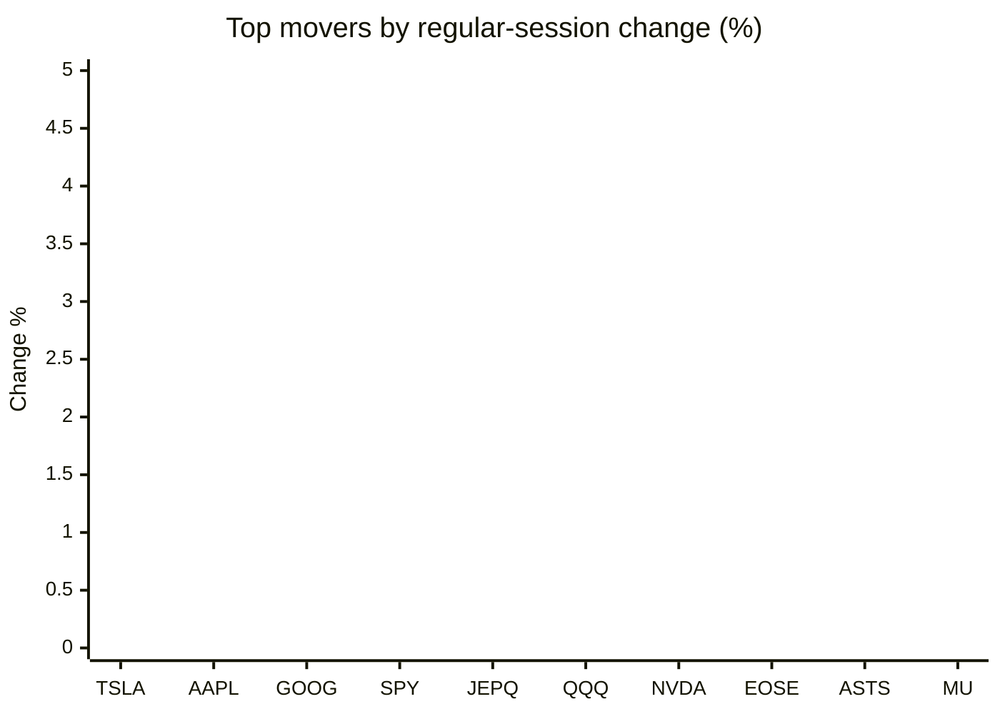
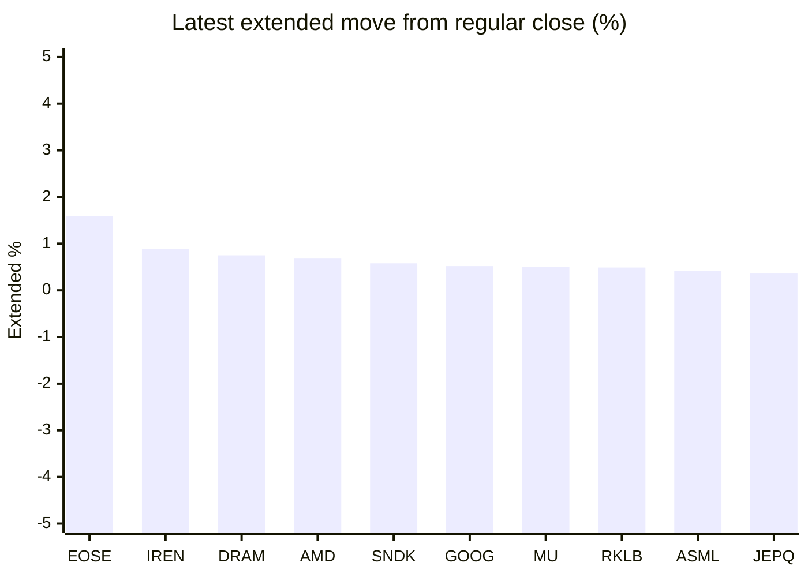

# Stock Brief - 2026-11-01

Generated at 2026-11-01 15:54 +07 from `watchlist.md`.
Prices are snapshots from Yahoo Finance public chart data. Extended/overnight is the latest available pre/post-market datapoint from the same feed.

## Market Snapshot

- SPY: close 755.72, latest extended 757.12, regular move -1.77%, extended move +0.19%
- QQQ: close 690.49, latest extended 692.74, regular move -3.47%, extended move +0.33%
- JEPQ: close 57.58, latest extended 57.79, regular move -3.03%, extended move +0.36%

## Watchlist Prices

| Ticker | Name | Regular close | Latest extended/overnight | Regular move | Extended move | Latest data time | Source |
|---|---|---:|---:|---:|---:|---|---|
| INTC | Intel Corporation | 65.76 USD | 64.89 USD | -28.58% | -1.32% | 2026-10-30 19:59 EDT | [Yahoo](https://finance.yahoo.com/quote/INTC/) |
| AVGO | Broadcom Inc. | 326.08 USD | 327.13 USD | -5.48% | +0.32% | 2026-10-30 19:59 EDT | [Yahoo](https://finance.yahoo.com/quote/AVGO/) |
| RKLB | Rocket Lab Corporation | 54.73 USD | 55.00 USD | -7.39% | +0.49% | 2026-10-30 19:59 EDT | [Yahoo](https://finance.yahoo.com/quote/RKLB/) |
| AAPL | Apple Inc. | 344.63 USD | 345.10 USD | -1.23% | +0.14% | 2026-10-30 19:59 EDT | [Yahoo](https://finance.yahoo.com/quote/AAPL/) |
| NVDA | NVIDIA Corporation | 204.64 USD | 205.25 USD | -4.22% | +0.30% | 2026-10-30 19:59 EDT | [Yahoo](https://finance.yahoo.com/quote/NVDA/) |
| TSLA | Tesla, Inc. | 399.81 USD | 400.22 USD | -0.87% | +0.10% | 2026-10-30 19:59 EDT | [Yahoo](https://finance.yahoo.com/quote/TSLA/) |
| SNDK | Sandisk Corporation | 1,150.89 USD | 1,157.58 USD | -13.47% | +0.58% | 2026-10-30 19:59 EDT | [Yahoo](https://finance.yahoo.com/quote/SNDK/) |
| QQQ | Invesco QQQ Trust, Series 1 | 690.49 USD | 692.74 USD | -3.47% | +0.33% | 2026-10-30 19:59 EDT | [Yahoo](https://finance.yahoo.com/quote/QQQ/) |
| SPY | State Street SPDR S&P 500 ETF T | 755.72 USD | 757.12 USD | -1.77% | +0.19% | 2026-10-30 19:59 EDT | [Yahoo](https://finance.yahoo.com/quote/SPY/) |
| JEPQ | JPMorgan Nasdaq Equity Premium  | 57.58 USD | 57.79 USD | -3.03% | +0.36% | 2026-10-30 19:59 EDT | [Yahoo](https://finance.yahoo.com/quote/JEPQ/) |
| ASTS | AST SpaceMobile, Inc. | 40.97 USD | 40.97 USD | -4.88% | -0.01% | 2026-10-30 19:57 EDT | [Yahoo](https://finance.yahoo.com/quote/ASTS/) |
| MU | Micron Technology, Inc. | 884.74 USD | 889.20 USD | -5.30% | +0.50% | 2026-10-30 19:59 EDT | [Yahoo](https://finance.yahoo.com/quote/MU/) |
| IREN | IREN LIMITED | 23.95 USD | 24.16 USD | -8.76% | +0.88% | 2026-10-30 19:59 EDT | [Yahoo](https://finance.yahoo.com/quote/IREN/) |
| EOSE | Eos Energy Enterprises, Inc. | 1.89 USD | 1.92 USD | -4.55% | +1.59% | 2026-10-30 19:59 EDT | [Yahoo](https://finance.yahoo.com/quote/EOSE/) |
| GOOG | Alphabet Inc. | 278.22 USD | 279.68 USD | -1.45% | +0.52% | 2026-10-30 19:59 EDT | [Yahoo](https://finance.yahoo.com/quote/GOOG/) |
| DRAM | Roundhill Memory ETF | 48.01 USD | 48.37 USD | -7.23% | +0.75% | 2026-10-30 19:59 EDT | [Yahoo](https://finance.yahoo.com/quote/DRAM/) |
| AMD | Advanced Micro Devices, Inc. | 504.80 USD | 508.22 USD | -10.88% | +0.68% | 2026-10-30 19:59 EDT | [Yahoo](https://finance.yahoo.com/quote/AMD/) |
| ASML | ASML Holding N.V. - New York Re | 1,565.90 USD | 1,572.39 USD | -6.55% | +0.41% | 2026-10-30 19:59 EDT | [Yahoo](https://finance.yahoo.com/quote/ASML/) |

## Charts

### Top Movers - Regular Session

### Extended / Overnight Move

### Quick Heatmap

| Group | Names in watchlist | Avg regular move | Avg extended move |
|---|---|---:|---:|
| Mega-cap tech | AVGO, AAPL, NVDA, TSLA, GOOG | -2.65% | +0.28% |
| Semis / memory | INTC, SNDK, MU, DRAM, AMD, ASML | -12.00% | +0.27% |
| Space / high beta | RKLB, ASTS, IREN, EOSE | -6.39% | +0.74% |
| ETFs | QQQ, SPY, JEPQ | -2.76% | +0.29% |

## News Headlines

- [Apple CEO John Ternus Says ‘I Really Like Where We're At’ in AI Race: Won't ‘Ship AI for AI's Sake’](https://finance.yahoo.com/technology/ai/articles/apple-ceo-john-ternus-says-073247018.html?.tsrc=rss) (2026-11-01 14:32 Bangkok)
- [Cybercab Expansion Might Change The Case For Investing In Tesla Stock (TSLA)](https://finance.yahoo.com/markets/stocks/articles/cybercab-expansion-might-change-case-051614061.html?.tsrc=rss) (2026-11-01 12:16 Bangkok)
- [Micron's Chinese Rival CXMT Just Grew Its Sales More Than Sevenfold. I'd Buy Micron Stock Now.](https://www.fool.com/investing/2026/10/31/micron-s-chinese-rival-cxmt-just-grew-its-sales-more-than-sevenfold-i-d-buy-micron-stock-now/?.tsrc=rss) (2026-11-01 10:33 Bangkok)
- [Dow Jones Futures Loom After Stock Market Sell-Off; Apple, Palantir, Midterm Elections In Focus](https://finance.yahoo.com/m/d0bc23d0-115b-314d-8989-07ca797bebfa/dow-jones-futures-loom-after.html?.tsrc=rss) (2026-11-01 09:44 Bangkok)
- [Prediction: This Will Be Intel's Stock Price by Year-End 2027](https://www.fool.com/investing/2026/10/31/prediction-this-will-be-intels-stock-price-by-year/?.tsrc=rss) (2026-11-01 09:20 Bangkok)
- [J.P. Morgan Just Made a Bold Prediction About Bitcoin. Should You Buy It?](https://www.fool.com/investing/2026/10/31/jp-morgan-just-made-a-bold-prediction-about-bitcoi/?.tsrc=rss) (2026-11-01 08:20 Bangkok)
- [Sandisk (SNDK) Stock Sees Modest Fair Value Cut As Analysts Weigh AI Demand](https://finance.yahoo.com/markets/stocks/articles/sandisk-sndk-stock-sees-modest-010947017.html?.tsrc=rss) (2026-11-01 08:09 Bangkok)
- [Tesla's Cybercab Reaches Dallas in November, and Nevada Just Cleared 5,000 Robotaxis in Las Vegas. Here's the Number That Makes the Bulls Right.](https://www.fool.com/investing/2026/10/31/teslas-cybercab-reaches-dallas-in-november-and-nev/?.tsrc=rss) (2026-11-01 08:05 Bangkok)

## Caveats

- This is not investment advice. Extended-hours prices can be thin and volatile.
- Yahoo public endpoints may lag official exchange data.
