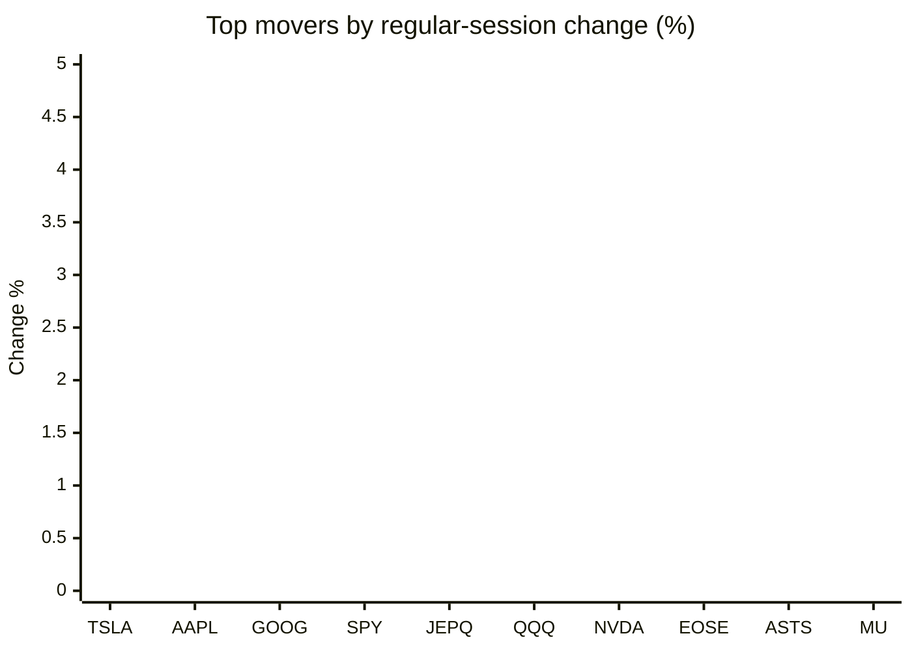
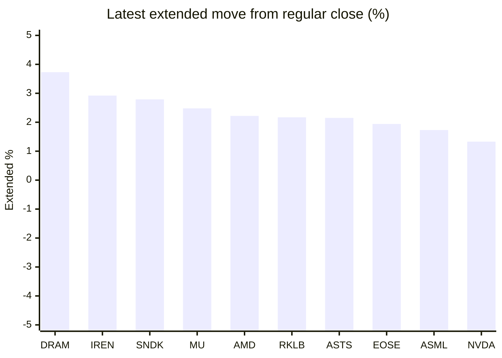

# Stock Brief - 2026-11-02

Generated at 2026-11-02 16:03 +07 from `watchlist.md`.
Prices are snapshots from Yahoo Finance public chart data. Extended/overnight is the latest available pre/post-market datapoint from the same feed.

## Market Snapshot

- SPY: close 755.72, latest extended 758.62, regular move -1.77%, extended move +0.38%
- QQQ: close 690.49, latest extended 695.85, regular move -3.47%, extended move +0.78%
- JEPQ: close 57.58, latest extended 57.55, regular move -3.03%, extended move -0.05%

## Watchlist Prices

| Ticker | Name | Regular close | Latest extended/overnight | Regular move | Extended move | Latest data time | Source |
|---|---|---:|---:|---:|---:|---|---|
| INTC | Intel Corporation | 65.76 USD | 66.52 USD | -28.58% | +1.15% | 2026-11-02 04:03 EST | [Yahoo](https://finance.yahoo.com/quote/INTC/) |
| AVGO | Broadcom Inc. | 326.08 USD | 330.00 USD | -5.48% | +1.20% | 2026-11-02 04:02 EST | [Yahoo](https://finance.yahoo.com/quote/AVGO/) |
| RKLB | Rocket Lab Corporation | 54.73 USD | 55.92 USD | -7.39% | +2.17% | 2026-11-02 04:02 EST | [Yahoo](https://finance.yahoo.com/quote/RKLB/) |
| AAPL | Apple Inc. | 344.63 USD | 343.42 USD | -1.23% | -0.35% | 2026-11-02 04:03 EST | [Yahoo](https://finance.yahoo.com/quote/AAPL/) |
| NVDA | NVIDIA Corporation | 204.64 USD | 207.36 USD | -4.22% | +1.33% | 2026-11-02 04:03 EST | [Yahoo](https://finance.yahoo.com/quote/NVDA/) |
| TSLA | Tesla, Inc. | 399.81 USD | 401.31 USD | -0.87% | +0.38% | 2026-11-02 04:03 EST | [Yahoo](https://finance.yahoo.com/quote/TSLA/) |
| SNDK | Sandisk Corporation | 1,150.89 USD | 1,183.00 USD | -13.47% | +2.79% | 2026-11-02 04:03 EST | [Yahoo](https://finance.yahoo.com/quote/SNDK/) |
| QQQ | Invesco QQQ Trust, Series 1 | 690.49 USD | 695.85 USD | -3.47% | +0.78% | 2026-11-02 04:03 EST | [Yahoo](https://finance.yahoo.com/quote/QQQ/) |
| SPY | State Street SPDR S&P 500 ETF T | 755.72 USD | 758.62 USD | -1.77% | +0.38% | 2026-11-02 04:03 EST | [Yahoo](https://finance.yahoo.com/quote/SPY/) |
| JEPQ | JPMorgan Nasdaq Equity Premium  | 57.58 USD | 57.55 USD | -3.03% | -0.05% | 2026-11-02 04:01 EST | [Yahoo](https://finance.yahoo.com/quote/JEPQ/) |
| ASTS | AST SpaceMobile, Inc. | 40.97 USD | 41.85 USD | -4.88% | +2.15% | 2026-11-02 04:01 EST | [Yahoo](https://finance.yahoo.com/quote/ASTS/) |
| MU | Micron Technology, Inc. | 884.74 USD | 906.70 USD | -5.30% | +2.48% | 2026-11-02 04:03 EST | [Yahoo](https://finance.yahoo.com/quote/MU/) |
| IREN | IREN LIMITED | 23.95 USD | 24.65 USD | -8.76% | +2.92% | 2026-11-02 04:03 EST | [Yahoo](https://finance.yahoo.com/quote/IREN/) |
| EOSE | Eos Energy Enterprises, Inc. | 1.89 USD | 1.93 USD | -4.55% | +1.94% | 2026-11-02 04:02 EST | [Yahoo](https://finance.yahoo.com/quote/EOSE/) |
| GOOG | Alphabet Inc. | 278.22 USD | 281.30 USD | -1.45% | +1.11% | 2026-11-02 04:03 EST | [Yahoo](https://finance.yahoo.com/quote/GOOG/) |
| DRAM | Roundhill Memory ETF | 48.01 USD | 49.80 USD | -7.23% | +3.73% | 2026-11-02 04:02 EST | [Yahoo](https://finance.yahoo.com/quote/DRAM/) |
| AMD | Advanced Micro Devices, Inc. | 504.80 USD | 516.00 USD | -10.88% | +2.22% | 2026-11-02 04:03 EST | [Yahoo](https://finance.yahoo.com/quote/AMD/) |
| ASML | ASML Holding N.V. - New York Re | 1,565.90 USD | 1,592.94 USD | -6.55% | +1.73% | 2026-11-02 04:03 EST | [Yahoo](https://finance.yahoo.com/quote/ASML/) |

## Charts

### Top Movers - Regular Session

### Extended / Overnight Move

### Quick Heatmap

| Group | Names in watchlist | Avg regular move | Avg extended move |
|---|---|---:|---:|
| Mega-cap tech | AVGO, AAPL, NVDA, TSLA, GOOG | -2.65% | +0.73% |
| Semis / memory | INTC, SNDK, MU, DRAM, AMD, ASML | -12.00% | +2.35% |
| Space / high beta | RKLB, ASTS, IREN, EOSE | -6.39% | +2.30% |
| ETFs | QQQ, SPY, JEPQ | -2.76% | +0.37% |

## News Headlines

- [Your stock portfolio increasingly hinges on the bond market — and the midterm elections](https://www.marketwatch.com/story/your-stock-portfolio-increasingly-hinges-on-the-bond-market-and-the-midterm-elections-dc1abadb?.tsrc=rss) (2026-11-02 15:56 Bangkok)
- [Apple And Palantir To Kick Off Tech Earnings In Another Crucial Week, AMD To Settle Chip Debate After Intel’s Warning](https://stocktwits.com/news-articles/markets/equity/apple-and-palantir-to-kick-off-tech-earnings-in-another-crucial-week-amd-to-settle-chip-debate-after-intel-s-warning/cNG9qNVR92s?.tsrc=rss) (2026-11-02 15:40 Bangkok)
- [Prediction: Nvidia Will Have an Incredible November Thanks to 1 Event](https://www.fool.com/investing/2026/11/02/prediction-nvidia-will-have-an-incredible-november/?.tsrc=rss) (2026-11-02 15:20 Bangkok)
- [SpaceX Could Mirror Nvidia’s Revenue Boom, Sequoia Partner Says — Tesla Influencer Runs Hypothetical Merger Math](https://stocktwits.com/news-articles/markets/equity/spacex-mirror-nvidia-revenue-boom-sequoia-partner-tesla-influencer-merger-math/cNG9YeiR92p?.tsrc=rss) (2026-11-02 14:48 Bangkok)
- [Apple Q4 Earnings: Holiday Sales Outlook, iPhone Duo Demand And Memory Costs Take Center Stage In First Report Under New CEO](https://stocktwits.com/news-articles/markets/equity/apple-q4-earnings-holiday-sales-outlook-i-phone-duo-demand-and-memory-costs-take-center-stage-in-first-report-under-new-ceo/cNG9Y35R92Y?.tsrc=rss) (2026-11-02 14:45 Bangkok)
- [Why Is Intel Stock Falling?](https://www.trefis.com/stock/intc/articles/621871/why-is-intel-stock-falling/2026-11-02?.tsrc=rss) (2026-11-02 14:04 Bangkok)
- [Stock Market: Will S&P 500 Open Up or Down Today?](https://www.benzinga.com/markets/prediction-markets/26/11/62767926/stock-market-will-sp-500-open-up-or-down-today-70?utm_source=yahooFinance&utm_campaign=partner_feed&utm_medium=referral&.tsrc=rss) (2026-11-02 12:47 Bangkok)
- [Tesla-SpaceX merger math just shifted in Tesla's favor](https://www.thestreet.com/markets/tesla-spacex-merger-math-just-shifted-in-teslas-favor?.tsrc=rss) (2026-11-02 12:37 Bangkok)

## Caveats

- This is not investment advice. Extended-hours prices can be thin and volatile.
- Yahoo public endpoints may lag official exchange data.
