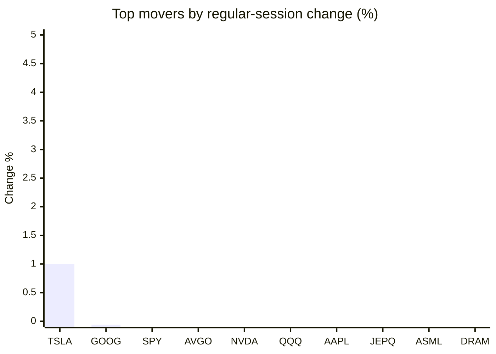
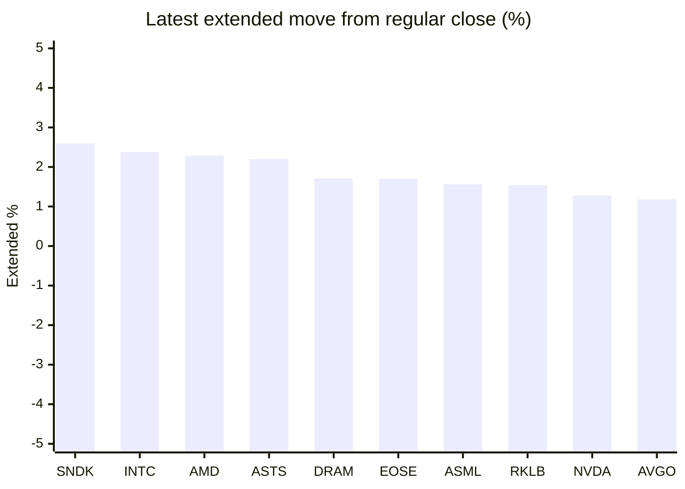

# Stock Brief - 2026-11-03

Generated at 2026-11-03 16:12 +07 from `watchlist.md`.
Prices are snapshots from Yahoo Finance public chart data. Extended/overnight is the latest available pre/post-market datapoint from the same feed.

## Market Snapshot

- SPY: close 752.10, latest extended 750.69, regular move -0.48%, extended move -0.19%
- QQQ: close 681.09, latest extended 682.52, regular move -1.36%, extended move +0.21%
- JEPQ: close 56.24, latest extended 56.33, regular move -2.33%, extended move +0.15%

## Watchlist Prices

| Ticker | Name | Regular close | Latest extended/overnight | Regular move | Extended move | Latest data time | Source |
|---|---|---:|---:|---:|---:|---|---|
| INTC | Intel Corporation | 59.97 USD | 61.40 USD | -8.80% | +2.38% | 2026-11-03 04:11 EST | [Yahoo](https://finance.yahoo.com/quote/INTC/) |
| AVGO | Broadcom Inc. | 322.23 USD | 326.02 USD | -1.18% | +1.18% | 2026-11-03 04:11 EST | [Yahoo](https://finance.yahoo.com/quote/AVGO/) |
| RKLB | Rocket Lab Corporation | 52.07 USD | 52.87 USD | -4.86% | +1.54% | 2026-11-03 04:11 EST | [Yahoo](https://finance.yahoo.com/quote/RKLB/) |
| AAPL | Apple Inc. | 338.32 USD | 328.49 USD | -1.83% | -2.91% | 2026-11-03 04:11 EST | [Yahoo](https://finance.yahoo.com/quote/AAPL/) |
| NVDA | NVIDIA Corporation | 202.06 USD | 204.65 USD | -1.26% | +1.28% | 2026-11-03 04:11 EST | [Yahoo](https://finance.yahoo.com/quote/NVDA/) |
| TSLA | Tesla, Inc. | 403.82 USD | 403.60 USD | +1.00% | -0.05% | 2026-11-03 04:11 EST | [Yahoo](https://finance.yahoo.com/quote/TSLA/) |
| SNDK | Sandisk Corporation | 1,075.08 USD | 1,103.06 USD | -6.59% | +2.60% | 2026-11-03 04:11 EST | [Yahoo](https://finance.yahoo.com/quote/SNDK/) |
| QQQ | Invesco QQQ Trust, Series 1 | 681.09 USD | 682.52 USD | -1.36% | +0.21% | 2026-11-03 04:11 EST | [Yahoo](https://finance.yahoo.com/quote/QQQ/) |
| SPY | State Street SPDR S&P 500 ETF T | 752.10 USD | 750.69 USD | -0.48% | -0.19% | 2026-11-03 04:11 EST | [Yahoo](https://finance.yahoo.com/quote/SPY/) |
| JEPQ | JPMorgan Nasdaq Equity Premium  | 56.24 USD | 56.33 USD | -2.33% | +0.15% | 2026-11-03 04:09 EST | [Yahoo](https://finance.yahoo.com/quote/JEPQ/) |
| ASTS | AST SpaceMobile, Inc. | 36.33 USD | 37.13 USD | -11.33% | +2.20% | 2026-11-03 04:11 EST | [Yahoo](https://finance.yahoo.com/quote/ASTS/) |
| MU | Micron Technology, Inc. | 833.59 USD | 842.00 USD | -5.78% | +1.01% | 2026-11-03 04:11 EST | [Yahoo](https://finance.yahoo.com/quote/MU/) |
| IREN | IREN LIMITED | 22.02 USD | 22.12 USD | -8.06% | +0.45% | 2026-11-03 04:11 EST | [Yahoo](https://finance.yahoo.com/quote/IREN/) |
| EOSE | Eos Energy Enterprises, Inc. | 1.76 USD | 1.79 USD | -6.88% | +1.70% | 2026-11-03 04:11 EST | [Yahoo](https://finance.yahoo.com/quote/EOSE/) |
| GOOG | Alphabet Inc. | 278.04 USD | 278.37 USD | -0.06% | +0.12% | 2026-11-03 04:11 EST | [Yahoo](https://finance.yahoo.com/quote/GOOG/) |
| DRAM | Roundhill Memory ETF | 46.32 USD | 47.11 USD | -3.52% | +1.71% | 2026-11-03 04:11 EST | [Yahoo](https://finance.yahoo.com/quote/DRAM/) |
| AMD | Advanced Micro Devices, Inc. | 466.84 USD | 477.54 USD | -7.52% | +2.29% | 2026-11-03 04:11 EST | [Yahoo](https://finance.yahoo.com/quote/AMD/) |
| ASML | ASML Holding N.V. - New York Re | 1,526.14 USD | 1,550.00 USD | -2.54% | +1.56% | 2026-11-03 04:11 EST | [Yahoo](https://finance.yahoo.com/quote/ASML/) |

## Charts

### Top Movers - Regular Session

### Extended / Overnight Move

### Quick Heatmap

| Group | Names in watchlist | Avg regular move | Avg extended move |
|---|---|---:|---:|
| Mega-cap tech | AVGO, AAPL, NVDA, TSLA, GOOG | -0.67% | -0.08% |
| Semis / memory | INTC, SNDK, MU, DRAM, AMD, ASML | -5.79% | +1.93% |
| Space / high beta | RKLB, ASTS, IREN, EOSE | -7.78% | +1.47% |
| ETFs | QQQ, SPY, JEPQ | -1.39% | +0.06% |

## News Headlines

- [Intel Stock's October Was Its Worst Month Since at Least 1980. History Says What Can Come Next.](https://www.fool.com/investing/2026/11/03/intel-stock-s-october-was-its-worst-month-since-at-least-1980-history-says-what-can-come-next/?.tsrc=rss) (2026-11-03 16:01 Bangkok)
- [NVDA Shares Inch Higher Overnight After 4-Day Rout: Chipmaker Reportedly Tells Cloud Clients To Limit China Exposure](https://stocktwits.com/news-articles/markets/equity/nvda-shares-inch-higher-overnight-after-4-day-rout-chipmaker-reportedly-tells-cloud-clients-to-reduce-china-exposure/cNGQy3nR95h?.tsrc=rss) (2026-11-03 15:55 Bangkok)
- [European shares slide as Apple margin warning trigger global tech rout](https://finance.yahoo.com/markets/world-indices/articles/european-shares-slide-apple-margin-083902572.html?.tsrc=rss) (2026-11-03 15:39 Bangkok)
- [Apple earnings beat expectations, but rising chip costs worry investors](https://www.euronews.com/2026/11/03/apple-earnings-beat-expectations-but-rising-chip-costs-worry-investors?.tsrc=rss) (2026-11-03 15:35 Bangkok)
- [TSLA Stock Slips Overnight: Trump Vows To Shield Musk — But Influencer Flags ‘Tougher Than Ever’ SpaceX Merger Vote](https://stocktwits.com/news-articles/markets/equity/tsla-stock-trump-vows-shield-musk-influencer-tougher-spacex-merger-vote/cNGQUPfR95Q?.tsrc=rss) (2026-11-03 15:15 Bangkok)
- [AAPL Stock Tumbles Overnight On Margin Pressure From Surging Memory Prices; MU, SNDK Inch Higher](https://stocktwits.com/news-articles/markets/equity/aapl-stock-tumbles-overnight-on-margin-pressure-from-surging-memory-prices-mu-sndk-inch-higher/cNGQxyuR95f?.tsrc=rss) (2026-11-03 15:09 Bangkok)
- [Nvidia orders data center clients to reduce China exposure: FT](https://finance.yahoo.com/technology/ai/articles/nvidia-orders-data-center-clients-080911859.html?.tsrc=rss) (2026-11-03 15:09 Bangkok)
- [Nvidia tells data center partners to limit China sales- FT](https://finance.yahoo.com/technology/articles/nvidia-tells-data-center-partners-072601586.html?.tsrc=rss) (2026-11-03 14:26 Bangkok)

## Caveats

- This is not investment advice. Extended-hours prices can be thin and volatile.
- Yahoo public endpoints may lag official exchange data.
