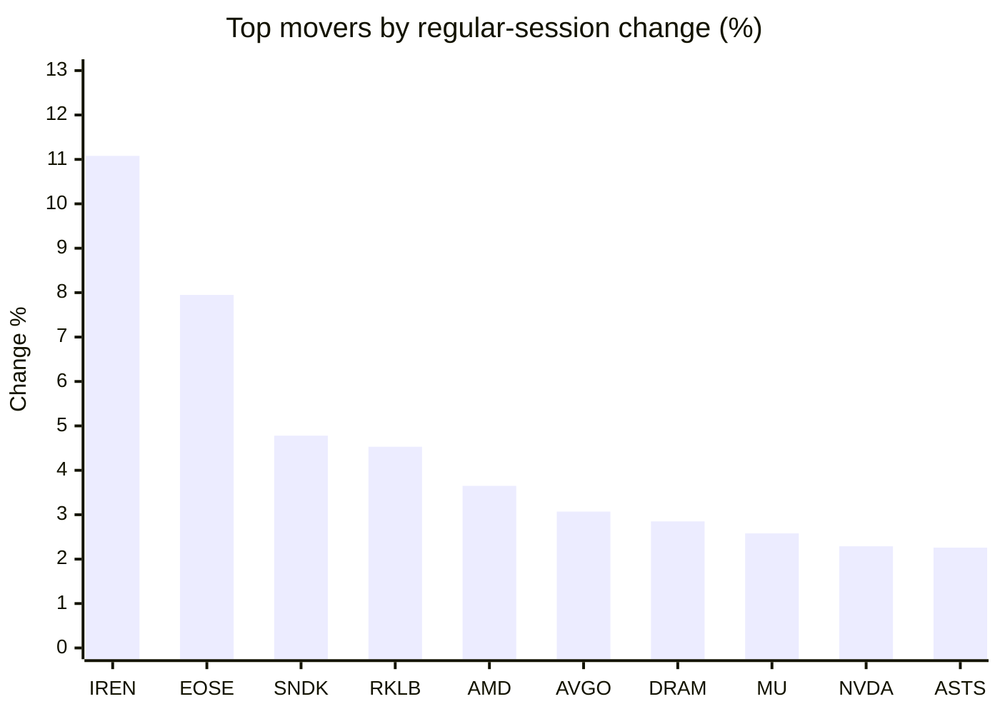
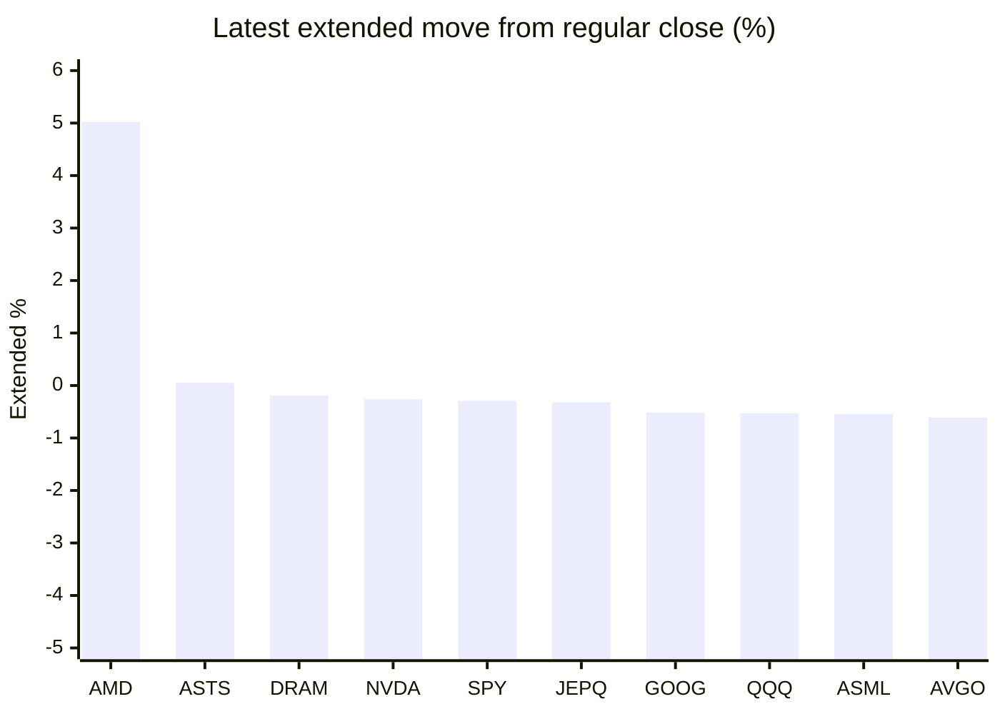

# Stock Brief - 2026-11-04

Generated at 2026-11-04 15:47 +07 from `watchlist.md`.
Prices are snapshots from Yahoo Finance public chart data. Extended/overnight is the latest available pre/post-market datapoint from the same feed.

## Market Snapshot

- SPY: close 754.35, latest extended 752.16, regular move +0.30%, extended move -0.29%
- QQQ: close 685.28, latest extended 681.62, regular move +0.62%, extended move -0.53%
- JEPQ: close 56.59, latest extended 56.41, regular move +0.62%, extended move -0.32%

## Watchlist Prices

| Ticker | Name | Regular close | Latest extended/overnight | Regular move | Extended move | Latest data time | Source |
|---|---|---:|---:|---:|---:|---|---|
| INTC | Intel Corporation | 60.55 USD | 60.01 USD | +0.97% | -0.89% | 2026-11-03 19:59 EST | [Yahoo](https://finance.yahoo.com/quote/INTC/) |
| AVGO | Broadcom Inc. | 332.13 USD | 330.11 USD | +3.07% | -0.61% | 2026-11-03 19:59 EST | [Yahoo](https://finance.yahoo.com/quote/AVGO/) |
| RKLB | Rocket Lab Corporation | 54.43 USD | 54.00 USD | +4.53% | -0.79% | 2026-11-03 19:57 EST | [Yahoo](https://finance.yahoo.com/quote/RKLB/) |
| AAPL | Apple Inc. | 331.90 USD | 329.82 USD | -1.90% | -0.63% | 2026-11-03 19:59 EST | [Yahoo](https://finance.yahoo.com/quote/AAPL/) |
| NVDA | NVIDIA Corporation | 206.69 USD | 206.15 USD | +2.29% | -0.26% | 2026-11-03 19:59 EST | [Yahoo](https://finance.yahoo.com/quote/NVDA/) |
| TSLA | Tesla, Inc. | 398.50 USD | 391.64 USD | -1.32% | -1.72% | 2026-11-03 19:59 EST | [Yahoo](https://finance.yahoo.com/quote/TSLA/) |
| SNDK | Sandisk Corporation | 1,126.52 USD | 1,118.75 USD | +4.78% | -0.69% | 2026-11-03 19:59 EST | [Yahoo](https://finance.yahoo.com/quote/SNDK/) |
| QQQ | Invesco QQQ Trust, Series 1 | 685.28 USD | 681.62 USD | +0.62% | -0.53% | 2026-11-03 19:59 EST | [Yahoo](https://finance.yahoo.com/quote/QQQ/) |
| SPY | State Street SPDR S&P 500 ETF T | 754.35 USD | 752.16 USD | +0.30% | -0.29% | 2026-11-03 19:59 EST | [Yahoo](https://finance.yahoo.com/quote/SPY/) |
| JEPQ | JPMorgan Nasdaq Equity Premium  | 56.59 USD | 56.41 USD | +0.62% | -0.32% | 2026-11-03 19:59 EST | [Yahoo](https://finance.yahoo.com/quote/JEPQ/) |
| ASTS | AST SpaceMobile, Inc. | 37.15 USD | 37.17 USD | +2.26% | +0.05% | 2026-11-03 19:58 EST | [Yahoo](https://finance.yahoo.com/quote/ASTS/) |
| MU | Micron Technology, Inc. | 855.10 USD | 849.60 USD | +2.58% | -0.64% | 2026-11-03 19:59 EST | [Yahoo](https://finance.yahoo.com/quote/MU/) |
| IREN | IREN LIMITED | 24.46 USD | 24.12 USD | +11.08% | -1.39% | 2026-11-03 19:59 EST | [Yahoo](https://finance.yahoo.com/quote/IREN/) |
| EOSE | Eos Energy Enterprises, Inc. | 1.90 USD | 1.88 USD | +7.95% | -1.05% | 2026-11-03 19:58 EST | [Yahoo](https://finance.yahoo.com/quote/EOSE/) |
| GOOG | Alphabet Inc. | 278.27 USD | 276.82 USD | +0.08% | -0.52% | 2026-11-03 19:59 EST | [Yahoo](https://finance.yahoo.com/quote/GOOG/) |
| DRAM | Roundhill Memory ETF | 47.64 USD | 47.55 USD | +2.85% | -0.19% | 2026-11-03 19:59 EST | [Yahoo](https://finance.yahoo.com/quote/DRAM/) |
| AMD | Advanced Micro Devices, Inc. | 483.90 USD | 508.20 USD | +3.65% | +5.02% | 2026-11-03 19:59 EST | [Yahoo](https://finance.yahoo.com/quote/AMD/) |
| ASML | ASML Holding N.V. - New York Re | 1,552.14 USD | 1,543.78 USD | +1.70% | -0.54% | 2026-11-03 19:59 EST | [Yahoo](https://finance.yahoo.com/quote/ASML/) |

## Charts

### Top Movers - Regular Session

### Extended / Overnight Move

### Quick Heatmap

| Group | Names in watchlist | Avg regular move | Avg extended move |
|---|---|---:|---:|
| Mega-cap tech | AVGO, AAPL, NVDA, TSLA, GOOG | +0.45% | -0.75% |
| Semis / memory | INTC, SNDK, MU, DRAM, AMD, ASML | +2.76% | +0.34% |
| Space / high beta | RKLB, ASTS, IREN, EOSE | +6.46% | -0.79% |
| ETFs | QQQ, SPY, JEPQ | +0.51% | -0.38% |

## News Headlines

- [Could Buying This 1 Cryptocurrency Make You Rich?](https://www.fool.com/investing/2026/11/04/could-buying-this-1-cryptocurrency-make-you-rich/?.tsrc=rss) (2026-11-04 14:50 Bangkok)
- [Democrats Have Retaken the House and Senate -- but There's an Even Bigger Winner Today](https://www.fool.com/investing/2026/11/04/democrats-have-retaken-the-house-and-senate-but-theres-an-even-bigger-winner-today/?.tsrc=rss) (2026-11-04 14:43 Bangkok)
- [Zacks Investment Ideas feature highlights: Apple and Palantir Technologies](https://finance.yahoo.com/markets/stocks/articles/zacks-investment-ideas-feature-highlights-073500208.html?.tsrc=rss) (2026-11-04 14:35 Bangkok)
- [Zacks Investment Ideas feature highlights: QQQ, CoreWeave, SanDisk, Marvell, Arm and Micron](https://finance.yahoo.com/markets/stocks/articles/zacks-investment-ideas-feature-highlights-073200537.html?.tsrc=rss) (2026-11-04 14:32 Bangkok)
- [Gene Munster Says Anduril Is Having Its Own Tesla Model 3 Moment—Company President Says 'We've Hired a Lot' of People From That Era](https://www.benzinga.com/markets/tech/26/11/62852650/gene-munster-says-anduril-is-having-its-own-tesla-model-3-moment-company-president-says-weve-hired-a-lot-of-people-from-that-era?utm_source=yahooFinance&utm_campaign=partner_feed&utm_medium=referral&.tsrc=rss) (2026-11-04 14:11 Bangkok)
- [Midterm Election Impact: SPCX, ASTS, RKLB Stocks Sink As Musk’s Political Ties Put Tesla-SpaceX Merger Under Fresh Scrutiny](https://stocktwits.com/news-articles/markets/equity/midterm-election-impact-spcx-asts-rklb-musk-political-tesla-spacex-merger-scrutiny/cNGLRztR9dU?.tsrc=rss) (2026-11-04 13:50 Bangkok)
- [Stock Market Election Night: Dow Futures, AI Stocks Slash Losses; CoreWeave, SpaceX, Tesla Off Lows (Live)](https://finance.yahoo.com/m/e5be454d-07fd-3d94-8114-a4e8ff2910de/stock-market-election-night%3A.html?.tsrc=rss) (2026-11-04 13:31 Bangkok)
- [Apple (AAPL) Stock Faces Q4 Earnings Margin Squeeze](https://finance.yahoo.com/markets/stocks/articles/apple-aapl-stock-faces-q4-062318560.html?.tsrc=rss) (2026-11-04 13:23 Bangkok)

## Caveats

- This is not investment advice. Extended-hours prices can be thin and volatile.
- Yahoo public endpoints may lag official exchange data.
