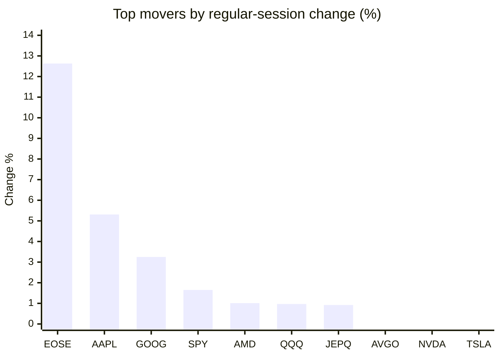
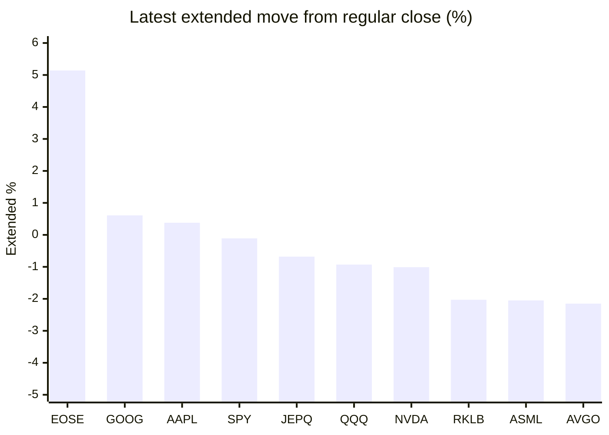

# Stock Brief - 2026-11-05

Generated at 2026-11-05 16:10 +07 from `watchlist.md`.
Prices are snapshots from Yahoo Finance public chart data. Extended/overnight is the latest available pre/post-market datapoint from the same feed.

## Market Snapshot

- SPY: close 766.81, latest extended 765.96, regular move +1.65%, extended move -0.11%
- QQQ: close 691.95, latest extended 685.53, regular move +0.97%, extended move -0.93%
- JEPQ: close 57.11, latest extended 56.72, regular move +0.92%, extended move -0.68%

## Watchlist Prices

| Ticker | Name | Regular close | Latest extended/overnight | Regular move | Extended move | Latest data time | Source |
|---|---|---:|---:|---:|---:|---|---|
| INTC | Intel Corporation | 58.27 USD | 56.55 USD | -3.77% | -2.95% | 2026-11-05 04:10 EST | [Yahoo](https://finance.yahoo.com/quote/INTC/) |
| AVGO | Broadcom Inc. | 325.48 USD | 318.49 USD | -2.00% | -2.15% | 2026-11-05 04:10 EST | [Yahoo](https://finance.yahoo.com/quote/AVGO/) |
| RKLB | Rocket Lab Corporation | 52.37 USD | 51.31 USD | -3.78% | -2.03% | 2026-11-05 04:10 EST | [Yahoo](https://finance.yahoo.com/quote/RKLB/) |
| AAPL | Apple Inc. | 349.51 USD | 350.83 USD | +5.31% | +0.38% | 2026-11-05 04:10 EST | [Yahoo](https://finance.yahoo.com/quote/AAPL/) |
| NVDA | NVIDIA Corporation | 200.13 USD | 198.10 USD | -3.17% | -1.01% | 2026-11-05 04:10 EST | [Yahoo](https://finance.yahoo.com/quote/NVDA/) |
| TSLA | Tesla, Inc. | 385.19 USD | 376.58 USD | -3.34% | -2.24% | 2026-11-05 04:10 EST | [Yahoo](https://finance.yahoo.com/quote/TSLA/) |
| SNDK | Sandisk Corporation | 1,037.40 USD | 998.64 USD | -7.91% | -3.74% | 2026-11-05 04:10 EST | [Yahoo](https://finance.yahoo.com/quote/SNDK/) |
| QQQ | Invesco QQQ Trust, Series 1 | 691.95 USD | 685.53 USD | +0.97% | -0.93% | 2026-11-05 04:10 EST | [Yahoo](https://finance.yahoo.com/quote/QQQ/) |
| SPY | State Street SPDR S&P 500 ETF T | 766.81 USD | 765.96 USD | +1.65% | -0.11% | 2026-11-05 04:10 EST | [Yahoo](https://finance.yahoo.com/quote/SPY/) |
| JEPQ | JPMorgan Nasdaq Equity Premium  | 57.11 USD | 56.72 USD | +0.92% | -0.68% | 2026-11-05 04:10 EST | [Yahoo](https://finance.yahoo.com/quote/JEPQ/) |
| ASTS | AST SpaceMobile, Inc. | 35.62 USD | 34.84 USD | -4.12% | -2.19% | 2026-11-05 04:10 EST | [Yahoo](https://finance.yahoo.com/quote/ASTS/) |
| MU | Micron Technology, Inc. | 795.23 USD | 770.27 USD | -7.00% | -3.14% | 2026-11-05 04:10 EST | [Yahoo](https://finance.yahoo.com/quote/MU/) |
| IREN | IREN LIMITED | 21.71 USD | 21.07 USD | -11.24% | -2.94% | 2026-11-05 04:10 EST | [Yahoo](https://finance.yahoo.com/quote/IREN/) |
| EOSE | Eos Energy Enterprises, Inc. | 2.14 USD | 2.25 USD | +12.63% | +5.14% | 2026-11-05 04:10 EST | [Yahoo](https://finance.yahoo.com/quote/EOSE/) |
| GOOG | Alphabet Inc. | 287.30 USD | 289.06 USD | +3.25% | +0.61% | 2026-11-05 04:10 EST | [Yahoo](https://finance.yahoo.com/quote/GOOG/) |
| DRAM | Roundhill Memory ETF | 45.11 USD | 43.03 USD | -5.31% | -4.61% | 2026-11-05 04:10 EST | [Yahoo](https://finance.yahoo.com/quote/DRAM/) |
| AMD | Advanced Micro Devices, Inc. | 488.78 USD | 471.54 USD | +1.01% | -3.53% | 2026-11-05 04:10 EST | [Yahoo](https://finance.yahoo.com/quote/AMD/) |
| ASML | ASML Holding N.V. - New York Re | 1,496.30 USD | 1,465.58 USD | -3.60% | -2.05% | 2026-11-05 04:09 EST | [Yahoo](https://finance.yahoo.com/quote/ASML/) |

## Charts

### Top Movers - Regular Session

### Extended / Overnight Move

### Quick Heatmap

| Group | Names in watchlist | Avg regular move | Avg extended move |
|---|---|---:|---:|
| Mega-cap tech | AVGO, AAPL, NVDA, TSLA, GOOG | +0.01% | -0.88% |
| Semis / memory | INTC, SNDK, MU, DRAM, AMD, ASML | -4.43% | -3.34% |
| Space / high beta | RKLB, ASTS, IREN, EOSE | -1.63% | -0.50% |
| ETFs | QQQ, SPY, JEPQ | +1.18% | -0.57% |

## News Headlines

- [AI Roundup: AMD, Apple Results Puzzle Investors, Democrats’ Midterm Win Weighs On Traders](https://stocktwits.com/news-articles/markets/equity/ai-roundup-amd-apple-results-puzzle-investors-democrats-midterm-win-weighs-on-traders/cNG1fJyR9EN?.tsrc=rss) (2026-11-05 15:48 Bangkok)
- [Why Rocket Lab Stock Plunged 15% in October and Why Its Decline Might Be Short-Lived](https://www.fool.com/investing/2026/11/05/why-rocket-lab-stock-plunged-15-in-october-and-why-its-decline-might-be-short-lived/?.tsrc=rss) (2026-11-05 15:10 Bangkok)
- [Zacks Earnings Trends Highlights: Nvidia, Micron and Alphabet](https://finance.yahoo.com/markets/stocks/articles/zacks-earnings-trends-highlights-nvidia-071000049.html?.tsrc=rss) (2026-11-05 14:10 Bangkok)
- [The Zacks Analyst Blog Highlights Analog Devices, Taiwan Semiconductor Manufacturing, Texas Instruments and NVIDIA](https://finance.yahoo.com/markets/stocks/articles/zacks-analyst-blog-highlights-analog-070000548.html?.tsrc=rss) (2026-11-05 14:00 Bangkok)
- [The Midterms Are Over. Here's What Chip Stocks Did in the Year After Each of the Last 8.](https://www.fool.com/investing/2026/11/05/the-midterms-are-over-here-s-what-chip-stocks-did-in-the-year-after-each-of-the-last-8/?.tsrc=rss) (2026-11-05 13:37 Bangkok)
- [SpaceX Targets Wireless And AI Riches, Rocket Lab Nears 100 Launches — What’s Moving Space Stocks](https://stocktwits.com/news-articles/markets/equity/spacex-wireless-ai-riches-rocketlab-100-launches-whats-moving-space-stocks/cNG1e6TR9EK?.tsrc=rss) (2026-11-05 13:07 Bangkok)
- [Why Did AAPL, MSFT, AMC Stocks Surge To 52-Week Highs?](https://stocktwits.com/news-articles/markets/equity/why-did-aapl-msft-amc-stocks-surge-to-52-week-highs/cNG1I0fR9Ei?.tsrc=rss) (2026-11-05 12:48 Bangkok)
- [TSLA Stock Slips Overnight: Analysts Flag Political, Premium Risks To SpaceX Merger — Cathie Wood’s ARK Buys Anyway](https://stocktwits.com/news-articles/markets/equity/tsla-stock-analysts-political-premium-risks-spacex-merger-cathie-wood-s-ark-buys/cNG14rwR9EL?.tsrc=rss) (2026-11-05 12:22 Bangkok)

## Caveats

- This is not investment advice. Extended-hours prices can be thin and volatile.
- Yahoo public endpoints may lag official exchange data.
