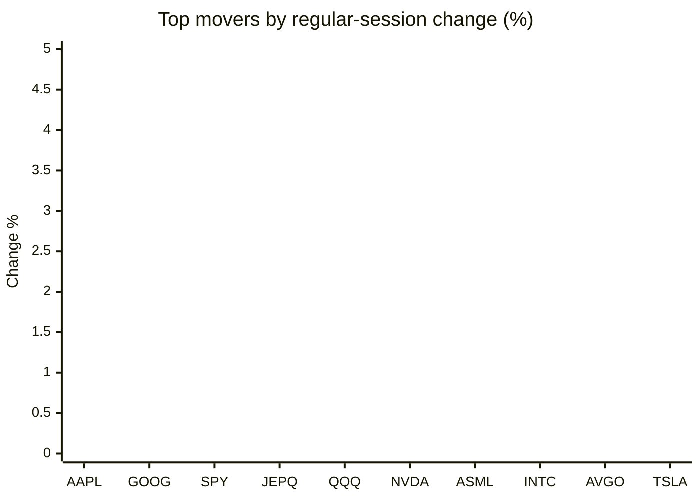
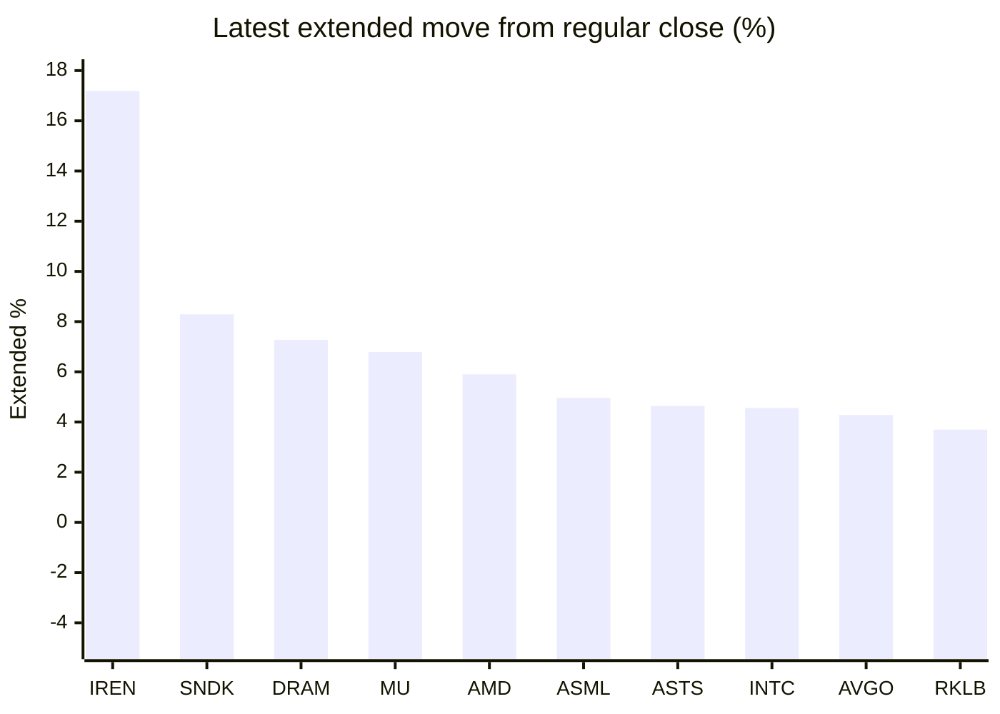

# Stock Brief - 2026-11-06

Generated at 2026-11-06 16:03 +07 from `watchlist.md`.
Prices are snapshots from Yahoo Finance public chart data. Extended/overnight is the latest available pre/post-market datapoint from the same feed.

## Market Snapshot

- SPY: close 733.00, latest extended 735.80, regular move -4.41%, extended move +0.38%
- QQQ: close 647.05, latest extended 656.50, regular move -6.49%, extended move +1.46%
- JEPQ: close 53.71, latest extended 54.46, regular move -5.95%, extended move +1.40%

## Watchlist Prices

| Ticker | Name | Regular close | Latest extended/overnight | Regular move | Extended move | Latest data time | Source |
|---|---|---:|---:|---:|---:|---|---|
| INTC | Intel Corporation | 52.25 USD | 54.63 USD | -10.33% | +4.56% | 2026-11-06 04:03 EST | [Yahoo](https://finance.yahoo.com/quote/INTC/) |
| AVGO | Broadcom Inc. | 291.53 USD | 304.00 USD | -10.43% | +4.28% | 2026-11-06 04:03 EST | [Yahoo](https://finance.yahoo.com/quote/AVGO/) |
| RKLB | Rocket Lab Corporation | 45.99 USD | 47.69 USD | -12.18% | +3.70% | 2026-11-06 04:02 EST | [Yahoo](https://finance.yahoo.com/quote/RKLB/) |
| AAPL | Apple Inc. | 344.17 USD | 341.43 USD | -1.53% | -0.80% | 2026-11-06 04:03 EST | [Yahoo](https://finance.yahoo.com/quote/AAPL/) |
| NVDA | NVIDIA Corporation | 181.60 USD | 186.92 USD | -9.26% | +2.93% | 2026-11-06 04:03 EST | [Yahoo](https://finance.yahoo.com/quote/NVDA/) |
| TSLA | Tesla, Inc. | 343.69 USD | 349.72 USD | -10.77% | +1.75% | 2026-11-06 04:03 EST | [Yahoo](https://finance.yahoo.com/quote/TSLA/) |
| SNDK | Sandisk Corporation | 806.43 USD | 873.29 USD | -22.26% | +8.29% | 2026-11-06 04:03 EST | [Yahoo](https://finance.yahoo.com/quote/SNDK/) |
| QQQ | Invesco QQQ Trust, Series 1 | 647.05 USD | 656.50 USD | -6.49% | +1.46% | 2026-11-06 04:03 EST | [Yahoo](https://finance.yahoo.com/quote/QQQ/) |
| SPY | State Street SPDR S&P 500 ETF T | 733.00 USD | 735.80 USD | -4.41% | +0.38% | 2026-11-06 04:03 EST | [Yahoo](https://finance.yahoo.com/quote/SPY/) |
| JEPQ | JPMorgan Nasdaq Equity Premium  | 53.71 USD | 54.46 USD | -5.95% | +1.40% | 2026-11-06 04:01 EST | [Yahoo](https://finance.yahoo.com/quote/JEPQ/) |
| ASTS | AST SpaceMobile, Inc. | 30.20 USD | 31.60 USD | -15.22% | +4.64% | 2026-11-06 04:02 EST | [Yahoo](https://finance.yahoo.com/quote/ASTS/) |
| MU | Micron Technology, Inc. | 656.39 USD | 700.99 USD | -17.46% | +6.79% | 2026-11-06 04:03 EST | [Yahoo](https://finance.yahoo.com/quote/MU/) |
| IREN | IREN LIMITED | 18.03 USD | 21.13 USD | -16.95% | +17.19% | 2026-11-06 04:03 EST | [Yahoo](https://finance.yahoo.com/quote/IREN/) |
| EOSE | Eos Energy Enterprises, Inc. | 1.88 USD | 1.86 USD | -12.15% | -1.06% | 2026-11-06 04:03 EST | [Yahoo](https://finance.yahoo.com/quote/EOSE/) |
| GOOG | Alphabet Inc. | 281.74 USD | 283.93 USD | -1.94% | +0.78% | 2026-11-06 04:02 EST | [Yahoo](https://finance.yahoo.com/quote/GOOG/) |
| DRAM | Roundhill Memory ETF | 37.01 USD | 39.70 USD | -17.96% | +7.27% | 2026-11-06 04:02 EST | [Yahoo](https://finance.yahoo.com/quote/DRAM/) |
| AMD | Advanced Micro Devices, Inc. | 404.40 USD | 428.25 USD | -17.26% | +5.90% | 2026-11-06 04:03 EST | [Yahoo](https://finance.yahoo.com/quote/AMD/) |
| ASML | ASML Holding N.V. - New York Re | 1,356.65 USD | 1,424.00 USD | -9.33% | +4.96% | 2026-11-06 04:02 EST | [Yahoo](https://finance.yahoo.com/quote/ASML/) |

## Charts

### Top Movers - Regular Session

### Extended / Overnight Move

### Quick Heatmap

| Group | Names in watchlist | Avg regular move | Avg extended move |
|---|---|---:|---:|
| Mega-cap tech | AVGO, AAPL, NVDA, TSLA, GOOG | -6.79% | +1.79% |
| Semis / memory | INTC, SNDK, MU, DRAM, AMD, ASML | -15.77% | +6.30% |
| Space / high beta | RKLB, ASTS, IREN, EOSE | -14.12% | +6.12% |
| ETFs | QQQ, SPY, JEPQ | -5.62% | +1.08% |

## News Headlines

- [Tesla Stock Has Fallen 29% From Its Record. I Think the Stock Is Overvalued.](https://www.fool.com/investing/2026/11/06/tesla-stock-has-fallen-29-from-its-record-i-think-the-stock-is-overvalued/?.tsrc=rss) (2026-11-06 15:27 Bangkok)
- [Prediction: November Will Be a Huge Month for Broadcom](https://www.fool.com/investing/2026/11/06/prediction-november-will-be-a-huge-month-for-broad/?.tsrc=rss) (2026-11-06 14:29 Bangkok)
- [Nasdaq Stock Market Correction: 3 Words From Warren Buffett To Remember RIght Now](https://www.fool.com/investing/2026/11/06/nasdaq-stock-market-correction-three-words-from-warren-buffett-to-remember-now/?.tsrc=rss) (2026-11-06 13:27 Bangkok)
- [Micron Stock Has Lost Over 40% Since Its June Record. I'd Still Buy It.](https://www.fool.com/investing/2026/11/06/micron-stock-has-lost-over-40-since-its-june-record-i-d-still-buy-it/?.tsrc=rss) (2026-11-06 13:13 Bangkok)
- [Oracle vs. Alphabet: Which Is the Better AI Cloud Stock to Own for the Next 5 Years?](https://www.fool.com/investing/2026/11/06/oracle-vs-alphabet-which-is-the-better-ai-cloud-st/?.tsrc=rss) (2026-11-06 12:20 Bangkok)
- [Rocket Lab Stock Slides As Neutron Delay Puts Focus On Earnings](https://finance.yahoo.com/markets/stocks/articles/rocket-lab-stock-slides-neutron-051632083.html?.tsrc=rss) (2026-11-06 12:16 Bangkok)
- [Bank of America doubles down on its Apple stock bet](https://www.thestreet.com/investing/stocks/bank-of-america-doubles-down-on-its-apple-stock-bet?.tsrc=rss) (2026-11-06 11:07 Bangkok)
- [Dow Jones Futures Fall, Techs Rise After Nasdaq Dives 5.5%; Nvidia, Sandisk, CoreWeave, SpaceX Plunge](https://finance.yahoo.com/m/0cd2227b-7753-3d54-a8c5-286efe82ac39/dow-jones-futures-fall%2C-techs.html?.tsrc=rss) (2026-11-06 11:05 Bangkok)

## Caveats

- This is not investment advice. Extended-hours prices can be thin and volatile.
- Yahoo public endpoints may lag official exchange data.
