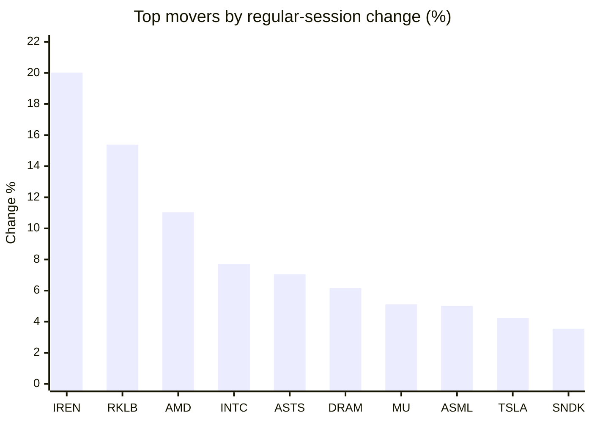
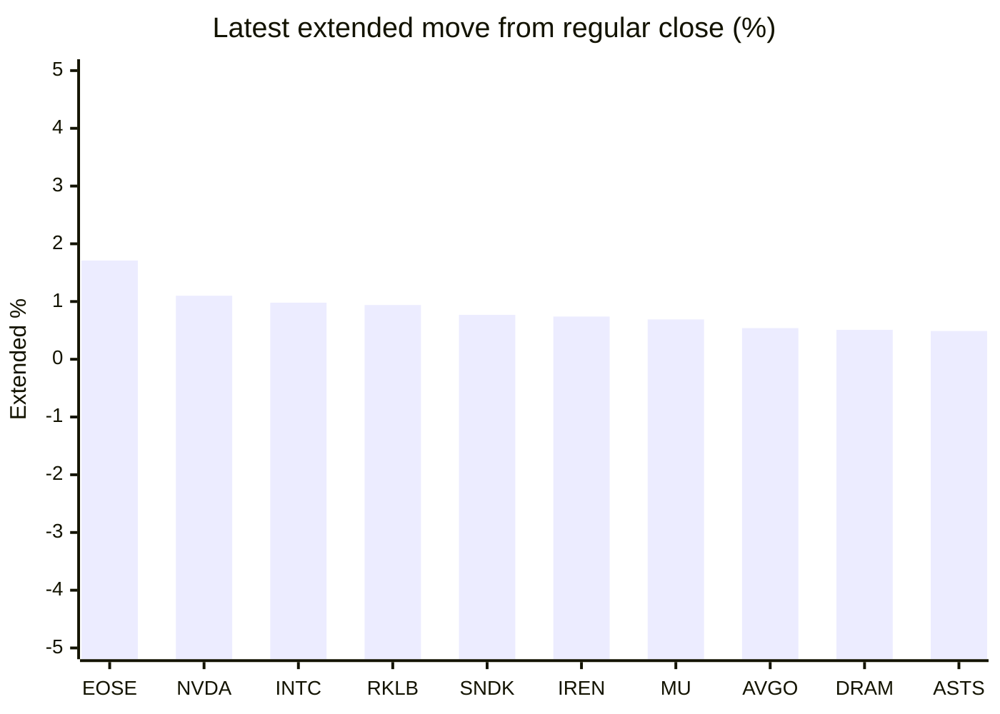

# Stock Brief - 2026-11-07

Generated at 2026-11-07 15:30 +07 from `watchlist.md`.
Prices are snapshots from Yahoo Finance public chart data. Extended/overnight is the latest available pre/post-market datapoint from the same feed.

## Market Snapshot

- SPY: close 735.29, latest extended 736.53, regular move +0.31%, extended move +0.17%
- QQQ: close 656.10, latest extended 657.50, regular move +1.40%, extended move +0.21%
- JEPQ: close 54.34, latest extended 54.49, regular move +1.17%, extended move +0.27%

## Watchlist Prices

| Ticker | Name | Regular close | Latest extended/overnight | Regular move | Extended move | Latest data time | Source |
|---|---|---:|---:|---:|---:|---|---|
| INTC | Intel Corporation | 56.28 USD | 56.83 USD | +7.71% | +0.98% | 2026-11-06 19:59 EST | [Yahoo](https://finance.yahoo.com/quote/INTC/) |
| AVGO | Broadcom Inc. | 293.69 USD | 295.27 USD | +0.74% | +0.54% | 2026-11-06 19:59 EST | [Yahoo](https://finance.yahoo.com/quote/AVGO/) |
| RKLB | Rocket Lab Corporation | 53.07 USD | 53.57 USD | +15.39% | +0.94% | 2026-11-06 19:59 EST | [Yahoo](https://finance.yahoo.com/quote/RKLB/) |
| AAPL | Apple Inc. | 342.37 USD | 342.65 USD | -0.52% | +0.08% | 2026-11-06 19:59 EST | [Yahoo](https://finance.yahoo.com/quote/AAPL/) |
| NVDA | NVIDIA Corporation | 186.64 USD | 188.70 USD | +2.78% | +1.10% | 2026-11-06 19:59 EST | [Yahoo](https://finance.yahoo.com/quote/NVDA/) |
| TSLA | Tesla, Inc. | 358.22 USD | 359.40 USD | +4.23% | +0.33% | 2026-11-06 19:59 EST | [Yahoo](https://finance.yahoo.com/quote/TSLA/) |
| SNDK | Sandisk Corporation | 835.06 USD | 841.46 USD | +3.55% | +0.77% | 2026-11-06 19:59 EST | [Yahoo](https://finance.yahoo.com/quote/SNDK/) |
| QQQ | Invesco QQQ Trust, Series 1 | 656.10 USD | 657.50 USD | +1.40% | +0.21% | 2026-11-06 19:59 EST | [Yahoo](https://finance.yahoo.com/quote/QQQ/) |
| SPY | State Street SPDR S&P 500 ETF T | 735.29 USD | 736.53 USD | +0.31% | +0.17% | 2026-11-06 19:59 EST | [Yahoo](https://finance.yahoo.com/quote/SPY/) |
| JEPQ | JPMorgan Nasdaq Equity Premium  | 54.34 USD | 54.49 USD | +1.17% | +0.27% | 2026-11-06 19:59 EST | [Yahoo](https://finance.yahoo.com/quote/JEPQ/) |
| ASTS | AST SpaceMobile, Inc. | 32.33 USD | 32.49 USD | +7.05% | +0.49% | 2026-11-06 19:59 EST | [Yahoo](https://finance.yahoo.com/quote/ASTS/) |
| MU | Micron Technology, Inc. | 690.00 USD | 694.79 USD | +5.12% | +0.69% | 2026-11-06 19:59 EST | [Yahoo](https://finance.yahoo.com/quote/MU/) |
| IREN | IREN LIMITED | 21.64 USD | 21.80 USD | +20.02% | +0.74% | 2026-11-06 19:59 EST | [Yahoo](https://finance.yahoo.com/quote/IREN/) |
| EOSE | Eos Energy Enterprises, Inc. | 1.74 USD | 1.77 USD | -7.45% | +1.71% | 2026-11-06 19:59 EST | [Yahoo](https://finance.yahoo.com/quote/EOSE/) |
| GOOG | Alphabet Inc. | 283.93 USD | 284.43 USD | +0.78% | +0.18% | 2026-11-06 19:59 EST | [Yahoo](https://finance.yahoo.com/quote/GOOG/) |
| DRAM | Roundhill Memory ETF | 39.29 USD | 39.49 USD | +6.16% | +0.51% | 2026-11-06 19:59 EST | [Yahoo](https://finance.yahoo.com/quote/DRAM/) |
| AMD | Advanced Micro Devices, Inc. | 449.04 USD | 448.14 USD | +11.04% | -0.20% | 2026-11-06 19:59 EST | [Yahoo](https://finance.yahoo.com/quote/AMD/) |
| ASML | ASML Holding N.V. - New York Re | 1,424.75 USD | 1,429.99 USD | +5.02% | +0.37% | 2026-11-06 19:59 EST | [Yahoo](https://finance.yahoo.com/quote/ASML/) |

## Charts

### Top Movers - Regular Session

### Extended / Overnight Move

### Quick Heatmap

| Group | Names in watchlist | Avg regular move | Avg extended move |
|---|---|---:|---:|
| Mega-cap tech | AVGO, AAPL, NVDA, TSLA, GOOG | +1.60% | +0.45% |
| Semis / memory | INTC, SNDK, MU, DRAM, AMD, ASML | +6.43% | +0.52% |
| Space / high beta | RKLB, ASTS, IREN, EOSE | +8.76% | +0.97% |
| ETFs | QQQ, SPY, JEPQ | +0.96% | +0.22% |

## News Headlines

- [AST SpaceMobile (ASTS) Bets On Reusable Blacklift Rocket To Control 2028 Launches](https://finance.yahoo.com/technology/articles/ast-spacemobile-asts-bets-reusable-081231242.html?.tsrc=rss) (2026-11-07 15:12 Bangkok)
- [Cathie Wood-Led Ark Loads Up On GOOG, AMD, NVDA And Biotech Stocks — But Sells CRWV, AVGO, LLY](https://stocktwits.com/news-articles/markets/equity/cathie-wood-ark-invest-buys-goog-amd-nvda-biotech-stocks-sell-crwv-avgo-lly/cNGVV2wR9Ii?.tsrc=rss) (2026-11-07 13:00 Bangkok)
- [Better Stock Split to Buy: Meta Platforms vs. Sandisk](https://www.fool.com/investing/2026/11/07/better-stock-split-to-buy-meta-platforms-vs-sandis/?.tsrc=rss) (2026-11-07 12:20 Bangkok)
- [A Retiree Who Bought 1,000 Tesla Shares at $197 Just Watched Musk Kill the Cybertruck](https://247wallst.com/investing/2026/11/07/a-retiree-who-bought-1000-tesla-shares-at-197-just-watched-musk-kill-the-cybertruck/?.tsrc=rss) (2026-11-07 12:07 Bangkok)
- [A Retiree Who Bought 1,000 Nvidia Shares at $122 Just Watched Chips Have Their Worst Day Since 2020](https://247wallst.com/investing/2026/11/07/a-retiree-who-bought-1000-nvidia-shares-at-122-just-watched-chips-have-their-worst-day-since-2020/?.tsrc=rss) (2026-11-07 12:06 Bangkok)
- [Micron stock flashes bargain pricing signal with costly catch](https://www.thestreet.com/investing/stocks/micron-stock-valuation-risk?.tsrc=rss) (2026-11-07 09:47 Bangkok)
- [Tesla, SpaceX Face Different Risks From Gina Hinojosa’s Texas Midterm Win: Bitunix Analyst Says Expansion, Not Existing Operations, Is Key Concern](https://finance.yahoo.com/markets/stocks/articles/tesla-spacex-face-different-risks-023006398.html?.tsrc=rss) (2026-11-07 09:30 Bangkok)
- [Tesla (TSLA) Stock Trades At An Expensive Price For Sales](https://finance.yahoo.com/markets/stocks/articles/tesla-tsla-stock-trades-expensive-021229427.html?.tsrc=rss) (2026-11-07 09:12 Bangkok)

## Caveats

- This is not investment advice. Extended-hours prices can be thin and volatile.
- Yahoo public endpoints may lag official exchange data.
