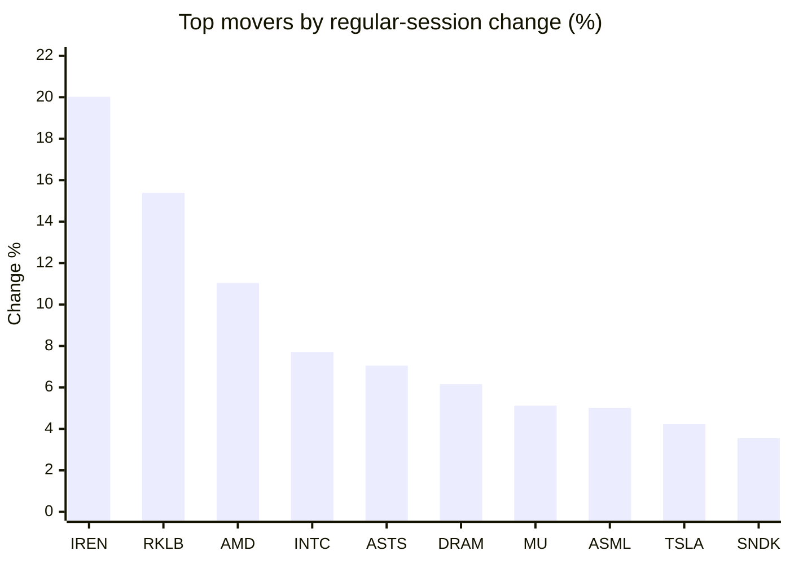
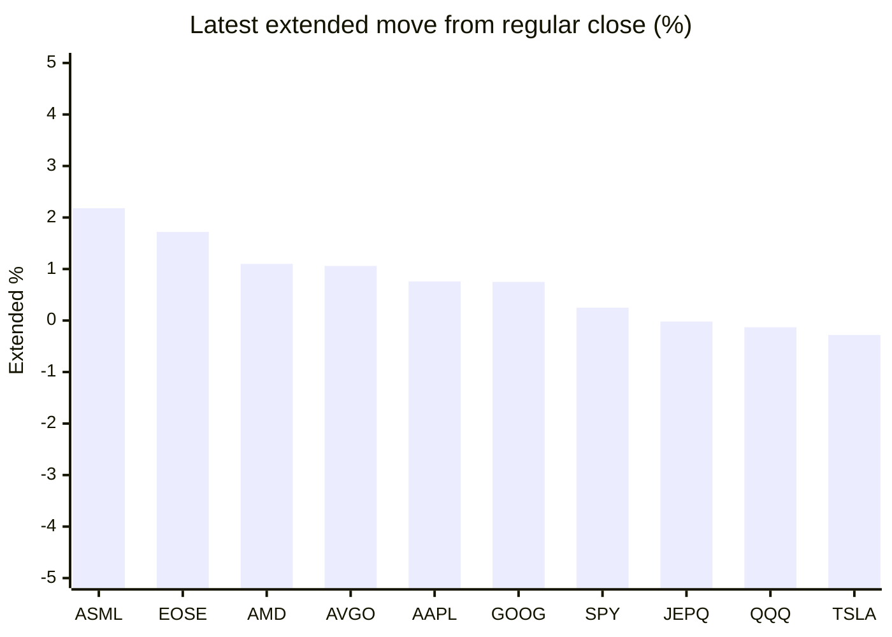

# Stock Brief - 2026-11-09

Generated at 2026-11-09 16:24 +07 from `watchlist.md`.
Prices are snapshots from Yahoo Finance public chart data. Extended/overnight is the latest available pre/post-market datapoint from the same feed.

## Market Snapshot

- SPY: close 735.29, latest extended 737.13, regular move +0.31%, extended move +0.25%
- QQQ: close 656.10, latest extended 655.25, regular move +1.40%, extended move -0.13%
- JEPQ: close 54.34, latest extended 54.33, regular move +1.17%, extended move -0.02%

## Watchlist Prices

| Ticker | Name | Regular close | Latest extended/overnight | Regular move | Extended move | Latest data time | Source |
|---|---|---:|---:|---:|---:|---|---|
| INTC | Intel Corporation | 56.28 USD | 55.31 USD | +7.71% | -1.72% | 2026-11-09 04:23 EST | [Yahoo](https://finance.yahoo.com/quote/INTC/) |
| AVGO | Broadcom Inc. | 293.69 USD | 296.80 USD | +0.74% | +1.06% | 2026-11-09 04:22 EST | [Yahoo](https://finance.yahoo.com/quote/AVGO/) |
| RKLB | Rocket Lab Corporation | 53.07 USD | 52.01 USD | +15.39% | -2.00% | 2026-11-09 04:23 EST | [Yahoo](https://finance.yahoo.com/quote/RKLB/) |
| AAPL | Apple Inc. | 342.37 USD | 344.96 USD | -0.52% | +0.76% | 2026-11-09 04:24 EST | [Yahoo](https://finance.yahoo.com/quote/AAPL/) |
| NVDA | NVIDIA Corporation | 186.64 USD | 176.83 USD | +2.78% | -5.26% | 2026-11-09 04:24 EST | [Yahoo](https://finance.yahoo.com/quote/NVDA/) |
| TSLA | Tesla, Inc. | 358.22 USD | 357.22 USD | +4.23% | -0.28% | 2026-11-09 04:23 EST | [Yahoo](https://finance.yahoo.com/quote/TSLA/) |
| SNDK | Sandisk Corporation | 835.06 USD | 813.18 USD | +3.55% | -2.62% | 2026-11-09 04:23 EST | [Yahoo](https://finance.yahoo.com/quote/SNDK/) |
| QQQ | Invesco QQQ Trust, Series 1 | 656.10 USD | 655.25 USD | +1.40% | -0.13% | 2026-11-09 04:24 EST | [Yahoo](https://finance.yahoo.com/quote/QQQ/) |
| SPY | State Street SPDR S&P 500 ETF T | 735.29 USD | 737.13 USD | +0.31% | +0.25% | 2026-11-09 04:23 EST | [Yahoo](https://finance.yahoo.com/quote/SPY/) |
| JEPQ | JPMorgan Nasdaq Equity Premium  | 54.34 USD | 54.33 USD | +1.17% | -0.02% | 2026-11-09 04:14 EST | [Yahoo](https://finance.yahoo.com/quote/JEPQ/) |
| ASTS | AST SpaceMobile, Inc. | 32.33 USD | 32.00 USD | +7.05% | -1.02% | 2026-11-09 04:23 EST | [Yahoo](https://finance.yahoo.com/quote/ASTS/) |
| MU | Micron Technology, Inc. | 690.00 USD | 679.65 USD | +5.12% | -1.50% | 2026-11-09 04:24 EST | [Yahoo](https://finance.yahoo.com/quote/MU/) |
| IREN | IREN LIMITED | 21.64 USD | 20.78 USD | +20.02% | -3.97% | 2026-11-09 04:24 EST | [Yahoo](https://finance.yahoo.com/quote/IREN/) |
| EOSE | Eos Energy Enterprises, Inc. | 1.74 USD | 1.77 USD | -7.45% | +1.72% | 2026-11-09 04:20 EST | [Yahoo](https://finance.yahoo.com/quote/EOSE/) |
| GOOG | Alphabet Inc. | 283.93 USD | 286.05 USD | +0.78% | +0.75% | 2026-11-09 04:23 EST | [Yahoo](https://finance.yahoo.com/quote/GOOG/) |
| DRAM | Roundhill Memory ETF | 39.29 USD | 38.66 USD | +6.16% | -1.59% | 2026-11-09 04:23 EST | [Yahoo](https://finance.yahoo.com/quote/DRAM/) |
| AMD | Advanced Micro Devices, Inc. | 449.04 USD | 454.00 USD | +11.04% | +1.10% | 2026-11-09 04:23 EST | [Yahoo](https://finance.yahoo.com/quote/AMD/) |
| ASML | ASML Holding N.V. - New York Re | 1,424.75 USD | 1,455.74 USD | +5.02% | +2.18% | 2026-11-09 04:24 EST | [Yahoo](https://finance.yahoo.com/quote/ASML/) |

## Charts

### Top Movers - Regular Session

### Extended / Overnight Move

### Quick Heatmap

| Group | Names in watchlist | Avg regular move | Avg extended move |
|---|---|---:|---:|
| Mega-cap tech | AVGO, AAPL, NVDA, TSLA, GOOG | +1.60% | -0.59% |
| Semis / memory | INTC, SNDK, MU, DRAM, AMD, ASML | +6.43% | -0.69% |
| Space / high beta | RKLB, ASTS, IREN, EOSE | +8.76% | -1.32% |
| ETFs | QQQ, SPY, JEPQ | +0.96% | +0.03% |

## News Headlines

- [Stock market today: Dow, S&P 500, Nasdaq futures rise with Nvidia stock, AI trade in focus](https://finance.yahoo.com/markets/live/stock-market-today-monday-november-9-dow-sp-500-nasdaq-nvidia-090535419.html?.tsrc=rss) (2026-11-09 16:05 Bangkok)
- [Jensen Huang’s Reported Ties To A Suspected Chinese Spy Put Trump’s Purchase Of Up To $5 Million In Nvidia Stock Back In The Spotlight](https://247wallst.com/investing/2026/11/09/jensen-huangs-reported-ties-to-a-suspected-chinese-spy-put-trumps-purchase-of-up-to-5-million-in-nvidia-stock-back-in-the-spotlight/?.tsrc=rss) (2026-11-09 16:17 Bangkok)
- [He Left His Wife Everything in His Will. She Still Couldn’t Get Into His Phone, His Email, or the Brokerage Account That Only Sent Statements There](https://247wallst.com/personal-finance/savings-accounts/2026/11/09/he-left-his-wife-everything-in-his-will-she-still-couldnt-get-into-his-phone-his-email-or-the-brokerage-account-that-only-sent-statements-there/?.tsrc=rss) (2026-11-09 16:16 Bangkok)
- [NVDA Stock Slides Premarket: Beijing Reportedly Rejects Jensen Huang Spy Allegations As ‘Smears Against China'](https://stocktwits.com/news-articles/markets/equity/nvda-stock-slides-premarket-beijing-reportedly-rejects-jensen-huang-spy-allegations-as-smears-against-china/cNGrdl8R9e0?.tsrc=rss) (2026-11-09 16:14 Bangkok)
- [Huang allegations, Berkshire earnings, AI regulations - What’s moving markets](https://finance.yahoo.com/markets/articles/huang-allegations-berkshire-earnings-ai-091315250.html?.tsrc=rss) (2026-11-09 16:13 Bangkok)
- [Nvidia Opens Investigation Into CEO Jensen Huang Over Relationship With Alleged Chinese Spy](https://www.ibtimes.com/nvidia-investigates-jensen-huang-china-intelligence-allegations-3809542?.tsrc=rss) (2026-11-09 16:01 Bangkok)
- [European equities flatline as markets digest Nvidia board probe](https://finance.yahoo.com/markets/stocks/articles/european-equities-flatline-markets-digest-083653253.html?.tsrc=rss) (2026-11-09 15:36 Bangkok)
- [Tech firms claw back some losses after midterms rout, eyes on Nvidia](https://finance.yahoo.com/technology/articles/tech-firms-claw-back-losses-025428116.html?.tsrc=rss) (2026-11-09 15:27 Bangkok)

## Caveats

- This is not investment advice. Extended-hours prices can be thin and volatile.
- Yahoo public endpoints may lag official exchange data.
