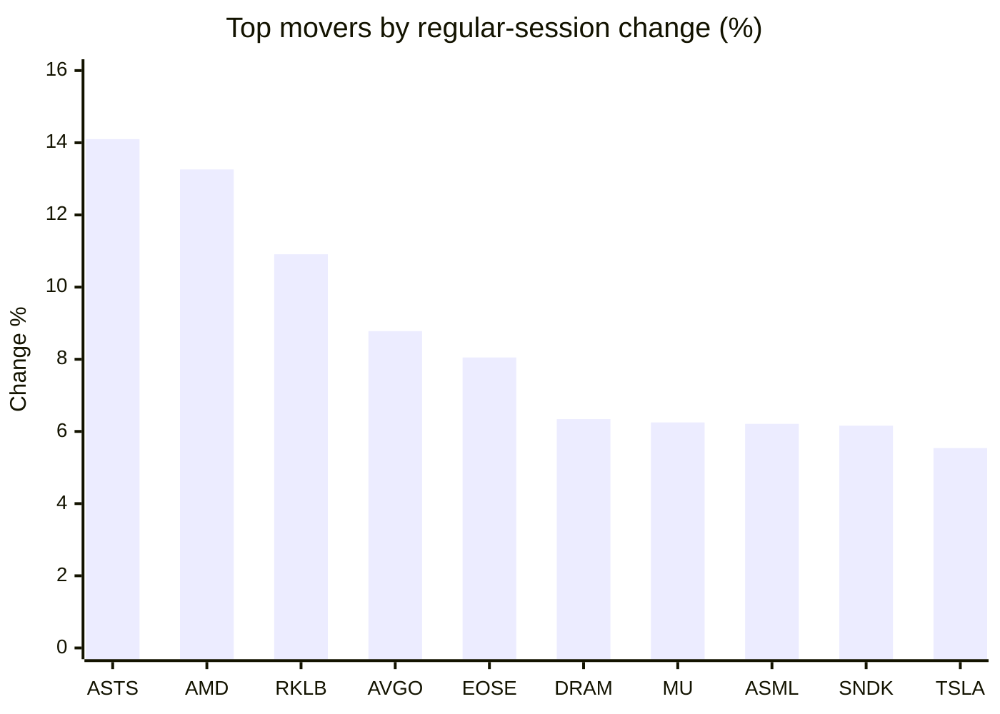
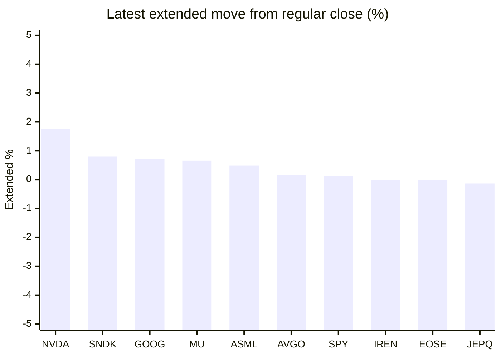

# Stock Brief - 2026-11-10

Generated at 2026-11-10 16:27 +07 from `watchlist.md`.
Prices are snapshots from Yahoo Finance public chart data. Extended/overnight is the latest available pre/post-market datapoint from the same feed.

## Market Snapshot

- SPY: close 752.69, latest extended 753.67, regular move +2.37%, extended move +0.13%
- QQQ: close 679.35, latest extended 678.00, regular move +3.54%, extended move -0.20%
- JEPQ: close 56.10, latest extended 56.02, regular move +3.24%, extended move -0.14%

## Watchlist Prices

| Ticker | Name | Regular close | Latest extended/overnight | Regular move | Extended move | Latest data time | Source |
|---|---|---:|---:|---:|---:|---|---|
| INTC | Intel Corporation | 59.37 USD | 58.78 USD | +5.49% | -0.99% | 2026-11-10 04:27 EST | [Yahoo](https://finance.yahoo.com/quote/INTC/) |
| AVGO | Broadcom Inc. | 319.48 USD | 320.00 USD | +8.78% | +0.16% | 2026-11-10 04:26 EST | [Yahoo](https://finance.yahoo.com/quote/AVGO/) |
| RKLB | Rocket Lab Corporation | 58.86 USD | 55.60 USD | +10.91% | -5.54% | 2026-11-10 04:27 EST | [Yahoo](https://finance.yahoo.com/quote/RKLB/) |
| AAPL | Apple Inc. | 350.69 USD | 349.73 USD | +2.43% | -0.27% | 2026-11-10 04:24 EST | [Yahoo](https://finance.yahoo.com/quote/AAPL/) |
| NVDA | NVIDIA Corporation | 178.67 USD | 181.84 USD | -4.27% | +1.77% | 2026-11-10 04:27 EST | [Yahoo](https://finance.yahoo.com/quote/NVDA/) |
| TSLA | Tesla, Inc. | 378.05 USD | 376.05 USD | +5.54% | -0.53% | 2026-11-10 04:27 EST | [Yahoo](https://finance.yahoo.com/quote/TSLA/) |
| SNDK | Sandisk Corporation | 886.51 USD | 893.57 USD | +6.16% | +0.80% | 2026-11-10 04:27 EST | [Yahoo](https://finance.yahoo.com/quote/SNDK/) |
| QQQ | Invesco QQQ Trust, Series 1 | 679.35 USD | 678.00 USD | +3.54% | -0.20% | 2026-11-10 04:27 EST | [Yahoo](https://finance.yahoo.com/quote/QQQ/) |
| SPY | State Street SPDR S&P 500 ETF T | 752.69 USD | 753.67 USD | +2.37% | +0.13% | 2026-11-10 04:27 EST | [Yahoo](https://finance.yahoo.com/quote/SPY/) |
| JEPQ | JPMorgan Nasdaq Equity Premium  | 56.10 USD | 56.02 USD | +3.24% | -0.14% | 2026-11-10 04:09 EST | [Yahoo](https://finance.yahoo.com/quote/JEPQ/) |
| ASTS | AST SpaceMobile, Inc. | 36.89 USD | 36.69 USD | +14.10% | -0.54% | 2026-11-10 04:21 EST | [Yahoo](https://finance.yahoo.com/quote/ASTS/) |
| MU | Micron Technology, Inc. | 733.15 USD | 738.00 USD | +6.25% | +0.66% | 2026-11-10 04:27 EST | [Yahoo](https://finance.yahoo.com/quote/MU/) |
| IREN | IREN LIMITED | 21.41 USD | 21.41 USD | -1.06% | +0.00% | 2026-11-10 04:27 EST | [Yahoo](https://finance.yahoo.com/quote/IREN/) |
| EOSE | Eos Energy Enterprises, Inc. | 1.88 USD | 1.88 USD | +8.05% | +0.00% | 2026-11-10 04:25 EST | [Yahoo](https://finance.yahoo.com/quote/EOSE/) |
| GOOG | Alphabet Inc. | 286.01 USD | 288.05 USD | +0.73% | +0.71% | 2026-11-10 04:27 EST | [Yahoo](https://finance.yahoo.com/quote/GOOG/) |
| DRAM | Roundhill Memory ETF | 41.78 USD | 41.64 USD | +6.34% | -0.35% | 2026-11-10 04:27 EST | [Yahoo](https://finance.yahoo.com/quote/DRAM/) |
| AMD | Advanced Micro Devices, Inc. | 508.58 USD | 507.19 USD | +13.26% | -0.27% | 2026-11-10 04:27 EST | [Yahoo](https://finance.yahoo.com/quote/AMD/) |
| ASML | ASML Holding N.V. - New York Re | 1,513.25 USD | 1,520.74 USD | +6.21% | +0.49% | 2026-11-10 04:26 EST | [Yahoo](https://finance.yahoo.com/quote/ASML/) |

## Charts

### Top Movers - Regular Session

### Extended / Overnight Move

### Quick Heatmap

| Group | Names in watchlist | Avg regular move | Avg extended move |
|---|---|---:|---:|
| Mega-cap tech | AVGO, AAPL, NVDA, TSLA, GOOG | +2.64% | +0.37% |
| Semis / memory | INTC, SNDK, MU, DRAM, AMD, ASML | +7.29% | +0.06% |
| Space / high beta | RKLB, ASTS, IREN, EOSE | +8.00% | -1.52% |
| ETFs | QQQ, SPY, JEPQ | +3.05% | -0.07% |

## News Headlines

- [Stock market today: Dow, S&P 500, Nasdaq trade mixed ahead of key inflation data](https://finance.yahoo.com/markets/live/stock-market-today-tuesday-november-10-dow-sp-500-nasdaq-inflation-data-cpi-090627830.html?.tsrc=rss) (2026-11-10 16:06 Bangkok)
- [Beyond Nvidia: 6 stocks winning the AI infrastructure buildout](https://finance.yahoo.com/technology/ai/articles/beyond-nvidia-6-stocks-winning-090950680.html?.tsrc=rss) (2026-11-10 16:09 Bangkok)
- [Cathie Wood Bought Just 3 Stocks On Monday; Here They Are](https://www.fool.com/investing/2026/11/10/cathie-wood-bought-just-3-stocks-on-monday-here-they-are/?.tsrc=rss) (2026-11-10 16:01 Bangkok)
- [Autobrains Brings NVIDIA Alpamayo Intelligence to the Road](https://finance.yahoo.com/technology/ai/articles/autobrains-brings-nvidia-alpamayo-intelligence-090000945.html?.tsrc=rss) (2026-11-10 16:00 Bangkok)
- [Nvidia sued by investors over ‘Chinese spy’ affair](https://uk.finance.yahoo.com/news/nvidia-sued-investors-over-chinese-085523836.html?.tsrc=rss) (2026-11-10 15:55 Bangkok)
- [Nvidia’s China Spy Fallout Deepens: Report Says Moonshot AI Accessed NVDA’s Advanced Chips Despite Export Controls](https://stocktwits.com/news-articles/markets/equity/nvidia-s-china-spy-fallout-deepens-report-says-moonshot-ai-accessed-nvda-s-advanced-chips-despite-export-controls/cNGua6lR97A?.tsrc=rss) (2026-11-10 15:48 Bangkok)
- [Elon Musk Ally Jason Calacanis Bets Another $1M On Uber — Says Waymo Team-Up Could Steal Tesla’s Driverless Crown](https://stocktwits.com/news-articles/markets/equity/elon-musk-ally-jason-calacanis-1m-uber-waymo-team-up-steal-tesla-driverless-crown/cNGuaWKR97Y?.tsrc=rss) (2026-11-10 15:25 Bangkok)
- [Tech leads stock rally as traders track Wall St rebound](https://finance.yahoo.com/markets/world-indices/articles/tech-leads-asian-stock-rally-023930562.html?.tsrc=rss) (2026-11-10 15:23 Bangkok)

## Caveats

- This is not investment advice. Extended-hours prices can be thin and volatile.
- Yahoo public endpoints may lag official exchange data.
