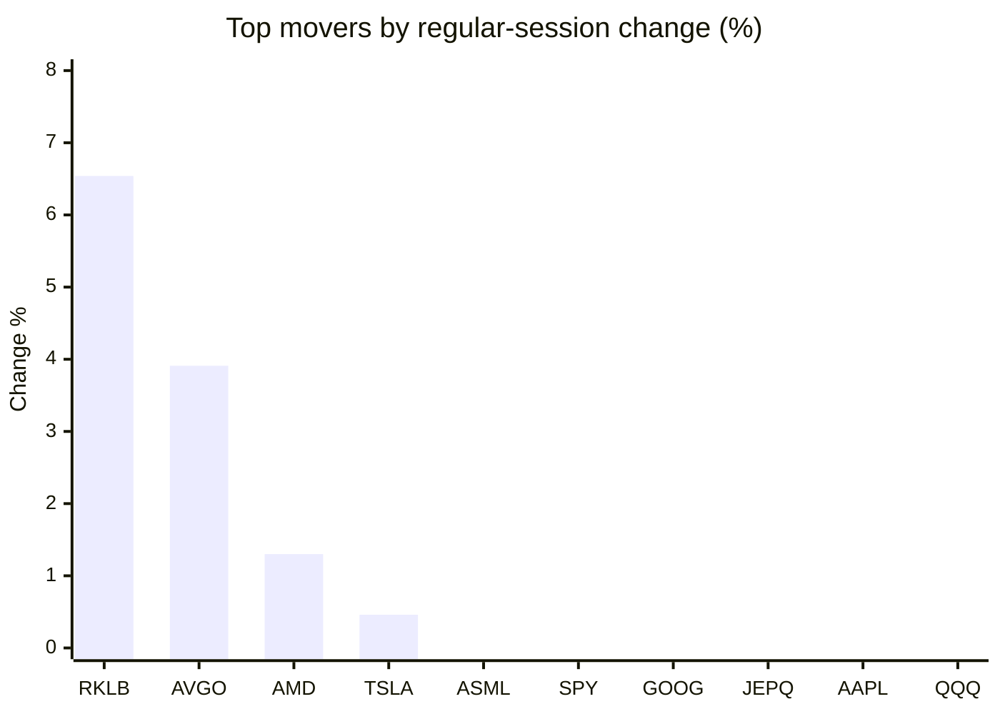
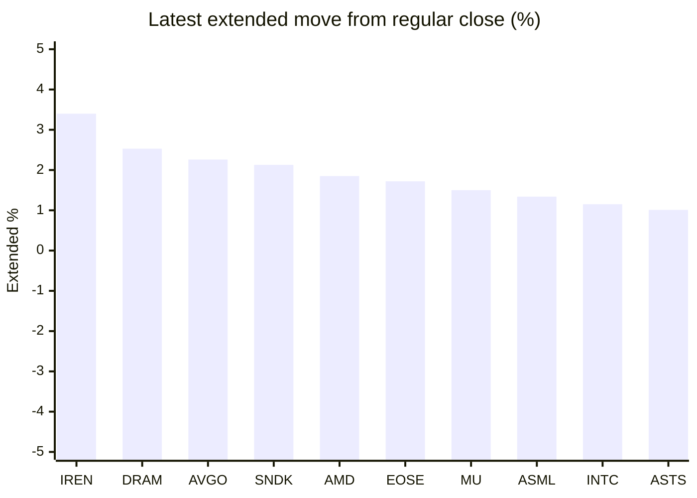

# Stock Brief - 2026-11-11

Generated at 2026-11-11 16:00 +07 from `watchlist.md`.
Prices are snapshots from Yahoo Finance public chart data. Extended/overnight is the latest available pre/post-market datapoint from the same feed.

## Market Snapshot

- SPY: close 749.92, latest extended 752.56, regular move -0.37%, extended move +0.35%
- QQQ: close 674.76, latest extended 679.24, regular move -0.68%, extended move +0.66%
- JEPQ: close 55.82, latest extended 56.08, regular move -0.50%, extended move +0.46%

## Watchlist Prices

| Ticker | Name | Regular close | Latest extended/overnight | Regular move | Extended move | Latest data time | Source |
|---|---|---:|---:|---:|---:|---|---|
| INTC | Intel Corporation | 58.13 USD | 58.80 USD | -2.09% | +1.15% | 2026-11-10 19:55 EST | [Yahoo](https://finance.yahoo.com/quote/INTC/) |
| AVGO | Broadcom Inc. | 331.98 USD | 339.48 USD | +3.91% | +2.26% | 2026-11-10 19:55 EST | [Yahoo](https://finance.yahoo.com/quote/AVGO/) |
| RKLB | Rocket Lab Corporation | 62.71 USD | 61.84 USD | +6.54% | -1.38% | 2026-11-10 19:55 EST | [Yahoo](https://finance.yahoo.com/quote/RKLB/) |
| AAPL | Apple Inc. | 348.51 USD | 348.91 USD | -0.62% | +0.11% | 2026-11-10 19:55 EST | [Yahoo](https://finance.yahoo.com/quote/AAPL/) |
| NVDA | NVIDIA Corporation | 168.89 USD | 170.48 USD | -5.47% | +0.94% | 2026-11-10 19:55 EST | [Yahoo](https://finance.yahoo.com/quote/NVDA/) |
| TSLA | Tesla, Inc. | 379.78 USD | 381.90 USD | +0.46% | +0.56% | 2026-11-10 19:55 EST | [Yahoo](https://finance.yahoo.com/quote/TSLA/) |
| SNDK | Sandisk Corporation | 859.99 USD | 878.33 USD | -2.99% | +2.13% | 2026-11-10 19:55 EST | [Yahoo](https://finance.yahoo.com/quote/SNDK/) |
| QQQ | Invesco QQQ Trust, Series 1 | 674.76 USD | 679.24 USD | -0.68% | +0.66% | 2026-11-10 19:55 EST | [Yahoo](https://finance.yahoo.com/quote/QQQ/) |
| SPY | State Street SPDR S&P 500 ETF T | 749.92 USD | 752.56 USD | -0.37% | +0.35% | 2026-11-10 19:55 EST | [Yahoo](https://finance.yahoo.com/quote/SPY/) |
| JEPQ | JPMorgan Nasdaq Equity Premium  | 55.82 USD | 56.08 USD | -0.50% | +0.46% | 2026-11-10 19:50 EST | [Yahoo](https://finance.yahoo.com/quote/JEPQ/) |
| ASTS | AST SpaceMobile, Inc. | 33.69 USD | 34.03 USD | -8.67% | +1.01% | 2026-11-10 19:55 EST | [Yahoo](https://finance.yahoo.com/quote/ASTS/) |
| MU | Micron Technology, Inc. | 725.11 USD | 736.00 USD | -1.10% | +1.50% | 2026-11-10 19:55 EST | [Yahoo](https://finance.yahoo.com/quote/MU/) |
| IREN | IREN LIMITED | 19.73 USD | 20.40 USD | -7.85% | +3.40% | 2026-11-10 19:55 EST | [Yahoo](https://finance.yahoo.com/quote/IREN/) |
| EOSE | Eos Energy Enterprises, Inc. | 1.74 USD | 1.77 USD | -7.45% | +1.72% | 2026-11-10 19:55 EST | [Yahoo](https://finance.yahoo.com/quote/EOSE/) |
| GOOG | Alphabet Inc. | 284.92 USD | 286.60 USD | -0.38% | +0.59% | 2026-11-10 19:55 EST | [Yahoo](https://finance.yahoo.com/quote/GOOG/) |
| DRAM | Roundhill Memory ETF | 40.64 USD | 41.67 USD | -2.73% | +2.53% | 2026-11-10 19:55 EST | [Yahoo](https://finance.yahoo.com/quote/DRAM/) |
| AMD | Advanced Micro Devices, Inc. | 515.21 USD | 524.73 USD | +1.30% | +1.85% | 2026-11-10 19:55 EST | [Yahoo](https://finance.yahoo.com/quote/AMD/) |
| ASML | ASML Holding N.V. - New York Re | 1,507.85 USD | 1,528.00 USD | -0.36% | +1.34% | 2026-11-10 19:55 EST | [Yahoo](https://finance.yahoo.com/quote/ASML/) |

## Charts

### Top Movers - Regular Session

### Extended / Overnight Move

### Quick Heatmap

| Group | Names in watchlist | Avg regular move | Avg extended move |
|---|---|---:|---:|
| Mega-cap tech | AVGO, AAPL, NVDA, TSLA, GOOG | -0.42% | +0.89% |
| Semis / memory | INTC, SNDK, MU, DRAM, AMD, ASML | -1.33% | +1.75% |
| Space / high beta | RKLB, ASTS, IREN, EOSE | -4.36% | +1.19% |
| ETFs | QQQ, SPY, JEPQ | -0.51% | +0.49% |

## News Headlines

- [1 Unstoppable Artificial Intelligence (AI) Stock Poised to Join the $5 Trillion Club by 2029](https://www.fool.com/investing/2026/11/11/1-unstoppable-artificial-intelligence-ai-stock-poi/?.tsrc=rss) (2026-11-11 15:25 Bangkok)
- [Is Nvidia Stock a Buy on the Spy Allegation Sell-Off?](https://www.fool.com/investing/2026/11/11/is-nvidia-stock-a-buy-on-the-spy-allegation-sell-off/?.tsrc=rss) (2026-11-11 15:03 Bangkok)
- [SpaceX Stock Carries Up To 25% ‘Political Discount,’ Dan Ives Says — Sees Elon Musk’s Tesla Merger Still In Play](https://stocktwits.com/news-articles/markets/equity/spacex-stock-political-discount-dan-ives-elon-musk-tesla-merger-play/cNGDhHhR9JU?.tsrc=rss) (2026-11-11 13:45 Bangkok)
- [The Zacks Analyst Blog Highlights Arista Networks, Fabrinet, Analog Devices, Advanced Micro Devices and NVIDIA](https://finance.yahoo.com/markets/stocks/articles/zacks-analyst-blog-highlights-arista-062800269.html?.tsrc=rss) (2026-11-11 13:28 Bangkok)
- [ASTS Stock Jumps Overnight: Analyst Estimates $50M Each For 3 Early BlueBirds — Retail Bulls Defend Spending](https://stocktwits.com/news-articles/markets/equity/asts-stock-analyst-50m-each-3-early-bluebirds-retail-bulls-defend-spending/cNGDXiPR9Js?.tsrc=rss) (2026-11-11 12:14 Bangkok)
- [Elon Musk's Cybertruck decision could change Tesla's next chapter](https://www.thestreet.com/investing/stocks/elon-musks-cybertruck-decision-could-change-teslas-next-chapter?.tsrc=rss) (2026-11-11 12:03 Bangkok)
- [Here's the 1 Thing I'd Wait to See Before Buying NuScale Stock](https://www.fool.com/investing/2026/11/11/heres-the-1-thing-id-wait-to-see-before-buying-nus/?.tsrc=rss) (2026-11-11 14:50 Bangkok)
- [Rivian's Vans Got a Serious Upgrade. Could Another Major Fleet Deal Finally Follow?](https://www.fool.com/investing/2026/11/11/rivians-vans-got-a-serious-upgrade-could-another-m/?.tsrc=rss) (2026-11-11 14:25 Bangkok)

## Caveats

- This is not investment advice. Extended-hours prices can be thin and volatile.
- Yahoo public endpoints may lag official exchange data.
