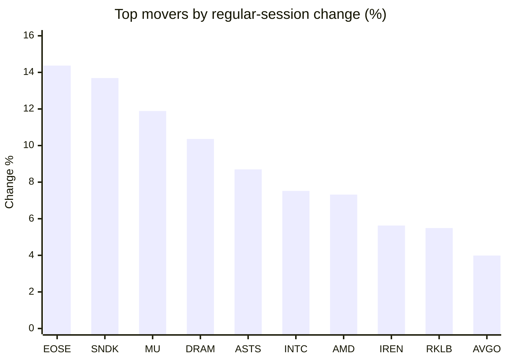
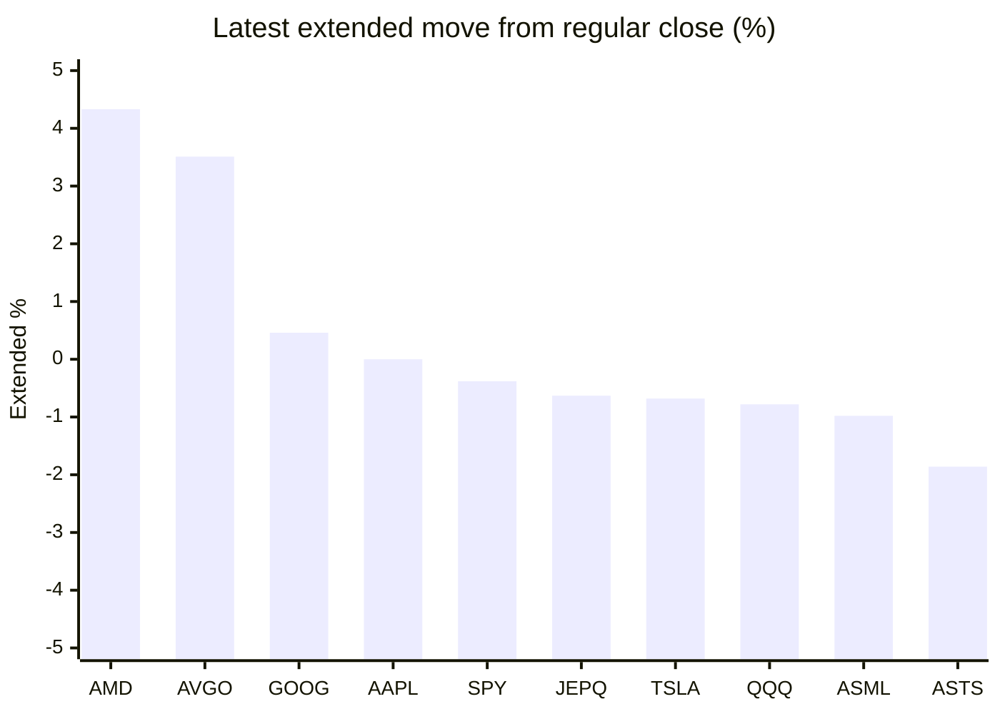

# Stock Brief - 2026-11-12

Generated at 2026-11-12 16:29 +07 from `watchlist.md`.
Prices are snapshots from Yahoo Finance public chart data. Extended/overnight is the latest available pre/post-market datapoint from the same feed.

## Market Snapshot

- SPY: close 759.81, latest extended 756.93, regular move +1.32%, extended move -0.38%
- QQQ: close 690.38, latest extended 685.02, regular move +2.31%, extended move -0.78%
- JEPQ: close 56.93, latest extended 56.57, regular move +1.99%, extended move -0.63%

## Watchlist Prices

| Ticker | Name | Regular close | Latest extended/overnight | Regular move | Extended move | Latest data time | Source |
|---|---|---:|---:|---:|---:|---|---|
| INTC | Intel Corporation | 62.50 USD | 61.18 USD | +7.52% | -2.11% | 2026-11-12 04:29 EST | [Yahoo](https://finance.yahoo.com/quote/INTC/) |
| AVGO | Broadcom Inc. | 345.22 USD | 357.35 USD | +3.99% | +3.51% | 2026-11-12 04:29 EST | [Yahoo](https://finance.yahoo.com/quote/AVGO/) |
| RKLB | Rocket Lab Corporation | 66.15 USD | 64.73 USD | +5.49% | -2.15% | 2026-11-12 04:25 EST | [Yahoo](https://finance.yahoo.com/quote/RKLB/) |
| AAPL | Apple Inc. | 355.63 USD | 355.64 USD | +2.04% | +0.00% | 2026-11-12 04:29 EST | [Yahoo](https://finance.yahoo.com/quote/AAPL/) |
| NVDA | NVIDIA Corporation | 173.73 USD | 162.15 USD | +2.87% | -6.67% | 2026-11-12 04:29 EST | [Yahoo](https://finance.yahoo.com/quote/NVDA/) |
| TSLA | Tesla, Inc. | 390.84 USD | 388.20 USD | +2.91% | -0.68% | 2026-11-12 04:29 EST | [Yahoo](https://finance.yahoo.com/quote/TSLA/) |
| SNDK | Sandisk Corporation | 977.69 USD | 946.53 USD | +13.69% | -3.19% | 2026-11-12 04:29 EST | [Yahoo](https://finance.yahoo.com/quote/SNDK/) |
| QQQ | Invesco QQQ Trust, Series 1 | 690.38 USD | 685.02 USD | +2.31% | -0.78% | 2026-11-12 04:29 EST | [Yahoo](https://finance.yahoo.com/quote/QQQ/) |
| SPY | State Street SPDR S&P 500 ETF T | 759.81 USD | 756.93 USD | +1.32% | -0.38% | 2026-11-12 04:29 EST | [Yahoo](https://finance.yahoo.com/quote/SPY/) |
| JEPQ | JPMorgan Nasdaq Equity Premium  | 56.93 USD | 56.57 USD | +1.99% | -0.63% | 2026-11-12 04:28 EST | [Yahoo](https://finance.yahoo.com/quote/JEPQ/) |
| ASTS | AST SpaceMobile, Inc. | 36.62 USD | 35.94 USD | +8.70% | -1.86% | 2026-11-12 04:24 EST | [Yahoo](https://finance.yahoo.com/quote/ASTS/) |
| MU | Micron Technology, Inc. | 811.30 USD | 786.52 USD | +11.89% | -3.05% | 2026-11-12 04:29 EST | [Yahoo](https://finance.yahoo.com/quote/MU/) |
| IREN | IREN LIMITED | 20.84 USD | 20.21 USD | +5.63% | -3.02% | 2026-11-12 04:29 EST | [Yahoo](https://finance.yahoo.com/quote/IREN/) |
| EOSE | Eos Energy Enterprises, Inc. | 1.99 USD | 1.93 USD | +14.37% | -3.02% | 2026-11-12 04:20 EST | [Yahoo](https://finance.yahoo.com/quote/EOSE/) |
| GOOG | Alphabet Inc. | 290.63 USD | 291.96 USD | +2.00% | +0.46% | 2026-11-12 04:29 EST | [Yahoo](https://finance.yahoo.com/quote/GOOG/) |
| DRAM | Roundhill Memory ETF | 44.85 USD | 43.52 USD | +10.36% | -2.97% | 2026-11-12 04:29 EST | [Yahoo](https://finance.yahoo.com/quote/DRAM/) |
| AMD | Advanced Micro Devices, Inc. | 552.90 USD | 576.84 USD | +7.32% | +4.33% | 2026-11-12 04:29 EST | [Yahoo](https://finance.yahoo.com/quote/AMD/) |
| ASML | ASML Holding N.V. - New York Re | 1,534.42 USD | 1,519.34 USD | +1.76% | -0.98% | 2026-11-12 04:28 EST | [Yahoo](https://finance.yahoo.com/quote/ASML/) |

## Charts

### Top Movers - Regular Session

### Extended / Overnight Move

### Quick Heatmap

| Group | Names in watchlist | Avg regular move | Avg extended move |
|---|---|---:|---:|
| Mega-cap tech | AVGO, AAPL, NVDA, TSLA, GOOG | +2.76% | -0.67% |
| Semis / memory | INTC, SNDK, MU, DRAM, AMD, ASML | +8.75% | -1.33% |
| Space / high beta | RKLB, ASTS, IREN, EOSE | +8.54% | -2.51% |
| ETFs | QQQ, SPY, JEPQ | +1.87% | -0.60% |

## News Headlines

- [NVDA Stock Rout: Another Analyst Slashes Rating, Beijing Warns US Against Tech Curbs](https://stocktwits.com/news-articles/markets/equity/nvda-stock-rout-another-analyst-slashes-rating-beijing-warns-us-against-tech-curbs/cNGzqRtR99y?.tsrc=rss) (2026-11-12 16:16 Bangkok)
- [‘He Can’t Just Pick Up and Go to Florida’: Dan Ives on Musk’s $1 Trillion Texas Problem](https://247wallst.com/personal-finance/2026/11/12/he-cant-just-pick-up-and-go-to-florida-dan-ives-on-musks-1-trillion-texas-problem/?.tsrc=rss) (2026-11-12 16:11 Bangkok)
- [European tech shares fall as Nvidia board weighs ousting Jensen Huang](https://www.euronews.com/2026/11/12/nvidia-shares-fall-on-reports-board-may-oust-ceo-jensen-huang?.tsrc=rss) (2026-11-12 16:10 Bangkok)
- [Market Chatter: Nvidia Chip Access Concerns Drive Chinese Firms to Secure Overseas Capacity](https://finance.yahoo.com/technology/ai/articles/market-chatter-nvidia-chip-access-084521497.html?.tsrc=rss) (2026-11-12 15:45 Bangkok)
- [European shares hit record highs as defensive appeal offsets Nvidia shock](https://finance.yahoo.com/markets/world-indices/articles/european-shares-hit-record-highs-083743723.html?.tsrc=rss) (2026-11-12 15:37 Bangkok)
- [Asian stocks drop as traders keep eye on Nvidia crisis](https://finance.yahoo.com/markets/stocks/articles/asian-stocks-extend-gains-traders-025559054.html?.tsrc=rss) (2026-11-12 15:29 Bangkok)
- [Intel's CEO Bought $9.7 Million of Stock Right After It Plunged 29%. I'm Not Ready to Follow Him In.](https://www.fool.com/investing/2026/11/12/intel-s-ceo-bought-usd9-7-million-of-stock-right-after-it-plunged-29-i-m-not-ready-to-follow-him-in/?.tsrc=rss) (2026-11-12 15:24 Bangkok)
- [China and Korea Will Outperform Taiwan: Market Analysis](https://finance.yahoo.com/video/china-korea-outperform-taiwan-market-082149621.html?.tsrc=rss) (2026-11-12 15:21 Bangkok)

## Caveats

- This is not investment advice. Extended-hours prices can be thin and volatile.
- Yahoo public endpoints may lag official exchange data.
