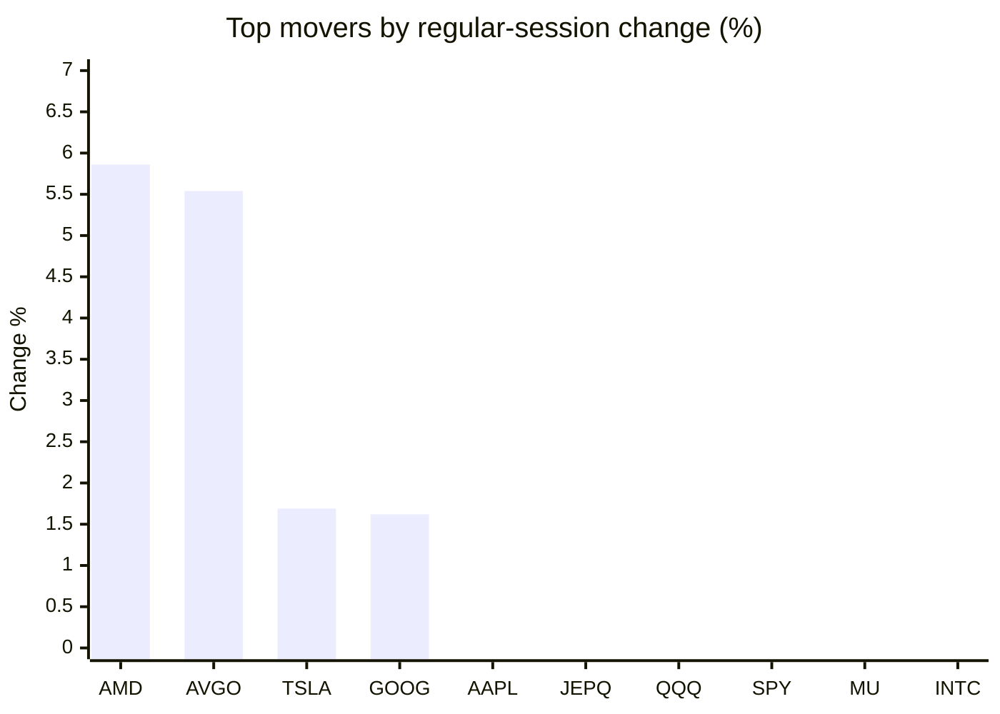
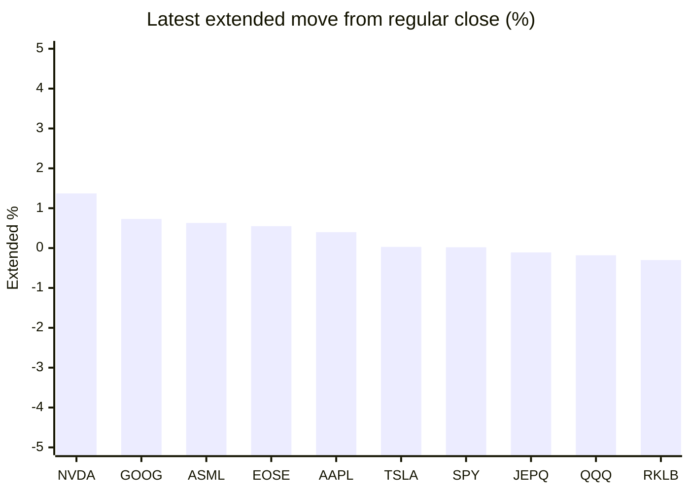

# Stock Brief - 2026-11-13

Generated at 2026-11-13 16:16 +07 from `watchlist.md`.
Prices are snapshots from Yahoo Finance public chart data. Extended/overnight is the latest available pre/post-market datapoint from the same feed.

## Market Snapshot

- SPY: close 757.12, latest extended 757.26, regular move -0.35%, extended move +0.02%
- QQQ: close 688.17, latest extended 686.96, regular move -0.32%, extended move -0.18%
- JEPQ: close 56.78, latest extended 56.72, regular move -0.26%, extended move -0.11%

## Watchlist Prices

| Ticker | Name | Regular close | Latest extended/overnight | Regular move | Extended move | Latest data time | Source |
|---|---|---:|---:|---:|---:|---|---|
| INTC | Intel Corporation | 61.20 USD | 60.91 USD | -2.08% | -0.47% | 2026-11-13 04:15 EST | [Yahoo](https://finance.yahoo.com/quote/INTC/) |
| AVGO | Broadcom Inc. | 364.36 USD | 356.80 USD | +5.54% | -2.07% | 2026-11-13 04:14 EST | [Yahoo](https://finance.yahoo.com/quote/AVGO/) |
| RKLB | Rocket Lab Corporation | 64.07 USD | 63.88 USD | -3.14% | -0.30% | 2026-11-13 04:15 EST | [Yahoo](https://finance.yahoo.com/quote/RKLB/) |
| AAPL | Apple Inc. | 354.88 USD | 356.31 USD | -0.21% | +0.40% | 2026-11-13 04:15 EST | [Yahoo](https://finance.yahoo.com/quote/AAPL/) |
| NVDA | NVIDIA Corporation | 166.19 USD | 168.47 USD | -4.34% | +1.37% | 2026-11-13 04:15 EST | [Yahoo](https://finance.yahoo.com/quote/NVDA/) |
| TSLA | Tesla, Inc. | 397.45 USD | 397.58 USD | +1.69% | +0.03% | 2026-11-13 04:15 EST | [Yahoo](https://finance.yahoo.com/quote/TSLA/) |
| SNDK | Sandisk Corporation | 937.46 USD | 929.57 USD | -4.11% | -0.84% | 2026-11-13 04:15 EST | [Yahoo](https://finance.yahoo.com/quote/SNDK/) |
| QQQ | Invesco QQQ Trust, Series 1 | 688.17 USD | 686.96 USD | -0.32% | -0.18% | 2026-11-13 04:15 EST | [Yahoo](https://finance.yahoo.com/quote/QQQ/) |
| SPY | State Street SPDR S&P 500 ETF T | 757.12 USD | 757.26 USD | -0.35% | +0.02% | 2026-11-13 04:15 EST | [Yahoo](https://finance.yahoo.com/quote/SPY/) |
| JEPQ | JPMorgan Nasdaq Equity Premium  | 56.78 USD | 56.72 USD | -0.26% | -0.11% | 2026-11-13 04:11 EST | [Yahoo](https://finance.yahoo.com/quote/JEPQ/) |
| ASTS | AST SpaceMobile, Inc. | 34.50 USD | 34.12 USD | -5.79% | -1.10% | 2026-11-13 04:06 EST | [Yahoo](https://finance.yahoo.com/quote/ASTS/) |
| MU | Micron Technology, Inc. | 798.44 USD | 794.00 USD | -1.59% | -0.56% | 2026-11-13 04:15 EST | [Yahoo](https://finance.yahoo.com/quote/MU/) |
| IREN | IREN LIMITED | 19.48 USD | 19.13 USD | -6.53% | -1.80% | 2026-11-13 04:15 EST | [Yahoo](https://finance.yahoo.com/quote/IREN/) |
| EOSE | Eos Energy Enterprises, Inc. | 1.81 USD | 1.82 USD | -9.05% | +0.55% | 2026-11-13 04:11 EST | [Yahoo](https://finance.yahoo.com/quote/EOSE/) |
| GOOG | Alphabet Inc. | 295.35 USD | 297.50 USD | +1.62% | +0.73% | 2026-11-13 04:15 EST | [Yahoo](https://finance.yahoo.com/quote/GOOG/) |
| DRAM | Roundhill Memory ETF | 43.66 USD | 43.28 USD | -2.65% | -0.87% | 2026-11-13 04:15 EST | [Yahoo](https://finance.yahoo.com/quote/DRAM/) |
| AMD | Advanced Micro Devices, Inc. | 585.30 USD | 572.17 USD | +5.86% | -2.24% | 2026-11-13 04:15 EST | [Yahoo](https://finance.yahoo.com/quote/AMD/) |
| ASML | ASML Holding N.V. - New York Re | 1,497.12 USD | 1,506.50 USD | -2.43% | +0.63% | 2026-11-13 04:15 EST | [Yahoo](https://finance.yahoo.com/quote/ASML/) |

## Charts

### Top Movers - Regular Session

### Extended / Overnight Move

### Quick Heatmap

| Group | Names in watchlist | Avg regular move | Avg extended move |
|---|---|---:|---:|
| Mega-cap tech | AVGO, AAPL, NVDA, TSLA, GOOG | +0.86% | +0.09% |
| Semis / memory | INTC, SNDK, MU, DRAM, AMD, ASML | -1.17% | -0.73% |
| Space / high beta | RKLB, ASTS, IREN, EOSE | -6.13% | -0.66% |
| ETFs | QQQ, SPY, JEPQ | -0.31% | -0.09% |

## News Headlines

- [Micron Stock Has Moved 5% or More on a Third of Its Trading Days Since October. Here's How Much of It I'd Own.](https://www.fool.com/investing/2026/11/13/micron-stock-has-moved-5-or-more-on-a-third-of-its-trading-days-since-october-here-s-how-much-of-it-i-d-own/?.tsrc=rss) (2026-11-13 16:07 Bangkok)
- [European shares fall as Nvidia CEO’s exit raises doubts over AI boom](https://www.euronews.com/2026/11/13/european-shares-fall-as-nvidia-ceos-exit-raises-doubts-over-ai-boom?.tsrc=rss) (2026-11-13 15:41 Bangkok)
- [Huang's exit, AI bubble and financial crisis fears in focus on Web Summit's last day](https://www.euronews.com/2026/11/12/huangs-exit-ai-bubble-and-financial-crisis-fears-in-focus-on-web-summits-last-day?.tsrc=rss) (2026-11-13 15:26 Bangkok)
- [Asian markets turn negative as early rally fades after Huang downfall](https://finance.yahoo.com/markets/stocks/articles/tech-firms-extend-rally-asia-024621637.html?.tsrc=rss) (2026-11-13 15:22 Bangkok)
- [How AI Memory Demand At Micron Stock Has Changed Its Investment Story](https://finance.yahoo.com/markets/stocks/articles/ai-memory-demand-micron-stock-081121346.html?.tsrc=rss) (2026-11-13 15:11 Bangkok)
- [Silicon Valley insiders nervously eye Nvidia scandal fallout](https://finance.yahoo.com/technology/ai/articles/silicon-valley-insiders-nervously-eye-080922372.html?.tsrc=rss) (2026-11-13 15:09 Bangkok)
- [Tom Lee Says ‘Buy The Dip’ In NVDA After Huang Exit Even As Bitcoin Plunges Below $70,000: ‘Best Risk/Reward In AI’](https://stocktwits.com/news-articles/markets/equity/tom-lee-buy-the-dip-nvda-huang-exit-bitcoin-plunges/cNbbwE6R9Ow?.tsrc=rss) (2026-11-13 15:00 Bangkok)
- [Space Stocks Had A Stellar Week, But SpaceX Rivals Flew Higher — What Powered LUNR, FLY, RKLB And ASTS Ahead?](https://stocktwits.com/news-articles/markets/equity/space-stocks-stellar-week-spacex-rivals-higher-lunr-fly-rklb-asts-rally/cNbbHxER9Ov?.tsrc=rss) (2026-11-13 14:51 Bangkok)

## Caveats

- This is not investment advice. Extended-hours prices can be thin and volatile.
- Yahoo public endpoints may lag official exchange data.
