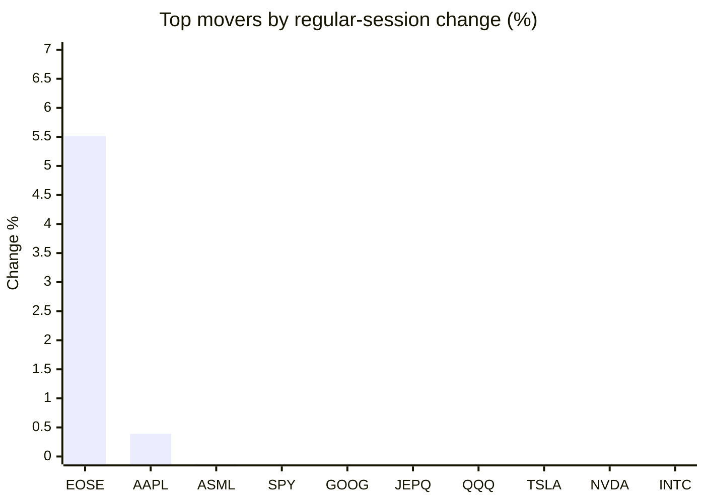
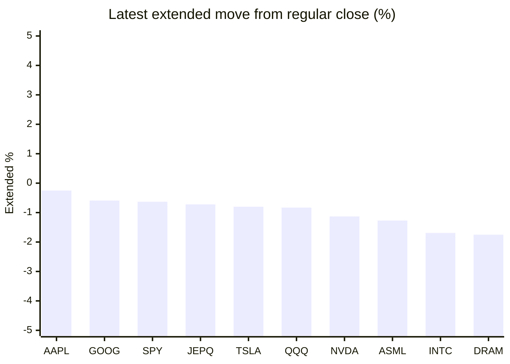

# Stock Brief - 2026-11-15

Generated at 2026-11-15 15:57 +07 from `watchlist.md`.
Prices are snapshots from Yahoo Finance public chart data. Extended/overnight is the latest available pre/post-market datapoint from the same feed.

## Market Snapshot

- SPY: close 754.37, latest extended 749.60, regular move -0.36%, extended move -0.63%
- QQQ: close 679.89, latest extended 674.26, regular move -1.20%, extended move -0.83%
- JEPQ: close 56.19, latest extended 55.78, regular move -1.04%, extended move -0.72%

## Watchlist Prices

| Ticker | Name | Regular close | Latest extended/overnight | Regular move | Extended move | Latest data time | Source |
|---|---|---:|---:|---:|---:|---|---|
| INTC | Intel Corporation | 59.66 USD | 58.65 USD | -2.52% | -1.69% | 2026-11-13 19:59 EST | [Yahoo](https://finance.yahoo.com/quote/INTC/) |
| AVGO | Broadcom Inc. | 347.01 USD | 340.37 USD | -4.76% | -1.91% | 2026-11-13 19:58 EST | [Yahoo](https://finance.yahoo.com/quote/AVGO/) |
| RKLB | Rocket Lab Corporation | 61.53 USD | 59.87 USD | -3.96% | -2.69% | 2026-11-13 19:59 EST | [Yahoo](https://finance.yahoo.com/quote/RKLB/) |
| AAPL | Apple Inc. | 356.27 USD | 355.38 USD | +0.39% | -0.25% | 2026-11-13 19:59 EST | [Yahoo](https://finance.yahoo.com/quote/AAPL/) |
| NVDA | NVIDIA Corporation | 162.85 USD | 161.01 USD | -2.01% | -1.13% | 2026-11-13 19:59 EST | [Yahoo](https://finance.yahoo.com/quote/NVDA/) |
| TSLA | Tesla, Inc. | 390.22 USD | 387.11 USD | -1.82% | -0.80% | 2026-11-13 19:59 EST | [Yahoo](https://finance.yahoo.com/quote/TSLA/) |
| SNDK | Sandisk Corporation | 885.01 USD | 865.23 USD | -5.59% | -2.24% | 2026-11-13 19:59 EST | [Yahoo](https://finance.yahoo.com/quote/SNDK/) |
| QQQ | Invesco QQQ Trust, Series 1 | 679.89 USD | 674.26 USD | -1.20% | -0.83% | 2026-11-13 19:59 EST | [Yahoo](https://finance.yahoo.com/quote/QQQ/) |
| SPY | State Street SPDR S&P 500 ETF T | 754.37 USD | 749.60 USD | -0.36% | -0.63% | 2026-11-13 19:59 EST | [Yahoo](https://finance.yahoo.com/quote/SPY/) |
| JEPQ | JPMorgan Nasdaq Equity Premium  | 56.19 USD | 55.78 USD | -1.04% | -0.72% | 2026-11-13 19:59 EST | [Yahoo](https://finance.yahoo.com/quote/JEPQ/) |
| ASTS | AST SpaceMobile, Inc. | 32.60 USD | 31.70 USD | -5.51% | -2.76% | 2026-11-13 19:59 EST | [Yahoo](https://finance.yahoo.com/quote/ASTS/) |
| MU | Micron Technology, Inc. | 778.31 USD | 761.20 USD | -2.52% | -2.20% | 2026-11-13 19:59 EST | [Yahoo](https://finance.yahoo.com/quote/MU/) |
| IREN | IREN LIMITED | 18.17 USD | 17.68 USD | -6.72% | -2.72% | 2026-11-13 19:59 EST | [Yahoo](https://finance.yahoo.com/quote/IREN/) |
| EOSE | Eos Energy Enterprises, Inc. | 1.91 USD | 1.87 USD | +5.52% | -2.09% | 2026-11-13 19:59 EST | [Yahoo](https://finance.yahoo.com/quote/EOSE/) |
| GOOG | Alphabet Inc. | 292.52 USD | 290.80 USD | -0.96% | -0.59% | 2026-11-13 19:59 EST | [Yahoo](https://finance.yahoo.com/quote/GOOG/) |
| DRAM | Roundhill Memory ETF | 42.40 USD | 41.66 USD | -2.89% | -1.75% | 2026-11-13 19:59 EST | [Yahoo](https://finance.yahoo.com/quote/DRAM/) |
| AMD | Advanced Micro Devices, Inc. | 534.06 USD | 521.20 USD | -8.75% | -2.41% | 2026-11-13 19:59 EST | [Yahoo](https://finance.yahoo.com/quote/AMD/) |
| ASML | ASML Holding N.V. - New York Re | 1,495.16 USD | 1,476.15 USD | -0.13% | -1.27% | 2026-11-13 19:56 EST | [Yahoo](https://finance.yahoo.com/quote/ASML/) |

## Charts

### Top Movers - Regular Session

### Extended / Overnight Move

### Quick Heatmap

| Group | Names in watchlist | Avg regular move | Avg extended move |
|---|---|---:|---:|
| Mega-cap tech | AVGO, AAPL, NVDA, TSLA, GOOG | -1.83% | -0.94% |
| Semis / memory | INTC, SNDK, MU, DRAM, AMD, ASML | -3.73% | -1.93% |
| Space / high beta | RKLB, ASTS, IREN, EOSE | -2.67% | -2.57% |
| ETFs | QQQ, SPY, JEPQ | -0.87% | -0.73% |

## News Headlines

- [Forget Former Nvidia CEO Jensen Huang -- This Is the Real Question Investors Need to Ask About Nvidia Stock](https://www.fool.com/investing/2026/11/15/forget-former-nvidia-ceo-jensen-huang-this-is-the-real-question-investors-need-to-ask-about-nvidia-stock/?.tsrc=rss) (2026-11-15 14:30 Bangkok)
- [Nvidia's Biggest Challenge After Jensen Huang? Finding Another Leader With His 'Sense Of Urgency,' Says Gene Munster](https://stocktwits.com/news-articles/markets/equity/nvidia-biggest-challenge-jensen-huang-gene-munster/cNbE79sR9Qp?.tsrc=rss) (2026-11-15 14:16 Bangkok)
- [‘Tesla of China’ could make cars in Britain as Burnham considers tariffs](https://uk.finance.yahoo.com/news/tesla-china-could-cars-britain-070000350.html?.tsrc=rss) (2026-11-15 14:00 Bangkok)
- [Nvidia's Jensen Huang Is 'Irreplaceable' And Worth $1 Trillion To The Story, Says Dan Ives Amid Support From Elon Musk, Gavin Baker And Others](https://stocktwits.com/news-articles/markets/equity/nvidia-jensen-huang-worth-1-trillion-dan-ives-elon-musk-support/cNbEIBvR9QY?.tsrc=rss) (2026-11-15 13:39 Bangkok)
- [AMD Has Two Big Catalysts Lined Up For 2027 — And Nvidia Should Be Watching, Says IO Fund](https://stocktwits.com/news-articles/markets/equity/amd-two-big-catalysts-2027-nvidia-watching/cNbEERhR9Q8?.tsrc=rss) (2026-11-15 12:53 Bangkok)
- [Nvidia earnings — along with the baggage — top next week's markets](https://www.thestreet.com/investing/nvidia-earnings-along-with-the-baggage-top-next-weeks-markets?.tsrc=rss) (2026-11-15 12:37 Bangkok)
- [1 ETF That Can Turn $500 Monthly Into a $600,000 Portfolio That Pays Out $18,000 Annually](https://www.fool.com/investing/2026/11/14/1-etf-that-can-turn-500-monthly-into-a-600000-portfolio-that-pays-out-usd18-000-annually/?.tsrc=rss) (2026-11-15 11:20 Bangkok)
- [Dow Jones Futures Loom, Bitcoin Dives In Shaky Market Rally; Nvidia Earnings, Anthropic IPO Ahead](https://finance.yahoo.com/m/53e50dc8-f137-3f6c-bfd6-912334fef9f1/dow-jones-futures-loom%2C.html?.tsrc=rss) (2026-11-15 11:05 Bangkok)

## Caveats

- This is not investment advice. Extended-hours prices can be thin and volatile.
- Yahoo public endpoints may lag official exchange data.
