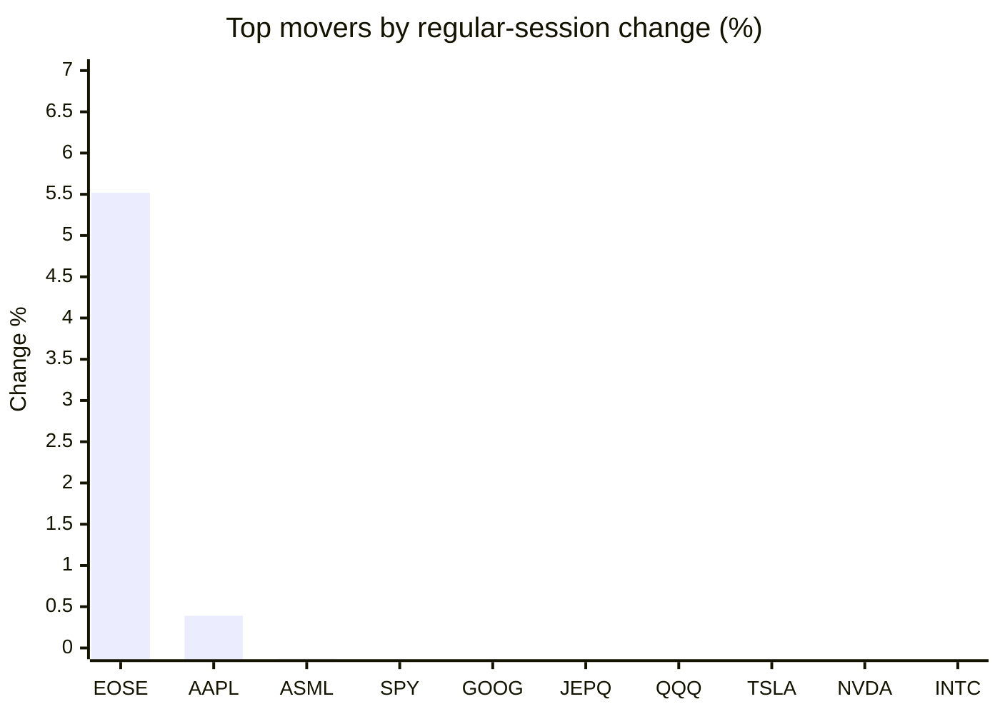
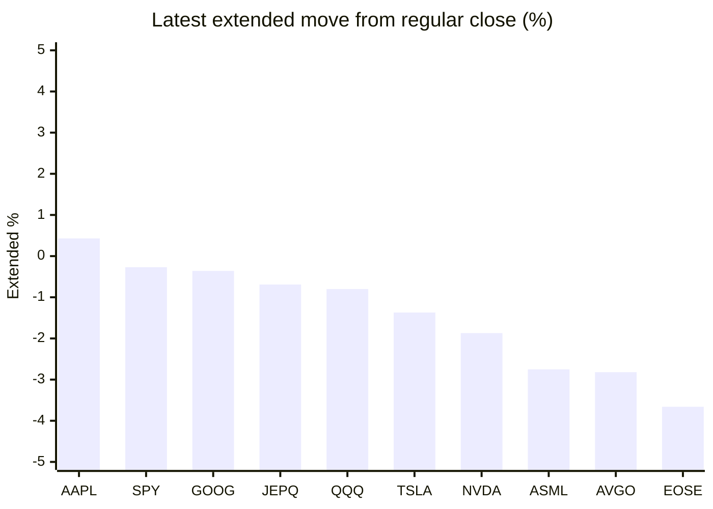

# Stock Brief - 2026-11-16

Generated at 2026-11-16 16:13 +07 from `watchlist.md`.
Prices are snapshots from Yahoo Finance public chart data. Extended/overnight is the latest available pre/post-market datapoint from the same feed.

## Market Snapshot

- SPY: close 754.37, latest extended 752.32, regular move -0.36%, extended move -0.27%
- QQQ: close 679.89, latest extended 674.48, regular move -1.20%, extended move -0.80%
- JEPQ: close 56.19, latest extended 55.80, regular move -1.04%, extended move -0.69%

## Watchlist Prices

| Ticker | Name | Regular close | Latest extended/overnight | Regular move | Extended move | Latest data time | Source |
|---|---|---:|---:|---:|---:|---|---|
| INTC | Intel Corporation | 59.66 USD | 57.16 USD | -2.52% | -4.19% | 2026-11-16 04:12 EST | [Yahoo](https://finance.yahoo.com/quote/INTC/) |
| AVGO | Broadcom Inc. | 347.01 USD | 337.22 USD | -4.76% | -2.82% | 2026-11-16 04:11 EST | [Yahoo](https://finance.yahoo.com/quote/AVGO/) |
| RKLB | Rocket Lab Corporation | 61.53 USD | 58.99 USD | -3.96% | -4.13% | 2026-11-16 04:10 EST | [Yahoo](https://finance.yahoo.com/quote/RKLB/) |
| AAPL | Apple Inc. | 356.27 USD | 357.79 USD | +0.39% | +0.43% | 2026-11-16 04:12 EST | [Yahoo](https://finance.yahoo.com/quote/AAPL/) |
| NVDA | NVIDIA Corporation | 162.85 USD | 159.81 USD | -2.01% | -1.87% | 2026-11-16 04:12 EST | [Yahoo](https://finance.yahoo.com/quote/NVDA/) |
| TSLA | Tesla, Inc. | 390.22 USD | 384.88 USD | -1.82% | -1.37% | 2026-11-16 04:11 EST | [Yahoo](https://finance.yahoo.com/quote/TSLA/) |
| SNDK | Sandisk Corporation | 885.01 USD | 840.66 USD | -5.59% | -5.01% | 2026-11-16 04:12 EST | [Yahoo](https://finance.yahoo.com/quote/SNDK/) |
| QQQ | Invesco QQQ Trust, Series 1 | 679.89 USD | 674.48 USD | -1.20% | -0.80% | 2026-11-16 04:12 EST | [Yahoo](https://finance.yahoo.com/quote/QQQ/) |
| SPY | State Street SPDR S&P 500 ETF T | 754.37 USD | 752.32 USD | -0.36% | -0.27% | 2026-11-16 04:12 EST | [Yahoo](https://finance.yahoo.com/quote/SPY/) |
| JEPQ | JPMorgan Nasdaq Equity Premium  | 56.19 USD | 55.80 USD | -1.04% | -0.69% | 2026-11-16 04:09 EST | [Yahoo](https://finance.yahoo.com/quote/JEPQ/) |
| ASTS | AST SpaceMobile, Inc. | 32.60 USD | 31.08 USD | -5.51% | -4.66% | 2026-11-16 04:12 EST | [Yahoo](https://finance.yahoo.com/quote/ASTS/) |
| MU | Micron Technology, Inc. | 778.31 USD | 744.09 USD | -2.52% | -4.40% | 2026-11-16 04:12 EST | [Yahoo](https://finance.yahoo.com/quote/MU/) |
| IREN | IREN LIMITED | 18.17 USD | 17.31 USD | -6.72% | -4.73% | 2026-11-16 04:12 EST | [Yahoo](https://finance.yahoo.com/quote/IREN/) |
| EOSE | Eos Energy Enterprises, Inc. | 1.91 USD | 1.84 USD | +5.52% | -3.66% | 2026-11-16 04:12 EST | [Yahoo](https://finance.yahoo.com/quote/EOSE/) |
| GOOG | Alphabet Inc. | 292.52 USD | 291.47 USD | -0.96% | -0.36% | 2026-11-16 04:12 EST | [Yahoo](https://finance.yahoo.com/quote/GOOG/) |
| DRAM | Roundhill Memory ETF | 42.40 USD | 40.53 USD | -2.89% | -4.42% | 2026-11-16 04:12 EST | [Yahoo](https://finance.yahoo.com/quote/DRAM/) |
| AMD | Advanced Micro Devices, Inc. | 534.06 USD | 513.35 USD | -8.75% | -3.88% | 2026-11-16 04:12 EST | [Yahoo](https://finance.yahoo.com/quote/AMD/) |
| ASML | ASML Holding N.V. - New York Re | 1,495.16 USD | 1,454.03 USD | -0.13% | -2.75% | 2026-11-16 04:12 EST | [Yahoo](https://finance.yahoo.com/quote/ASML/) |

## Charts

### Top Movers - Regular Session

### Extended / Overnight Move

### Quick Heatmap

| Group | Names in watchlist | Avg regular move | Avg extended move |
|---|---|---:|---:|
| Mega-cap tech | AVGO, AAPL, NVDA, TSLA, GOOG | -1.83% | -1.20% |
| Semis / memory | INTC, SNDK, MU, DRAM, AMD, ASML | -3.73% | -4.11% |
| Space / high beta | RKLB, ASTS, IREN, EOSE | -2.67% | -4.30% |
| ETFs | QQQ, SPY, JEPQ | -0.87% | -0.59% |

## News Headlines

- [NVDA Earnings Preview: Nvidia’s AI Engine Is Running, But Can It Keep Growing Without Its Chief Architect?](https://stocktwits.com/news-articles/markets/equity/nvda-earnings-preview-nvidia-s-ai-engine-is-running-but-can-it-keep-growing-without-its-chief-architect/cNb71cZR9XZ?.tsrc=rss) (2026-11-16 15:56 Bangkok)
- [Market Chatter: Nvidia's Jensen Huang Discusses Return as CEO With Allies](https://finance.yahoo.com/markets/stocks/articles/market-chatter-nvidia-apos-jensen-084807880.html?.tsrc=rss) (2026-11-16 15:48 Bangkok)
- [Stocks extend losses as traders await Nvidia earnings and Anthropic IPO](https://www.euronews.com/2026/11/16/stocks-extend-losses-as-traders-await-nvidia-earnings-and-anthropic-ipo?.tsrc=rss) (2026-11-16 15:47 Bangkok)
- [European shares flat as Nvidia turmoil lingers and markets brace for AI mega-tests](https://finance.yahoo.com/markets/stocks/articles/european-shares-flat-nvidia-turmoil-083952986.html?.tsrc=rss) (2026-11-16 15:39 Bangkok)
- [TSLA, SPCX Diverge Overnight As Retail Traders Split On Merger Winner — Could SpaceX Get Tesla’s S&P 500 Seat?](https://stocktwits.com/news-articles/markets/equity/tsla-spcx-retail-split-merger-winner-could-spacex-get-tesla-sp500-seat/cNb7KL4R9Xm?.tsrc=rss) (2026-11-16 15:31 Bangkok)
- [Stocks extend losses as traders digest Nvidia fallout](https://finance.yahoo.com/markets/stocks/articles/stocks-extend-losses-traders-digest-030006305.html?.tsrc=rss) (2026-11-16 15:22 Bangkok)
- [Retail Traders' Power Fuels Volatility: Market Analysis](https://finance.yahoo.com/video/retail-traders-power-fuels-volatility-081723893.html?.tsrc=rss) (2026-11-16 15:17 Bangkok)
- [November 2026 Cash Flow Stocks Like NVIDIA Stock](https://finance.yahoo.com/markets/stocks/articles/november-2026-cash-flow-stocks-080926567.html?.tsrc=rss) (2026-11-16 15:09 Bangkok)

## Caveats

- This is not investment advice. Extended-hours prices can be thin and volatile.
- Yahoo public endpoints may lag official exchange data.
