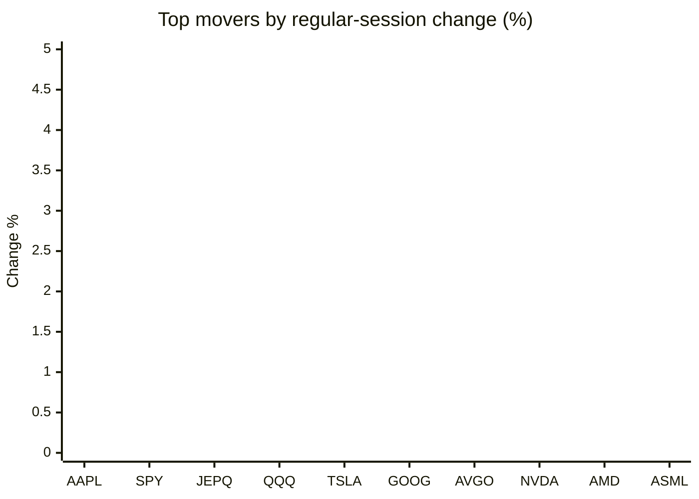
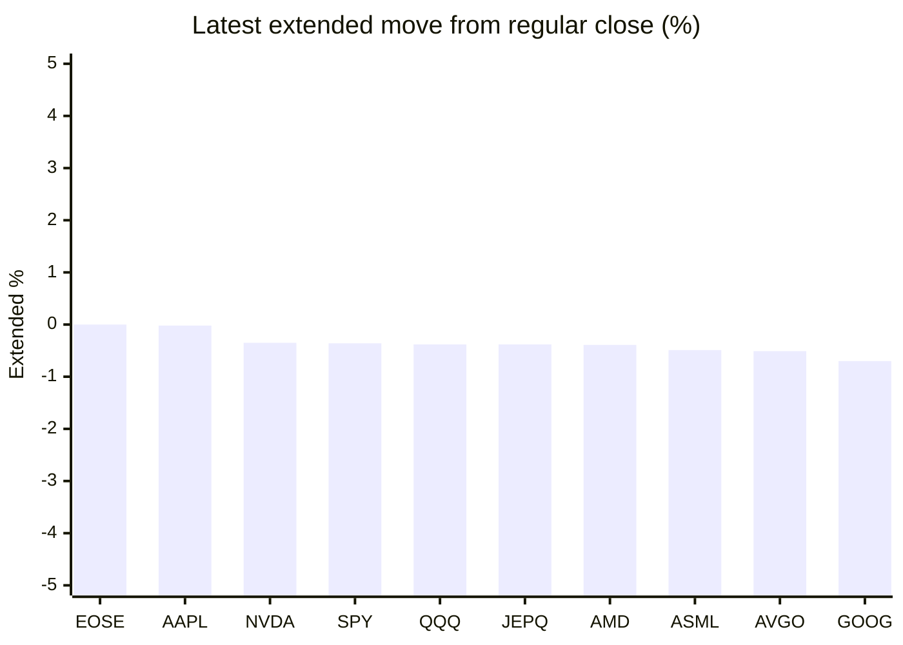

# Stock Brief - 2026-11-17

Generated at 2026-11-17 17:23 +07 from `watchlist.md`.
Prices are snapshots from Yahoo Finance public chart data. Extended/overnight is the latest available pre/post-market datapoint from the same feed.

## Market Snapshot

- SPY: close 739.95, latest extended 737.28, regular move -1.91%, extended move -0.36%
- QQQ: close 661.75, latest extended 659.23, regular move -2.67%, extended move -0.38%
- JEPQ: close 54.86, latest extended 54.65, regular move -2.37%, extended move -0.38%

## Watchlist Prices

| Ticker | Name | Regular close | Latest extended/overnight | Regular move | Extended move | Latest data time | Source |
|---|---|---:|---:|---:|---:|---|---|
| INTC | Intel Corporation | 55.47 USD | 53.61 USD | -7.02% | -3.35% | 2026-11-17 05:23 EST | [Yahoo](https://finance.yahoo.com/quote/INTC/) |
| AVGO | Broadcom Inc. | 333.40 USD | 331.69 USD | -3.92% | -0.51% | 2026-11-17 05:18 EST | [Yahoo](https://finance.yahoo.com/quote/AVGO/) |
| RKLB | Rocket Lab Corporation | 57.37 USD | 56.53 USD | -6.76% | -1.46% | 2026-11-17 05:23 EST | [Yahoo](https://finance.yahoo.com/quote/RKLB/) |
| AAPL | Apple Inc. | 352.78 USD | 352.70 USD | -0.98% | -0.02% | 2026-11-17 05:19 EST | [Yahoo](https://finance.yahoo.com/quote/AAPL/) |
| NVDA | NVIDIA Corporation | 156.14 USD | 155.59 USD | -4.12% | -0.35% | 2026-11-17 05:23 EST | [Yahoo](https://finance.yahoo.com/quote/NVDA/) |
| TSLA | Tesla, Inc. | 379.74 USD | 376.98 USD | -2.69% | -0.73% | 2026-11-17 05:21 EST | [Yahoo](https://finance.yahoo.com/quote/TSLA/) |
| SNDK | Sandisk Corporation | 809.11 USD | 792.98 USD | -8.58% | -1.99% | 2026-11-17 05:23 EST | [Yahoo](https://finance.yahoo.com/quote/SNDK/) |
| QQQ | Invesco QQQ Trust, Series 1 | 661.75 USD | 659.23 USD | -2.67% | -0.38% | 2026-11-17 05:23 EST | [Yahoo](https://finance.yahoo.com/quote/QQQ/) |
| SPY | State Street SPDR S&P 500 ETF T | 739.95 USD | 737.28 USD | -1.91% | -0.36% | 2026-11-17 05:22 EST | [Yahoo](https://finance.yahoo.com/quote/SPY/) |
| JEPQ | JPMorgan Nasdaq Equity Premium  | 54.86 USD | 54.65 USD | -2.37% | -0.38% | 2026-11-17 05:11 EST | [Yahoo](https://finance.yahoo.com/quote/JEPQ/) |
| ASTS | AST SpaceMobile, Inc. | 28.58 USD | 28.07 USD | -12.33% | -1.78% | 2026-11-17 05:22 EST | [Yahoo](https://finance.yahoo.com/quote/ASTS/) |
| MU | Micron Technology, Inc. | 719.02 USD | 712.86 USD | -7.62% | -0.86% | 2026-11-17 05:23 EST | [Yahoo](https://finance.yahoo.com/quote/MU/) |
| IREN | IREN LIMITED | 16.39 USD | 16.19 USD | -9.80% | -1.22% | 2026-11-17 05:23 EST | [Yahoo](https://finance.yahoo.com/quote/IREN/) |
| EOSE | Eos Energy Enterprises, Inc. | 1.71 USD | 1.71 USD | -10.47% | -0.00% | 2026-11-17 04:55 EST | [Yahoo](https://finance.yahoo.com/quote/EOSE/) |
| GOOG | Alphabet Inc. | 281.26 USD | 279.28 USD | -3.85% | -0.70% | 2026-11-17 05:23 EST | [Yahoo](https://finance.yahoo.com/quote/GOOG/) |
| DRAM | Roundhill Memory ETF | 39.27 USD | 38.84 USD | -7.38% | -1.09% | 2026-11-17 05:22 EST | [Yahoo](https://finance.yahoo.com/quote/DRAM/) |
| AMD | Advanced Micro Devices, Inc. | 504.28 USD | 502.33 USD | -5.58% | -0.39% | 2026-11-17 05:22 EST | [Yahoo](https://finance.yahoo.com/quote/AMD/) |
| ASML | ASML Holding N.V. - New York Re | 1,406.79 USD | 1,399.94 USD | -5.91% | -0.49% | 2026-11-17 05:23 EST | [Yahoo](https://finance.yahoo.com/quote/ASML/) |

## Charts

### Top Movers - Regular Session

### Extended / Overnight Move

### Quick Heatmap

| Group | Names in watchlist | Avg regular move | Avg extended move |
|---|---|---:|---:|
| Mega-cap tech | AVGO, AAPL, NVDA, TSLA, GOOG | -3.11% | -0.46% |
| Semis / memory | INTC, SNDK, MU, DRAM, AMD, ASML | -7.01% | -1.36% |
| Space / high beta | RKLB, ASTS, IREN, EOSE | -9.84% | -1.12% |
| ETFs | QQQ, SPY, JEPQ | -2.32% | -0.38% |

## News Headlines

- [Jensen Huang looks to have accepted his fate with Nvidia: He cleaned up his X profile](https://finance.yahoo.com/markets/stocks/article/jensen-huang-looks-to-have-accepted-his-fate-with-nvidia-he-cleaned-up-his-x-profile-101253477.html?.tsrc=rss) (2026-11-17 17:12 Bangkok)
- [Stock market today: Dow, S&P 500 futures slip, and Nasdaq futures slip in countdown to Nvidia earnings](https://finance.yahoo.com/markets/live/stock-market-today-tuesday-november-17-dow-sp-500-nasdaq-nvidia-earnings-091546152.html?.tsrc=rss) (2026-11-17 16:15 Bangkok)
- [Tesla is seemingly rushing Cybercab production to win a bet with a YouTuber. Reckless, or Elon Musk’s genius at work?](https://finance.yahoo.com/technology/articles/tesla-seemingly-rushing-cybercab-production-100000963.html?.tsrc=rss) (2026-11-17 17:00 Bangkok)
- [NVIDIA Board of Directors Establishes National Security and Export Control Oversight Committee](https://finance.yahoo.com/technology/articles/nvidia-board-directors-establishes-national-100000145.html?.tsrc=rss) (2026-11-17 17:00 Bangkok)
- [Nvidia Board Not Considering Jensen Huang's Return: Report](https://decrypt.co/383411/nvidia-board-not-considering-jensen-huangs-return-report?.tsrc=rss) (2026-11-17 16:54 Bangkok)
- [Nvidia earnings in focus amid Huang exit fallout - what’s moving markets](https://finance.yahoo.com/markets/stocks/articles/nvidia-earnings-focus-amid-huang-093728228.html?.tsrc=rss) (2026-11-17 16:37 Bangkok)
- [Nvidia Stock Fell Below $170. Here’s Why It Could Be a Screaming Buy.](https://www.fool.com/investing/2026/11/17/nvidia-stock-fell-below-170-heres-why-it-could-be-a-screaming-buy/?.tsrc=rss) (2026-11-17 16:37 Bangkok)
- [Head of China's Baidu warns of AI 'bubble' ahead of APEC talks](https://finance.yahoo.com/technology/ai/articles/head-chinas-baidu-warns-ai-093346870.html?.tsrc=rss) (2026-11-17 16:33 Bangkok)

## Caveats

- This is not investment advice. Extended-hours prices can be thin and volatile.
- Yahoo public endpoints may lag official exchange data.
