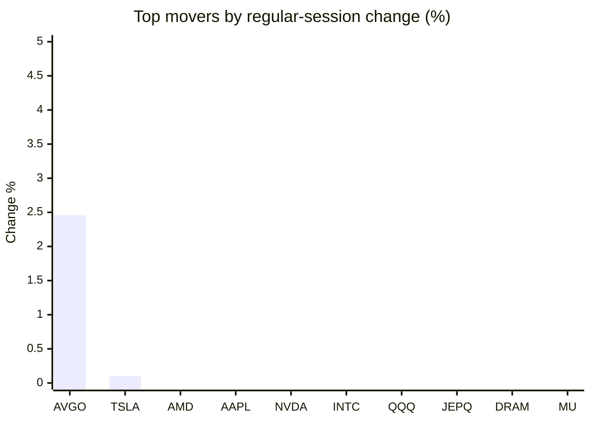
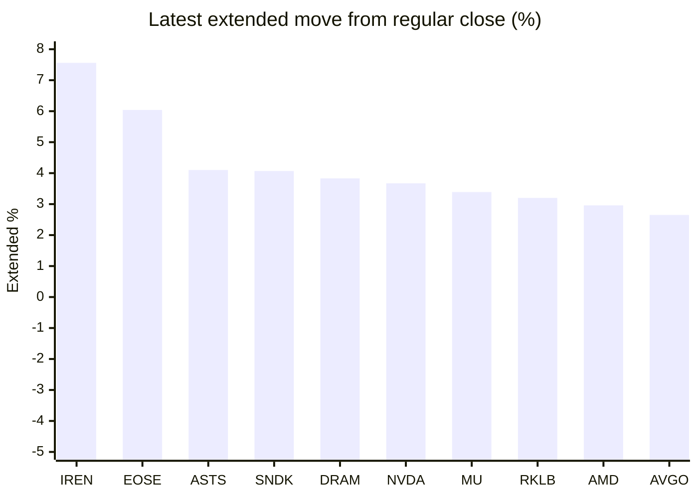

# Stock Brief - 2026-11-18

Generated at 2026-11-18 16:53 +07 from `watchlist.md`.
Prices are snapshots from Yahoo Finance public chart data. Extended/overnight is the latest available pre/post-market datapoint from the same feed.

## Market Snapshot

- SPY: close 732.44, latest extended 736.74, regular move -1.01%, extended move +0.59%
- QQQ: close 656.95, latest extended 664.56, regular move -0.73%, extended move +1.16%
- JEPQ: close 54.45, latest extended 55.03, regular move -0.75%, extended move +1.06%

## Watchlist Prices

| Ticker | Name | Regular close | Latest extended/overnight | Regular move | Extended move | Latest data time | Source |
|---|---|---:|---:|---:|---:|---|---|
| INTC | Intel Corporation | 55.17 USD | 56.21 USD | -0.54% | +1.89% | 2026-11-18 04:53 EST | [Yahoo](https://finance.yahoo.com/quote/INTC/) |
| AVGO | Broadcom Inc. | 341.60 USD | 350.65 USD | +2.46% | +2.65% | 2026-11-18 04:53 EST | [Yahoo](https://finance.yahoo.com/quote/AVGO/) |
| RKLB | Rocket Lab Corporation | 55.05 USD | 56.81 USD | -4.04% | +3.20% | 2026-11-18 04:52 EST | [Yahoo](https://finance.yahoo.com/quote/RKLB/) |
| AAPL | Apple Inc. | 351.91 USD | 350.75 USD | -0.25% | -0.33% | 2026-11-18 04:45 EST | [Yahoo](https://finance.yahoo.com/quote/AAPL/) |
| NVDA | NVIDIA Corporation | 155.46 USD | 161.17 USD | -0.44% | +3.67% | 2026-11-18 04:53 EST | [Yahoo](https://finance.yahoo.com/quote/NVDA/) |
| TSLA | Tesla, Inc. | 380.11 USD | 384.75 USD | +0.10% | +1.22% | 2026-11-18 04:53 EST | [Yahoo](https://finance.yahoo.com/quote/TSLA/) |
| SNDK | Sandisk Corporation | 797.24 USD | 829.71 USD | -1.47% | +4.07% | 2026-11-18 04:53 EST | [Yahoo](https://finance.yahoo.com/quote/SNDK/) |
| QQQ | Invesco QQQ Trust, Series 1 | 656.95 USD | 664.56 USD | -0.73% | +1.16% | 2026-11-18 04:53 EST | [Yahoo](https://finance.yahoo.com/quote/QQQ/) |
| SPY | State Street SPDR S&P 500 ETF T | 732.44 USD | 736.74 USD | -1.01% | +0.59% | 2026-11-18 04:53 EST | [Yahoo](https://finance.yahoo.com/quote/SPY/) |
| JEPQ | JPMorgan Nasdaq Equity Premium  | 54.45 USD | 55.03 USD | -0.75% | +1.06% | 2026-11-18 04:49 EST | [Yahoo](https://finance.yahoo.com/quote/JEPQ/) |
| ASTS | AST SpaceMobile, Inc. | 27.59 USD | 28.72 USD | -3.46% | +4.10% | 2026-11-18 04:49 EST | [Yahoo](https://finance.yahoo.com/quote/ASTS/) |
| MU | Micron Technology, Inc. | 712.42 USD | 736.55 USD | -0.92% | +3.39% | 2026-11-18 04:53 EST | [Yahoo](https://finance.yahoo.com/quote/MU/) |
| IREN | IREN LIMITED | 15.81 USD | 17.00 USD | -3.57% | +7.56% | 2026-11-18 04:53 EST | [Yahoo](https://finance.yahoo.com/quote/IREN/) |
| EOSE | Eos Energy Enterprises, Inc. | 1.49 USD | 1.58 USD | -12.87% | +6.04% | 2026-11-18 04:53 EST | [Yahoo](https://finance.yahoo.com/quote/EOSE/) |
| GOOG | Alphabet Inc. | 277.60 USD | 280.40 USD | -1.30% | +1.01% | 2026-11-18 04:53 EST | [Yahoo](https://finance.yahoo.com/quote/GOOG/) |
| DRAM | Roundhill Memory ETF | 38.93 USD | 40.42 USD | -0.87% | +3.83% | 2026-11-18 04:49 EST | [Yahoo](https://finance.yahoo.com/quote/DRAM/) |
| AMD | Advanced Micro Devices, Inc. | 503.41 USD | 518.30 USD | -0.17% | +2.96% | 2026-11-18 04:53 EST | [Yahoo](https://finance.yahoo.com/quote/AMD/) |
| ASML | ASML Holding N.V. - New York Re | 1,383.11 USD | 1,405.74 USD | -1.68% | +1.64% | 2026-11-18 04:51 EST | [Yahoo](https://finance.yahoo.com/quote/ASML/) |

## Charts

### Top Movers - Regular Session

### Extended / Overnight Move

### Quick Heatmap

| Group | Names in watchlist | Avg regular move | Avg extended move |
|---|---|---:|---:|
| Mega-cap tech | AVGO, AAPL, NVDA, TSLA, GOOG | +0.11% | +1.64% |
| Semis / memory | INTC, SNDK, MU, DRAM, AMD, ASML | -0.94% | +2.96% |
| Space / high beta | RKLB, ASTS, IREN, EOSE | -5.99% | +5.22% |
| ETFs | QQQ, SPY, JEPQ | -0.83% | +0.93% |

## News Headlines

- [Stock market today: Dow, S&P 500, Nasdaq futures rise after Nvidia clears hurdle, Anthropic prepares to price its IPO](https://finance.yahoo.com/markets/live/stock-market-today-wednesday-november-18-dow-sp-500-nasdaq-nvidia-anthropic-ipo-090613569.html?.tsrc=rss) (2026-11-18 16:06 Bangkok)
- [Why CoreWeave May Be the Biggest Loser From Jensen Huang's Resignation](https://www.fool.com/investing/2026/11/18/why-coreweave-biggest-loser-jensen-huang-nvidia-resignation/?.tsrc=rss) (2026-11-18 16:45 Bangkok)
- [Prediction: This Will Be Micron’s Stock Price in 3 Years](https://www.fool.com/investing/2026/11/18/prediction-this-will-be-micron-s-stock-price-in-3-years/?.tsrc=rss) (2026-11-18 16:35 Bangkok)
- [Stock Market Sell-Off: 3 Consumer Stocks I'd Buy With $1,000 Before the End of November](https://www.fool.com/investing/2026/11/18/stock-market-sell-off-3-consumer-stocks-id-buy-with-1000-before-the-end-of-november/?.tsrc=rss) (2026-11-18 16:22 Bangkok)
- [Nvidia's Troubles: 1 Crucial Lesson for Investors](https://www.fool.com/investing/2026/11/18/nvidia-troubles-1-crucial-lesson-for-investors/?.tsrc=rss) (2026-11-18 16:15 Bangkok)
- [Samsung Electronics (KOSE:A005930) Nears Rare Multi Year DRAM Supply Deal](https://finance.yahoo.com/markets/stocks/articles/samsung-electronics-kose-a005930-nears-091338091.html?.tsrc=rss) (2026-11-18 16:13 Bangkok)
- [Market Chatter: Nvidia Co-Founder Jensen Huang Retains Right to Nominate Two Directors](https://finance.yahoo.com/markets/stocks/articles/market-chatter-nvidia-co-founder-091102982.html?.tsrc=rss) (2026-11-18 16:11 Bangkok)
- [Tesla Is Now Taking Cybercab Orders. Here's Where I Think the Stock Will Be in 2030.](https://www.fool.com/investing/2026/11/18/tesla-is-now-taking-cybercab-orders-here-s-where-i-think-the-stock-will-be-in-2030/?.tsrc=rss) (2026-11-18 16:03 Bangkok)

## Caveats

- This is not investment advice. Extended-hours prices can be thin and volatile.
- Yahoo public endpoints may lag official exchange data.
