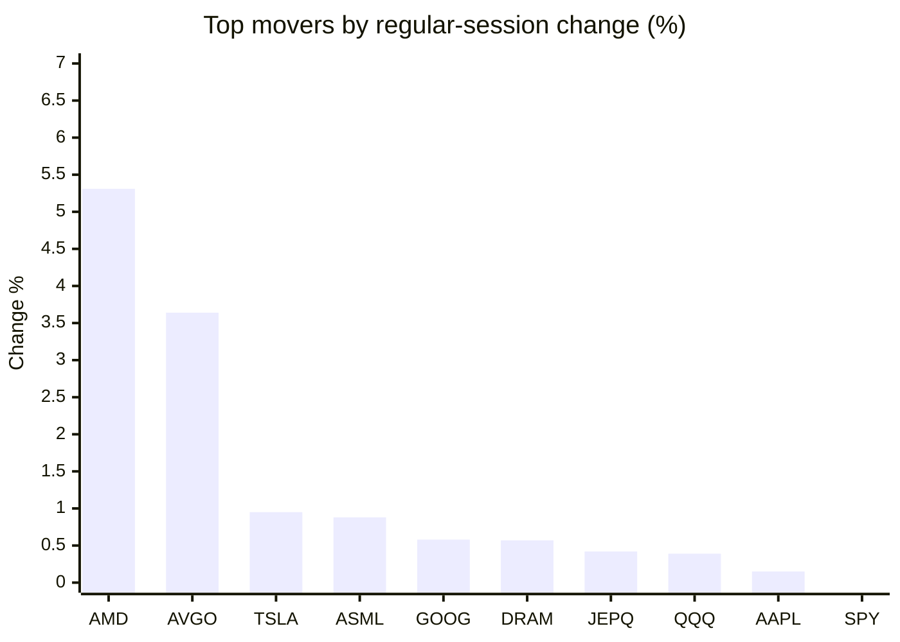
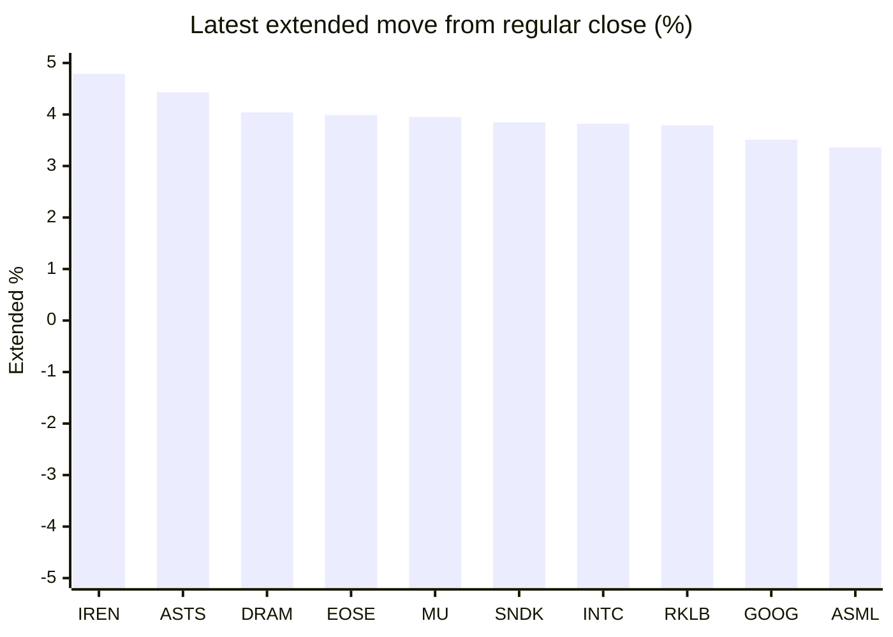

# Stock Brief - 2026-11-19

Generated at 2026-11-19 17:00 +07 from `watchlist.md`.
Prices are snapshots from Yahoo Finance public chart data. Extended/overnight is the latest available pre/post-market datapoint from the same feed.

## Market Snapshot

- SPY: close 730.20, latest extended 737.99, regular move -0.31%, extended move +1.07%
- QQQ: close 659.51, latest extended 672.00, regular move +0.39%, extended move +1.89%
- JEPQ: close 54.68, latest extended 55.58, regular move +0.42%, extended move +1.65%

## Watchlist Prices

| Ticker | Name | Regular close | Latest extended/overnight | Regular move | Extended move | Latest data time | Source |
|---|---|---:|---:|---:|---:|---|---|
| INTC | Intel Corporation | 54.67 USD | 56.76 USD | -0.91% | +3.82% | 2026-11-19 05:00 EST | [Yahoo](https://finance.yahoo.com/quote/INTC/) |
| AVGO | Broadcom Inc. | 354.05 USD | 363.80 USD | +3.64% | +2.75% | 2026-11-19 04:59 EST | [Yahoo](https://finance.yahoo.com/quote/AVGO/) |
| RKLB | Rocket Lab Corporation | 53.07 USD | 55.08 USD | -3.60% | +3.79% | 2026-11-19 04:56 EST | [Yahoo](https://finance.yahoo.com/quote/RKLB/) |
| AAPL | Apple Inc. | 352.45 USD | 353.92 USD | +0.15% | +0.42% | 2026-11-19 04:59 EST | [Yahoo](https://finance.yahoo.com/quote/AAPL/) |
| NVDA | NVIDIA Corporation | 150.96 USD | 153.53 USD | -2.89% | +1.70% | 2026-11-19 05:00 EST | [Yahoo](https://finance.yahoo.com/quote/NVDA/) |
| TSLA | Tesla, Inc. | 383.72 USD | 389.31 USD | +0.95% | +1.46% | 2026-11-19 05:00 EST | [Yahoo](https://finance.yahoo.com/quote/TSLA/) |
| SNDK | Sandisk Corporation | 776.22 USD | 806.13 USD | -2.64% | +3.85% | 2026-11-19 05:00 EST | [Yahoo](https://finance.yahoo.com/quote/SNDK/) |
| QQQ | Invesco QQQ Trust, Series 1 | 659.51 USD | 672.00 USD | +0.39% | +1.89% | 2026-11-19 05:00 EST | [Yahoo](https://finance.yahoo.com/quote/QQQ/) |
| SPY | State Street SPDR S&P 500 ETF T | 730.20 USD | 737.99 USD | -0.31% | +1.07% | 2026-11-19 05:00 EST | [Yahoo](https://finance.yahoo.com/quote/SPY/) |
| JEPQ | JPMorgan Nasdaq Equity Premium  | 54.68 USD | 55.58 USD | +0.42% | +1.65% | 2026-11-19 04:58 EST | [Yahoo](https://finance.yahoo.com/quote/JEPQ/) |
| ASTS | AST SpaceMobile, Inc. | 25.49 USD | 26.62 USD | -7.61% | +4.43% | 2026-11-19 04:57 EST | [Yahoo](https://finance.yahoo.com/quote/ASTS/) |
| MU | Micron Technology, Inc. | 705.27 USD | 733.16 USD | -1.00% | +3.95% | 2026-11-19 05:00 EST | [Yahoo](https://finance.yahoo.com/quote/MU/) |
| IREN | IREN LIMITED | 15.24 USD | 15.97 USD | -3.57% | +4.79% | 2026-11-19 04:59 EST | [Yahoo](https://finance.yahoo.com/quote/IREN/) |
| EOSE | Eos Energy Enterprises, Inc. | 1.48 USD | 1.54 USD | -0.67% | +3.99% | 2026-11-19 04:59 EST | [Yahoo](https://finance.yahoo.com/quote/EOSE/) |
| GOOG | Alphabet Inc. | 279.20 USD | 288.99 USD | +0.58% | +3.51% | 2026-11-19 05:00 EST | [Yahoo](https://finance.yahoo.com/quote/GOOG/) |
| DRAM | Roundhill Memory ETF | 39.15 USD | 40.73 USD | +0.57% | +4.04% | 2026-11-19 05:00 EST | [Yahoo](https://finance.yahoo.com/quote/DRAM/) |
| AMD | Advanced Micro Devices, Inc. | 530.14 USD | 544.21 USD | +5.31% | +2.65% | 2026-11-19 05:00 EST | [Yahoo](https://finance.yahoo.com/quote/AMD/) |
| ASML | ASML Holding N.V. - New York Re | 1,395.27 USD | 1,442.22 USD | +0.88% | +3.36% | 2026-11-19 04:57 EST | [Yahoo](https://finance.yahoo.com/quote/ASML/) |

## Charts

### Top Movers - Regular Session

### Extended / Overnight Move

### Quick Heatmap

| Group | Names in watchlist | Avg regular move | Avg extended move |
|---|---|---:|---:|
| Mega-cap tech | AVGO, AAPL, NVDA, TSLA, GOOG | +0.49% | +1.97% |
| Semis / memory | INTC, SNDK, MU, DRAM, AMD, ASML | +0.37% | +3.61% |
| Space / high beta | RKLB, ASTS, IREN, EOSE | -3.86% | +4.25% |
| ETFs | QQQ, SPY, JEPQ | +0.17% | +1.54% |

## News Headlines

- [Market Chatter: Tesla to Continue Boosting Production at China Factory](https://finance.yahoo.com/markets/stocks/articles/market-chatter-tesla-continue-boosting-094949764.html?.tsrc=rss) (2026-11-19 16:49 Bangkok)
- [Anthropic's record IPO lands as Nvidia suffers its worst run since 2008](https://www.euronews.com/2026/11/19/anthropics-record-ipo-lands-as-nvidia-suffers-its-worst-run-since-2008?.tsrc=rss) (2026-11-19 16:44 Bangkok)
- [Campaign Urges Ripple to Burn $30B in XRP as Analyst Cites Tesla in $70 XRP Call](https://www.ccn.com/news/crypto/campaign-urges-ripple-to-burn-30b-in-xrp-as-analyst-cites-tesla-in-70-xrp-call/?.tsrc=rss) (2026-11-19 16:19 Bangkok)
- [2 Words From Nvidia’s Colette Kress That Should Reassure Investors](https://www.fool.com/investing/2026/11/19/2-words-from-nvidia-s-colette-kress-that-should-reassure-investors/?.tsrc=rss) (2026-11-19 16:15 Bangkok)
- [3 Growth Stocks With Earnings Growth Over 24%](https://finance.yahoo.com/markets/stocks/articles/3-growth-stocks-earnings-growth-091033259.html?.tsrc=rss) (2026-11-19 16:10 Bangkok)
- [NVDA, INTC Stocks Ease Post 5-Day Rout: After Meeting Xi Jinping, Trump Says Nvidia Blackwell Chips Could Reach China Within 2-3 Years](https://stocktwits.com/news-articles/markets/equity/nvda-intc-stocks-ease-post-5-day-rout-after-meeting-xi-jinping-trump-says-nvidia-blackwell-chips-could-reach-china-within-2-3-years/cNbiTxFR9io?.tsrc=rss) (2026-11-19 15:33 Bangkok)
- [Tech firms rise after record Anthropic IPO but Nvidia casts shadow](https://finance.yahoo.com/markets/world-indices/articles/asian-stocks-drop-anthropics-record-025108034.html?.tsrc=rss) (2026-11-19 15:21 Bangkok)
- [If a Stock Market Crash Is Coming, History Says This 1 Investing Move Has Never Once Failed](https://www.fool.com/investing/2026/11/19/if-a-stock-market-crash-is-coming-history-says-this-1-investing-move-has-never-once-failed/?.tsrc=rss) (2026-11-19 14:50 Bangkok)

## Caveats

- This is not investment advice. Extended-hours prices can be thin and volatile.
- Yahoo public endpoints may lag official exchange data.
