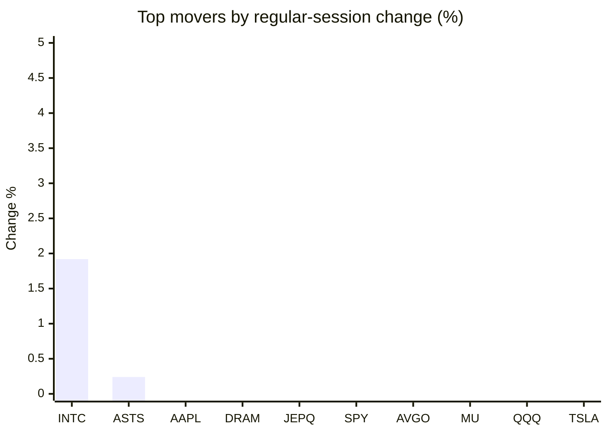
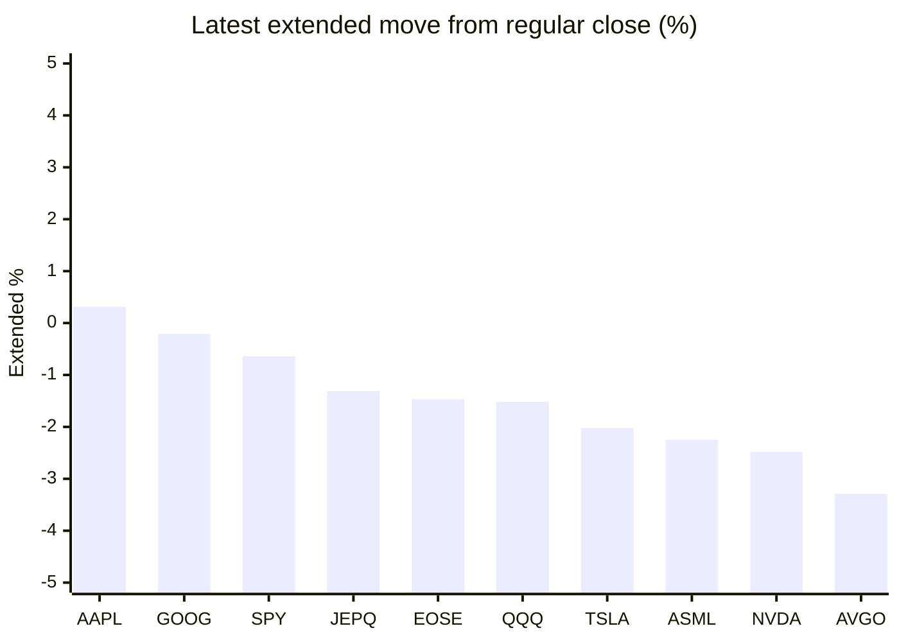

# Stock Brief - 2026-11-20

Generated at 2026-11-20 16:49 +07 from `watchlist.md`.
Prices are snapshots from Yahoo Finance public chart data. Extended/overnight is the latest available pre/post-market datapoint from the same feed.

## Market Snapshot

- SPY: close 715.87, latest extended 711.27, regular move -1.96%, extended move -0.64%
- QQQ: close 645.04, latest extended 635.23, regular move -2.19%, extended move -1.52%
- JEPQ: close 53.63, latest extended 52.93, regular move -1.92%, extended move -1.31%

## Watchlist Prices

| Ticker | Name | Regular close | Latest extended/overnight | Regular move | Extended move | Latest data time | Source |
|---|---|---:|---:|---:|---:|---|---|
| INTC | Intel Corporation | 55.72 USD | 53.10 USD | +1.92% | -4.70% | 2026-11-20 04:49 EST | [Yahoo](https://finance.yahoo.com/quote/INTC/) |
| AVGO | Broadcom Inc. | 346.65 USD | 335.23 USD | -2.09% | -3.29% | 2026-11-20 04:49 EST | [Yahoo](https://finance.yahoo.com/quote/AVGO/) |
| RKLB | Rocket Lab Corporation | 50.99 USD | 48.90 USD | -3.92% | -4.10% | 2026-11-20 04:49 EST | [Yahoo](https://finance.yahoo.com/quote/RKLB/) |
| AAPL | Apple Inc. | 349.21 USD | 350.28 USD | -0.92% | +0.31% | 2026-11-20 04:49 EST | [Yahoo](https://finance.yahoo.com/quote/AAPL/) |
| NVDA | NVIDIA Corporation | 145.98 USD | 142.36 USD | -3.30% | -2.48% | 2026-11-20 04:49 EST | [Yahoo](https://finance.yahoo.com/quote/NVDA/) |
| TSLA | Tesla, Inc. | 374.41 USD | 366.85 USD | -2.43% | -2.02% | 2026-11-20 04:49 EST | [Yahoo](https://finance.yahoo.com/quote/TSLA/) |
| SNDK | Sandisk Corporation | 94.39 USD | 88.21 USD | -2.71% | -6.55% | 2026-11-20 04:49 EST | [Yahoo](https://finance.yahoo.com/quote/SNDK/) |
| QQQ | Invesco QQQ Trust, Series 1 | 645.04 USD | 635.23 USD | -2.19% | -1.52% | 2026-11-20 04:49 EST | [Yahoo](https://finance.yahoo.com/quote/QQQ/) |
| SPY | State Street SPDR S&P 500 ETF T | 715.87 USD | 711.27 USD | -1.96% | -0.64% | 2026-11-20 04:49 EST | [Yahoo](https://finance.yahoo.com/quote/SPY/) |
| JEPQ | JPMorgan Nasdaq Equity Premium  | 53.63 USD | 52.93 USD | -1.92% | -1.31% | 2026-11-20 04:46 EST | [Yahoo](https://finance.yahoo.com/quote/JEPQ/) |
| ASTS | AST SpaceMobile, Inc. | 25.55 USD | 24.37 USD | +0.24% | -4.62% | 2026-11-20 04:49 EST | [Yahoo](https://finance.yahoo.com/quote/ASTS/) |
| MU | Micron Technology, Inc. | 690.44 USD | 662.85 USD | -2.10% | -4.00% | 2026-11-20 04:49 EST | [Yahoo](https://finance.yahoo.com/quote/MU/) |
| IREN | IREN LIMITED | 14.41 USD | 13.82 USD | -5.45% | -4.10% | 2026-11-20 04:49 EST | [Yahoo](https://finance.yahoo.com/quote/IREN/) |
| EOSE | Eos Energy Enterprises, Inc. | 1.36 USD | 1.34 USD | -8.11% | -1.47% | 2026-11-20 04:42 EST | [Yahoo](https://finance.yahoo.com/quote/EOSE/) |
| GOOG | Alphabet Inc. | 271.02 USD | 270.46 USD | -2.93% | -0.21% | 2026-11-20 04:48 EST | [Yahoo](https://finance.yahoo.com/quote/GOOG/) |
| DRAM | Roundhill Memory ETF | 38.43 USD | 37.04 USD | -1.84% | -3.62% | 2026-11-20 04:48 EST | [Yahoo](https://finance.yahoo.com/quote/DRAM/) |
| AMD | Advanced Micro Devices, Inc. | 489.19 USD | 464.20 USD | -7.72% | -5.11% | 2026-11-20 04:49 EST | [Yahoo](https://finance.yahoo.com/quote/AMD/) |
| ASML | ASML Holding N.V. - New York Re | 1,356.20 USD | 1,325.63 USD | -2.80% | -2.25% | 2026-11-20 04:46 EST | [Yahoo](https://finance.yahoo.com/quote/ASML/) |

## Charts

### Top Movers - Regular Session

### Extended / Overnight Move

### Quick Heatmap

| Group | Names in watchlist | Avg regular move | Avg extended move |
|---|---|---:|---:|
| Mega-cap tech | AVGO, AAPL, NVDA, TSLA, GOOG | -2.33% | -1.54% |
| Semis / memory | INTC, SNDK, MU, DRAM, AMD, ASML | -2.54% | -4.37% |
| Space / high beta | RKLB, ASTS, IREN, EOSE | -4.31% | -3.57% |
| ETFs | QQQ, SPY, JEPQ | -2.03% | -1.16% |

## News Headlines

- [Nvidia Added $111 Billion of Supply Commitments in a Quarter, Mostly Memory. Micron Is Still Priced Like a Bust](https://www.tikr.com/blog/nvidia-added-111-billion-of-supply-commitments-in-a-quarter-mostly-memory-micron-is-still-priced-like-a-bust?ref=yahoofinance&tlnk=yf-261120-v94hx7gc&.tsrc=rss) (2026-11-20 16:34 Bangkok)
- [Nvidia Has Lost More Than the Market Value of 495 S&P 500 Companies in 6 Weeks -- and Its Downtrend May Be Just Beginning](https://www.fool.com/investing/2026/11/20/nvidia-lost-more-than-market-value-of-495-sp-500-companies-downtrend-just-beginning/?.tsrc=rss) (2026-11-20 16:26 Bangkok)
- [Warren Buffett’s Successor Just Bought $10 Billion of This AI Stock, and It’s Not Apple](https://www.fool.com/investing/2026/11/20/warren-buffetts-successor-just-bought-10-billion-of-this-ai-stock-and-its-not-apple/?.tsrc=rss) (2026-11-20 16:20 Bangkok)
- [‘Dean Of Valuation’ Says Nvidia Is 30% Below Fair Value, Waits For $140 — Calls Jensen Huang ‘Great CEO, But Human’](https://stocktwits.com/news-articles/markets/equity/dean-of-valuation-says-nvidia-is-30-below-fair-value-waits-for-140-calls-jensen-huang-great-ceo-but-human/cNbSBYBR9KS?.tsrc=rss) (2026-11-20 15:58 Bangkok)
- [SNDK Stock Falls Overnight: NAND Price Forecast Turns Bearish For 2027, According To TrendForce](https://stocktwits.com/news-articles/markets/equity/sndk-stock-falls-overnight-nand-price-forecast-turns-bearish-for-2027-according-to-trend-force/cNbSJomR9Kh?.tsrc=rss) (2026-11-20 15:19 Bangkok)
- [Here's How Many Shares of SCHD You'd Need to Generate $1,000 in Monthly Passive Income](https://www.fool.com/investing/2026/11/20/how-many-shares-schd-need-generate-1000-income/?.tsrc=rss) (2026-11-20 16:35 Bangkok)
- [Anthropic's Blockbuster IPO Dominated Headlines This Week – AI Anxiety Eased, While Investors And Employees Reaped A Windfall](https://stocktwits.com/news-articles/markets/equity/anthropic-s-blockbuster-ipo-dominated-headlines-this-week-ai-anxiety-eased-while-investors-and-employees-reaped-a-windfall/cNbSajAR9Kk?.tsrc=rss) (2026-11-20 16:28 Bangkok)
- [Moderna vs. BioNTech: Why Only 1 Is a Buy Heading Into 2027](https://www.fool.com/investing/2026/11/20/moderna-vs-biontech-why-only-1-is-a-buy-heading-in/?.tsrc=rss) (2026-11-20 16:15 Bangkok)

## Caveats

- This is not investment advice. Extended-hours prices can be thin and volatile.
- Yahoo public endpoints may lag official exchange data.
