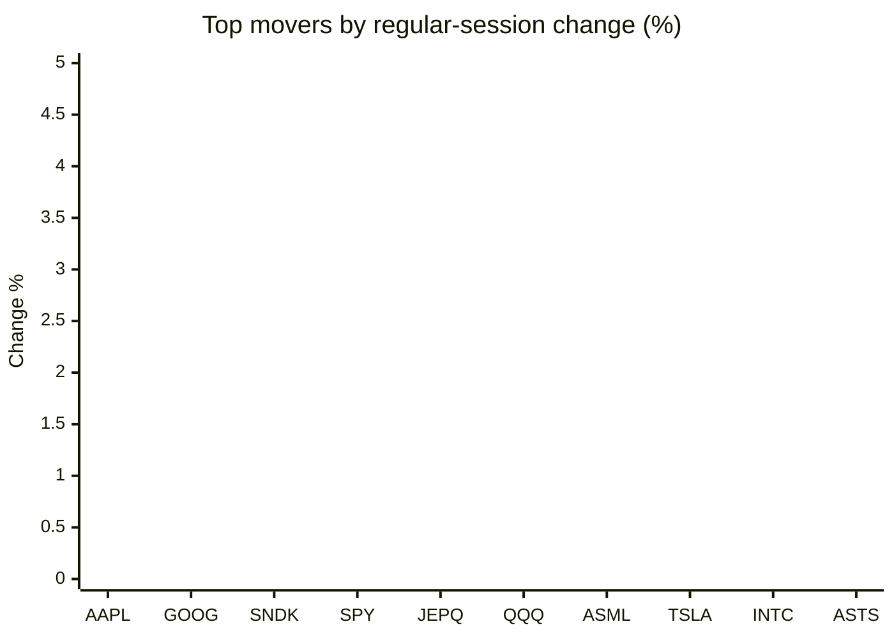
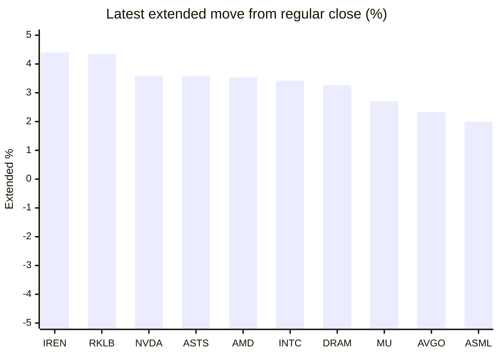

# Stock Brief - 2026-11-22

Generated at 2026-11-22 16:30 +07 from `watchlist.md`.
Prices are snapshots from Yahoo Finance public chart data. Extended/overnight is the latest available pre/post-market datapoint from the same feed.

## Market Snapshot

- SPY: close 689.81, latest extended 697.49, regular move -3.64%, extended move +1.11%
- QQQ: close 608.45, latest extended 617.74, regular move -5.67%, extended move +1.53%
- JEPQ: close 50.84, latest extended 51.45, regular move -5.20%, extended move +1.20%

## Watchlist Prices

| Ticker | Name | Regular close | Latest extended/overnight | Regular move | Extended move | Latest data time | Source |
|---|---|---:|---:|---:|---:|---|---|
| INTC | Intel Corporation | 51.28 USD | 53.03 USD | -7.97% | +3.42% | 2026-11-20 19:59 EST | [Yahoo](https://finance.yahoo.com/quote/INTC/) |
| AVGO | Broadcom Inc. | 304.41 USD | 311.51 USD | -12.19% | +2.33% | 2026-11-20 19:59 EST | [Yahoo](https://finance.yahoo.com/quote/AVGO/) |
| RKLB | Rocket Lab Corporation | 45.42 USD | 47.40 USD | -10.92% | +4.35% | 2026-11-20 19:59 EST | [Yahoo](https://finance.yahoo.com/quote/RKLB/) |
| AAPL | Apple Inc. | 342.56 USD | 344.87 USD | -1.90% | +0.67% | 2026-11-20 19:59 EST | [Yahoo](https://finance.yahoo.com/quote/AAPL/) |
| NVDA | NVIDIA Corporation | 125.53 USD | 130.01 USD | -14.01% | +3.57% | 2026-11-20 19:59 EST | [Yahoo](https://finance.yahoo.com/quote/NVDA/) |
| TSLA | Tesla, Inc. | 345.82 USD | 351.08 USD | -7.64% | +1.52% | 2026-11-20 19:59 EST | [Yahoo](https://finance.yahoo.com/quote/TSLA/) |
| SNDK | Sandisk Corporation | 94.39 USD | 81.40 USD | -2.71% | -13.76% | 2026-11-20 19:59 EST | [Yahoo](https://finance.yahoo.com/quote/SNDK/) |
| QQQ | Invesco QQQ Trust, Series 1 | 608.45 USD | 617.74 USD | -5.67% | +1.53% | 2026-11-20 19:59 EST | [Yahoo](https://finance.yahoo.com/quote/QQQ/) |
| SPY | State Street SPDR S&P 500 ETF T | 689.81 USD | 697.49 USD | -3.64% | +1.11% | 2026-11-20 19:59 EST | [Yahoo](https://finance.yahoo.com/quote/SPY/) |
| JEPQ | JPMorgan Nasdaq Equity Premium  | 50.84 USD | 51.45 USD | -5.20% | +1.20% | 2026-11-20 19:56 EST | [Yahoo](https://finance.yahoo.com/quote/JEPQ/) |
| ASTS | AST SpaceMobile, Inc. | 23.27 USD | 24.10 USD | -8.92% | +3.57% | 2026-11-20 19:59 EST | [Yahoo](https://finance.yahoo.com/quote/ASTS/) |
| MU | Micron Technology, Inc. | 594.51 USD | 610.60 USD | -13.89% | +2.71% | 2026-11-20 19:59 EST | [Yahoo](https://finance.yahoo.com/quote/MU/) |
| IREN | IREN LIMITED | 11.82 USD | 12.34 USD | -17.97% | +4.40% | 2026-11-20 19:59 EST | [Yahoo](https://finance.yahoo.com/quote/IREN/) |
| EOSE | Eos Energy Enterprises, Inc. | 1.19 USD | 1.21 USD | -12.50% | +1.68% | 2026-11-20 19:59 EST | [Yahoo](https://finance.yahoo.com/quote/EOSE/) |
| GOOG | Alphabet Inc. | 264.00 USD | 268.50 USD | -2.59% | +1.70% | 2026-11-20 19:59 EST | [Yahoo](https://finance.yahoo.com/quote/GOOG/) |
| DRAM | Roundhill Memory ETF | 33.36 USD | 34.45 USD | -13.19% | +3.27% | 2026-11-20 19:59 EST | [Yahoo](https://finance.yahoo.com/quote/DRAM/) |
| AMD | Advanced Micro Devices, Inc. | 424.39 USD | 439.39 USD | -13.25% | +3.53% | 2026-11-20 19:59 EST | [Yahoo](https://finance.yahoo.com/quote/AMD/) |
| ASML | ASML Holding N.V. - New York Re | 1,266.22 USD | 1,291.50 USD | -6.63% | +2.00% | 2026-11-20 19:56 EST | [Yahoo](https://finance.yahoo.com/quote/ASML/) |

## Charts

### Top Movers - Regular Session

### Extended / Overnight Move

### Quick Heatmap

| Group | Names in watchlist | Avg regular move | Avg extended move |
|---|---|---:|---:|
| Mega-cap tech | AVGO, AAPL, NVDA, TSLA, GOOG | -7.66% | +1.96% |
| Semis / memory | INTC, SNDK, MU, DRAM, AMD, ASML | -9.61% | +0.19% |
| Space / high beta | RKLB, ASTS, IREN, EOSE | -12.58% | +3.50% |
| ETFs | QQQ, SPY, JEPQ | -4.84% | +1.28% |

## News Headlines

- [The S&P 500 Is 14 for 14 After Midterm Elections. Here’s How I’d Invest Now.](https://www.fool.com/investing/2026/11/22/sp-500-14-for-14-after-midterm-elections-how-id-invest-now/?.tsrc=rss) (2026-11-22 15:20 Bangkok)
- [Mortgage Rates Have Jumped More Than 1 Point Since February. Home Depot and Lowe’s Shareholders Are Feeling the Pain.](https://www.fool.com/investing/2026/11/22/mortgage-rates-have-jumped-more-than-1-point-since-february-home-depot-and-lowes-shareholders-are-feeling-the-pain/?.tsrc=rss) (2026-11-22 14:43 Bangkok)
- [Tesla Just Started Selling Cybercabs, Here's What It Means for a SpaceX and Tesla Merger .](https://www.fool.com/investing/2026/11/22/tesla-just-started-selling-cybercabs-here-s-what-it-means-for-a-spacex-and-tesla-merger/?.tsrc=rss) (2026-11-22 14:25 Bangkok)
- [Chamath Palihapitiya Praises Jensen Huang As ‘Biblically Good,’ But Warns Bringing Him Back At Nvidia Could Put ‘Everybody’ At Risk](https://stocktwits.com/news-articles/markets/equity/chamath-palihapitiya-praises-jensen-huang-biblically-good-nvidia-risk/cNbnmnOR91r?.tsrc=rss) (2026-11-22 13:52 Bangkok)
- [The 2 ETFs I'd Buy Today: 1 for Growth, 1 for Dividends](https://www.fool.com/investing/2026/11/22/the-2-etfs-i-d-buy-today-1-for-growth-1-for-dividends/?.tsrc=rss) (2026-11-22 12:57 Bangkok)
- [Where Will Nvidia Stock Be in 20 Years? The Answer Might Surprise You.](https://www.fool.com/investing/2026/11/22/where-will-nvidia-stock-be-in-20-years-the-answer-might-surprise-you/?.tsrc=rss) (2026-11-22 12:20 Bangkok)
- [Nvidia Shock Puts MongoDB Stock And Cloud Software Names Back In Focus](https://finance.yahoo.com/technology/ai/articles/nvidia-shock-puts-mongodb-stock-051540855.html?.tsrc=rss) (2026-11-22 12:15 Bangkok)
- [In China’s tech mecca, Trump and Xi touted AI cooperation. Now comes the harsh reality](https://www.cnn.com/2026/11/22/business/trump-xi-apec-tech-rivalry-intl-hnk?.tsrc=rss) (2026-11-22 12:01 Bangkok)

## Caveats

- This is not investment advice. Extended-hours prices can be thin and volatile.
- Yahoo public endpoints may lag official exchange data.
