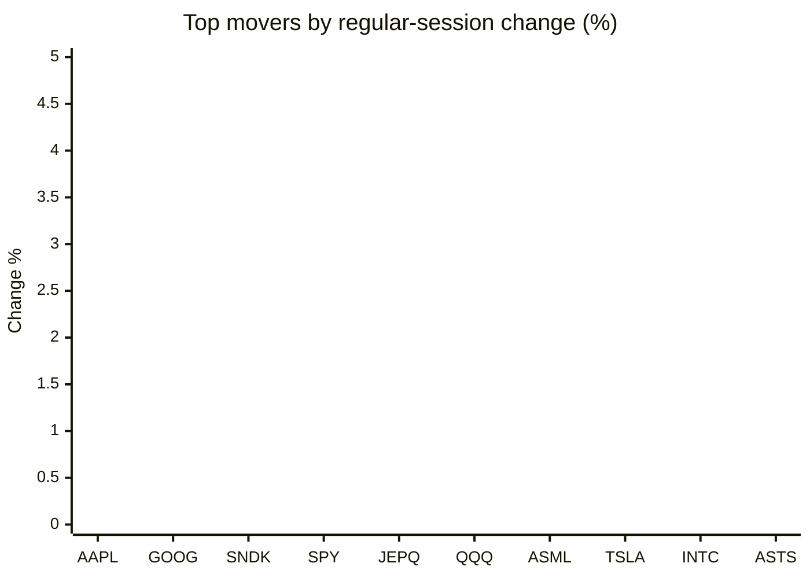
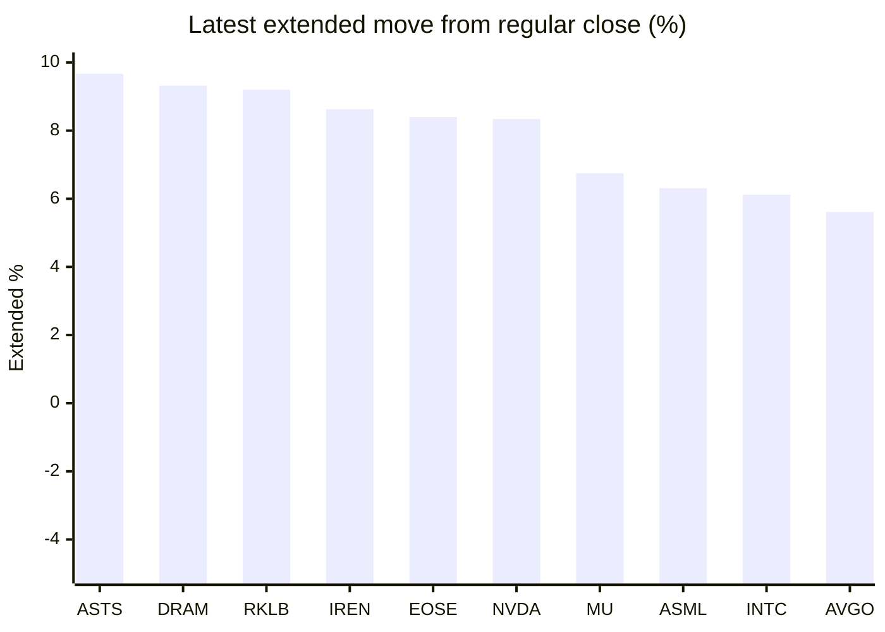

# Stock Brief - 2026-11-23

Generated at 2026-11-23 17:28 +07 from `watchlist.md`.
Prices are snapshots from Yahoo Finance public chart data. Extended/overnight is the latest available pre/post-market datapoint from the same feed.

## Market Snapshot

- SPY: close 689.81, latest extended 708.93, regular move -3.64%, extended move +2.77%
- QQQ: close 608.45, latest extended 630.99, regular move -5.67%, extended move +3.70%
- JEPQ: close 50.84, latest extended 52.47, regular move -5.20%, extended move +3.21%

## Watchlist Prices

| Ticker | Name | Regular close | Latest extended/overnight | Regular move | Extended move | Latest data time | Source |
|---|---|---:|---:|---:|---:|---|---|
| INTC | Intel Corporation | 51.28 USD | 54.42 USD | -7.97% | +6.12% | 2026-11-23 05:28 EST | [Yahoo](https://finance.yahoo.com/quote/INTC/) |
| AVGO | Broadcom Inc. | 304.41 USD | 321.50 USD | -12.19% | +5.61% | 2026-11-23 05:26 EST | [Yahoo](https://finance.yahoo.com/quote/AVGO/) |
| RKLB | Rocket Lab Corporation | 45.42 USD | 49.60 USD | -10.92% | +9.20% | 2026-11-23 05:28 EST | [Yahoo](https://finance.yahoo.com/quote/RKLB/) |
| AAPL | Apple Inc. | 342.56 USD | 347.54 USD | -1.90% | +1.45% | 2026-11-23 05:28 EST | [Yahoo](https://finance.yahoo.com/quote/AAPL/) |
| NVDA | NVIDIA Corporation | 125.53 USD | 136.00 USD | -14.01% | +8.34% | 2026-11-23 05:28 EST | [Yahoo](https://finance.yahoo.com/quote/NVDA/) |
| TSLA | Tesla, Inc. | 345.82 USD | 362.00 USD | -7.64% | +4.68% | 2026-11-23 05:28 EST | [Yahoo](https://finance.yahoo.com/quote/TSLA/) |
| SNDK | Sandisk Corporation | 94.39 USD | 85.02 USD | -2.71% | -9.93% | 2026-11-23 05:28 EST | [Yahoo](https://finance.yahoo.com/quote/SNDK/) |
| QQQ | Invesco QQQ Trust, Series 1 | 608.45 USD | 630.99 USD | -5.67% | +3.70% | 2026-11-23 05:28 EST | [Yahoo](https://finance.yahoo.com/quote/QQQ/) |
| SPY | State Street SPDR S&P 500 ETF T | 689.81 USD | 708.93 USD | -3.64% | +2.77% | 2026-11-23 05:28 EST | [Yahoo](https://finance.yahoo.com/quote/SPY/) |
| JEPQ | JPMorgan Nasdaq Equity Premium  | 50.84 USD | 52.47 USD | -5.20% | +3.21% | 2026-11-23 05:25 EST | [Yahoo](https://finance.yahoo.com/quote/JEPQ/) |
| ASTS | AST SpaceMobile, Inc. | 23.27 USD | 25.52 USD | -8.92% | +9.67% | 2026-11-23 05:28 EST | [Yahoo](https://finance.yahoo.com/quote/ASTS/) |
| MU | Micron Technology, Inc. | 594.51 USD | 634.61 USD | -13.89% | +6.75% | 2026-11-23 05:28 EST | [Yahoo](https://finance.yahoo.com/quote/MU/) |
| IREN | IREN LIMITED | 11.82 USD | 12.84 USD | -17.97% | +8.63% | 2026-11-23 05:28 EST | [Yahoo](https://finance.yahoo.com/quote/IREN/) |
| EOSE | Eos Energy Enterprises, Inc. | 1.19 USD | 1.29 USD | -12.50% | +8.40% | 2026-11-23 05:25 EST | [Yahoo](https://finance.yahoo.com/quote/EOSE/) |
| GOOG | Alphabet Inc. | 264.00 USD | 277.47 USD | -2.59% | +5.10% | 2026-11-23 05:28 EST | [Yahoo](https://finance.yahoo.com/quote/GOOG/) |
| DRAM | Roundhill Memory ETF | 33.36 USD | 36.47 USD | -13.19% | +9.32% | 2026-11-23 05:26 EST | [Yahoo](https://finance.yahoo.com/quote/DRAM/) |
| AMD | Advanced Micro Devices, Inc. | 424.39 USD | 448.00 USD | -13.25% | +5.56% | 2026-11-23 05:28 EST | [Yahoo](https://finance.yahoo.com/quote/AMD/) |
| ASML | ASML Holding N.V. - New York Re | 1,266.22 USD | 1,346.10 USD | -6.63% | +6.31% | 2026-11-23 05:27 EST | [Yahoo](https://finance.yahoo.com/quote/ASML/) |

## Charts

### Top Movers - Regular Session

### Extended / Overnight Move

### Quick Heatmap

| Group | Names in watchlist | Avg regular move | Avg extended move |
|---|---|---:|---:|
| Mega-cap tech | AVGO, AAPL, NVDA, TSLA, GOOG | -7.66% | +5.04% |
| Semis / memory | INTC, SNDK, MU, DRAM, AMD, ASML | -9.61% | +4.02% |
| Space / high beta | RKLB, ASTS, IREN, EOSE | -12.58% | +8.98% |
| ETFs | QQQ, SPY, JEPQ | -4.84% | +3.23% |

## News Headlines

- [Could $1,000 a Month in Dividend Stocks Make You Rich by 2040?](https://www.fool.com/investing/2026/11/23/could-1000-a-month-in-dividend-stocks-make-you-rich-by-2040/?.tsrc=rss) (2026-11-23 17:04 Bangkok)
- [Micron Stock Rallies After Brutal Selloff. 3 Reasons Its Surge Has Legs.](https://finance.yahoo.com/m/3f1f89c7-5433-3bc0-990f-eab9250e8983/micron-stock-rallies-after.html?.tsrc=rss) (2026-11-23 16:59 Bangkok)
- [Market Chatter: Nvidia's Alice Huang Scandal Draws Fresh Scrutiny Over China Intelligence Links](https://finance.yahoo.com/markets/stocks/articles/market-chatter-nvidia-apos-alice-095535152.html?.tsrc=rss) (2026-11-23 16:55 Bangkok)
- [Swap Cash for the Apple Stock Inside Your Irrevocable Trust Before You Die and the Shares Come Home for a Full Step-Up. Estate Lawyers Write That Power In on Purpose](https://247wallst.com/personal-finance/2026/11/23/swap-cash-for-the-apple-stock-inside-your-irrevocable-trust-before-you-die-and-the-shares-come-home-for-a-full-step-up-estate-lawyers-write-that-power-in-on-purpose/?.tsrc=rss) (2026-11-23 16:43 Bangkok)
- [US Stock Futures Rebound After AI Sell-Off as Nvidia Investigation and Fed Outlook Remain in Focus: Dow Jones, S&P, Nasdaq, Wall Street](https://investorshub.advfn.com/market-news/article/40488/us-stock-futures-rebound-after-ai-sell-off-as-nvidia-investigation-and-fed-outlook-remain-in-focus-dow-jones-sp-nasdaq-wall-street?.tsrc=rss) (2026-11-23 16:41 Bangkok)
- [Michael Burry Sees 1929’s and 2000’s “Lack of a Proximate Cause in Earnings.” Nvidia’s Estimates Keep Rising](https://www.tikr.com/blog/michael-burry-sees-1929s-and-2000s-lack-of-a-proximate-cause-in-earnings-nvidias-estimates-keep-rising?ref=yahoofinance&tlnk=yf-261123-rg89fg6v&.tsrc=rss) (2026-11-23 16:35 Bangkok)
- [Fed Chair Kevin Warsh and the FOMC Have a New Concern, and It Has Nothing to Do With Trumpflation](https://www.fool.com/investing/2026/11/23/fed-chair-kevin-warsh-fomc-have-new-concern-nothing-to-do-with-trumpflation/?.tsrc=rss) (2026-11-23 16:26 Bangkok)
- [Rocket Lab and Nebius Are Each About 66% Below Their Highs. I'd Buy Both and Hold Through 2030.](https://www.fool.com/investing/2026/11/23/rocket-lab-and-nebius-are-each-about-66-below-their-highs-i-d-buy-both-and-hold-through-2030/?.tsrc=rss) (2026-11-23 16:07 Bangkok)

## Caveats

- This is not investment advice. Extended-hours prices can be thin and volatile.
- Yahoo public endpoints may lag official exchange data.
