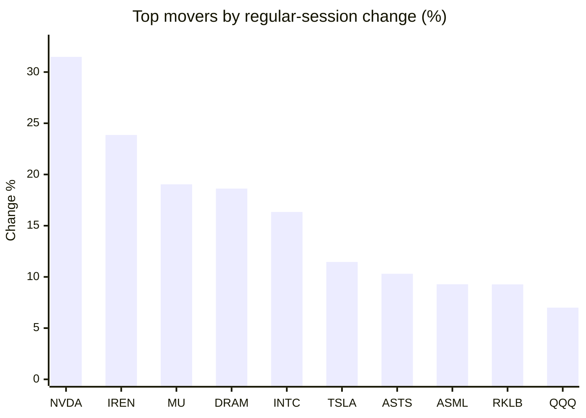
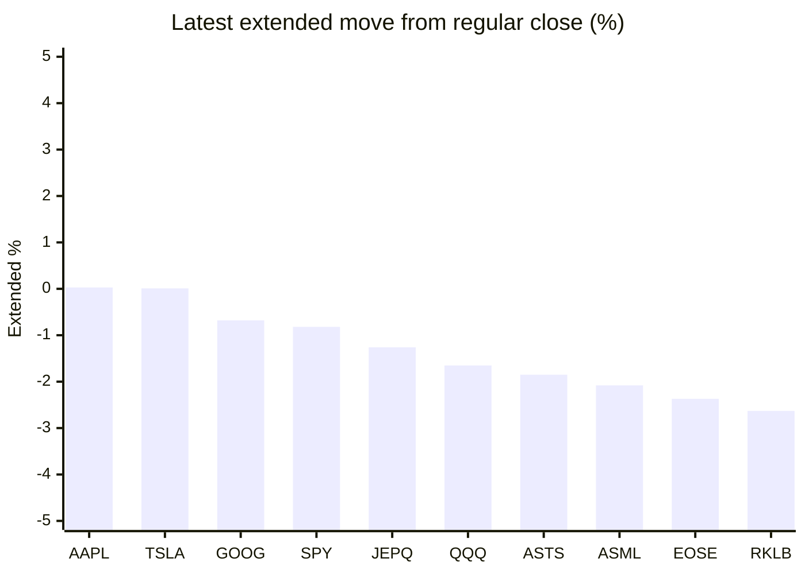

# Stock Brief - 2026-11-24

Generated at 2026-11-24 19:10 +07 from `watchlist.md`.
Prices are snapshots from Yahoo Finance public chart data. Extended/overnight is the latest available pre/post-market datapoint from the same feed.

## Market Snapshot

- SPY: close 722.29, latest extended 716.39, regular move +4.71%, extended move -0.82%
- QQQ: close 651.03, latest extended 640.30, regular move +7.00%, extended move -1.65%
- JEPQ: close 54.03, latest extended 53.35, regular move +6.27%, extended move -1.26%

## Watchlist Prices

| Ticker | Name | Regular close | Latest extended/overnight | Regular move | Extended move | Latest data time | Source |
|---|---|---:|---:|---:|---:|---|---|
| INTC | Intel Corporation | 59.66 USD | 56.03 USD | +16.34% | -6.08% | 2026-11-24 07:10 EST | [Yahoo](https://finance.yahoo.com/quote/INTC/) |
| AVGO | Broadcom Inc. | 313.55 USD | 304.01 USD | +3.00% | -3.04% | 2026-11-24 07:09 EST | [Yahoo](https://finance.yahoo.com/quote/AVGO/) |
| RKLB | Rocket Lab Corporation | 49.63 USD | 48.32 USD | +9.27% | -2.63% | 2026-11-24 07:08 EST | [Yahoo](https://finance.yahoo.com/quote/RKLB/) |
| AAPL | Apple Inc. | 349.08 USD | 349.18 USD | +1.90% | +0.03% | 2026-11-24 07:09 EST | [Yahoo](https://finance.yahoo.com/quote/AAPL/) |
| NVDA | NVIDIA Corporation | 165.05 USD | 155.97 USD | +31.48% | -5.50% | 2026-11-24 07:10 EST | [Yahoo](https://finance.yahoo.com/quote/NVDA/) |
| TSLA | Tesla, Inc. | 385.46 USD | 385.50 USD | +11.46% | +0.01% | 2026-11-24 07:09 EST | [Yahoo](https://finance.yahoo.com/quote/TSLA/) |
| SNDK | Sandisk Corporation | 94.39 USD | 82.26 USD | -2.71% | -12.85% | 2026-11-24 07:10 EST | [Yahoo](https://finance.yahoo.com/quote/SNDK/) |
| QQQ | Invesco QQQ Trust, Series 1 | 651.03 USD | 640.30 USD | +7.00% | -1.65% | 2026-11-24 07:10 EST | [Yahoo](https://finance.yahoo.com/quote/QQQ/) |
| SPY | State Street SPDR S&P 500 ETF T | 722.29 USD | 716.39 USD | +4.71% | -0.82% | 2026-11-24 07:10 EST | [Yahoo](https://finance.yahoo.com/quote/SPY/) |
| JEPQ | JPMorgan Nasdaq Equity Premium  | 54.03 USD | 53.35 USD | +6.27% | -1.26% | 2026-11-24 07:09 EST | [Yahoo](https://finance.yahoo.com/quote/JEPQ/) |
| ASTS | AST SpaceMobile, Inc. | 25.67 USD | 25.19 USD | +10.31% | -1.85% | 2026-11-24 07:09 EST | [Yahoo](https://finance.yahoo.com/quote/ASTS/) |
| MU | Micron Technology, Inc. | 707.70 USD | 661.05 USD | +19.04% | -6.59% | 2026-11-24 07:10 EST | [Yahoo](https://finance.yahoo.com/quote/MU/) |
| IREN | IREN LIMITED | 14.64 USD | 13.96 USD | +23.86% | -4.64% | 2026-11-24 07:10 EST | [Yahoo](https://finance.yahoo.com/quote/IREN/) |
| EOSE | Eos Energy Enterprises, Inc. | 1.27 USD | 1.24 USD | +6.72% | -2.37% | 2026-11-24 07:08 EST | [Yahoo](https://finance.yahoo.com/quote/EOSE/) |
| GOOG | Alphabet Inc. | 279.53 USD | 277.64 USD | +5.88% | -0.68% | 2026-11-24 07:10 EST | [Yahoo](https://finance.yahoo.com/quote/GOOG/) |
| DRAM | Roundhill Memory ETF | 39.57 USD | 37.34 USD | +18.62% | -5.64% | 2026-11-24 07:10 EST | [Yahoo](https://finance.yahoo.com/quote/DRAM/) |
| AMD | Advanced Micro Devices, Inc. | 453.46 USD | 435.70 USD | +6.85% | -3.92% | 2026-11-24 07:10 EST | [Yahoo](https://finance.yahoo.com/quote/AMD/) |
| ASML | ASML Holding N.V. - New York Re | 1,383.78 USD | 1,354.99 USD | +9.28% | -2.08% | 2026-11-24 07:10 EST | [Yahoo](https://finance.yahoo.com/quote/ASML/) |

## Charts

### Top Movers - Regular Session

### Extended / Overnight Move

### Quick Heatmap

| Group | Names in watchlist | Avg regular move | Avg extended move |
|---|---|---:|---:|
| Mega-cap tech | AVGO, AAPL, NVDA, TSLA, GOOG | +10.75% | -1.84% |
| Semis / memory | INTC, SNDK, MU, DRAM, AMD, ASML | +11.24% | -6.19% |
| Space / high beta | RKLB, ASTS, IREN, EOSE | +12.54% | -2.87% |
| ETFs | QQQ, SPY, JEPQ | +5.99% | -1.24% |

## News Headlines

- [Will Jensen’s return act as a clearing event for chip stocks?](https://finance.yahoo.com/markets/stocks/articles/jensen-return-act-clearing-event-115924058.html?.tsrc=rss) (2026-11-24 18:59 Bangkok)
- [Michael Burry Cuts Nvidia Puts by 75% Before Stock's 31% Rally](https://finance.yahoo.com/markets/options/articles/michael-burry-cuts-nvidia-puts-115611916.html?.tsrc=rss) (2026-11-24 18:56 Bangkok)
- [Nvidia staff chant, holler and hug at Huang's triumphant return](https://finance.yahoo.com/technology/ai/articles/nvidia-staff-chant-holler-hug-114950207.html?.tsrc=rss) (2026-11-24 18:49 Bangkok)
- [Nvidia Added $954 Billion In A Day. Is Jensen Huang Too Big To Fire?](https://www.trefis.com/stock/nvda/articles/628204/nvidia-added-954-billion-in-a-day-is-jensen-huang-too-big-to-fire/2026-11-24?.tsrc=rss) (2026-11-24 18:39 Bangkok)
- [How Jensen Huang's return to Nvidia made the world trillions richer](https://www.euronews.com/2026/11/24/how-jensen-huangs-return-to-nvidia-made-the-world-trillions-richer?.tsrc=rss) (2026-11-24 18:37 Bangkok)
- [Intel Is Up 73% in a Year Despite Its October Crash. CEO Lip-Bu Tan: “I Just Cannot Supply Enough”](https://www.tikr.com/blog/intel-is-up-70-in-a-year-despite-its-october-crash-ceo-lip-bu-tan-i-just-cannot-supply-enough?ref=yahoofinance&tlnk=yf-261124-43mcc74v&.tsrc=rss) (2026-11-24 18:35 Bangkok)
- [Tech firms fuel global rally on Huang's shock Nvidia return](https://finance.yahoo.com/technology/ai/articles/tech-firms-soar-huangs-return-023753159.html?.tsrc=rss) (2026-11-24 18:34 Bangkok)
- [Nvidia Shares Fall 5% in Premarket Trading as Goldman Sachs Highlights Lingering Uncertainty Following Huang’s Return](https://investorshub.advfn.com/market-news/article/40601/nvidia-shares-fall-5-in-premarket-trading-as-goldman-sachs-highlights-lingering-uncertainty-following-huangs-return?.tsrc=rss) (2026-11-24 18:23 Bangkok)

## Caveats

- This is not investment advice. Extended-hours prices can be thin and volatile.
- Yahoo public endpoints may lag official exchange data.
