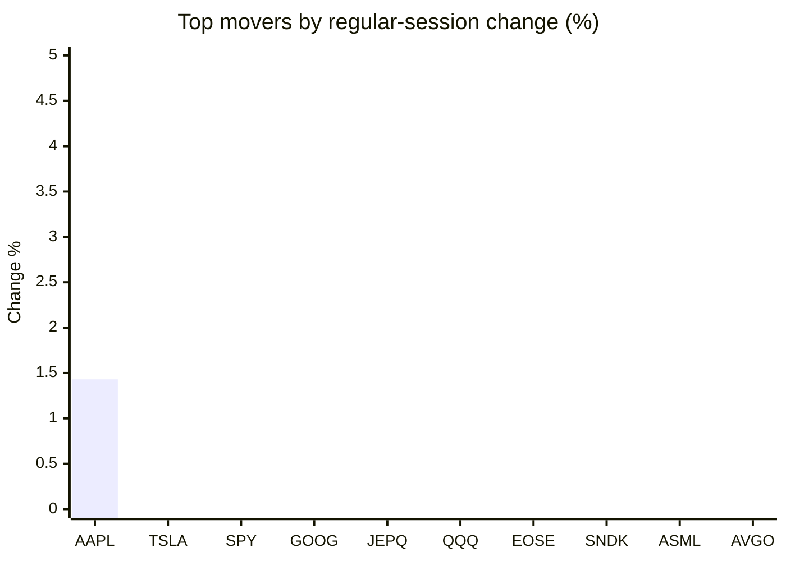
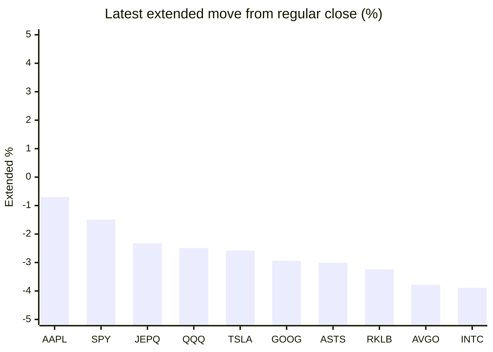

# Stock Brief - 2026-11-25

Generated at 2026-11-25 17:59 +07 from `watchlist.md`.
Prices are snapshots from Yahoo Finance public chart data. Extended/overnight is the latest available pre/post-market datapoint from the same feed.

## Market Snapshot

- SPY: close 718.78, latest extended 708.10, regular move -0.49%, extended move -1.49%
- QQQ: close 638.10, latest extended 622.20, regular move -1.99%, extended move -2.49%
- JEPQ: close 53.06, latest extended 51.83, regular move -1.80%, extended move -2.32%

## Watchlist Prices

| Ticker | Name | Regular close | Latest extended/overnight | Regular move | Extended move | Latest data time | Source |
|---|---|---:|---:|---:|---:|---|---|
| INTC | Intel Corporation | 54.80 USD | 52.67 USD | -8.15% | -3.89% | 2026-11-25 05:59 EST | [Yahoo](https://finance.yahoo.com/quote/INTC/) |
| AVGO | Broadcom Inc. | 301.08 USD | 289.70 USD | -3.98% | -3.78% | 2026-11-25 05:59 EST | [Yahoo](https://finance.yahoo.com/quote/AVGO/) |
| RKLB | Rocket Lab Corporation | 45.98 USD | 44.49 USD | -7.35% | -3.24% | 2026-11-25 05:58 EST | [Yahoo](https://finance.yahoo.com/quote/RKLB/) |
| AAPL | Apple Inc. | 354.07 USD | 351.60 USD | +1.43% | -0.70% | 2026-11-25 05:59 EST | [Yahoo](https://finance.yahoo.com/quote/AAPL/) |
| NVDA | NVIDIA Corporation | 155.38 USD | 147.90 USD | -5.86% | -4.81% | 2026-11-25 05:59 EST | [Yahoo](https://finance.yahoo.com/quote/NVDA/) |
| TSLA | Tesla, Inc. | 384.68 USD | 374.75 USD | -0.20% | -2.58% | 2026-11-25 05:59 EST | [Yahoo](https://finance.yahoo.com/quote/TSLA/) |
| SNDK | Sandisk Corporation | 94.39 USD | 73.34 USD | -2.71% | -22.31% | 2026-11-25 05:59 EST | [Yahoo](https://finance.yahoo.com/quote/SNDK/) |
| QQQ | Invesco QQQ Trust, Series 1 | 638.10 USD | 622.20 USD | -1.99% | -2.49% | 2026-11-25 05:59 EST | [Yahoo](https://finance.yahoo.com/quote/QQQ/) |
| SPY | State Street SPDR S&P 500 ETF T | 718.78 USD | 708.10 USD | -0.49% | -1.49% | 2026-11-25 05:59 EST | [Yahoo](https://finance.yahoo.com/quote/SPY/) |
| JEPQ | JPMorgan Nasdaq Equity Premium  | 53.06 USD | 51.83 USD | -1.80% | -2.32% | 2026-11-25 05:55 EST | [Yahoo](https://finance.yahoo.com/quote/JEPQ/) |
| ASTS | AST SpaceMobile, Inc. | 23.60 USD | 22.89 USD | -8.06% | -3.01% | 2026-11-25 05:59 EST | [Yahoo](https://finance.yahoo.com/quote/ASTS/) |
| MU | Micron Technology, Inc. | 629.79 USD | 594.30 USD | -11.01% | -5.64% | 2026-11-25 05:59 EST | [Yahoo](https://finance.yahoo.com/quote/MU/) |
| IREN | IREN LIMITED | 12.95 USD | 12.30 USD | -11.54% | -5.02% | 2026-11-25 05:58 EST | [Yahoo](https://finance.yahoo.com/quote/IREN/) |
| EOSE | Eos Energy Enterprises, Inc. | 1.24 USD | 1.19 USD | -2.36% | -4.03% | 2026-11-25 05:57 EST | [Yahoo](https://finance.yahoo.com/quote/EOSE/) |
| GOOG | Alphabet Inc. | 276.58 USD | 268.46 USD | -1.06% | -2.94% | 2026-11-25 05:59 EST | [Yahoo](https://finance.yahoo.com/quote/GOOG/) |
| DRAM | Roundhill Memory ETF | 35.92 USD | 33.90 USD | -9.22% | -5.62% | 2026-11-25 05:59 EST | [Yahoo](https://finance.yahoo.com/quote/DRAM/) |
| AMD | Advanced Micro Devices, Inc. | 413.27 USD | 387.13 USD | -8.86% | -6.33% | 2026-11-25 05:58 EST | [Yahoo](https://finance.yahoo.com/quote/AMD/) |
| ASML | ASML Holding N.V. - New York Re | 1,336.06 USD | 1,283.98 USD | -3.45% | -3.90% | 2026-11-25 05:59 EST | [Yahoo](https://finance.yahoo.com/quote/ASML/) |

## Charts

### Top Movers - Regular Session

### Extended / Overnight Move

### Quick Heatmap

| Group | Names in watchlist | Avg regular move | Avg extended move |
|---|---|---:|---:|
| Mega-cap tech | AVGO, AAPL, NVDA, TSLA, GOOG | -1.93% | -2.96% |
| Semis / memory | INTC, SNDK, MU, DRAM, AMD, ASML | -7.23% | -7.95% |
| Space / high beta | RKLB, ASTS, IREN, EOSE | -7.33% | -3.83% |
| ETFs | QQQ, SPY, JEPQ | -1.42% | -2.10% |

## News Headlines

- [U.S. chip stocks extend losses premarket as AI spending concerns resurface](https://finance.yahoo.com/technology/ai/articles/u-chip-stocks-extend-losses-104903644.html?.tsrc=rss) (2026-11-25 17:49 Bangkok)
- [Nvidia scandal reveals cracks in US corporate governance](https://finance.yahoo.com/markets/stocks/articles/nvidia-scandal-reveals-cracks-us-104339315.html?.tsrc=rss) (2026-11-25 17:43 Bangkok)
- [Not Tesla. Not Nvidia. This "Magnificent Seven" Stock Could Be Overdue for a Big Rally.](https://www.fool.com/investing/2026/11/25/not-tesla-nvidia-magnificent-seven-stock-big-rally/?.tsrc=rss) (2026-11-25 17:25 Bangkok)
- [Will Nvidia Stock Continue to Soar Now That Jensen Huang Is Back? Here Are the Bull and Bear Cases.](https://www.fool.com/investing/2026/11/25/will-nvidia-stock-continue-to-soar-now-that-jensen-huang-is-back-here-are-the-bull-and-bear-cases/?.tsrc=rss) (2026-11-25 17:22 Bangkok)
- [Nvidia shares fall 5% premarket after Huang return rally wanes](https://finance.yahoo.com/markets/stocks/articles/nvidia-shares-fall-5-premarket-101944403.html?.tsrc=rss) (2026-11-25 17:19 Bangkok)
- [Semiconductor Stocks Are Sinking. These 2 AI Chip Stocks Could Make You Richer on the Rebound.](https://www.fool.com/investing/2026/11/25/semiconductor-stocks-are-sinking-these-2-ai-chip-stocks-could-make-you-richer-on-the-rebound/?.tsrc=rss) (2026-11-25 17:12 Bangkok)
- [Jack Bogle Told Investors to Own the Market ‘Warts and All.’ Then Nvidia Soared 31% and Moved a 68-Year-Old’s $1 Million S&P 500 Index Fund by $16,000 in a Day](https://247wallst.com/investing/2026/11/25/jack-bogle-told-investors-to-own-the-market-warts-and-all-then-nvidia-soared-31-and-moved-a-68-year-olds-1-million-sp-500-index-fund-by-16000-in-a-day/?.tsrc=rss) (2026-11-25 17:12 Bangkok)
- [Michael Burry Sells Remaining Nasdaq-100 Puts, Eyes Fresh Nvidia Short Near $200: ‘I Am Long Undervalued Common Stocks’](https://stocktwits.com/news-articles/markets/equity/michael-burry-sells-remaining-nasdaq-100-puts-eyes-fresh-nvidia-short-near-200/cNbHOX0R9lu?.tsrc=rss) (2026-11-25 17:09 Bangkok)

## Caveats

- This is not investment advice. Extended-hours prices can be thin and volatile.
- Yahoo public endpoints may lag official exchange data.
