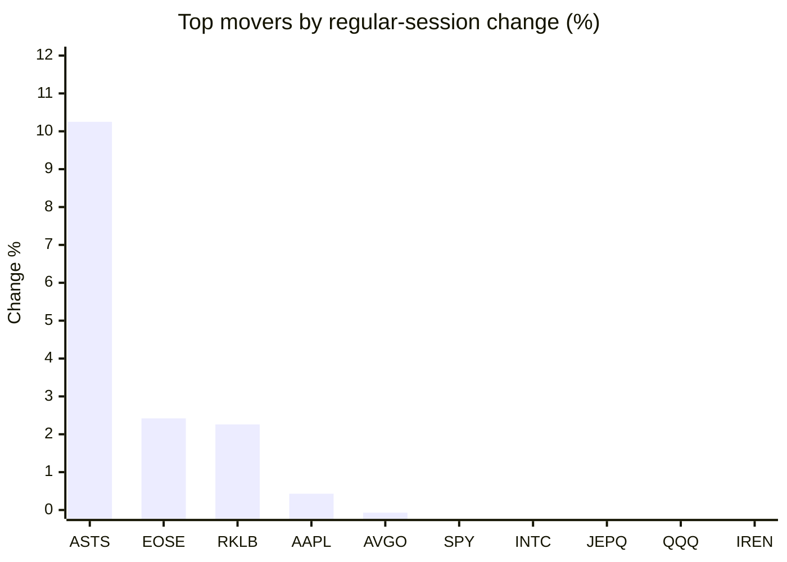
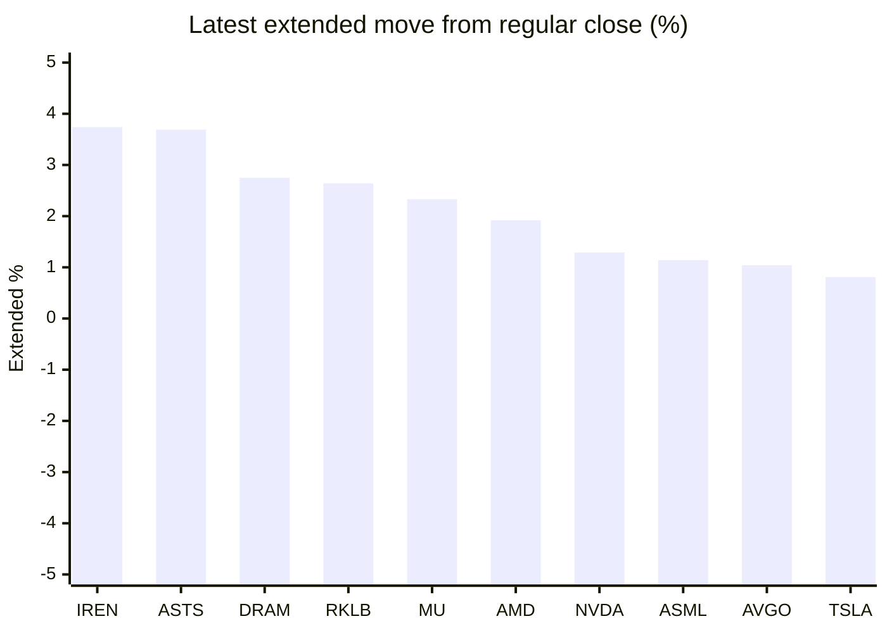

# Stock Brief - 2026-11-26

Generated at 2026-11-26 17:36 +07 from `watchlist.md`.
Prices are snapshots from Yahoo Finance public chart data. Extended/overnight is the latest available pre/post-market datapoint from the same feed.

## Market Snapshot

- SPY: close 716.70, latest extended 720.43, regular move -0.29%, extended move +0.52%
- QQQ: close 633.93, latest extended 636.62, regular move -0.65%, extended move +0.42%
- JEPQ: close 52.72, latest extended 52.92, regular move -0.64%, extended move +0.38%

## Watchlist Prices

| Ticker | Name | Regular close | Latest extended/overnight | Regular move | Extended move | Latest data time | Source |
|---|---|---:|---:|---:|---:|---|---|
| INTC | Intel Corporation | 54.47 USD | 54.85 USD | -0.60% | +0.70% | 2026-11-25 19:59 EST | [Yahoo](https://finance.yahoo.com/quote/INTC/) |
| AVGO | Broadcom Inc. | 300.86 USD | 304.00 USD | -0.07% | +1.04% | 2026-11-25 19:59 EST | [Yahoo](https://finance.yahoo.com/quote/AVGO/) |
| RKLB | Rocket Lab Corporation | 47.02 USD | 48.26 USD | +2.26% | +2.64% | 2026-11-25 19:59 EST | [Yahoo](https://finance.yahoo.com/quote/RKLB/) |
| AAPL | Apple Inc. | 355.58 USD | 355.10 USD | +0.43% | -0.13% | 2026-11-25 19:59 EST | [Yahoo](https://finance.yahoo.com/quote/AAPL/) |
| NVDA | NVIDIA Corporation | 149.30 USD | 151.22 USD | -3.91% | +1.29% | 2026-11-25 19:59 EST | [Yahoo](https://finance.yahoo.com/quote/NVDA/) |
| TSLA | Tesla, Inc. | 380.14 USD | 383.23 USD | -1.18% | +0.81% | 2026-11-25 19:59 EST | [Yahoo](https://finance.yahoo.com/quote/TSLA/) |
| SNDK | Sandisk Corporation | 94.39 USD | 76.68 USD | -2.71% | -18.77% | 2026-11-25 19:59 EST | [Yahoo](https://finance.yahoo.com/quote/SNDK/) |
| QQQ | Invesco QQQ Trust, Series 1 | 633.93 USD | 636.62 USD | -0.65% | +0.42% | 2026-11-25 19:59 EST | [Yahoo](https://finance.yahoo.com/quote/QQQ/) |
| SPY | State Street SPDR S&P 500 ETF T | 716.70 USD | 720.43 USD | -0.29% | +0.52% | 2026-11-25 19:59 EST | [Yahoo](https://finance.yahoo.com/quote/SPY/) |
| JEPQ | JPMorgan Nasdaq Equity Premium  | 52.72 USD | 52.92 USD | -0.64% | +0.38% | 2026-11-25 19:59 EST | [Yahoo](https://finance.yahoo.com/quote/JEPQ/) |
| ASTS | AST SpaceMobile, Inc. | 26.02 USD | 26.98 USD | +10.25% | +3.69% | 2026-11-25 19:59 EST | [Yahoo](https://finance.yahoo.com/quote/ASTS/) |
| MU | Micron Technology, Inc. | 601.25 USD | 615.26 USD | -4.53% | +2.33% | 2026-11-25 19:59 EST | [Yahoo](https://finance.yahoo.com/quote/MU/) |
| IREN | IREN LIMITED | 12.85 USD | 13.33 USD | -0.77% | +3.74% | 2026-11-25 19:59 EST | [Yahoo](https://finance.yahoo.com/quote/IREN/) |
| EOSE | Eos Energy Enterprises, Inc. | 1.27 USD | 1.27 USD | +2.42% | +0.00% | 2026-11-25 19:59 EST | [Yahoo](https://finance.yahoo.com/quote/EOSE/) |
| GOOG | Alphabet Inc. | 270.98 USD | 272.80 USD | -2.02% | +0.67% | 2026-11-25 19:59 EST | [Yahoo](https://finance.yahoo.com/quote/GOOG/) |
| DRAM | Roundhill Memory ETF | 34.83 USD | 35.79 USD | -3.03% | +2.75% | 2026-11-25 19:59 EST | [Yahoo](https://finance.yahoo.com/quote/DRAM/) |
| AMD | Advanced Micro Devices, Inc. | 406.03 USD | 413.81 USD | -1.75% | +1.92% | 2026-11-25 19:59 EST | [Yahoo](https://finance.yahoo.com/quote/AMD/) |
| ASML | ASML Holding N.V. - New York Re | 1,303.08 USD | 1,318.00 USD | -2.47% | +1.14% | 2026-11-25 19:59 EST | [Yahoo](https://finance.yahoo.com/quote/ASML/) |

## Charts

### Top Movers - Regular Session

### Extended / Overnight Move

### Quick Heatmap

| Group | Names in watchlist | Avg regular move | Avg extended move |
|---|---|---:|---:|
| Mega-cap tech | AVGO, AAPL, NVDA, TSLA, GOOG | -1.35% | +0.74% |
| Semis / memory | INTC, SNDK, MU, DRAM, AMD, ASML | -2.52% | -1.65% |
| Space / high beta | RKLB, ASTS, IREN, EOSE | +3.54% | +2.52% |
| ETFs | QQQ, SPY, JEPQ | -0.53% | +0.44% |

## News Headlines

- [There’s one proven way not to lose during a market downturn. Ignore it and risk blowing up your entire financial future](https://finance.yahoo.com/news/one-proven-way-not-lose-103000392.html?.tsrc=rss) (2026-11-26 17:30 Bangkok)
- [3 AI Infrastructure Stocks With Revenue Growth Up To 168%](https://finance.yahoo.com/technology/ai/articles/3-ai-infrastructure-stocks-revenue-100924358.html?.tsrc=rss) (2026-11-26 17:09 Bangkok)
- [4 Memory and Storage Stocks Cut by More Than 30% That I'd Buy Now and Hold for the Next Decade](https://www.fool.com/investing/2026/11/26/4-memory-and-storage-stocks-cut-by-more-than-30-that-i-d-buy-now-and-hold-for-the-next-decade/?.tsrc=rss) (2026-11-26 17:01 Bangkok)
- [A vocal cohort of tech leaders celebrates Huang’s Nvidia return, but others are keeping quiet](https://finance.yahoo.com/technology/articles/vocal-cohort-tech-leaders-celebrates-100052004.html?.tsrc=rss) (2026-11-26 17:00 Bangkok)
- [Nvidia halts chip exports to south-east Asia](https://www.telegraph.co.uk/business/2026/11/26/nvidia-halts-chip-exports-to-south-east-asia-after-us-crack/?.tsrc=rss) (2026-11-26 16:17 Bangkok)
- [Musk Confirms He Pushed Trump to Bring Back Jensen Huang. The White House Had Anthropic in Mind](https://www.tikr.com/blog/musk-confirms-he-pushed-trump-to-bring-back-jensen-huang-the-white-house-had-anthropic-in-mind?ref=yahoofinance&tlnk=yf-261126-66q3rrhh&.tsrc=rss) (2026-11-26 15:59 Bangkok)
- [Bad News for Intel: Dell Says Companies Are “Deferring Their PC Purchases” for AI Servers](https://www.tikr.com/blog/bad-news-for-intel-dell-says-companies-are-deferring-their-pc-purchases-for-ai-servers?ref=yahoofinance&tlnk=yf-261126-x92x938h&.tsrc=rss) (2026-11-26 15:50 Bangkok)
- [Nvidia Wins Back Wall Street Backing As Jensen Huang Returns; CRWD, LI Stocks Score Upgrades While DKNG, AMBA Face Pressure](https://stocktwits.com/news-articles/markets/equity/nvda-jensen-huang-return-stock-upgrades-crwd-li-amba-dkng/cNbxi4aR9ZF?.tsrc=rss) (2026-11-26 15:43 Bangkok)

## Caveats

- This is not investment advice. Extended-hours prices can be thin and volatile.
- Yahoo public endpoints may lag official exchange data.
