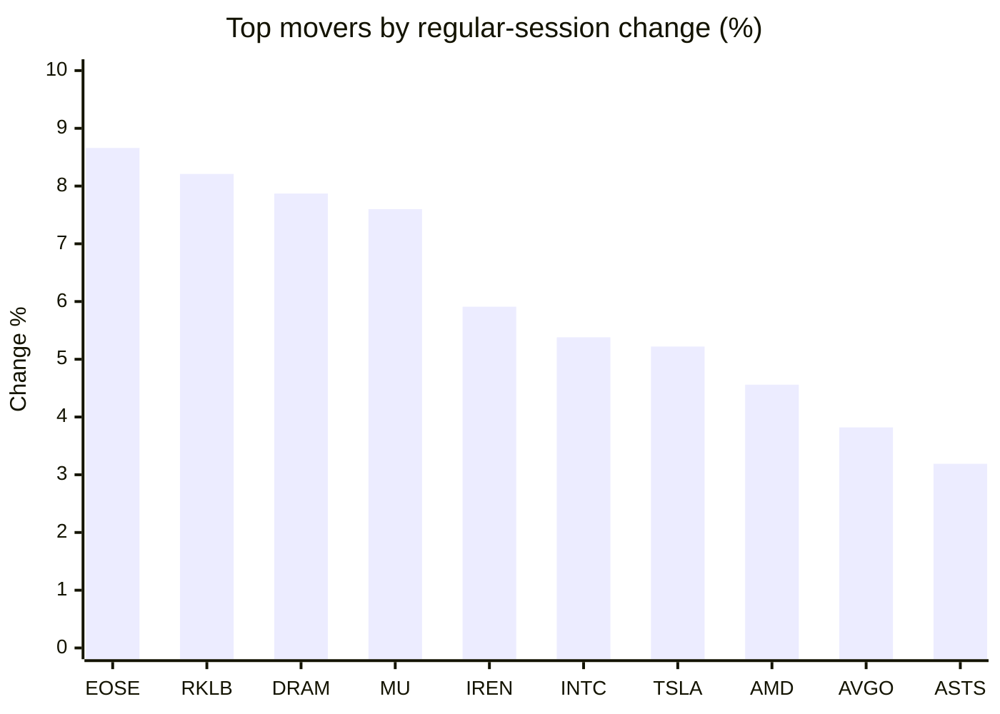
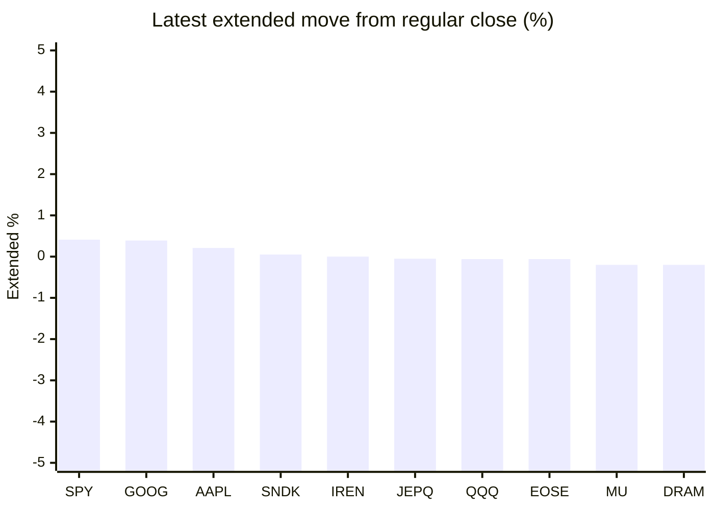

# Stock Brief - 2026-11-28

Generated at 2026-11-28 16:57 +07 from `watchlist.md`.
Prices are snapshots from Yahoo Finance public chart data. Extended/overnight is the latest available pre/post-market datapoint from the same feed.

## Market Snapshot

- SPY: close 728.32, latest extended 731.30, regular move +1.62%, extended move +0.41%
- QQQ: close 650.99, latest extended 650.62, regular move +2.69%, extended move -0.06%
- JEPQ: close 53.95, latest extended 53.92, regular move +2.33%, extended move -0.05%

## Watchlist Prices

| Ticker | Name | Regular close | Latest extended/overnight | Regular move | Extended move | Latest data time | Source |
|---|---|---:|---:|---:|---:|---|---|
| INTC | Intel Corporation | 57.40 USD | 57.05 USD | +5.38% | -0.61% | 2026-11-27 16:59 EST | [Yahoo](https://finance.yahoo.com/quote/INTC/) |
| AVGO | Broadcom Inc. | 312.34 USD | 311.67 USD | +3.82% | -0.21% | 2026-11-27 16:59 EST | [Yahoo](https://finance.yahoo.com/quote/AVGO/) |
| RKLB | Rocket Lab Corporation | 50.88 USD | 50.69 USD | +8.21% | -0.37% | 2026-11-27 16:59 EST | [Yahoo](https://finance.yahoo.com/quote/RKLB/) |
| AAPL | Apple Inc. | 358.54 USD | 359.29 USD | +0.83% | +0.21% | 2026-11-27 16:59 EST | [Yahoo](https://finance.yahoo.com/quote/AAPL/) |
| NVDA | NVIDIA Corporation | 150.49 USD | 149.80 USD | +0.80% | -0.46% | 2026-11-27 16:59 EST | [Yahoo](https://finance.yahoo.com/quote/NVDA/) |
| TSLA | Tesla, Inc. | 400.00 USD | 398.85 USD | +5.22% | -0.29% | 2026-11-27 16:59 EST | [Yahoo](https://finance.yahoo.com/quote/TSLA/) |
| SNDK | Sandisk Corporation | 85.36 USD | 85.40 USD | -9.57% | +0.05% | 2026-11-27 16:59 EST | [Yahoo](https://finance.yahoo.com/quote/SNDK/) |
| QQQ | Invesco QQQ Trust, Series 1 | 650.99 USD | 650.62 USD | +2.69% | -0.06% | 2026-11-27 16:59 EST | [Yahoo](https://finance.yahoo.com/quote/QQQ/) |
| SPY | State Street SPDR S&P 500 ETF T | 728.32 USD | 731.30 USD | +1.62% | +0.41% | 2026-11-27 16:59 EST | [Yahoo](https://finance.yahoo.com/quote/SPY/) |
| JEPQ | JPMorgan Nasdaq Equity Premium  | 53.95 USD | 53.92 USD | +2.33% | -0.05% | 2026-11-27 16:59 EST | [Yahoo](https://finance.yahoo.com/quote/JEPQ/) |
| ASTS | AST SpaceMobile, Inc. | 26.85 USD | 26.62 USD | +3.19% | -0.86% | 2026-11-27 16:58 EST | [Yahoo](https://finance.yahoo.com/quote/ASTS/) |
| MU | Micron Technology, Inc. | 646.95 USD | 645.66 USD | +7.60% | -0.20% | 2026-11-27 16:59 EST | [Yahoo](https://finance.yahoo.com/quote/MU/) |
| IREN | IREN LIMITED | 13.61 USD | 13.61 USD | +5.91% | +0.00% | 2026-11-27 16:59 EST | [Yahoo](https://finance.yahoo.com/quote/IREN/) |
| EOSE | Eos Energy Enterprises, Inc. | 1.38 USD | 1.38 USD | +8.66% | -0.06% | 2026-11-27 16:59 EST | [Yahoo](https://finance.yahoo.com/quote/EOSE/) |
| GOOG | Alphabet Inc. | 272.44 USD | 273.51 USD | +0.54% | +0.39% | 2026-11-27 16:58 EST | [Yahoo](https://finance.yahoo.com/quote/GOOG/) |
| DRAM | Roundhill Memory ETF | 37.57 USD | 37.49 USD | +7.87% | -0.20% | 2026-11-27 16:59 EST | [Yahoo](https://finance.yahoo.com/quote/DRAM/) |
| AMD | Advanced Micro Devices, Inc. | 424.54 USD | 422.90 USD | +4.56% | -0.39% | 2026-11-27 16:59 EST | [Yahoo](https://finance.yahoo.com/quote/AMD/) |
| ASML | ASML Holding N.V. - New York Re | 1,325.82 USD | 1,322.18 USD | +1.75% | -0.27% | 2026-11-27 16:58 EST | [Yahoo](https://finance.yahoo.com/quote/ASML/) |

## Charts

### Top Movers - Regular Session

### Extended / Overnight Move

### Quick Heatmap

| Group | Names in watchlist | Avg regular move | Avg extended move |
|---|---|---:|---:|
| Mega-cap tech | AVGO, AAPL, NVDA, TSLA, GOOG | +2.24% | -0.07% |
| Semis / memory | INTC, SNDK, MU, DRAM, AMD, ASML | +2.93% | -0.27% |
| Space / high beta | RKLB, ASTS, IREN, EOSE | +6.49% | -0.32% |
| ETFs | QQQ, SPY, JEPQ | +2.22% | +0.10% |

## News Headlines

- [Is Sandisk Stock a Buy After Kioxia and Nvidia Tested Flash Drives as Extra AI Memory?](https://www.fool.com/investing/2026/11/28/is-sandisk-stock-a-buy-after-kioxia-and-nvidia-tested-flash-drives-as-extra-ai-memory/?.tsrc=rss) (2026-11-28 16:33 Bangkok)
- [‘He Doesn’t Have Integrity’: Suze Orman Says Jensen Huang Should ‘Never, Ever, Ever Come Back’ but Won’t Sell a Single Nvidia Share](https://247wallst.com/personal-finance/2026/11/28/he-doesnt-have-integrity-suze-orman-says-jensen-huang-should-never-ever-ever-come-back-but-wont-sell-a-single-nvidia-share/?.tsrc=rss) (2026-11-28 16:16 Bangkok)
- [Gene Munster Admits Focusing On AI Fundamentals Was A Mistake, But Believes Investors Buying NVDA Stock Now Could Be Rewarded](https://stocktwits.com/news-articles/markets/equity/gene-munster-ai-fundamentals-mistake-nvda-stock-rewarded/cNRRuDVR9Vy?.tsrc=rss) (2026-11-28 15:59 Bangkok)
- [If A Stock Market Crash Is Coming, Warren Buffett Says This Is the Smartest Move You Can Make](https://www.fool.com/investing/2026/11/28/if-a-stock-market-crash-is-coming-warren-buffett-s/?.tsrc=rss) (2026-11-28 15:20 Bangkok)
- [Dan Ives Sees ‘Rollercoaster Ride’ Ahead For AI Stocks, But Says Nvidia Bull Case Remains Intact — ‘Our Stress Test Stands’](https://stocktwits.com/news-articles/markets/equity/dan-ives-ai-stocks-rollercoaster-ride-nvidia-bull-case-intact/cNRRs2jR9Vt?.tsrc=rss) (2026-11-28 14:13 Bangkok)
- [Micron Trades at “Two and a Half Times EBITDA.” Its Buyback Window Opens December 9](https://www.tikr.com/blog/micron-trades-at-two-and-a-half-times-ebitda-its-buyback-window-opens-december-9?ref=yahoofinance&tlnk=yf-261128-pg4c6xj9&.tsrc=rss) (2026-11-28 13:33 Bangkok)
- [SanDisk (SNDK) Just Unleashed Another Massive Rally](https://finance.yahoo.com/markets/stocks/articles/sandisk-sndk-just-unleashed-another-061428326.html?.tsrc=rss) (2026-11-28 13:14 Bangkok)
- [Nvidia And AI Infrastructure Stocks Worth Watching For Data Center Demand](https://finance.yahoo.com/technology/ai/articles/nvidia-ai-infrastructure-stocks-worth-061003955.html?.tsrc=rss) (2026-11-28 13:10 Bangkok)

## Caveats

- This is not investment advice. Extended-hours prices can be thin and volatile.
- Yahoo public endpoints may lag official exchange data.
